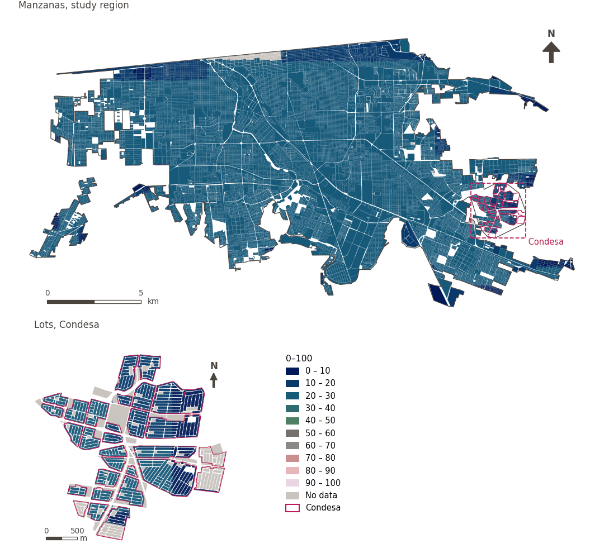

# Heat adaptive capability (GUHVI)

[← Back to contents](../README.md)

> The GUHVI's adaptive capability sub-index (0-100), from the child dependency ratio, the subnational human development index and infant mortality; higher is better.

## Identity

| | |
|---|---|
| Identifier | `adaptive_capability` |
| Core measure (variable sheet) | Global Urban Heat Vulnerability Index (GUHVI) |
| Sheet / register ID | – |
| Sample point variable | `sp_urban_heat_adaptive_capability_index` |
| Area variable (measured value) | `urban_heat_adaptive_capability_index` (0–100) |
| Normalised score | `index_uli__adaptive_capability` |
| Domains (share of weight) | [Ambient environment](domain_ambient_environment.md) |
| Subdomain | Climate risks |
| Lens | Quality |
| Better when | higher |
| Effective weight in the index | `uli` 2.8% · `uli_plain` 2.4% |
| Status | Scored in the published index |

## Rationale and interpretation

*Pending: Not recorded in the project register.*

**How to read it.** Adaptive capability index of … (0-100; higher is better).

**Adaptive capability** (Global Urban Heat Vulnerability Index (GUHVI); ID –)
- *How to calculate (variable sheet):* USE GHSCI CALCULATION HERE (Child dependency ratio, Subnational Human Development Index, Infant Mortality Rates)

## Data sources

**Sources declared in the configuration:**

- Turner et al. (2025) Urban Climate 64, 102716; computed in Google Earth Engine by GHSCI.

**Inputs:** [Global Urban Heat Vulnerability Index (GUHVI) and its inputs](guhvi.md)

## Method: theory

1. A sub-index of the Global Urban Heat Vulnerability Index (GUHVI; Turner et al. 2025), computed in Google Earth Engine on an analysis grid and min–max normalised to 0–100 within the region (R8).
2. Each sample point takes the value of the cell containing it.
3. AMPI normalisation (R11) with fixed goalposts of 0 and 100 (the sub-index's own scale), aggregation (R12) and areas (R13).

## Method: practice

**Recipes:** [R1. Sample points and the pedestrian network](../03_recipes.md#r1), [R8. Earth Engine: heat vulnerability and large green space](../03_recipes.md#r8), [R11. Normalisation: the Adjusted Mazziotta–Pareto Index (AMPI)](../03_recipes.md#r11), [R12. Aggregation: domains, shared indicators and the index](../03_recipes.md#r12), [R13. From sample points to areas](../03_recipes.md#r13), [R14. Frozen goalposts and recalculating a scenario](../03_recipes.md#r14)

**Configuration** ([`MX_Mexicali_2025_ULI.yml:1247`](../../data/MX_Mexicali_2025_ULI.yml#L1247)):

```yaml
- variable: sp_urban_heat_adaptive_capability_index
  name: adaptive_capability
  domains: [ambient_environment]
  polarity: positive
  goalposts: {min: 0, max: 100}
  lens: quality
  group: {es: 'Índice Global de Vulnerabilidad Urbana al Calor (GUHVI)', en: 'Global Urban Heat Vulnerability Index (GUHVI)'}
  label: {es: 'Capacidad de adaptación al calor (GUHVI)', en: 'Heat adaptive capability (GUHVI)'}
  reading: {es: 'Índice de capacidad de adaptación de {value} (0-100; mayor es mejor)', en: 'Adaptive capability index of {value} (0-100; higher is better)'}
  subdomain: {es: 'Riesgos climáticos', en: 'Climate risks'}
  about:
    es: Subíndice de capacidad de adaptación del GUHVI (0-100), a partir de la razón de dependencia infantil, el índice de desarrollo humano subnacional y la mortalidad infantil; mayor es mejor.
    en: The GUHVI's adaptive capability sub-index (0-100), from the child dependency ratio, the subnational human development index and infant mortality; higher is better.
  sources:
    - 'Turner et al. (2025) Urban Climate 64, 102716; computed in Google Earth Engine by GHSCI.'
```

**Code (GHSCI):**

- [`process/subprocesses/_earth_engine_indicators.py:846`](https://github.com/healthysustainablecities/global-indicators/blob/f03909611dba336c2728fffab6d697779487d0b1/process/subprocesses/_earth_engine_indicators.py#L846) `guhvi_analysis()`
- [`process/subprocesses/_earth_engine_indicators.py:1105`](https://github.com/healthysustainablecities/global-indicators/blob/f03909611dba336c2728fffab6d697779487d0b1/process/subprocesses/_earth_engine_indicators.py#L1105) `normalise_band()`
- [`process/subprocesses/_composite_index.py:1819`](https://github.com/healthysustainablecities/global-indicators/blob/f03909611dba336c2728fffab6d697779487d0b1/process/subprocesses/_composite_index.py#L1819) `normalise()`
- [`process/subprocesses/_composite_index.py:1838`](https://github.com/healthysustainablecities/global-indicators/blob/f03909611dba336c2728fffab6d697779487d0b1/process/subprocesses/_composite_index.py#L1838) `mpi_aggregate()`

|  | Sample point variable | Transform | Goalposts (scale scored) | inf – sup | skew / kurt. / tied | Flags |
|---|---|---|---|---|---|---|
| `uli` | sp_urban_heat_adaptive_capability_index | as measured | 0 · 22 · 100 | 0 – 30 | −2.81 / 7.51 / 2.6% | skewed |
| `uli_plain` | sp_urban_heat_adaptive_capability_index | as measured | 0 · 22 · 100 | 0 – 30 | −2.81 / 7.51 / 2.6% | skewed |

## Recalculation (Reimagina Urbano)

GUHVI sub-indices are normalised within the region by their own minima and maxima; a scenario must use the baseline's minima and maxima so as not to re-scale the whole city.

With the frozen goalposts of the parameters file (`Ref`, `Min`, `Max`, R14), a new score is `r = 100 ± 60·(x − Ref)/(Max − Min)` without re-resolving goalposts; the domain and index are recomputed by R12, less 100. A scenario is then compared with the baseline on the same scale.

## Results

| Measure | Study region (Mexicali incl. Condesa) | Condesa |
|---|---|---|
| Region value | 22.2 | 15.0 |
| Region score (`uli`) | +0.6 | −4.0 |
| Areas with a value | 14,148 of 14,252 manzanas | 13,265 of 14,988 lots |
| Median (P25–P75), weighted | 23.1 (23.1 – 23.2) | 13.0 (11.3 – 23.1) |
| Range | 0.0 – 30.3 | 0.0 – 23.9 |
| Score: median (P25–P75) (`uli`) | +0.9 (+0.9 – +0.9) | −5.2 (−6.2 – +0.9) |

*Distributions: study region manzanas weighted by census population (2020); Condesa lots weighted equally (3.2 residents assumed per lot). Region values are those GHSCI reports for each region as a whole.*

- Study region: Adaptive capability index of 22.2 (0-100; higher is better).
- Condesa: Adaptive capability index of 15.0 (0-100; higher is better).
- For the study region as a whole the value is 22.2; in Condesa, 15.0. Condesa's score lies 4.0 points below the study region average (+0.6 for the study region).

## Map



*Map. Heat adaptive capability (GUHVI): measured value (0–100) by manzana across the study region and by lot in Condesa (inset). Dashboard classes; the favourable end is the light end (higher is better).*

## Caveats and open questions

- Several of its inputs (the subnational human development index, the infant mortality rate) are constant across a single city, so its variation within Mexicali comes mainly from the child dependency ratio (configuration, dashboard.hide).
