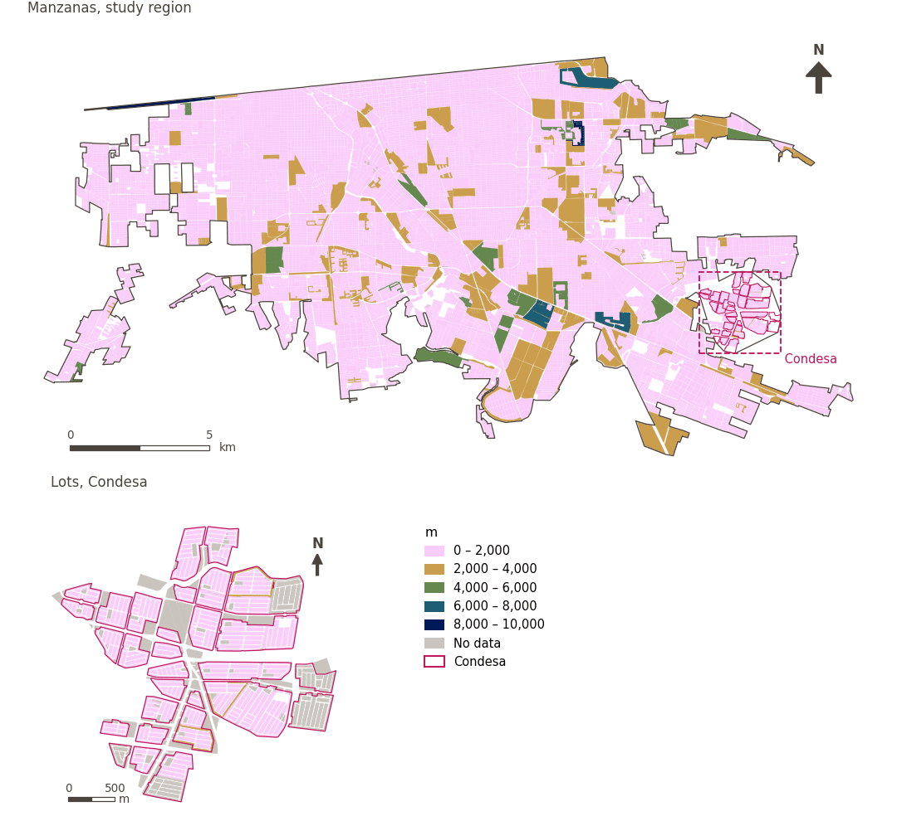

# Block size (perimeter)

[← Back to contents](../README.md)

> Mean block perimeter (m); smaller blocks are more walkable; lower is better.

## Identity

| | |
|---|---|
| Identifier | `block_size` |
| Core measure (variable sheet) | Pedestrian infrastructure presence |
| Sheet / register ID | – |
| Sample point variable | `sp_ext_block_perimeter_m` |
| Area variable (measured value) | `ext_block_perimeter_m` (m) |
| Normalised score | `index_uli__block_size` |
| Domains (share of weight) | [Built environment](domain_built_environment.md) (33%), [Mobility and transport](domain_mobility_transport.md) (33%), [Safety and protection](domain_safety.md) (33%) |
| Subdomain | Built environment: Urban morphology; Mobility and transport: Active mobility; Safety and protection: Road safety |
| Lens | Presence |
| Better when | lower |
| Effective weight in the index | `uli` 6.2% · `uli_plain` 6.2% |
| Status | Scored in the published index |

## Rationale and interpretation

*Pending: Not recorded in the project register.*

**How to read it.** Blocks average … in perimeter (lower is better).

**Block size** (Pedestrian infrastructure presence; ID –)
- *How to calculate (variable sheet):* Average block length/perimeter
- *Notes (sheet):* Smaller blocks are generally more walkable.
- *Doubts (sheet):* This one is very important if we consider that Condesa is comprised of multiple gated communities

## Data sources

**Sources declared in the configuration:**

- Mexicali ULI work packages (final_indicators.gpkg, 22 September 2026).

**Source recorded by GHSCI (data dictionary)** (`ext_block_perimeter_m`):

- Work package indicators: Mexicali ULI work packages (final_indicators.gpkg; see excel_work_sheet_key.xlsx)

**Inputs:** [Work package indicators (linked)](work_package_layers.md)

## Method: theory

1. A value prepared outside GHSCI by a work package and linked to the reference areas (R7: by geometry against the reference areas).
2. Replicated to each sample point from the area containing it (`grid`, `condesa_lotes (15 m)`, `manzanas (30 m)`).
3. AMPI normalisation (R11) of the value as measured, aggregation (R12) and areas (R13).

## Method: practice

**Recipes:** [R1. Sample points and the pedestrian network](../03_recipes.md#r1), [R7. Linking externally prepared indicators](../03_recipes.md#r7), [R11. Normalisation: the Adjusted Mazziotta–Pareto Index (AMPI)](../03_recipes.md#r11), [R12. Aggregation: domains, shared indicators and the index](../03_recipes.md#r12), [R13. From sample points to areas](../03_recipes.md#r13), [R14. Frozen goalposts and recalculating a scenario](../03_recipes.md#r14)

**Configuration** ([`MX_Mexicali_2025_ULI.yml:1390`](../../data/MX_Mexicali_2025_ULI.yml#L1390)):

```yaml
- variable: sp_ext_block_perimeter_m
  name: block_size
  domains: [built_environment, mobility_transport, safety]
  polarity: negative
  lens: presence
  group: {es: 'Presencia de infraestructura peatonal', en: 'Pedestrian infrastructure presence'}
  label: {es: 'Tamaño de manzana (perímetro)', en: 'Block size (perimeter)'}
  reading: {es: 'Las manzanas miden en promedio {value} de perímetro', en: 'Blocks average {value} in perimeter'}
  subdomain:
    built_environment: {es: 'Morfología urbana', en: 'Urban morphology'}
    mobility_transport: {es: 'Movilidad activa', en: 'Active mobility'}
    safety: {es: 'Seguridad vial', en: 'Road safety'}
  about:
    es: Perímetro medio de manzana (m); las manzanas más pequeñas son más caminables; menor es mejor.
    en: Mean block perimeter (m); smaller blocks are more walkable; lower is better.
  sources:
    - 'Mexicali ULI work packages (final_indicators.gpkg, 22 September 2026).'
```

**Code (GHSCI):**

- [`process/subprocesses/_linkage_indicators.py:403`](https://github.com/healthysustainablecities/global-indicators/blob/f03909611dba336c2728fffab6d697779487d0b1/process/subprocesses/_linkage_indicators.py#L403) `match_by_geometry()`
- [`process/subprocesses/_linkage_indicators.py:537`](https://github.com/healthysustainablecities/global-indicators/blob/f03909611dba336c2728fffab6d697779487d0b1/process/subprocesses/_linkage_indicators.py#L537) `sample_point_values()`
- [`process/subprocesses/_composite_index.py:1819`](https://github.com/healthysustainablecities/global-indicators/blob/f03909611dba336c2728fffab6d697779487d0b1/process/subprocesses/_composite_index.py#L1819) `normalise()`
- [`process/subprocesses/_composite_index.py:1838`](https://github.com/healthysustainablecities/global-indicators/blob/f03909611dba336c2728fffab6d697779487d0b1/process/subprocesses/_composite_index.py#L1838) `mpi_aggregate()`

|  | Sample point variable | Transform | Goalposts (scale scored) | inf – sup | skew / kurt. / tied | Flags |
|---|---|---|---|---|---|---|
| `uli` | sp_ext_block_perimeter_m | as measured | −3,860 · 856 · 5,572 | 101 – 9,533 | 3.67 / 20.36 / 0.2% | skewed |
| `uli_plain` | sp_ext_block_perimeter_m | as measured | −3,860 · 856 · 5,572 | 101 – 9,533 | 3.67 / 20.36 / 0.2% | skewed |

## Recalculation (Reimagina Urbano)

The value comes from an external work package: a scenario (for example, more vegetation) replaces the area's value, which is replicated to its sample points.

With the frozen goalposts of the parameters file (`Ref`, `Min`, `Max`, R14), a new score is `r = 100 ± 60·(x − Ref)/(Max − Min)` without re-resolving goalposts; the domain and index are recomputed by R12, less 100. A scenario is then compared with the baseline on the same scale.

## Results

| Measure | Study region (Mexicali incl. Condesa) | Condesa |
|---|---|---|
| Region value | 677 m | 712 m |
| Region score (`uli`) | +1.1 | +1.1 |
| Areas with a value | 14,200 of 14,252 manzanas | 12,690 of 14,988 lots |
| Median (P25–P75), weighted | 457 m (358 m – 571 m) | 509 m (399 m – 837 m) |
| Range | 53 m – 9,533 m | 101 m – 2,485 m |
| Score: median (P25–P75) (`uli`) | +2.2 (+1.1 – +2.7) | +1.3 (+0.2 – +2.2) |

*Distributions: study region manzanas weighted by census population (2020); Condesa lots weighted equally (3.2 residents assumed per lot). Region values are those GHSCI reports for each region as a whole.*

- Study region: Blocks average 677 m in perimeter.
- Condesa: Blocks average 712 m in perimeter.
- For the study region as a whole the value is 677 m; in Condesa, 712 m. Condesa's score lies 1.1 points above the study region average (+1.1 for the study region).

## Map



*Map. Block size (perimeter): measured value (m) by manzana across the study region and by lot in Condesa (inset). Dashboard classes; the favourable end is the light end (lower is better).*

## Caveats and open questions

- The sheet notes this is very important given that Condesa comprises multiple gated communities.
