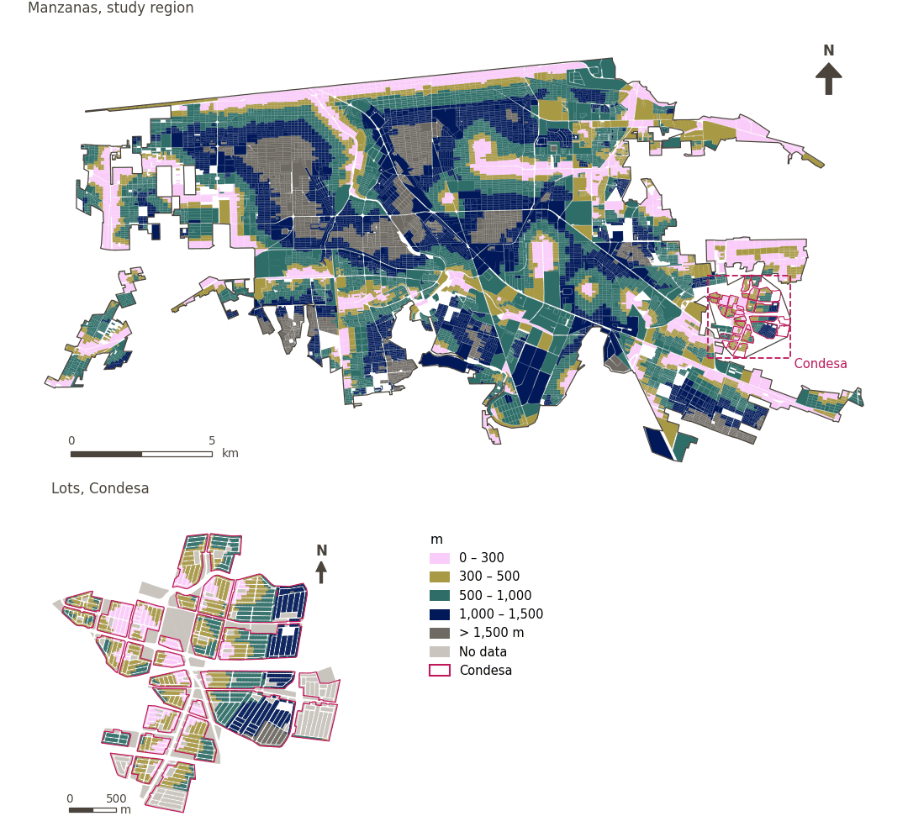

# Natural blue space nearby

[← Back to contents](../README.md)

> Walking distance to the nearest water body, scored by the project's scale for arid cities (100 within 200 m, 90 within 500 m, 80 within 1 km, and 60 beyond).

## Identity

| | |
|---|---|
| Identifier | `blue_space` |
| Core measure (variable sheet) | Available natural blue spaces |
| Sheet / register ID | 10 · #10 |
| Sample point variable | `sp_walk_nearest_node_blue_space` |
| Area variable (measured value) | `avg_walk_dist_blue_space` (m) |
| Normalised score | `index_uli__blue_space` |
| Domains (share of weight) | [Ambient environment](domain_ambient_environment.md) |
| Subdomain | Ambient |
| Lens | Proximity |
| Better when | measured value lower (transformed score higher) |
| Effective weight in the index | `uli` 2.8% · `uli_plain` 2.4% |
| Status | Scored in the published index |

## Rationale and interpretation

> Proximity to available water resources is a critical liveability indicator in arid urban environments, as access to water is fundamental to human health, comfort, and survival.
>
> — *Indicator register #10: Access to blue space (Ambient Environment / Resources)*

- Workbook citation: No external citations provided for this indicator.
- Article list: #28: Chen (2023), ‘Evaluation of the livability of arid urban environments under global warming: A multi-parameter approach’
- ⚠ the workbook citation names no author of the listed article; verify before citing (citation_audit.csv)

**How to read it.** … of the population live within 500 m of a water body; on average the nearest is … away (lower is better).

**Available natural blue spaces** (Available natural blue spaces; ID 10)
- *How to calculate (variable sheet):* Based on Landsat OLI_TIRS multispectral data, thenormalized differential water index (MNDWI) was calculated, where: MNDWI = G - MIR/G + MIR where MIR is the reflectance value of the infrared band in Landsat and Gis the reflectance value of the infrared band. Single-factor scores were evaluated in combination with the effects of water bodies on the livability of urban environments within a certain radiation distance. When the radiation range of water bodies was < 200 m, the areas surrounding water bodies (e.g., wetlands and parks) were the most livable,reaching scores of 100. Water bodies could influence the livability of the urban environment within 200–500 m, where AWR was evaluated as having a score of 90. Areas 500–1000 m away from water bodies might be influenced by other buildings, where AWR had a score of 80. Areas 1000–1500 m away from water bodies require travel by foot, bike orother means, and their AWR score was 60. Since water resources are extremely important to arid cities, the lowest limit was determined as 60. That means the lowest level of the livability in this area is the Generally livable when only water resources are considered

## Data sources

**Sources declared in the configuration:**

- OpenStreetMap contributors (Geofabrik Mexico extract, 15 August 2026).

**Source recorded by GHSCI (data dictionary)** (`avg_walk_dist_blue_space`):

- OpenStreetMap: Geofabrik GmbH, 20260815, ODbL, https://download.geofabrik.de/north-america/mexico-latest.osm.pbf, OpenStreetMap Contributors.  Geofabrik GmbH (2026). https://download.geofabrik.de/north-america/mexico-latest.osm.pbf

**Inputs:** [Natural blue space](blue_space_layer.md)

## Method: theory

1. Distance along the pedestrian network to the nearest destination, `d` (R2), censored at 1,500 m.
2. Stepped ladder (R10): 100 within 200 m, 90 within 500 m, 80 within 1,000 m, 60 within 1,500 m; no value (nothing within 1,500 m) → 60.
3. AMPI normalisation (R11), aggregation (R12) and areas (R13).

## Method: practice

**Recipes:** [R1. Sample points and the pedestrian network](../03_recipes.md#r1), [R2. Network distance to the nearest destination, censored](../03_recipes.md#r2), [R10. Transforms: soft thresholds and stepped ladders](../03_recipes.md#r10), [R11. Normalisation: the Adjusted Mazziotta–Pareto Index (AMPI)](../03_recipes.md#r11), [R12. Aggregation: domains, shared indicators and the index](../03_recipes.md#r12), [R13. From sample points to areas](../03_recipes.md#r13), [R14. Frozen goalposts and recalculating a scenario](../03_recipes.md#r14)

**Configuration** ([`MX_Mexicali_2025_ULI.yml:1285`](../../data/MX_Mexicali_2025_ULI.yml#L1285)):

```yaml
- variable: sp_walk_nearest_node_blue_space
  domains: [ambient_environment]
  transform: {steps: [[200, 100], [500, 90], [1000, 80], [1500, 60]], beyond: 60}
  group: {es: 'Espacios azules naturales disponibles', en: 'Available natural blue spaces'}
  label: {es: 'Espacios azules naturales cercanos', en: 'Natural blue space nearby'}
  reading: {es: '{access} de la población vive a menos de 500 m de un cuerpo de agua; en promedio, el más cercano está a {value}', en: '{access} of the population live within 500 m of a water body; on average the nearest is {value} away'}
  reading_columns: {access: pct_access_walk_blue_space_500m}
  subdomain: {es: 'Medioambiente', en: 'Ambient'}
  about:
    es: Distancia a pie al cuerpo de agua más cercano, puntuada con la escala del proyecto para ciudades áridas (100 a 200 m, 90 a 500 m, 80 a 1 km y 60 más allá).
    en: Walking distance to the nearest water body, scored by the project's scale for arid cities (100 within 200 m, 90 within 500 m, 80 within 1 km, and 60 beyond).
  sources:
    - 'OpenStreetMap contributors (Geofabrik Mexico extract, 15 August 2026).'
```

[`MX_Mexicali_2025_ULI.yml:489`](../../data/MX_Mexicali_2025_ULI.yml#L489):

```yaml
- {name: blue_space, category: blue_space, variant: any, layer: blue_space_nodes_30m_line}
```

**Code (GHSCI):**

- [`process/subprocesses/_accessibility_spec.py:806`](https://github.com/healthysustainablecities/global-indicators/blob/f03909611dba336c2728fffab6d697779487d0b1/process/subprocesses/_accessibility_spec.py#L806) `_banded_distances()`
- [`process/subprocesses/setup_sp.py:888`](https://github.com/healthysustainablecities/global-indicators/blob/f03909611dba336c2728fffab6d697779487d0b1/process/subprocesses/setup_sp.py#L888) `create_full_nodes()`
- [`process/subprocesses/_composite_index.py:423`](https://github.com/healthysustainablecities/global-indicators/blob/f03909611dba336c2728fffab6d697779487d0b1/process/subprocesses/_composite_index.py#L423) `stepped_score()`
- [`process/subprocesses/_composite_index.py:1819`](https://github.com/healthysustainablecities/global-indicators/blob/f03909611dba336c2728fffab6d697779487d0b1/process/subprocesses/_composite_index.py#L1819) `normalise()`
- [`process/subprocesses/_composite_index.py:1838`](https://github.com/healthysustainablecities/global-indicators/blob/f03909611dba336c2728fffab6d697779487d0b1/process/subprocesses/_composite_index.py#L1838) `mpi_aggregate()`

|  | Sample point variable | Transform | Goalposts (scale scored) | inf – sup | skew / kurt. / tied | Flags |
|---|---|---|---|---|---|---|
| `uli` | sp_walk_nearest_node_blue_space | stepped ladder | 56.9 · 76.9 · 96.9 | 60.0 – 100.0 | −0.01 / −1.37 / 36.7% | none |
| `uli_plain` | sp_walk_nearest_node_blue_space | stepped ladder | 56.9 · 76.9 · 96.9 | 60.0 – 100.0 | −0.01 / −1.37 / 36.7% | none |

## Recalculation (Reimagina Urbano)

A destination added or removed, or a change to the pedestrian network, changes `d` only at points whose nearest destination changes: a multi-source Dijkstra from the affected destinations, limited to 1,500 m, taking the minimum with the previous distance, suffices.

With the frozen goalposts of the parameters file (`Ref`, `Min`, `Max`, R14), a new score is `r = 100 ± 60·(x − Ref)/(Max − Min)` without re-resolving goalposts; the domain and index are recomputed by R12, less 100. A scenario is then compared with the baseline on the same scale.

## Results

| Measure | Study region (Mexicali incl. Condesa) | Condesa |
|---|---|---|
| Region value | 797 m | 590 m |
| Region score (`uli`) | −3.9 | +7.8 |
| Areas with a value | 12,412 of 14,252 manzanas | 12,866 of 14,988 lots |
| Median (P25–P75), weighted | 771 m (454 m – 1,111 m) | 472 m (338 m – 665 m) |
| Range | 0 m – 1,937 m | 8 m – 1,848 m |
| Nothing within the distance searched | 13.5% | 3.0% |
| Score: median (P25–P75) (`uli`) | +3.5 (−25.4 – +12.5) | +19.6 (+4.6 – +19.6) |

*Distributions: study region manzanas weighted by census population (2020); Condesa lots weighted equally (3.2 residents assumed per lot). Region values are those GHSCI reports for each region as a whole.*

*A mean distance is taken over the sample points that found a destination within the distance searched; the row "Nothing within the distance searched" gives the share of population in areas that found none.*

- Study region: 23.7% of the population live within 500 m of a water body; on average the nearest is 797 m away.
- Condesa: 53.0% of the population live within 500 m of a water body; on average the nearest is 590 m away.
- For the study region as a whole the value is 797 m; in Condesa, 590 m. Condesa's score lies 7.8 points above the study region average (−3.9 for the study region).

## Map



*Map. Natural blue space nearby: measured value (m) by manzana across the study region and by lot in Condesa (inset). Dashboard classes; the favourable end is the light end (lower is better).*

## Caveats and open questions

- The sheet's source method derives water from Landsat (MNDWI) and scores by radiation distance; here the ladder is applied to walking distance to water features mapped in OpenStreetMap, polygons and lines, so that Mexicali's canals and drains count (configuration, accessibility).
