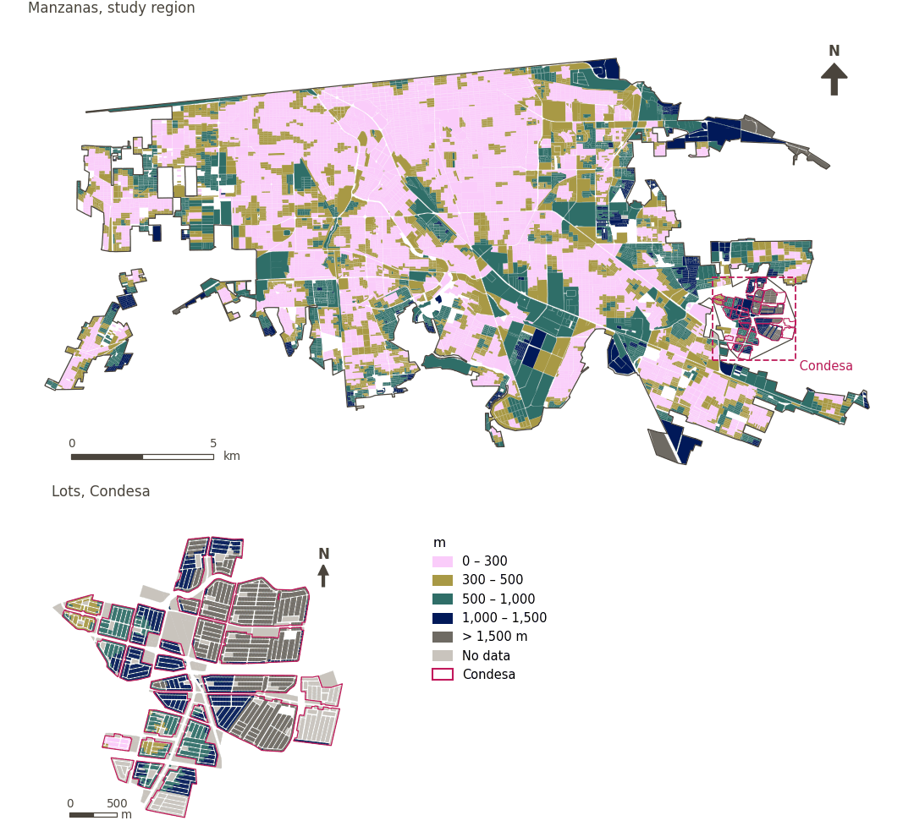

# Community, culture and recreation within 300 m

[← Back to contents](../README.md)

> Walking distance to the nearest community, cultural or recreational venue, scored with a 300 m soft threshold.

## Identity

| | |
|---|---|
| Identifier | `ccr_any` |
| Core measure (variable sheet) | Community, culture and recreation access |
| Sheet / register ID | 4, 46, 58, 121, 134, 225, 228, 257, 394 · #46, #58, #121, #134, #228, #225, #257, #394 |
| Sample point variable | `sp_walk_nearest_node_denue_ccr_any` |
| Area variable (measured value) | `avg_walk_dist_denue_ccr_any` (m) |
| Normalised score | `index_uli__ccr_any` |
| Domains (share of weight) | [Social infrastructure](domain_social_infrastructure.md) |
| Subdomain | Community, culture and recreation |
| Lens | Proximity |
| Better when | measured value lower (transformed score higher) |
| Effective weight in the index | `uli` 1.7% · `uli_plain` 1.7% |
| Status | Scored in the published index |

## Rationale and interpretation

> Multi-purpose community centres provide important opportunities for social interaction and community connection, which are vital for mental and social wellbeing.
>
> — *Indicator register #46: Access to community centres (Social Infrastructure / Community, culture & leisure)*

- Workbook citation: Saitluanga, 2014, 'Spatial pattern of urban livability in Himalayan region: a case of Aizawl City'
- Article list: #22: Alderton (2019), ‘What is the meaning of urban liveability for a city in a low-to-middle-income country? Contextualising liveability for Bangkok, Thailand’
- ⚠ the workbook citation names no author of the listed article; verify before citing (citation_audit.csv)

> Cultural centers serve as important hubs for social and cultural activities that enhance community identity and promote the psychological well-being of residents.
>
> — *Indicator register #58: Access to cultural centers (Social Infrastructure / Community, culture & leisure)*

- Workbook citation: Kang et al., 2022, 'Can tourism development make cities more livable? Investigating 40 cities in China'
- Article list: #16: Kashi (2025), ‘Spatial analysis and ranking of urban districts based on a comprehensive livability approach: the case of Tehran’
- ⚠ the workbook citation names no author of the listed article; verify before citing (citation_audit.csv)

> Easy access to cultural facilities like libraries is a key component of urban convenience, allowing residents to satisfy their fundamental information and educational requirements.
>
> — *Indicator register #121: Access to libraries (Social Infrastructure / Community, culture & leisure)*

- Workbook citation: Onnom et al., 2018, 'Development of a Liveable City Index (LCI) Using Multi Criteria Geospatial Modelling for Medium Class Cities in Developing Countries'; Liu et al., 2020, 'Using Multi-Source Data to Assess Livability in Hong Kong at the Community-Based Level: A Combined Subjective-Objective Approach'
- Article list: #18: Jodder (2024), ‘Urban Livability in a Rapidly Urbanizing Mid-Size City: Lessons for Planning in the Global South’
- ⚠ the workbook citation names no author of the listed article; verify before citing (citation_audit.csv)

> Museums provide important cultural infrastructure that supports social development, lifelong learning, and community social cohesion.
>
> — *Indicator register #134: Access to museums (Social Infrastructure / Community, culture & leisure)*

- Workbook citation: Lowe et al., 2015, 'Planning healthy, liveable and sustainable cities: how can indicators inform policy?'
- Article list: #13: Alderton (2021), ‘Measuring and monitoring liveability in a low-to-middle income country: a proof-of-concept for Bangkok, Thailand and lessons from an international partnership’
- ⚠ the workbook citation names no author of the listed article; verify before citing (citation_audit.csv)

> Access to religious centres contributes to the amenity value of urban areas, providing social and cultural comfort that enhances human wellbeing.
>
> — *Indicator register #228: Access to religious buildings (Social Infrastructure / Community, Culture & Leisure)*

- Workbook citation: Rehdanz and Maddison, 2008, 'Local environmental quality and life-satisfaction in Germany'
- Article list: #20: Basu (2021), ‘Urban livability index assessment based on land-use changes in an Indian medium-sized city (Raiganj)’
- ⚠ the workbook citation names no author of the listed article; verify before citing (citation_audit.csv)

> Easy access to recreational facilities emphasizes the provision of spaces that offer pleasure and physical comfort, improving the overall livability of urban environments.
>
> — *Indicator register #225: Access to recreational areas (Social Infrastructure / Community, Culture & Leisure)*

- Workbook citation: Basu et al., 2021, 'Urban Livability Index Assessment Based on Land-Use Changes in an Indian Medium-Sized City (Raiganj)'; Fu et al., 2019, 'The Livable Urban Landscape: GIS and Remote Sensing Extracted Land Use Assessment for Urban Livability in Changchun Proper, China'
- Article list: #18: Jodder (2024), ‘Urban Livability in a Rapidly Urbanizing Mid-Size City: Lessons for Planning in the Global South’
- ⚠ the workbook citation names no author of the listed article; verify before citing (citation_audit.csv)

> The provision of sport centres is critical for promoting physical activity, which reduces the risk of chronic diseases and improves mental health outcome.
>
> — *Indicator register #257: Access to sports centres (Social Infrastructure / Community, Culture & Leisure)*

- Workbook citation: Lowe et al., 2015, 'Planning healthy, liveable and sustainable cities: how can indicators inform policy?'; Sachs et al., 2019, 'Six transformations to achieve the sustainable development goals'
- Article list: #13: Alderton (2021), ‘Measuring and monitoring liveability in a low-to-middle income country: a proof-of-concept for Bangkok, Thailand and lessons from an international partnership’; #16: Kashi (2025), ‘Spatial analysis and ranking of urban districts based on a comprehensive livability approach: the case of Tehran’; #20: Basu (2021), ‘Urban livability index assessment based on land-use changes in an Indian medium-sized city (Raiganj)’
- ⚠ the workbook citation names no author of the listed article; verify before citing (citation_audit.csv)

> Access to youth centres provides essential social infrastructure that supports social cohesion, mental health, and community wellbeing for young residents.
>
> — *Indicator register #394: Access to youth centres (Social Infrastructure / Community, culture & leisure)*

- Workbook citation: Lowe et al., 2015, 'Planning healthy, liveable and sustainable cities: how can indicators inform policy?'
- Article list: #13: Alderton (2021), ‘Measuring and monitoring liveability in a low-to-middle income country: a proof-of-concept for Bangkok, Thailand and lessons from an international partnership’
- ⚠ the workbook citation names no author of the listed article; verify before citing (citation_audit.csv)

**How to read it.** … of the population live within 300 m of a community, cultural or recreational venue; on average the nearest is … away (lower is better).

**Access to community, culture and recreation services** (Community, culture and recreation access; ID 4, 46, 58, 121,134,225,228,257,394)
- *How to calculate (variable sheet):* Walking distance access to cultural centers, libraries, museums, recreational areas, religious buildings, sports centers, youth centers, activity centers and community centers.
- *Doubts (sheet):* Do we want to split this in 3: 1. Community 2. Recreational and 3. Cultural?

## Data sources

**Sources declared in the configuration:**

- INEGI (2026) Directorio Estadístico Nacional de Unidades Económicas (DENUE), May 2026.

**Source recorded by GHSCI (data dictionary)** (`avg_walk_dist_denue_ccr_any`):

- OpenStreetMap: Geofabrik GmbH, 20260815, ODbL, https://download.geofabrik.de/north-america/mexico-latest.osm.pbf, OpenStreetMap Contributors.  Geofabrik GmbH (2026). https://download.geofabrik.de/north-america/mexico-latest.osm.pbf; INEGI, Directorio Estadistico Nacional de Unidades Economicas (DENUE): 2026-05, Terminos de Libre Uso de la Informacion del INEGI, https://www.inegi.org.mx/app/mapa/denue/, INEGI (2026). Directorio Estadistico Nacional de Unidades Economicas (DENUE), mayo 2026. Instituto Nacional de Estadistica y Geografia, Mexico.

**Destination filter:**

- `denue_community` (Community and social facilities (DENUE)): `MX/INEGI/DENUE_2026/denue_inegi_02_.shp` — Destination filter: `"codigo_act IN ('813210','813230','931610')"`
- `denue_culture` (Cultural facilities (DENUE)): `MX/INEGI/DENUE_2026/denue_inegi_02_.shp` — Destination filter: `"codigo_act IN ('712111','712112','519211','519212','512130','711311','711312')"`
- `denue_sport` (Sports and active recreation (DENUE)): `MX/INEGI/DENUE_2026/denue_inegi_02_.shp` — Destination filter: `"codigo_act IN ('713941','713942','713943','713944','713910','713950','611621','611622')"`
- `denue_recreation` (Public recreation venues (DENUE)): `MX/INEGI/DENUE_2026/denue_inegi_02_.shp` — Destination filter: `"codigo_act IN ('713111','713112','713113','712131','712132')"`

**Inputs:** [DENUE destinations by SCIAN code](denue_destinations.md)

## Method: theory

1. Distance along the pedestrian network from each sample point to the nearest destination, `d` (R2), censored at the largest band searched (1,500 m): a point with no destination within it has no value.
2. Soft access score (R10): `s(d) = 1 / (1 + exp(k·(d − t)/t))`, with `t = 300 m` and `k = 5`; `s = 0.5` at the threshold, ≈ 0.99 beside the destination, ≈ 0.007 at `2t`; no value → `s = 0`.
3. AMPI normalisation (R11) of `s` against the study region's goalposts, then aggregation to domains and index (R12) and to areas (R13).

## Method: practice

**Recipes:** [R1. Sample points and the pedestrian network](../03_recipes.md#r1), [R2. Network distance to the nearest destination, censored](../03_recipes.md#r2), [R10. Transforms: soft thresholds and stepped ladders](../03_recipes.md#r10), [R11. Normalisation: the Adjusted Mazziotta–Pareto Index (AMPI)](../03_recipes.md#r11), [R12. Aggregation: domains, shared indicators and the index](../03_recipes.md#r12), [R13. From sample points to areas](../03_recipes.md#r13), [R14. Frozen goalposts and recalculating a scenario](../03_recipes.md#r14)

**Configuration** ([`MX_Mexicali_2025_ULI.yml:1614`](../../data/MX_Mexicali_2025_ULI.yml#L1614)):

```yaml
- variable: sp_walk_nearest_node_denue_ccr_any
  name: ccr_any
  domains: [social_infrastructure]
  transform: {soft_threshold: 300}
  group: {es: 'Acceso a comunidad, cultura y recreación', en: 'Community, culture and recreation access'}
  label: {es: 'Comunidad, cultura y recreación a menos de 300 m', en: 'Community, culture and recreation within 300 m'}
  reading: {es: '{access} de la población vive a menos de 300 m de un espacio comunitario, cultural o recreativo; en promedio, el más cercano está a {value}', en: '{access} of the population live within 300 m of a community, cultural or recreational venue; on average the nearest is {value} away'}
  subdomain: {es: 'Comunidad, cultura y recreación', en: 'Community, culture and recreation'}
  about:
    es: Distancia a pie al espacio comunitario, cultural o recreativo más cercano, puntuada con un umbral suave de 300 m.
    en: Walking distance to the nearest community, cultural or recreational venue, scored with a 300 m soft threshold.
  sources:
    - 'INEGI (2026) Directorio Estadístico Nacional de Unidades Económicas (DENUE), May 2026.'
```

[`MX_Mexicali_2025_ULI.yml:517`](../../data/MX_Mexicali_2025_ULI.yml#L517):

```yaml
- {name: denue_ccr_any, category: community_culture_recreation, variant: any, layer: destinations, where: "dest_name IN ('denue_community', 'denue_culture', 'denue_sport', 'denue_recreation')"}
```

**Code (GHSCI):**

- [`process/subprocesses/_accessibility_spec.py:806`](https://github.com/healthysustainablecities/global-indicators/blob/f03909611dba336c2728fffab6d697779487d0b1/process/subprocesses/_accessibility_spec.py#L806) `_banded_distances()`
- [`process/subprocesses/setup_sp.py:888`](https://github.com/healthysustainablecities/global-indicators/blob/f03909611dba336c2728fffab6d697779487d0b1/process/subprocesses/setup_sp.py#L888) `create_full_nodes()`
- [`process/subprocesses/_composite_index.py:1457`](https://github.com/healthysustainablecities/global-indicators/blob/f03909611dba336c2728fffab6d697779487d0b1/process/subprocesses/_composite_index.py#L1457) `soft_threshold()`
- [`process/subprocesses/_composite_index.py:1819`](https://github.com/healthysustainablecities/global-indicators/blob/f03909611dba336c2728fffab6d697779487d0b1/process/subprocesses/_composite_index.py#L1819) `normalise()`
- [`process/subprocesses/_composite_index.py:1838`](https://github.com/healthysustainablecities/global-indicators/blob/f03909611dba336c2728fffab6d697779487d0b1/process/subprocesses/_composite_index.py#L1838) `mpi_aggregate()`

|  | Sample point variable | Transform | Goalposts (scale scored) | inf – sup | skew / kurt. / tied | Flags |
|---|---|---|---|---|---|---|
| `uli` | sp_walk_nearest_node_denue_ccr_any | soft access, 300 m threshold, k = 5 | −0.077 · 0.420 · 0.916 | 0.000 – 0.993 | 0.21 / −1.67 / 6.6% | none |
| `uli_plain` | sp_walk_nearest_node_denue_ccr_any | soft access, 300 m threshold, k = 5 | −0.077 · 0.420 · 0.916 | 0.000 – 0.993 | 0.21 / −1.67 / 6.6% | none |

## Recalculation (Reimagina Urbano)

A destination added or removed, or a change to the pedestrian network, changes `d` only at points whose nearest destination changes: a multi-source Dijkstra from the affected destinations, limited to 1,500 m, taking the minimum with the previous distance, suffices.

With the frozen goalposts of the parameters file (`Ref`, `Min`, `Max`, R14), a new score is `r = 100 ± 60·(x − Ref)/(Max − Min)` without re-resolving goalposts; the domain and index are recomputed by R12, less 100. A scenario is then compared with the baseline on the same scale.

## Results

| Measure | Study region (Mexicali incl. Condesa) | Condesa |
|---|---|---|
| Region value | 332 m | 1,075 m |
| Region score (`uli`) | +6.5 | −24.4 |
| Areas with a value | 14,110 of 14,252 manzanas | 6,788 of 14,988 lots |
| Median (P25–P75), weighted | 292 m (189 m – 458 m) | 1,071 m (791 m – 1,417 m) |
| Range | 17 m – 2,257 m | 64 m – 2,412 m |
| Nothing within the distance searched | 0.3% | 48.8% |
| Score: median (P25–P75) (`uli`) | +6.5 (−18.1 – +24.0) | −25.3 (−25.3 – −25.3) |

*Distributions: study region manzanas weighted by census population (2020); Condesa lots weighted equally (3.2 residents assumed per lot). Region values are those GHSCI reports for each region as a whole.*

*A mean distance is taken over the sample points that found a destination within the distance searched; the row "Nothing within the distance searched" gives the share of population in areas that found none.*

- Study region: 55.7% of the population live within 300 m of a community, cultural or recreational venue; on average the nearest is 332 m away.
- Condesa: 1.4% of the population live within 300 m of a community, cultural or recreational venue; on average the nearest is 1,075 m away.
- For the study region as a whole the value is 332 m; in Condesa, 1,075 m. Condesa's score lies 24.4 points below the study region average (+6.5 for the study region).

## Map



*Map. Community, culture and recreation within 300 m: measured value (m) by manzana across the study region and by lot in Condesa (inset). Dashboard classes; the favourable end is the light end (lower is better).*

## Caveats and open questions

- The sheet asks whether to split this into community, recreational and cultural access; one measure is used, and the split is reflected in its diversity.
