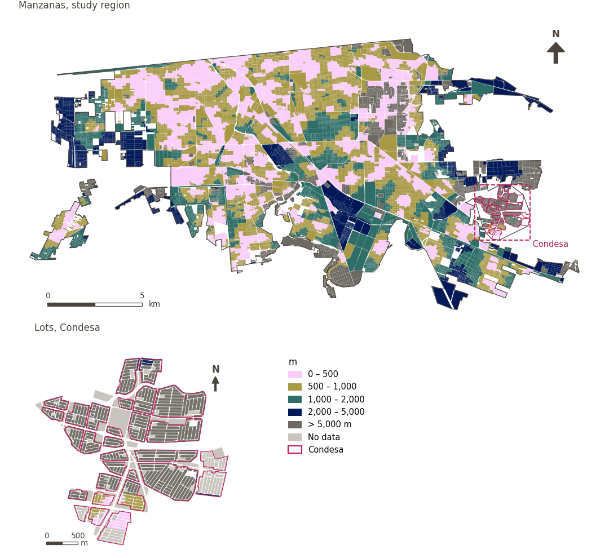

# Food within 1.5 km by low-stress cycling

[← Back to contents](../README.md)

> Distance to the nearest fresh food or convenience store using only low-stress cycling streets (LTS 1-2), scored with a 1.5 km soft threshold.

## Identity

| | |
|---|---|
| Identifier | `cycle_low_stress_food` |
| Core measure (variable sheet) | Level of traffic stress for cycling |
| Sheet / register ID | #62 |
| Sample point variable | `sp_cycle_safe_nearest_node_fresh_food_pooled` |
| Area variable (measured value) | `avg_cycle_dist_safe_fresh_food_pooled` (m) |
| Normalised score | `index_uli__cycle_low_stress_food` |
| Domains (share of weight) | [Safety and protection](domain_safety.md) (33%), [Mobility and transport](domain_mobility_transport.md) (33%), [Built environment](domain_built_environment.md) (33%) |
| Subdomain | Safety and protection: Road safety; Mobility and transport: Active mobility; Built environment: Urban design |
| Lens | Proximity |
| Better when | measured value lower (transformed score higher) |
| Effective weight in the index | `uli` 6.2% · `uli_plain` 6.2% |
| Status | Scored in the published index |

## Rationale and interpretation

> Designing side alleys to promote walking and cycling integrates residents into the urban fabric and supports a healthy, human-oriented environment.
>
> — *Indicator register #62: Level of cycling traffic stress (Mobility & Transport / Active Travel)*

- Workbook citation: Skalicky & Čerpes, 2019, 'Comprehensive assessment methodology for liveable residential environment'
- Article list: #23: Sarkar (2020), ‘Socio-physical liveability through socio-spatiality in low-income resettlement archetypes - A case of slum rehabilitation housing in Mumbai, India.’
- ⚠ the workbook citation names no author of the listed article; verify before citing (citation_audit.csv)

**How to read it.** On average the nearest fresh food or convenience store is … away by low-stress streets (lower is better).

**Average distance to nearest** (Level of Traffic Stress for Cycling; ID –)
- *How to calculate (variable sheet):* USE GHSCI CALCULATION HERE
- *Doubts (sheet):* This is a suite of variables that we need to disaggregate.

## Data sources

**Sources declared in the configuration:**

- OpenStreetMap contributors (Geofabrik Mexico extract, 15 August 2026); level of traffic stress classified by GHSCI.
- INEGI (2026) Directorio Estadístico Nacional de Unidades Económicas (DENUE), May 2026.

**Source recorded by GHSCI (data dictionary)** (`avg_cycle_dist_safe_fresh_food_pooled`):

- OpenStreetMap: Geofabrik GmbH, 20260815, ODbL, https://download.geofabrik.de/north-america/mexico-latest.osm.pbf, OpenStreetMap Contributors.  Geofabrik GmbH (2026). https://download.geofabrik.de/north-america/mexico-latest.osm.pbf

**Inputs:** [Cycling network by level of traffic stress (LTS)](lts_network.md)

## Method: theory

1. Cycling network classified by level of traffic stress (LTS 1–4) and restricted to low-stress links (LTS ≤ 2) where cycling or walking the bike is permitted (R6).
2. Distance along that network to the nearest destination, `d` (R2), searched to 5,000 m.
3. Soft access (R10): `t = 1,500 m`, `k = 5`; no value → 0. Then R11–R13.

## Method: practice

**Recipes:** [R1. Sample points and the pedestrian network](../03_recipes.md#r1), [R6. Level of traffic stress and the low-stress cycling network](../03_recipes.md#r6), [R2. Network distance to the nearest destination, censored](../03_recipes.md#r2), [R10. Transforms: soft thresholds and stepped ladders](../03_recipes.md#r10), [R11. Normalisation: the Adjusted Mazziotta–Pareto Index (AMPI)](../03_recipes.md#r11), [R12. Aggregation: domains, shared indicators and the index](../03_recipes.md#r12), [R13. From sample points to areas](../03_recipes.md#r13), [R14. Frozen goalposts and recalculating a scenario](../03_recipes.md#r14)

**Configuration** ([`MX_Mexicali_2025_ULI.yml:1440`](../../data/MX_Mexicali_2025_ULI.yml#L1440)):

```yaml
- variable: sp_cycle_safe_nearest_node_fresh_food_pooled
  name: cycle_low_stress_food
  domains: [safety, mobility_transport, built_environment]
  transform: {soft_threshold: 1500}
  group: {es: 'Nivel de estrés del tráfico para ciclismo', en: 'Level of traffic stress for cycling'}
  label: {es: 'Alimentos a menos de 1.5 km en bicicleta de bajo estrés', en: 'Food within 1.5 km by low-stress cycling'}
  reading: {es: 'En promedio, la tienda de alimentos más cercana está a {value} por calles de bajo estrés', en: 'On average the nearest fresh food or convenience store is {value} away by low-stress streets'}
  subdomain:
    safety: {es: 'Seguridad vial', en: 'Road safety'}
    mobility_transport: {es: 'Movilidad activa', en: 'Active mobility'}
    built_environment: {es: 'Diseño urbano', en: 'Urban design'}
  about:
    es: Distancia a la tienda de alimentos frescos o de conveniencia más cercana usando solo calles de bajo estrés para bicicleta (LTS 1-2), puntuada con un umbral suave de 1.5 km.
    en: Distance to the nearest fresh food or convenience store using only low-stress cycling streets (LTS 1-2), scored with a 1.5 km soft threshold.
  sources:
    - 'OpenStreetMap contributors (Geofabrik Mexico extract, 15 August 2026); level of traffic stress classified by GHSCI.'
    - 'INEGI (2026) Directorio Estadístico Nacional de Unidades Económicas (DENUE), May 2026.'
```

**Code (GHSCI):**

- [`process/subprocesses/_cycling_lts_network.py:546`](https://github.com/healthysustainablecities/global-indicators/blob/f03909611dba336c2728fffab6d697779487d0b1/process/subprocesses/_cycling_lts_network.py#L546) `assign_lts()`
- [`process/subprocesses/_cycling_accessibility.py:469`](https://github.com/healthysustainablecities/global-indicators/blob/f03909611dba336c2728fffab6d697779487d0b1/process/subprocesses/_cycling_accessibility.py#L469) `cycling_poi_distance()`
- [`process/subprocesses/_composite_index.py:1457`](https://github.com/healthysustainablecities/global-indicators/blob/f03909611dba336c2728fffab6d697779487d0b1/process/subprocesses/_composite_index.py#L1457) `soft_threshold()`
- [`process/subprocesses/_composite_index.py:1819`](https://github.com/healthysustainablecities/global-indicators/blob/f03909611dba336c2728fffab6d697779487d0b1/process/subprocesses/_composite_index.py#L1819) `normalise()`
- [`process/subprocesses/_composite_index.py:1838`](https://github.com/healthysustainablecities/global-indicators/blob/f03909611dba336c2728fffab6d697779487d0b1/process/subprocesses/_composite_index.py#L1838) `mpi_aggregate()`

|  | Sample point variable | Transform | Goalposts (scale scored) | inf – sup | skew / kurt. / tied | Flags |
|---|---|---|---|---|---|---|
| `uli` | sp_cycle_safe_nearest_node_fresh_food_pooled | soft access, 1,500 m threshold, k = 5 | 0.059 · 0.555 · 1.052 | 0.000 – 0.993 | −0.34 / −1.76 / 28.6% | none |
| `uli_plain` | sp_cycle_safe_nearest_node_fresh_food_pooled | soft access, 1,500 m threshold, k = 5 | 0.059 · 0.555 · 1.052 | 0.000 – 0.993 | −0.34 / −1.76 / 28.6% | none |

## Recalculation (Reimagina Urbano)

Reclassifying a link's LTS (for example, a new protected cycle lane) changes the low-stress subnetwork; distances must be recomputed for points connected through that link.

With the frozen goalposts of the parameters file (`Ref`, `Min`, `Max`, R14), a new score is `r = 100 ± 60·(x − Ref)/(Max − Min)` without re-resolving goalposts; the domain and index are recomputed by R12, less 100. A scenario is then compared with the baseline on the same scale.

## Results

| Measure | Study region (Mexicali incl. Condesa) | Condesa |
|---|---|---|
| Region value | 826 m | 1,025 m |
| Region score (`uli`) | +10.4 | −27.9 |
| Areas with a value | 12,510 of 14,252 manzanas | 1,530 of 14,988 lots |
| Median (P25–P75), weighted | 677 m (418 m – 1,062 m) | 550 m (402 m – 743 m) |
| Range | 10 m – 5,552 m | 57 m – 5,142 m |
| Nothing within the distance searched | 9.3% | 88.5% |
| Score: median (P25–P75) (`uli`) | +20.5 (−2.4 – +24.7) | −33.5 (−33.5 – −33.5) |

*Distributions: study region manzanas weighted by census population (2020); Condesa lots weighted equally (3.2 residents assumed per lot). Region values are those GHSCI reports for each region as a whole.*

*A mean distance is taken over the sample points that found a destination within the distance searched; the row "Nothing within the distance searched" gives the share of population in areas that found none.*

- Study region: On average the nearest fresh food or convenience store is 826 m away by low-stress streets.
- Condesa: On average the nearest fresh food or convenience store is 1,025 m away by low-stress streets.
- For the study region as a whole the value is 826 m; in Condesa, 1,025 m. Condesa's score lies 27.9 points below the study region average (+10.4 for the study region).

## Map



*Map. Food within 1.5 km by low-stress cycling: measured value (m) by manzana across the study region and by lot in Condesa (inset). Dashboard classes; the favourable end is the light end (lower is better).*

## Caveats and open questions

- The sheet describes level of traffic stress as a suite of variables still to be disaggregated; the destination (fresh food or convenience, from OpenStreetMap) and the 1.5 km threshold are a provisional single choice from that suite.
