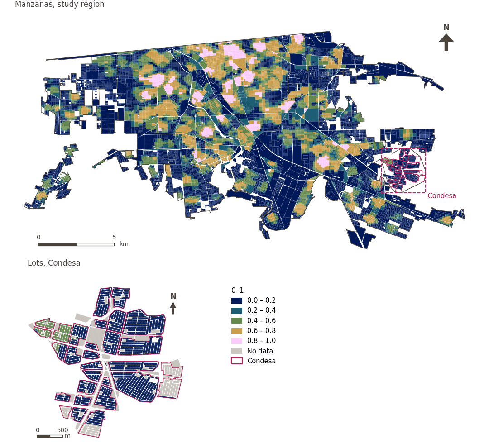

# Education diversity within 500 m

[← Back to contents](../README.md)

> Diversity (Shannon entropy, 0-1) of the levels of education offered within a 500 m walk.

## Identity

| | |
|---|---|
| Identifier | `div_education_500m` |
| Core measure (variable sheet) | Health, education and care access |
| Sheet / register ID | 180, 246, 379 · #180, #246, #379 |
| Sample point variable | `sp_walk_diversity_education_500m` |
| Area variable (measured value) | `avg_diversity_walk_education_500m` (0–1) |
| Normalised score | `index_uli__div_education_500m` |
| Domains (share of weight) | [Social infrastructure](domain_social_infrastructure.md) |
| Subdomain | Education |
| Lens | Diversity |
| Better when | higher |
| Effective weight in the index | `uli` 1.7% · `uli_plain` 1.7% |
| Status | Scored in the published index |

## Rationale and interpretation

> Close proximity to primary schools supports family-oriented livability by facilitating easy and convenient access to essential basic education for young residents.
>
> — *Indicator register #180: Access to schools: primary (Social Infrastructure / Education)*

- Workbook citation: Onnom et al., 2018, 'Development of a Liveable City Index (LCI) Using Multi Criteria Geospatial Modelling for Medium Class Cities in Developing Countries'; Fu et al., 2019, 'The Livable Urban Landscape: GIS and Remote Sensing Extracted Land Use Assessment for Urban Livability in Changchun Proper, China'; Liu et al., 2020, 'Using Multi-Source Data to Assess Livability in Hong Kong at the Community-Based Level: A Combined Subjective-Objective Approach'
- Article list: #18: Jodder (2024), ‘Urban Livability in a Rapidly Urbanizing Mid-Size City: Lessons for Planning in the Global South’
- ⚠ the workbook citation names no author of the listed article; verify before citing (citation_audit.csv)

> Ensuring secondary schools are within a accessible distance enhances urban convenience and satisfies the educational requirements of residents, contributing to higher community satisfaction.
>
> — *Indicator register #246: Access to schools: secondary (Social Infrastructure / Education)*

- Workbook citation: Onnom et al., 2018, 'Development of a Liveable City Index (LCI) Using Multi Criteria Geospatial Modelling for Medium Class Cities in Developing Countries'; Fu et al., 2019, 'The Livable Urban Landscape: GIS and Remote Sensing Extracted Land Use Assessment for Urban Livability in Changchun Proper, China'; Liu et al., 2020, 'Using Multi-Source Data to Assess Livability in Hong Kong at the Community-Based Level: A Combined Subjective-Objective Approach'
- Article list: #18: Jodder (2024), ‘Urban Livability in a Rapidly Urbanizing Mid-Size City: Lessons for Planning in the Global South’
- ⚠ the workbook citation names no author of the listed article; verify before citing (citation_audit.csv)

> Universities provide essential social infrastructure; their accessibility contributes to the overall convenience and livability rating of urban environments.
>
> — *Indicator register #379: Access to schools: tertiary (universities) (Social Infrastructure / Education)*

- Workbook citation: Ibem and Amole, 2013, 'Residential satisfaction in public core housing in Abeokuta, Ogun State, Nigeria'; Huang and Du, 2015, 'Assessment and determinants of residential satisfaction with public housing in Hangzhou, China'
- Article list: #20: Basu (2021), ‘Urban livability index assessment based on land-use changes in an Indian medium-sized city (Raiganj)’
- ⚠ the workbook citation names no author of the listed article; verify before citing (citation_audit.csv)

**How to read it.** Mean diversity of levels of education within a 500 m walk: … (0 = one kind or none, 1 = every kind equally).

**Diversity of available educational services** (Health, education and care access; ID 180, 246, 379)
- *How to calculate (variable sheet):* Weighted share/number of preeschols, primary, secondary and tertiary educaitonal centers reachable within a walking distance

## Data sources

**Sources declared in the configuration:**

- INEGI (2026) Directorio Estadístico Nacional de Unidades Económicas (DENUE), May 2026.

**Source recorded by GHSCI (data dictionary)** (`avg_diversity_walk_education_500m`):

- OpenStreetMap: Geofabrik GmbH, 20260815, ODbL, https://download.geofabrik.de/north-america/mexico-latest.osm.pbf, OpenStreetMap Contributors.  Geofabrik GmbH (2026). https://download.geofabrik.de/north-america/mexico-latest.osm.pbf; INEGI, Directorio Estadistico Nacional de Unidades Economicas (DENUE): 2026-05, Terminos de Libre Uso de la Informacion del INEGI, https://www.inegi.org.mx/app/mapa/denue/, INEGI (2026). Directorio Estadistico Nacional de Unidades Economicas (DENUE), mayo 2026. Instituto Nacional de Estadistica y Geografia, Mexico.

**Destination filter:**

- `denue_preschool` (Preschools (DENUE)): `MX/INEGI/DENUE_2026/denue_inegi_02_.shp` — Destination filter: `"codigo_act IN ('611111','611112','611171','611172')"`
- `denue_primary_school` (Primary schools (DENUE)): `MX/INEGI/DENUE_2026/denue_inegi_02_.shp` — Destination filter: `"codigo_act IN ('611121','611122','611171','611172')"`
- `denue_secondary_school` (Secondary and upper secondary schools (DENUE)): `MX/INEGI/DENUE_2026/denue_inegi_02_.shp` — Destination filter: `"codigo_act IN ('611131','611132','611142','611151','611152','611161','611162','611171','611172')"`
- `denue_tertiary_education` (Tertiary and vocational education (DENUE)): `MX/INEGI/DENUE_2026/denue_inegi_02_.shp` — Destination filter: `"codigo_act LIKE '6112%' OR codigo_act LIKE '6113%' OR codigo_act IN ('611411','611412','611511','611512')"`

**Inputs:** [Diversity sets and their sub-types](diversity_sets.md), [DENUE destinations by SCIAN code](denue_destinations.md)

## Method: theory

1. For each of the `k = 4` sub-types of the set "education" (`preschool`, `primary`, `secondary`, `tertiary`), the number of distinct destinations reachable within 500 m along the pedestrian network, `c_g` (R4).
2. Normalised Shannon entropy: `p_g = c_g / Σc`, `H = −Σ p_g·ln p_g / ln k`, from 0 (one sub-type or none) to 1 (every sub-type equally). `k` is the number of configured sub-types, not the number present.
3. AMPI normalisation (R11), aggregation (R12) and areas (R13).

## Method: practice

**Recipes:** [R1. Sample points and the pedestrian network](../03_recipes.md#r1), [R4. Diversity of what is reachable](../03_recipes.md#r4), [R11. Normalisation: the Adjusted Mazziotta–Pareto Index (AMPI)](../03_recipes.md#r11), [R12. Aggregation: domains, shared indicators and the index](../03_recipes.md#r12), [R13. From sample points to areas](../03_recipes.md#r13), [R14. Frozen goalposts and recalculating a scenario](../03_recipes.md#r14)

**Configuration** ([`MX_Mexicali_2025_ULI.yml:1552`](../../data/MX_Mexicali_2025_ULI.yml#L1552)):

```yaml
- variable: sp_walk_diversity_education_500m
  name: div_education_500m
  domains: [social_infrastructure]
  group: {es: 'Acceso a salud, educación y cuidados', en: 'Health, education and care access'}
  label: {es: 'Diversidad educativa a 500 m', en: 'Education diversity within 500 m'}
  reading: {es: 'Diversidad media de niveles educativos a 500 m a pie: {value} (0 = un tipo o ninguno, 1 = todos los tipos por igual)', en: 'Mean diversity of levels of education within a 500 m walk: {value} (0 = one kind or none, 1 = every kind equally)'}
  subdomain: {es: 'Educación', en: 'Education'}
  about:
    es: Diversidad (entropía de Shannon, 0-1) de los niveles educativos ofrecidos a 500 m a pie.
    en: Diversity (Shannon entropy, 0-1) of the levels of education offered within a 500 m walk.
  sources:
    - 'INEGI (2026) Directorio Estadístico Nacional de Unidades Económicas (DENUE), May 2026.'
```

**Code (GHSCI):**

- [`process/subprocesses/_accessibility_spec.py:929`](https://github.com/healthysustainablecities/global-indicators/blob/f03909611dba336c2728fffab6d697779487d0b1/process/subprocesses/_accessibility_spec.py#L929) `_banded_counts()`
- [`process/subprocesses/_accessibility_spec.py:466`](https://github.com/healthysustainablecities/global-indicators/blob/f03909611dba336c2728fffab6d697779487d0b1/process/subprocesses/_accessibility_spec.py#L466) `normalised_entropy()`
- [`process/subprocesses/_composite_index.py:1819`](https://github.com/healthysustainablecities/global-indicators/blob/f03909611dba336c2728fffab6d697779487d0b1/process/subprocesses/_composite_index.py#L1819) `normalise()`
- [`process/subprocesses/_composite_index.py:1838`](https://github.com/healthysustainablecities/global-indicators/blob/f03909611dba336c2728fffab6d697779487d0b1/process/subprocesses/_composite_index.py#L1838) `mpi_aggregate()`

|  | Sample point variable | Transform | Goalposts (scale scored) | inf – sup | skew / kurt. / tied | Flags |
|---|---|---|---|---|---|---|
| `uli` | sp_walk_diversity_education_500m | as measured | −0.232 · 0.268 · 0.768 | 0.000 – 1.000 | 0.67 / −1.15 / 57.3% | none |
| `uli_plain` | sp_walk_diversity_education_500m | as measured | −0.232 · 0.268 · 0.768 | 0.000 – 1.000 | 0.67 / −1.15 / 57.3% | none |

## Recalculation (Reimagina Urbano)

A new destination adds 1 to its sub-type's `c_g` at points within 500 m along the network; entropy is recomputed at those points.

With the frozen goalposts of the parameters file (`Ref`, `Min`, `Max`, R14), a new score is `r = 100 ± 60·(x − Ref)/(Max − Min)` without re-resolving goalposts; the domain and index are recomputed by R12, less 100. A scenario is then compared with the baseline on the same scale.

## Results

| Measure | Study region (Mexicali incl. Condesa) | Condesa |
|---|---|---|
| Region value | 0.36 | 0.04 |
| Region score (`uli`) | +5.8 | −13.9 |
| Areas with a value | 14,216 of 14,252 manzanas | 13,265 of 14,988 lots |
| Median (P25–P75), weighted | 0.32 (0.00 – 0.55) | 0.00 (0.00 – 0.00) |
| Range | 0.00 – 1.00 | 0.00 – 0.74 |
| Score: median (P25–P75) (`uli`) | +3.2 (−16.1 – +17.2) | −16.1 (−16.1 – −16.1) |

*Distributions: study region manzanas weighted by census population (2020); Condesa lots weighted equally (3.2 residents assumed per lot). Region values are those GHSCI reports for each region as a whole.*

- Study region: Mean diversity of levels of education within a 500 m walk: 0.36 (0 = one kind or none, 1 = every kind equally).
- Condesa: Mean diversity of levels of education within a 500 m walk: 0.04 (0 = one kind or none, 1 = every kind equally).
- For the study region as a whole the value is 0.36; in Condesa, 0.04. Condesa's score lies 13.9 points below the study region average (+5.8 for the study region).

## Map



*Map. Education diversity within 500 m: measured value (0–1) by manzana across the study region and by lot in Condesa (inset). Dashboard classes; the favourable end is the light end (higher is better).*
