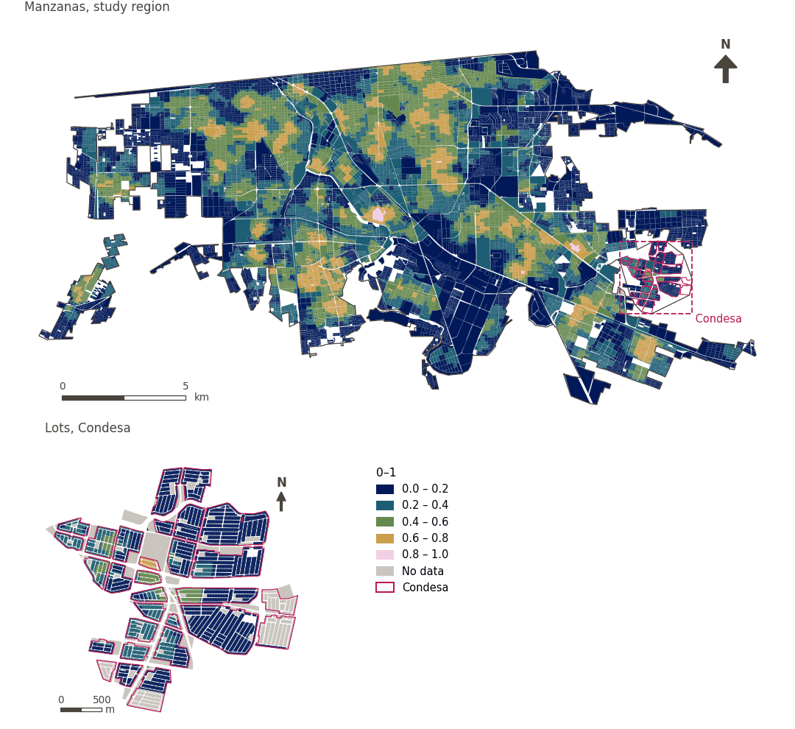

# Fresh food diversity within 500 m

[← Back to contents](../README.md)

> Diversity (Shannon entropy, 0-1) of the kinds of fresh food retail within a 500 m walk.

## Identity

| | |
|---|---|
| Identifier | `div_fresh_food_500m` |
| Core measure (variable sheet) | Daily essential-services access |
| Sheet / register ID | 129, 11, 367 · #129, #11, #367 |
| Sample point variable | `sp_walk_diversity_fresh_food_500m` |
| Area variable (measured value) | `avg_diversity_walk_fresh_food_500m` (0–1) |
| Normalised score | `index_uli__div_fresh_food_500m` |
| Domains (share of weight) | [Social infrastructure](domain_social_infrastructure.md) (33%), [Mobility and transport](domain_mobility_transport.md) (33%), [Economic development](domain_economic_development.md) (33%) |
| Subdomain | Social infrastructure: Public services; Mobility and transport: Active mobility; Economic development: Food environment |
| Lens | Diversity |
| Better when | higher |
| Effective weight in the index | `uli` 3.6% · `uli_plain` 3.6% |
| Status | Scored in the published index |

## Rationale and interpretation

> Local markets provide residents with access to fresh food and opportunities for economic activity and social interaction within their neighborhoods.
>
> — *Indicator register #129: Access to markets (Economic Development / Food Environment)*

- Workbook citation: Ghasemi, 2024, 'Enhancing urban livability: Analyzing Tehran through equitable land use distribution'; Yang et al., 2021, 'Spatiotemporal trends and driving factors of urban livability in the Yangtze River Delta Agglomeration'
- Article list: #16: Kashi (2025), ‘Spatial analysis and ranking of urban districts based on a comprehensive livability approach: the case of Tehran’
- ⚠ the workbook citation names no author of the listed article; verify before citing (citation_audit.csv)

> The presence of local bakeries and food services contributes to the convenience of urban life and supports the everyday functional needs of residents.
>
> — *Indicator register #11: Access to bakery (Economic Development / Food Environment)*

- Workbook citation: Ghasemi, 2024, 'Enhancing urban livability: Analyzing Tehran through equitable land use distribution'
- Article list: #16: Kashi (2025), ‘Spatial analysis and ranking of urban districts based on a comprehensive livability approach: the case of Tehran’
- ⚠ the workbook citation names no author of the listed article; verify before citing (citation_audit.csv)

> The availability of supermarkets is a indicator of the formal food environment that influences residents' ability to access varied and nutritional food options.
>
> — *Indicator register #367: Access to supermarket (Economic Development / Food Environment)*

- Workbook citation: Lowe et al., 2015, 'Planning healthy, liveable and sustainable cities: how can indicators inform policy?'
- Article list: #13: Alderton (2021), ‘Measuring and monitoring liveability in a low-to-middle income country: a proof-of-concept for Bangkok, Thailand and lessons from an international partnership’
- ⚠ the workbook citation names no author of the listed article; verify before citing (citation_audit.csv)

**How to read it.** Mean diversity of fresh food retail within a 500 m walk: … (0 = one kind or none, 1 = every kind equally).

**Diversity of available fresh food** (Daily essential-services access; ID 129, 11, 367)
- *How to calculate (variable sheet):* Weighted share/number of supermarkets, markets, bakeries, abarroterías, tortillerías, pollerías, carnicerías, fruterías, verdulerías reachable within a walking distance
- *Notes (sheet):* Using DENUE data

## Data sources

**Sources declared in the configuration:**

- INEGI (2026) Directorio Estadístico Nacional de Unidades Económicas (DENUE), May 2026.

**Source recorded by GHSCI (data dictionary)** (`avg_diversity_walk_fresh_food_500m`):

- OpenStreetMap: Geofabrik GmbH, 20260815, ODbL, https://download.geofabrik.de/north-america/mexico-latest.osm.pbf, OpenStreetMap Contributors.  Geofabrik GmbH (2026). https://download.geofabrik.de/north-america/mexico-latest.osm.pbf; INEGI, Directorio Estadistico Nacional de Unidades Economicas (DENUE): 2026-05, Terminos de Libre Uso de la Informacion del INEGI, https://www.inegi.org.mx/app/mapa/denue/, INEGI (2026). Directorio Estadistico Nacional de Unidades Economicas (DENUE), mayo 2026. Instituto Nacional de Estadistica y Geografia, Mexico.

**Destination filter:**

- `denue_fresh_food` (Fresh food retail (DENUE)): `MX/INEGI/DENUE_2026/denue_inegi_02_.shp` — Destination filter: `"codigo_act IN ('461121','461122','461123','461130','461140','461150','462111','462112')"`
- `denue_bakery_tortilleria` (Bakeries and tortillerias (DENUE)): `MX/INEGI/DENUE_2026/denue_inegi_02_.shp` — Destination filter: `"codigo_act IN ('311812','311813','311830')"`

**Inputs:** [Diversity sets and their sub-types](diversity_sets.md), [DENUE destinations by SCIAN code](denue_destinations.md)

## Method: theory

1. For each of the `k = 7` sub-types of the set "fresh_food" (`meat`, `produce`, `grains_and_spices`, `dairy`, `supermarket`, `minisuper`, `bakery_tortilleria`), the number of distinct destinations reachable within 500 m along the pedestrian network, `c_g` (R4).
2. Normalised Shannon entropy: `p_g = c_g / Σc`, `H = −Σ p_g·ln p_g / ln k`, from 0 (one sub-type or none) to 1 (every sub-type equally). `k` is the number of configured sub-types, not the number present.
3. AMPI normalisation (R11), aggregation (R12) and areas (R13).

## Method: practice

**Recipes:** [R1. Sample points and the pedestrian network](../03_recipes.md#r1), [R4. Diversity of what is reachable](../03_recipes.md#r4), [R11. Normalisation: the Adjusted Mazziotta–Pareto Index (AMPI)](../03_recipes.md#r11), [R12. Aggregation: domains, shared indicators and the index](../03_recipes.md#r12), [R13. From sample points to areas](../03_recipes.md#r13), [R14. Frozen goalposts and recalculating a scenario](../03_recipes.md#r14)

**Configuration** ([`MX_Mexicali_2025_ULI.yml:1491`](../../data/MX_Mexicali_2025_ULI.yml#L1491)):

```yaml
- variable: sp_walk_diversity_fresh_food_500m
  name: div_fresh_food_500m
  domains: [social_infrastructure, mobility_transport, economic_development]
  group: {es: 'Acceso a servicios esenciales cotidianos', en: 'Daily essential-services access'}
  label: {es: 'Diversidad de alimentos frescos a 500 m', en: 'Fresh food diversity within 500 m'}
  reading: {es: 'Diversidad media de comercio de alimentos frescos a 500 m a pie: {value} (0 = un tipo o ninguno, 1 = todos los tipos por igual)', en: 'Mean diversity of fresh food retail within a 500 m walk: {value} (0 = one kind or none, 1 = every kind equally)'}
  subdomain:
    social_infrastructure: {es: 'Servicios públicos', en: 'Public services'}
    mobility_transport: {es: 'Movilidad activa', en: 'Active mobility'}
    economic_development: {es: 'Ambiente de alimentación', en: 'Food environment'}
  about:
    es: Diversidad (entropía de Shannon, 0-1) de los tipos de comercio de alimentos frescos a 500 m a pie.
    en: Diversity (Shannon entropy, 0-1) of the kinds of fresh food retail within a 500 m walk.
  sources:
    - 'INEGI (2026) Directorio Estadístico Nacional de Unidades Económicas (DENUE), May 2026.'
```

**Code (GHSCI):**

- [`process/subprocesses/_accessibility_spec.py:929`](https://github.com/healthysustainablecities/global-indicators/blob/f03909611dba336c2728fffab6d697779487d0b1/process/subprocesses/_accessibility_spec.py#L929) `_banded_counts()`
- [`process/subprocesses/_accessibility_spec.py:466`](https://github.com/healthysustainablecities/global-indicators/blob/f03909611dba336c2728fffab6d697779487d0b1/process/subprocesses/_accessibility_spec.py#L466) `normalised_entropy()`
- [`process/subprocesses/_composite_index.py:1819`](https://github.com/healthysustainablecities/global-indicators/blob/f03909611dba336c2728fffab6d697779487d0b1/process/subprocesses/_composite_index.py#L1819) `normalise()`
- [`process/subprocesses/_composite_index.py:1838`](https://github.com/healthysustainablecities/global-indicators/blob/f03909611dba336c2728fffab6d697779487d0b1/process/subprocesses/_composite_index.py#L1838) `mpi_aggregate()`

|  | Sample point variable | Transform | Goalposts (scale scored) | inf – sup | skew / kurt. / tied | Flags |
|---|---|---|---|---|---|---|
| `uli` | sp_walk_diversity_fresh_food_500m | as measured | −0.167 · 0.269 · 0.705 | 0.000 – 0.871 | 0.19 / −1.36 / 39.9% | none |
| `uli_plain` | sp_walk_diversity_fresh_food_500m | as measured | −0.167 · 0.269 · 0.705 | 0.000 – 0.871 | 0.19 / −1.36 / 39.9% | none |

## Recalculation (Reimagina Urbano)

A new destination adds 1 to its sub-type's `c_g` at points within 500 m along the network; entropy is recomputed at those points.

With the frozen goalposts of the parameters file (`Ref`, `Min`, `Max`, R14), a new score is `r = 100 ± 60·(x − Ref)/(Max − Min)` without re-resolving goalposts; the domain and index are recomputed by R12, less 100. A scenario is then compared with the baseline on the same scale.

## Results

| Measure | Study region (Mexicali incl. Condesa) | Condesa |
|---|---|---|
| Region value | 0.37 | 0.11 |
| Region score (`uli`) | +7.0 | −11.1 |
| Areas with a value | 14,216 of 14,252 manzanas | 13,265 of 14,988 lots |
| Median (P25–P75), weighted | 0.35 (0.18 – 0.51) | 0.00 (0.00 – 0.27) |
| Range | 0.00 – 0.85 | 0.00 – 0.70 |
| Score: median (P25–P75) (`uli`) | +5.7 (−6.3 – +16.9) | −18.5 (−18.5 – +0.3) |

*Distributions: study region manzanas weighted by census population (2020); Condesa lots weighted equally (3.2 residents assumed per lot). Region values are those GHSCI reports for each region as a whole.*

- Study region: Mean diversity of fresh food retail within a 500 m walk: 0.37 (0 = one kind or none, 1 = every kind equally).
- Condesa: Mean diversity of fresh food retail within a 500 m walk: 0.11 (0 = one kind or none, 1 = every kind equally).
- For the study region as a whole the value is 0.37; in Condesa, 0.11. Condesa's score lies 11.1 points below the study region average (+7.0 for the study region).

## Map



*Map. Fresh food diversity within 500 m: measured value (0–1) by manzana across the study region and by lot in Condesa (inset). Dashboard classes; the favourable end is the light end (higher is better).*
