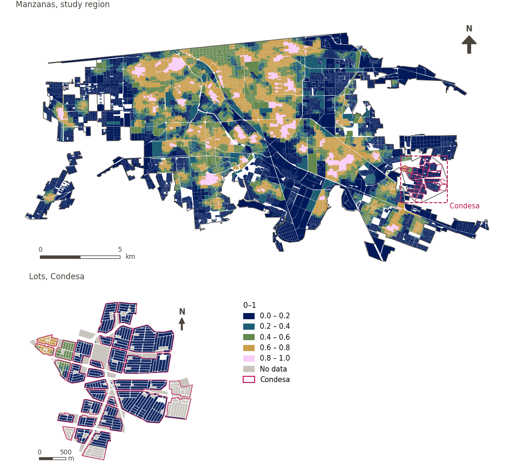

# Health service diversity within 500 m

[← Back to contents](../README.md)

> Diversity (Shannon entropy, 0-1) of the kinds of health service within a 500 m walk.

## Identity

| | |
|---|---|
| Identifier | `div_health_500m` |
| Core measure (variable sheet) | Health, education and care access |
| Sheet / register ID | 97, 101, 170 · #97, #101, #170 |
| Sample point variable | `sp_walk_diversity_health_care_500m` |
| Area variable (measured value) | `avg_diversity_walk_health_care_500m` (0–1) |
| Normalised score | `index_uli__div_health_500m` |
| Domains (share of weight) | [Social infrastructure](domain_social_infrastructure.md) |
| Subdomain | Health and healthcare |
| Lens | Diversity |
| Better when | higher |
| Effective weight in the index | `uli` 1.7% · `uli_plain` 1.7% |
| Status | Scored in the published index |

## Rationale and interpretation

> Proximity to healthcare facilities is essential for maintaining urban life quality and ensures residents have timely access to medical services.
>
> — *Indicator register #97: Access to health centres (Social Infrastructure / Health & Healthcare)*

- Workbook citation: McMichael, 2000, 'The urban environment and health in a world of increasing globalisation: issues for developing countries'
- Article list: #19: Wu (2022), ‘Urban greenness, mixed land-use, and life satisfaction: Evidence from residential locations and workplace settings in Beijing’; #20: Basu (2021), ‘Urban livability index assessment based on land-use changes in an Indian medium-sized city (Raiganj)’
- ⚠ the workbook citation names no author of the listed article; verify before citing (citation_audit.csv)

> The physical availability and accessibility of healthcare facilities, such as hospitals, are essential determinants of health within the urban liveability framework.
>
> — *Indicator register #101: Access to hospitals (Social Infrastructure / Health & Healthcare)*

- Workbook citation: Mercer, 2017, 'Quality of Living Survey'; Economist Intelligence Unit (EIU), 2012, 'Quality of Life Index'
- Article list: #8: Onnom (2018), ‘Development of a Liveable City Index (LCI) Using Multi Criteria Geospatial Modelling for Medium Class Cities in Developing Countries’
- ⚠ the workbook citation names no author of the listed article; verify before citing (citation_audit.csv)

> Access to medical stores is identified by residents as a fundamental amenity for liveability, ensuring the availability of healthcare commodities across the city.
>
> — *Indicator register #170: Access to pharmacies (Social Infrastructure / Health & Healthcare)*

- Workbook citation: Chi et al., 2021, 'From Comparative and Statistical Assessments of Liveability and Health Conditions of Districts in Hong Kong towards Future City Development'; Suptelo & Sehida, 2020, 'Factors of Post-Industrial Transformations of Urban Sociogeosystems (Case Kharkiv)'
- Article list: #5: Mahanta (2025), ‘Constructing a city liveability index and evaluating the spatial pattern of liveability of Guwahati city’
- ⚠ the workbook citation names no author of the listed article; verify before citing (citation_audit.csv)

**How to read it.** Mean diversity of health services within a 500 m walk: … (0 = one kind or none, 1 = every kind equally).

**Diversity of available health & health care services** (Health, education and care acc ess; ID 97,101, 170)
- *How to calculate (variable sheet):* Weighted share/number of health centers, clinics, hospitals and pharmacies reachable within a walking distance

## Data sources

**Sources declared in the configuration:**

- INEGI (2026) Directorio Estadístico Nacional de Unidades Económicas (DENUE), May 2026.

**Source recorded by GHSCI (data dictionary)** (`avg_diversity_walk_health_care_500m`):

- OpenStreetMap: Geofabrik GmbH, 20260815, ODbL, https://download.geofabrik.de/north-america/mexico-latest.osm.pbf, OpenStreetMap Contributors.  Geofabrik GmbH (2026). https://download.geofabrik.de/north-america/mexico-latest.osm.pbf; INEGI, Directorio Estadistico Nacional de Unidades Economicas (DENUE): 2026-05, Terminos de Libre Uso de la Informacion del INEGI, https://www.inegi.org.mx/app/mapa/denue/, INEGI (2026). Directorio Estadistico Nacional de Unidades Economicas (DENUE), mayo 2026. Instituto Nacional de Estadistica y Geografia, Mexico.

**Destination filter:**

- `denue_primary_healthcare` (Primary healthcare (DENUE)): `MX/INEGI/DENUE_2026/denue_inegi_02_.shp` — Destination filter: `"codigo_act IN ('621111','621112','621115','621116')"`
- `denue_medical_clinic` (Specialist and diagnostic clinics (DENUE)): `MX/INEGI/DENUE_2026/denue_inegi_02_.shp` — Destination filter: `"codigo_act IN ('621113','621211','621212','621511')"`
- `denue_hospital` (Hospitals (DENUE)): `MX/INEGI/DENUE_2026/denue_inegi_02_.shp` — Destination filter: `"codigo_act LIKE '622%'"`
- `denue_pharmacy` (Pharmacies and medicine retail (DENUE)): `MX/INEGI/DENUE_2026/denue_inegi_02_.shp` — Destination filter: `"codigo_act IN ('464111','464112','464113')"`
- `denue_care_support` (Care and social support services (DENUE)): `MX/INEGI/DENUE_2026/denue_inegi_02_.shp` — Destination filter: `"codigo_act LIKE '623%' OR codigo_act LIKE '624%'"`

**Inputs:** [Diversity sets and their sub-types](diversity_sets.md), [DENUE destinations by SCIAN code](denue_destinations.md)

## Method: theory

1. For each of the `k = 5` sub-types of the set "health_care" (`primary_healthcare`, `specialist_clinic`, `hospital`, `pharmacy`, `care_support`), the number of distinct destinations reachable within 500 m along the pedestrian network, `c_g` (R4).
2. Normalised Shannon entropy: `p_g = c_g / Σc`, `H = −Σ p_g·ln p_g / ln k`, from 0 (one sub-type or none) to 1 (every sub-type equally). `k` is the number of configured sub-types, not the number present.
3. AMPI normalisation (R11), aggregation (R12) and areas (R13).

## Method: practice

**Recipes:** [R1. Sample points and the pedestrian network](../03_recipes.md#r1), [R4. Diversity of what is reachable](../03_recipes.md#r4), [R11. Normalisation: the Adjusted Mazziotta–Pareto Index (AMPI)](../03_recipes.md#r11), [R12. Aggregation: domains, shared indicators and the index](../03_recipes.md#r12), [R13. From sample points to areas](../03_recipes.md#r13), [R14. Frozen goalposts and recalculating a scenario](../03_recipes.md#r14)

**Configuration** ([`MX_Mexicali_2025_ULI.yml:1577`](../../data/MX_Mexicali_2025_ULI.yml#L1577)):

```yaml
- variable: sp_walk_diversity_health_care_500m
  name: div_health_500m
  domains: [social_infrastructure]
  group: {es: 'Acceso a salud, educación y cuidados', en: 'Health, education and care access'}
  label: {es: 'Diversidad de servicios de salud a 500 m', en: 'Health service diversity within 500 m'}
  reading: {es: 'Diversidad media de servicios de salud a 500 m a pie: {value} (0 = un tipo o ninguno, 1 = todos los tipos por igual)', en: 'Mean diversity of health services within a 500 m walk: {value} (0 = one kind or none, 1 = every kind equally)'}
  subdomain: {es: 'Salud y atención sanitaria', en: 'Health and healthcare'}
  about:
    es: Diversidad (entropía de Shannon, 0-1) de los tipos de servicio de salud a 500 m a pie.
    en: Diversity (Shannon entropy, 0-1) of the kinds of health service within a 500 m walk.
  sources:
    - 'INEGI (2026) Directorio Estadístico Nacional de Unidades Económicas (DENUE), May 2026.'
```

**Code (GHSCI):**

- [`process/subprocesses/_accessibility_spec.py:929`](https://github.com/healthysustainablecities/global-indicators/blob/f03909611dba336c2728fffab6d697779487d0b1/process/subprocesses/_accessibility_spec.py#L929) `_banded_counts()`
- [`process/subprocesses/_accessibility_spec.py:466`](https://github.com/healthysustainablecities/global-indicators/blob/f03909611dba336c2728fffab6d697779487d0b1/process/subprocesses/_accessibility_spec.py#L466) `normalised_entropy()`
- [`process/subprocesses/_composite_index.py:1819`](https://github.com/healthysustainablecities/global-indicators/blob/f03909611dba336c2728fffab6d697779487d0b1/process/subprocesses/_composite_index.py#L1819) `normalise()`
- [`process/subprocesses/_composite_index.py:1838`](https://github.com/healthysustainablecities/global-indicators/blob/f03909611dba336c2728fffab6d697779487d0b1/process/subprocesses/_composite_index.py#L1838) `mpi_aggregate()`

|  | Sample point variable | Transform | Goalposts (scale scored) | inf – sup | skew / kurt. / tied | Flags |
|---|---|---|---|---|---|---|
| `uli` | sp_walk_diversity_health_care_500m | as measured | −0.190 · 0.310 · 0.810 | 0.000 – 1.000 | 0.32 / −1.53 / 48.1% | none |
| `uli_plain` | sp_walk_diversity_health_care_500m | as measured | −0.190 · 0.310 · 0.810 | 0.000 – 1.000 | 0.32 / −1.53 / 48.1% | none |

## Recalculation (Reimagina Urbano)

A new destination adds 1 to its sub-type's `c_g` at points within 500 m along the network; entropy is recomputed at those points.

With the frozen goalposts of the parameters file (`Ref`, `Min`, `Max`, R14), a new score is `r = 100 ± 60·(x − Ref)/(Max − Min)` without re-resolving goalposts; the domain and index are recomputed by R12, less 100. A scenario is then compared with the baseline on the same scale.

## Results

| Measure | Study region (Mexicali incl. Condesa) | Condesa |
|---|---|---|
| Region value | 0.43 | 0.04 |
| Region score (`uli`) | +7.4 | −15.9 |
| Areas with a value | 14,216 of 14,252 manzanas | 13,265 of 14,988 lots |
| Median (P25–P75), weighted | 0.42 (0.00 – 0.64) | 0.00 (0.00 – 0.00) |
| Range | 0.00 – 0.99 | 0.00 – 0.66 |
| Score: median (P25–P75) (`uli`) | +6.4 (−18.6 – +19.6) | −18.6 (−18.6 – −18.6) |

*Distributions: study region manzanas weighted by census population (2020); Condesa lots weighted equally (3.2 residents assumed per lot). Region values are those GHSCI reports for each region as a whole.*

- Study region: Mean diversity of health services within a 500 m walk: 0.43 (0 = one kind or none, 1 = every kind equally).
- Condesa: Mean diversity of health services within a 500 m walk: 0.04 (0 = one kind or none, 1 = every kind equally).
- For the study region as a whole the value is 0.43; in Condesa, 0.04. Condesa's score lies 15.9 points below the study region average (+7.4 for the study region).

## Map



*Map. Health service diversity within 500 m: measured value (0–1) by manzana across the study region and by lot in Condesa (inset). Dashboard classes; the favourable end is the light end (higher is better).*
