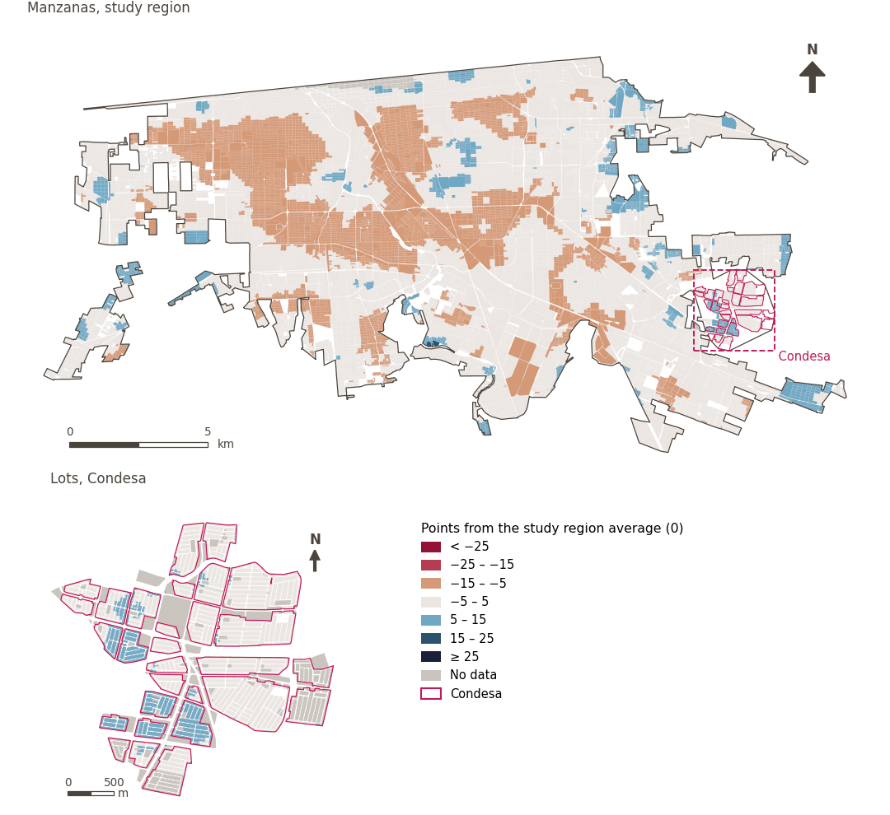

# Ambient environment

[← Back to contents](../README.md)

> The quality of environmental conditions to which residents are exposed every day. Examples include air, water, noise and temperature.

## Subdomains

- **Climate risks.** The effects of climate change at neighbourhood scale and the capacity to adapt to and mitigate them. Examples include heat islands, flood risk and extreme weather events.
- **Ambient.** Biophysical and environmental conditions of the immediate surroundings, encompassing factors such as noise, water, soil, vegetation and thermal comfort, which directly affect residents’ health, comfort and physical well-being.
- **Natural resources.** Availability, access, preservation and sustainable management of natural resources and essential basic services, such as water, land and solid-waste management, which are fundamental to ecological sustainability and the community’s continued functioning.

## Indicators of the domain

| Indicator | Subdomain | Share | Effective weight | Better when |
|---|---|---|---|---|
| [Natural blue space nearby](blue_space.md) | Ambient | 100% | 2.8% | higher |
| [Heat adaptive capability (GUHVI)](adaptive_capability.md) | Climate risks | 100% | 2.8% | higher |
| [Heat exposure (GUHVI)](heat_exposure.md) | Climate risks | 100% | 2.8% | lower |
| [Heat sensitivity (GUHVI)](heat_sensitivity.md) | Climate risks | 100% | 2.8% | lower |
| [Daytime thermal comfort](thermal_comfort.md) *(inactive in `uli`)* | Ambient | 100% | – | lower |
| [Parks within 300 m](parks.md) | Ambient | 50% | 4.0% | higher |
| [Large public green space within 500 m](lpugs.md) | Ambient | 50% | 4.0% | higher |
| [Vegetation cover (NDVI)](vegetation.md) | Ambient | 50% | 4.0% | higher |
| [Proximity to major roads](major_roads.md) | Ambient | 50% | 5.9% | lower |

## Method: theory

The domain score is the weighted Mazziotta–Pareto composite of its indicators' normalised scores (R12): each indicator weighs `weight × share`, normalised over the indicators with a value; `M` is their weighted mean, `S` their weighted deviation, and the score is `M − S·(S/M)`, less 100. In the `uli_plain` variant walkability is not attenuated and, in the ambient environment, thermal comfort is activated.

**Recipes:** [R11. Normalisation: the Adjusted Mazziotta–Pareto Index (AMPI)](../03_recipes.md#r11), [R12. Aggregation: domains, shared indicators and the index](../03_recipes.md#r12), [R13. From sample points to areas](../03_recipes.md#r13), [R14. Frozen goalposts and recalculating a scenario](../03_recipes.md#r14)

**Code (GHSCI):** [`process/subprocesses/_composite_index.py:1874`](https://github.com/healthysustainablecities/global-indicators/blob/f03909611dba336c2728fffab6d697779487d0b1/process/subprocesses/_composite_index.py#L1874) `score()`, [`process/subprocesses/_composite_index.py:1838`](https://github.com/healthysustainablecities/global-indicators/blob/f03909611dba336c2728fffab6d697779487d0b1/process/subprocesses/_composite_index.py#L1838) `mpi_aggregate()`

## Results

| Measure | Study region (Mexicali incl. Condesa) | Condesa |
|---|---|---|
| Region score (`uli`) | −2.6 | +2.3 |
| Region score (`uli_plain`) | −1.8 | +1.0 |
| Areas with a value | 14,148 of 14,252 manzanas | 13,265 of 14,988 lots |
| Median (P25–P75), weighted | −2.0 (−5.7 – +1.1) | +3.0 (+1.0 – +4.2) |
| Range | −12.3 – +16.3 | −4.5 – +10.2 |

*Distributions: study region manzanas weighted by census population (2020); Condesa lots weighted equally (3.2 residents assumed per lot). Region values are those GHSCI reports for each region as a whole.*

- The study region scores −2.6; Condesa lies 2.3 points above the study region average.

## Map

*Map. Ambient environment: score by manzana across the study region and by lot in Condesa (inset), in points from the study region average (0); blue is better.*
