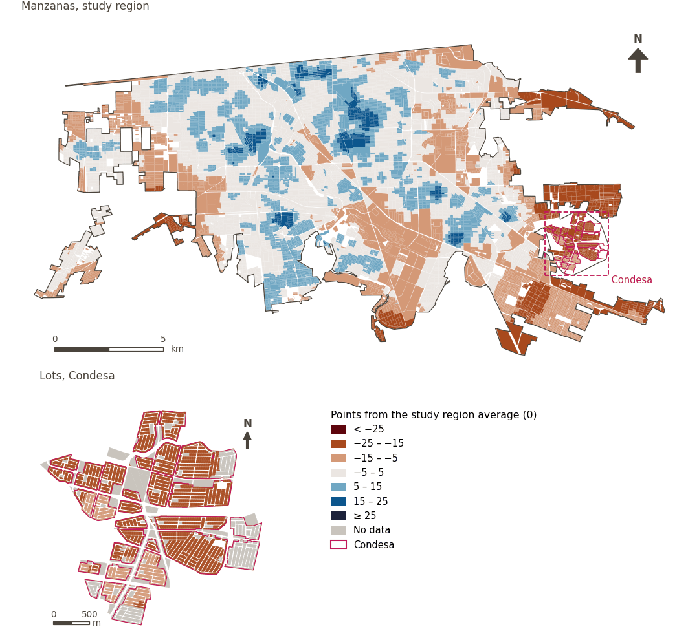

# Built environment

[← Back to contents](../README.md)

> The physical environment created by people, whose density, mix of land uses and connectivity shape everyday life. Examples include buildings, streets and public spaces.

## Subdomains

- **Urban morphology.** The physical form, structure and design of the urban fabric, which determine how space is organised and how this influences the experience of living in the city.
- **Urban design.** Configuration and quality of the spaces, streets and elements that make up the city, including pedestrian, cycling and road infrastructure, as well as the urban landscape, which influence mobility, accessibility, safety, connectivity and people’s everyday experience.
- **Green and blue infrastructure.** Network of green spaces and water features, such as parks, trees, rivers, canals, wetlands and stormwater-management systems, that provide ecosystem services, contribute to climate regulation, support physical activity and recreation, and promote mental health.

## Indicators of the domain

| Indicator | Subdomain | Share | Effective weight | Better when |
|---|---|---|---|---|
| [Parks within 300 m](parks.md) | Green and blue infrastructure | 50% | 4.0% | higher |
| [Large public green space within 500 m](lpugs.md) | Green and blue infrastructure | 50% | 4.0% | higher |
| [Vegetation cover (NDVI)](vegetation.md) | Green and blue infrastructure | 50% | 4.0% | higher |
| [Food within 1.5 km by low-stress cycling](cycle_low_stress_food.md) | Urban design | 33% | 6.2% | higher |
| [Block size (perimeter)](block_size.md) | Urban morphology | 33% | 6.2% | lower |
| [Fire station within 3 km](fire_3km.md) |  | 33% | 6.2% | higher |
| [Police station within 2 km](police_2km.md) |  | 33% | 6.2% | higher |
| [Walkability (300 m), attenuated by thermal comfort](walkability.md) | Urban design | 33% | 3.7% | higher |

## Method: theory

The domain score is the weighted Mazziotta–Pareto composite of its indicators' normalised scores (R12): each indicator weighs `weight × share`, normalised over the indicators with a value; `M` is their weighted mean, `S` their weighted deviation, and the score is `M − S·(S/M)`, less 100. In the `uli_plain` variant walkability is not attenuated and, in the ambient environment, thermal comfort is activated.

**Recipes:** [R11. Normalisation: the Adjusted Mazziotta–Pareto Index (AMPI)](../03_recipes.md#r11), [R12. Aggregation: domains, shared indicators and the index](../03_recipes.md#r12), [R13. From sample points to areas](../03_recipes.md#r13), [R14. Frozen goalposts and recalculating a scenario](../03_recipes.md#r14)

**Code (GHSCI):** [`process/subprocesses/_composite_index.py:1874`](https://github.com/healthysustainablecities/global-indicators/blob/f03909611dba336c2728fffab6d697779487d0b1/process/subprocesses/_composite_index.py#L1874) `score()`, [`process/subprocesses/_composite_index.py:1838`](https://github.com/healthysustainablecities/global-indicators/blob/f03909611dba336c2728fffab6d697779487d0b1/process/subprocesses/_composite_index.py#L1838) `mpi_aggregate()`

## Results

| Measure | Study region (Mexicali incl. Condesa) | Condesa |
|---|---|---|
| Region score (`uli`) | +2.0 | −17.8 |
| Region score (`uli_plain`) | +1.5 | −16.5 |
| Areas with a value | 14,216 of 14,252 manzanas | 12,862 of 14,988 lots |
| Median (P25–P75), weighted | +1.8 (−2.9 – +6.3) | −18.9 (−19.4 – −17.7) |
| Range | −21.2 – +23.5 | −20.1 – −7.3 |

*Distributions: study region manzanas weighted by census population (2020); Condesa lots weighted equally (3.2 residents assumed per lot). Region values are those GHSCI reports for each region as a whole.*

- The study region scores +2.0; Condesa lies 17.8 points below the study region average.

## Map

*Map. Built environment: score by manzana across the study region and by lot in Condesa (inset), in points from the study region average (0); blue is better.*
