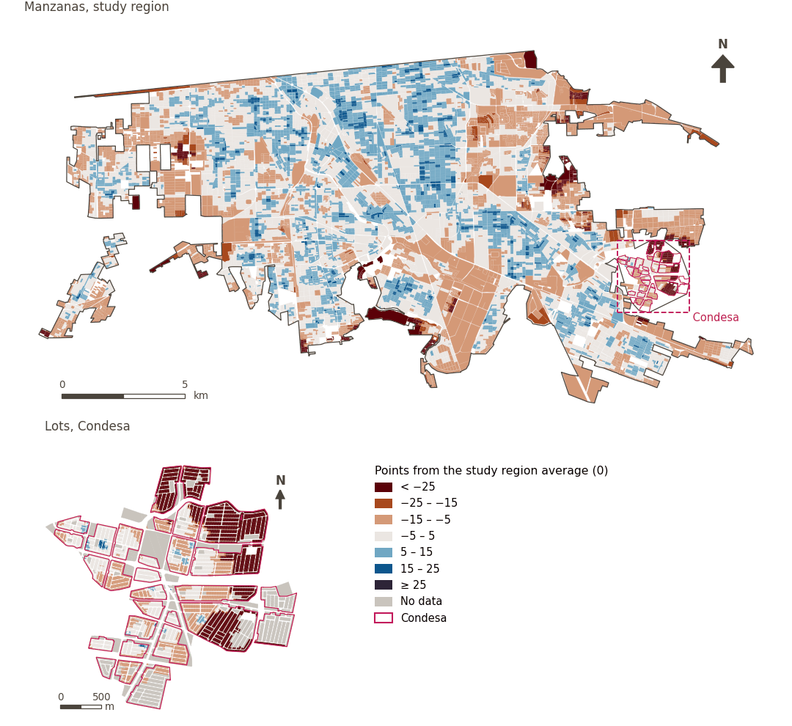

# Economic development

[← Back to contents](../README.md)

> Local economic conditions that offer residents opportunities for productive employment, fair income and economic participation.

## Subdomains

- **Food environment.** Presence, proximity and diversity of food retail establishments, such as supermarkets and convenience destinations, that determine the ease and equity with which residents access food supplies in their immediate surroundings.
- **Resources.** Availability, access, coverage and continuous supply of essential energy services and inputs, such as electricity and fuels, needed for productive, commercial and household activities.
- **Economy.** Dynamism and structure of local productive activity, including the presence and distribution of retail, industry and employment sources, which generate job opportunities, income and economic support for the urban population.

## Indicators of the domain

| Indicator | Subdomain | Share | Effective weight | Better when |
|---|---|---|---|---|
| [250 m or more from petrol stations](petrol_250m.md) | Resources | 33% | 3.6% | higher |
| [Convenience stores within 300 m](convenience.md) | Food environment | 33% | 3.6% | higher |
| [Fresh food diversity within 500 m](div_fresh_food_500m.md) | Food environment | 33% | 3.6% | higher |
| [Fresh food within 300 m](fresh_food.md) | Food environment | 33% | 3.6% | higher |
| [Job diversity](job_diversity.md) | Economy | 100% | 5.0% | higher |
| [Manufacturing within 1 km](manufacturing_1000m.md) | Economy | 100% | 5.0% | higher |

## Method: theory

The domain score is the weighted Mazziotta–Pareto composite of its indicators' normalised scores (R12): each indicator weighs `weight × share`, normalised over the indicators with a value; `M` is their weighted mean, `S` their weighted deviation, and the score is `M − S·(S/M)`, less 100. In the `uli_plain` variant walkability is not attenuated and, in the ambient environment, thermal comfort is activated.

**Recipes:** [R11. Normalisation: the Adjusted Mazziotta–Pareto Index (AMPI)](../03_recipes.md#r11), [R12. Aggregation: domains, shared indicators and the index](../03_recipes.md#r12), [R13. From sample points to areas](../03_recipes.md#r13), [R14. Frozen goalposts and recalculating a scenario](../03_recipes.md#r14)

**Code (GHSCI):** [`process/subprocesses/_composite_index.py:1874`](https://github.com/healthysustainablecities/global-indicators/blob/f03909611dba336c2728fffab6d697779487d0b1/process/subprocesses/_composite_index.py#L1874) `score()`, [`process/subprocesses/_composite_index.py:1838`](https://github.com/healthysustainablecities/global-indicators/blob/f03909611dba336c2728fffab6d697779487d0b1/process/subprocesses/_composite_index.py#L1838) `mpi_aggregate()`

## Results

| Measure | Study region (Mexicali incl. Condesa) | Condesa |
|---|---|---|
| Region score (`uli`) | +1.9 | −14.8 |
| Region score (`uli_plain`) | +1.9 | −14.8 |
| Areas with a value | 14,213 of 14,252 manzanas | 12,589 of 14,988 lots |
| Median (P25–P75), weighted | +1.7 (−3.3 – +6.8) | −7.6 (−31.3 – −3.4) |
| Range | −36.9 – +21.0 | −35.3 – +18.1 |

*Distributions: study region manzanas weighted by census population (2020); Condesa lots weighted equally (3.2 residents assumed per lot). Region values are those GHSCI reports for each region as a whole.*

- The study region scores +1.9; Condesa lies 14.8 points below the study region average.

## Map

*Map. Economic development: score by manzana across the study region and by lot in Condesa (inset), in points from the study region average (0); blue is better.*
