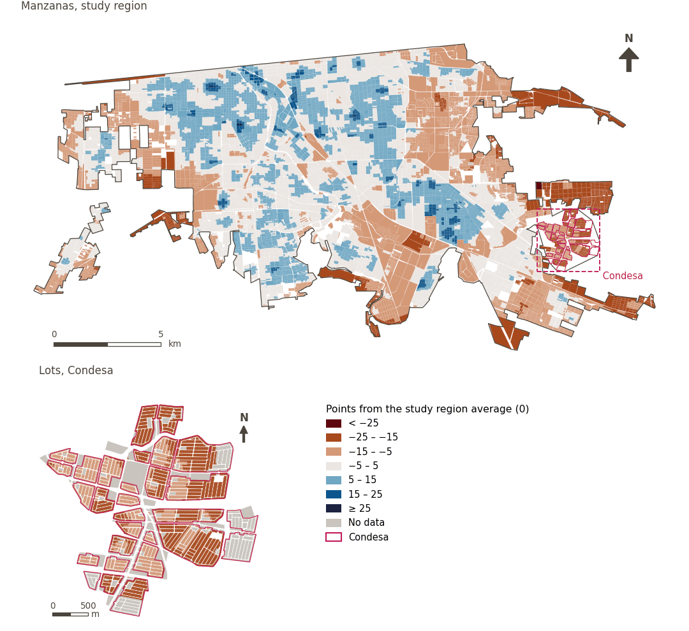

# Mobility and transport

[← Back to contents](../README.md)

> Networks and systems that enable efficient travel between home, work and services.

## Subdomains

- **Public transport.** Public transport systems that connect residents with work, education and services.
- **Active mobility.** Urban environment conditions that facilitate non-motorised travel, on foot and by bicycle, such as connected, permeable and well-designed street networks.

## Indicators of the domain

| Indicator | Subdomain | Share | Effective weight | Better when |
|---|---|---|---|---|
| [Food within 1.5 km by low-stress cycling](cycle_low_stress_food.md) | Active mobility | 33% | 6.2% | higher |
| [Block size (perimeter)](block_size.md) | Active mobility | 33% | 6.2% | lower |
| [Fire station within 3 km](fire_3km.md) |  | 33% | 6.2% | higher |
| [Police station within 2 km](police_2km.md) |  | 33% | 6.2% | higher |
| [Walkability (300 m), attenuated by thermal comfort](walkability.md) | Active mobility | 33% | 3.7% | higher |
| [250 m or more from petrol stations](petrol_250m.md) |  | 33% | 3.6% | higher |
| [Convenience stores within 300 m](convenience.md) | Active mobility | 33% | 3.6% | higher |
| [Fresh food diversity within 500 m](div_fresh_food_500m.md) | Active mobility | 33% | 3.6% | higher |
| [Fresh food within 300 m](fresh_food.md) | Active mobility | 33% | 3.6% | higher |
| [Public transport within 300 m](public_transport.md) | Public transport | 100% | 4.2% | higher |

## Method: theory

The domain score is the weighted Mazziotta–Pareto composite of its indicators' normalised scores (R12): each indicator weighs `weight × share`, normalised over the indicators with a value; `M` is their weighted mean, `S` their weighted deviation, and the score is `M − S·(S/M)`, less 100. In the `uli_plain` variant walkability is not attenuated and, in the ambient environment, thermal comfort is activated.

**Recipes:** [R11. Normalisation: the Adjusted Mazziotta–Pareto Index (AMPI)](../03_recipes.md#r11), [R12. Aggregation: domains, shared indicators and the index](../03_recipes.md#r12), [R13. From sample points to areas](../03_recipes.md#r13), [R14. Frozen goalposts and recalculating a scenario](../03_recipes.md#r14)

**Code (GHSCI):** [`process/subprocesses/_composite_index.py:1874`](https://github.com/healthysustainablecities/global-indicators/blob/f03909611dba336c2728fffab6d697779487d0b1/process/subprocesses/_composite_index.py#L1874) `score()`, [`process/subprocesses/_composite_index.py:1838`](https://github.com/healthysustainablecities/global-indicators/blob/f03909611dba336c2728fffab6d697779487d0b1/process/subprocesses/_composite_index.py#L1838) `mpi_aggregate()`

## Results

| Measure | Study region (Mexicali incl. Condesa) | Condesa |
|---|---|---|
| Region score (`uli`) | +2.4 | −15.4 |
| Region score (`uli_plain`) | +2.0 | −14.4 |
| Areas with a value | 14,216 of 14,252 manzanas | 12,862 of 14,988 lots |
| Median (P25–P75), weighted | +2.4 (−3.1 – +6.4) | −15.5 (−17.1 – −12.9) |
| Range | −26.4 – +26.7 | −21.3 – −6.6 |

*Distributions: study region manzanas weighted by census population (2020); Condesa lots weighted equally (3.2 residents assumed per lot). Region values are those GHSCI reports for each region as a whole.*

- The study region scores +2.4; Condesa lies 15.4 points below the study region average.

## Map

*Map. Mobility and transport: score by manzana across the study region and by lot in Condesa (inset), in points from the study region average (0); blue is better.*
