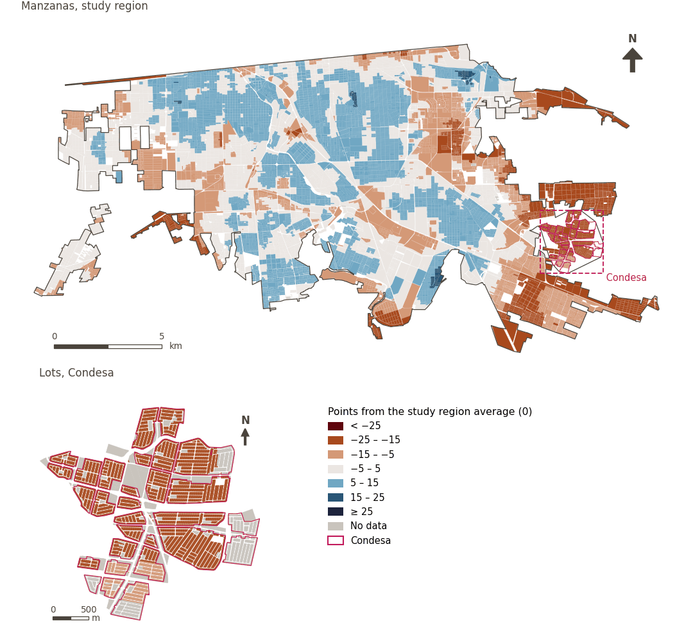

# Safety and protection

[← Back to contents](../README.md)

> Conditions in the urban environment that allow residents to move freely and participate in public life without fear of crime, violence or traffic accidents.

## Subdomains

- **Personal safety.** Conditions in the urban environment related to crime incidence and the presence of public and surveillance services that determine the degree of people’s physical protection, reduce exposure to crime and promote peace of mind in public space.
- **Road safety.** Characteristics and conditions of road and pedestrian infrastructure designed to prevent traffic crashes, protecting the physical integrity of pedestrians, cyclists and drivers travelling through the city.
- **Risks.** Population exposure and vulnerability to natural or human-caused hazards, such as earthquakes, flooding, extreme heat, fire and adverse climate events, as well as the urban environment’s capacity to mitigate their impacts and safeguard the community.

## Indicators of the domain

| Indicator | Subdomain | Share | Effective weight | Better when |
|---|---|---|---|---|
| [Proximity to major roads](major_roads.md) | Road safety | 50% | 5.9% | lower |
| [Food within 1.5 km by low-stress cycling](cycle_low_stress_food.md) | Road safety | 33% | 6.2% | higher |
| [Block size (perimeter)](block_size.md) | Road safety | 33% | 6.2% | lower |
| [Fire station within 3 km](fire_3km.md) | Risks | 33% | 6.2% | higher |
| [Police station within 2 km](police_2km.md) | Personal safety | 33% | 6.2% | higher |

## Method: theory

The domain score is the weighted Mazziotta–Pareto composite of its indicators' normalised scores (R12): each indicator weighs `weight × share`, normalised over the indicators with a value; `M` is their weighted mean, `S` their weighted deviation, and the score is `M − S·(S/M)`, less 100. In the `uli_plain` variant walkability is not attenuated and, in the ambient environment, thermal comfort is activated.

**Recipes:** [R11. Normalisation: the Adjusted Mazziotta–Pareto Index (AMPI)](../03_recipes.md#r11), [R12. Aggregation: domains, shared indicators and the index](../03_recipes.md#r12), [R13. From sample points to areas](../03_recipes.md#r13), [R14. Frozen goalposts and recalculating a scenario](../03_recipes.md#r14)

**Code (GHSCI):** [`process/subprocesses/_composite_index.py:1874`](https://github.com/healthysustainablecities/global-indicators/blob/f03909611dba336c2728fffab6d697779487d0b1/process/subprocesses/_composite_index.py#L1874) `score()`, [`process/subprocesses/_composite_index.py:1838`](https://github.com/healthysustainablecities/global-indicators/blob/f03909611dba336c2728fffab6d697779487d0b1/process/subprocesses/_composite_index.py#L1838) `mpi_aggregate()`

## Results

| Measure | Study region (Mexicali incl. Condesa) | Condesa |
|---|---|---|
| Region score (`uli`) | +2.2 | −20.7 |
| Region score (`uli_plain`) | +2.2 | −20.7 |
| Areas with a value | 14,216 of 14,252 manzanas | 12,862 of 14,988 lots |
| Median (P25–P75), weighted | +3.3 (−4.1 – +8.2) | −21.4 (−21.8 – −21.2) |
| Range | −24.1 – +16.1 | −23.7 – −10.7 |

*Distributions: study region manzanas weighted by census population (2020); Condesa lots weighted equally (3.2 residents assumed per lot). Region values are those GHSCI reports for each region as a whole.*

- The study region scores +2.2; Condesa lies 20.7 points below the study region average.

## Map

*Map. Safety and protection: score by manzana across the study region and by lot in Condesa (inset), in points from the study region average (0); blue is better.*
