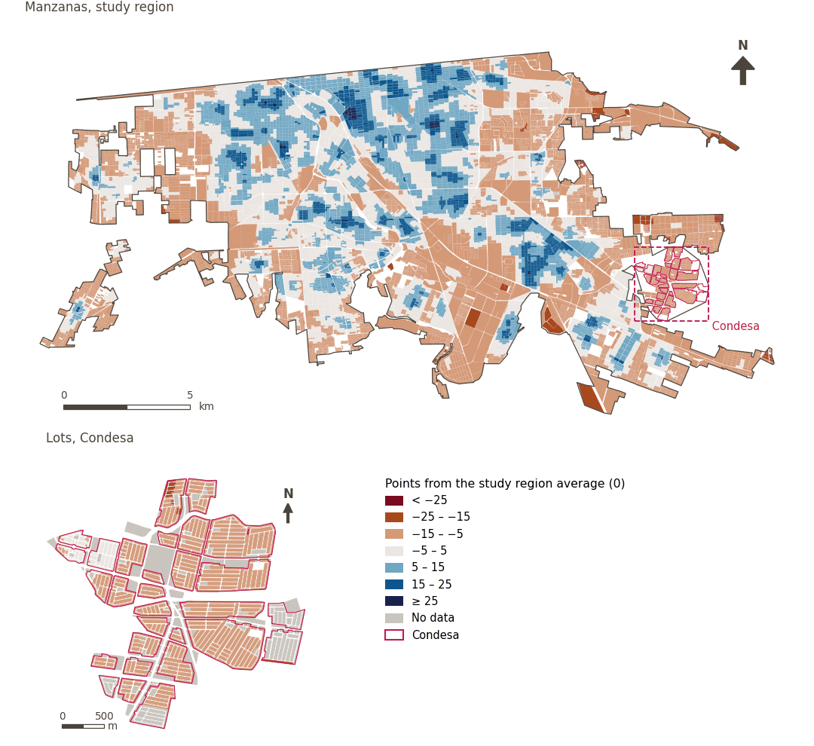

# Social infrastructure

[← Back to contents](../README.md)

> The network of public facilities that supports social interaction, cohesion and collective well-being.

## Subdomains

- **Public services.** Set of essential government or community facilities, equipment, networks and services oriented toward well-being, urban management and support for daily life; their availability, coverage and proper operation ensure dignified, safe and equitable conditions for the population in the urban environment.
- **Health and healthcare.** Facilities and health services that contribute to residents’ physical and mental well-being.
- **Community, culture and recreation.** Cultural spaces, heritage sites and community events that foster identity and a sense of belonging.
- **Education.** Educational institutions, from early childhood through higher education, that support human development and social mobility.

## Indicators of the domain

| Indicator | Subdomain | Share | Effective weight | Better when |
|---|---|---|---|---|
| [Walkability (300 m), attenuated by thermal comfort](walkability.md) | Public services | 33% | 3.7% | higher |
| [250 m or more from petrol stations](petrol_250m.md) | Public services | 33% | 3.6% | higher |
| [Convenience stores within 300 m](convenience.md) | Public services | 33% | 3.6% | higher |
| [Fresh food diversity within 500 m](div_fresh_food_500m.md) | Public services | 33% | 3.6% | higher |
| [Fresh food within 300 m](fresh_food.md) | Public services | 33% | 3.6% | higher |
| [Community, culture and recreation diversity within 500 m](div_ccr_500m.md) | Community, culture and recreation | 100% | 1.7% | higher |
| [Community, culture and recreation within 300 m](ccr_any.md) | Community, culture and recreation | 100% | 1.7% | higher |
| [Care service diversity within 500 m](div_care_500m.md) | Public services | 100% | 1.7% | higher |
| [Care services within 300 m](care_support.md) | Public services | 100% | 1.7% | higher |
| [Education diversity within 500 m](div_education_500m.md) | Education | 100% | 1.7% | higher |
| [Health service diversity within 500 m](div_health_500m.md) | Health and healthcare | 100% | 1.7% | higher |
| [Primary healthcare within 300 m](primary_healthcare.md) | Health and healthcare | 100% | 1.7% | higher |
| [Primary schools within 300 m](primary_school.md) | Education | 100% | 1.7% | higher |

## Method: theory

The domain score is the weighted Mazziotta–Pareto composite of its indicators' normalised scores (R12): each indicator weighs `weight × share`, normalised over the indicators with a value; `M` is their weighted mean, `S` their weighted deviation, and the score is `M − S·(S/M)`, less 100. In the `uli_plain` variant walkability is not attenuated and, in the ambient environment, thermal comfort is activated.

**Recipes:** [R11. Normalisation: the Adjusted Mazziotta–Pareto Index (AMPI)](../03_recipes.md#r11), [R12. Aggregation: domains, shared indicators and the index](../03_recipes.md#r12), [R13. From sample points to areas](../03_recipes.md#r13), [R14. Frozen goalposts and recalculating a scenario](../03_recipes.md#r14)

**Code (GHSCI):** [`process/subprocesses/_composite_index.py:1874`](https://github.com/healthysustainablecities/global-indicators/blob/f03909611dba336c2728fffab6d697779487d0b1/process/subprocesses/_composite_index.py#L1874) `score()`, [`process/subprocesses/_composite_index.py:1838`](https://github.com/healthysustainablecities/global-indicators/blob/f03909611dba336c2728fffab6d697779487d0b1/process/subprocesses/_composite_index.py#L1838) `mpi_aggregate()`

## Results

| Measure | Study region (Mexicali incl. Condesa) | Condesa |
|---|---|---|
| Region score (`uli`) | +2.4 | −12.1 |
| Region score (`uli_plain`) | +2.3 | −11.6 |
| Areas with a value | 14,216 of 14,252 manzanas | 13,265 of 14,988 lots |
| Median (P25–P75), weighted | +0.4 (−6.3 – +7.0) | −12.6 (−14.4 – −11.6) |
| Range | −17.4 – +33.7 | −15.2 – +8.5 |

*Distributions: study region manzanas weighted by census population (2020); Condesa lots weighted equally (3.2 residents assumed per lot). Region values are those GHSCI reports for each region as a whole.*

- The study region scores +2.4; Condesa lies 12.1 points below the study region average.

## Map

*Map. Social infrastructure: score by manzana across the study region and by lot in Condesa (inset), in points from the study region average (0); blue is better.*
