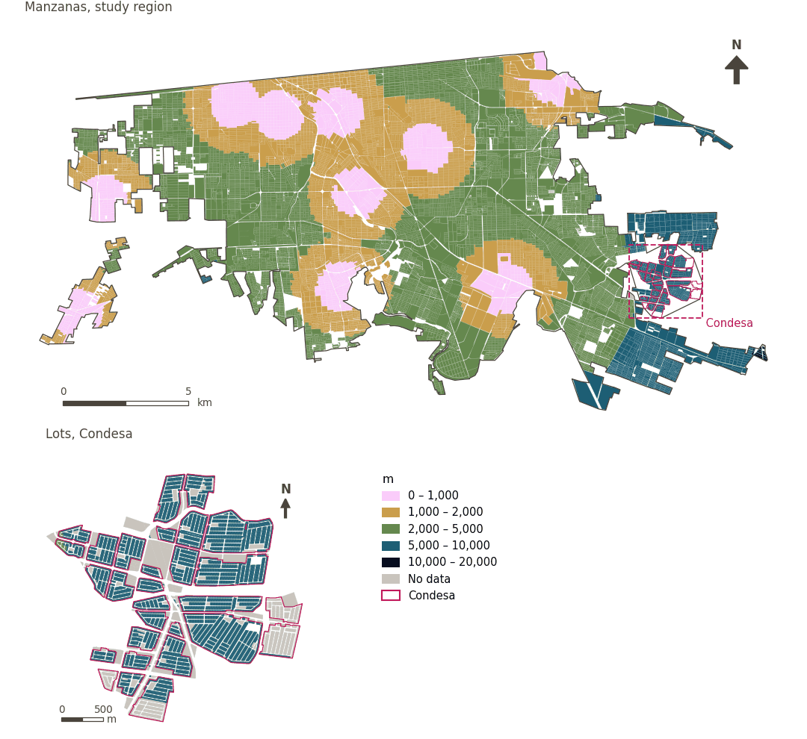

# Fire station within 3 km

[← Back to contents](../README.md)

> Straight-line distance to the nearest municipal fire station, scored with a 3 km soft threshold (NFPA 1710, about four minutes at 45 km/h).

## Identity

| | |
|---|---|
| Identifier | `fire_3km` |
| Core measure (variable sheet) | Personal and road safety |
| Sheet / register ID | 69, 174 · #69 |
| Sample point variable | `sp_euclid_dist_imip_fire_station` |
| Area variable (measured value) | `avg_euclid_dist_imip_fire_station` (m) |
| Normalised score | `index_uli__fire_3km` |
| Domains (share of weight) | [Safety and protection](domain_safety.md) (33%), [Mobility and transport](domain_mobility_transport.md) (33%), [Built environment](domain_built_environment.md) (33%) |
| Subdomain | Safety and protection: Risks |
| Lens | Proximity |
| Better when | measured value lower (transformed score higher) |
| Effective weight in the index | `uli` 6.2% · `uli_plain` 6.2% |
| Status | Scored in the published index |

## Rationale and interpretation

> Close proximity to fire stations ensures rapid emergency response times, which is essential for protecting residents from physical harm and property damage.
>
> — *Indicator register #69: Access to fire station (Safety / Personal Safety)*

- Workbook citation: Liu et al., 2020, 'Using Multi-Source Data to Assess Livability in Hong Kong at the Community-Based Level: A Combined Subjective-Objective Approach'
- Article list: #18: Jodder (2024), ‘Urban Livability in a Rapidly Urbanizing Mid-Size City: Lessons for Planning in the Global South’
- ⚠ the workbook citation names no author of the listed article; verify before citing (citation_audit.csv)

**How to read it.** On average the nearest fire station is … away in a straight line (lower is better).

**% of the population with coverage of of emergency services** (Personal and road safety; ID 69, 174)
- *How to calculate (variable sheet):* % of the population that is within a network buffer of 70 km around a fire station
- *Notes (sheet):* Threshold change from 70km to 3km (NFPA 1710 standard, ~4 min at 45 km/h; 70 km covered the entire muncipality with no variation). ~65% of grid cells within 3 km. Condesa: 40/40.

## Data sources

**Sources declared in the configuration:**

- IMIP equipamiento layer via CFC (10 municipal fire stations); threshold revised by the work package (Alejandro).

**Source recorded by GHSCI (data dictionary)** (`avg_euclid_dist_imip_fire_station`):

- Municipal fire stations (IMIP): IMIP / CFC, Provided by IMIP via CFC

**Inputs:** [Police and fire stations (straight line)](emergency_stations.md)

## Method: theory

1. Straight-line distance from each sample point to the nearest station, `d` (R5), searched to 75 km; beyond it, no value.
2. Soft access (R10): `s(d) = 1 / (1 + exp(k·(d − t)/t))`, `t = 3,000 m`, `k = 5`; no value → 0.
3. AMPI normalisation (R11), aggregation (R12) and areas (R13).

## Method: practice

**Recipes:** [R1. Sample points and the pedestrian network](../03_recipes.md#r1), [R5. Straight-line catchments](../03_recipes.md#r5), [R10. Transforms: soft thresholds and stepped ladders](../03_recipes.md#r10), [R11. Normalisation: the Adjusted Mazziotta–Pareto Index (AMPI)](../03_recipes.md#r11), [R12. Aggregation: domains, shared indicators and the index](../03_recipes.md#r12), [R13. From sample points to areas](../03_recipes.md#r13), [R14. Frozen goalposts and recalculating a scenario](../03_recipes.md#r14)

**Configuration** ([`MX_Mexicali_2025_ULI.yml:1423`](../../data/MX_Mexicali_2025_ULI.yml#L1423)):

```yaml
- variable: sp_euclid_dist_imip_fire_station
  name: fire_3km
  domains: [safety, mobility_transport, built_environment]
  transform: {soft_threshold: 3000}
  group: {es: 'Seguridad personal y vial', en: 'Personal and road safety'}
  label: {es: 'Estación de bomberos a menos de 3 km', en: 'Fire station within 3 km'}
  reading: {es: 'En promedio, la estación de bomberos más cercana está a {value} en línea recta', en: 'On average the nearest fire station is {value} away in a straight line'}
  subdomain:
    safety: {es: 'Riesgos', en: 'Risks'}
  about:
    es: Distancia en línea recta a la estación de bomberos municipal más cercana, puntuada con un umbral suave de 3 km (NFPA 1710, unos cuatro minutos a 45 km/h).
    en: Straight-line distance to the nearest municipal fire station, scored with a 3 km soft threshold (NFPA 1710, about four minutes at 45 km/h).
  sources:
    - 'IMIP equipamiento layer via CFC (10 municipal fire stations); threshold revised by the work package (Alejandro).'
```

**Code (GHSCI):**

- [`process/subprocesses/_euclidean_accessibility.py:247`](https://github.com/healthysustainablecities/global-indicators/blob/f03909611dba336c2728fffab6d697779487d0b1/process/subprocesses/_euclidean_accessibility.py#L247) `nearest_distances()`
- [`process/subprocesses/_composite_index.py:1457`](https://github.com/healthysustainablecities/global-indicators/blob/f03909611dba336c2728fffab6d697779487d0b1/process/subprocesses/_composite_index.py#L1457) `soft_threshold()`
- [`process/subprocesses/_composite_index.py:1819`](https://github.com/healthysustainablecities/global-indicators/blob/f03909611dba336c2728fffab6d697779487d0b1/process/subprocesses/_composite_index.py#L1819) `normalise()`
- [`process/subprocesses/_composite_index.py:1838`](https://github.com/healthysustainablecities/global-indicators/blob/f03909611dba336c2728fffab6d697779487d0b1/process/subprocesses/_composite_index.py#L1838) `mpi_aggregate()`

|  | Sample point variable | Transform | Goalposts (scale scored) | inf – sup | skew / kurt. / tied | Flags |
|---|---|---|---|---|---|---|
| `uli` | sp_euclid_dist_imip_fire_station | soft access, 3,000 m threshold, k = 5 | 0.096 · 0.592 · 1.089 | 0.000 – 0.993 | −0.53 / −1.28 / 0.1% | none |
| `uli_plain` | sp_euclid_dist_imip_fire_station | soft access, 3,000 m threshold, k = 5 | 0.096 · 0.592 · 1.089 | 0.000 – 0.993 | −0.53 / −1.28 / 0.1% | none |

## Recalculation (Reimagina Urbano)

A new station changes `d` at points nearer it than any other: `d = min(d_previous, straight-line distance to the new station)`.

With the frozen goalposts of the parameters file (`Ref`, `Min`, `Max`, R14), a new score is `r = 100 ± 60·(x − Ref)/(Max − Min)` without re-resolving goalposts; the domain and index are recomputed by R12, less 100. A scenario is then compared with the baseline on the same scale.

## Results

| Measure | Study region (Mexicali incl. Condesa) | Condesa |
|---|---|---|
| Region value | 2,297 m | 6,371 m |
| Region score (`uli`) | +5.8 | −35.4 |
| Areas with a value | 14,216 of 14,252 manzanas | 13,265 of 14,988 lots |
| Median (P25–P75), weighted | 2,293 m (1,501 m – 3,251 m) | 6,440 m (5,918 m – 6,830 m) |
| Range | 71 m – 10,582 m | 4,920 m – 7,586 m |
| Score: median (P25–P75) (`uli`) | +10.4 (−11.8 – +20.0) | −35.6 (−35.7 – −35.3) |

*Distributions: study region manzanas weighted by census population (2020); Condesa lots weighted equally (3.2 residents assumed per lot). Region values are those GHSCI reports for each region as a whole.*

- Study region: On average the nearest fire station is 2,297 m away in a straight line.
- Condesa: On average the nearest fire station is 6,371 m away in a straight line.
- For the study region as a whole the value is 2,297 m; in Condesa, 6,371 m. Condesa's score lies 35.4 points below the study region average (+5.8 for the study region).

## Map



*Map. Fire station within 3 km: measured value (m) by manzana across the study region and by lot in Condesa (inset). Dashboard classes; the favourable end is the light end (lower is better).*

## Caveats and open questions

- Threshold revised from 70 km to 3 km (NFPA 1710, about four minutes at 45 km/h); 70 km covered the entire municipality (sheet note). The straight-line search for fire stations has no cap below its 75 km catchment.
