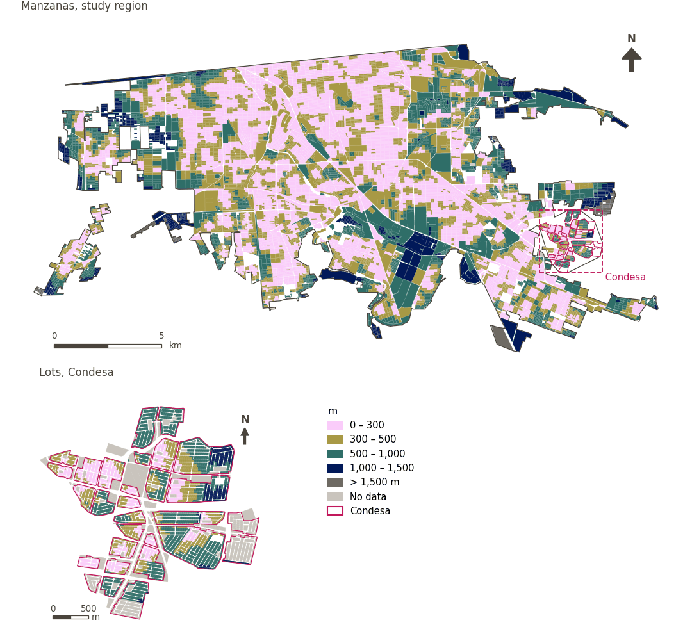

# Fresh food within 300 m

[← Back to contents](../README.md)

> Walking distance to the nearest fresh food retailer, scored with a 300 m soft threshold.

## Identity

| | |
|---|---|
| Identifier | `fresh_food` |
| Core measure (variable sheet) | Daily essential-services access |
| Sheet / register ID | 129, 11, 367 · #129, #11, #367 |
| Sample point variable | `sp_walk_nearest_node_denue_fresh_food` |
| Area variable (measured value) | `avg_walk_dist_denue_fresh_food` (m) |
| Normalised score | `index_uli__fresh_food` |
| Domains (share of weight) | [Social infrastructure](domain_social_infrastructure.md) (33%), [Mobility and transport](domain_mobility_transport.md) (33%), [Economic development](domain_economic_development.md) (33%) |
| Subdomain | Social infrastructure: Public services; Mobility and transport: Active mobility; Economic development: Food environment |
| Lens | Proximity |
| Better when | measured value lower (transformed score higher) |
| Effective weight in the index | `uli` 3.6% · `uli_plain` 3.6% |
| Status | Scored in the published index |

## Rationale and interpretation

> Local markets provide residents with access to fresh food and opportunities for economic activity and social interaction within their neighborhoods.
>
> — *Indicator register #129: Access to markets (Economic Development / Food Environment)*

- Workbook citation: Ghasemi, 2024, 'Enhancing urban livability: Analyzing Tehran through equitable land use distribution'; Yang et al., 2021, 'Spatiotemporal trends and driving factors of urban livability in the Yangtze River Delta Agglomeration'
- Article list: #16: Kashi (2025), ‘Spatial analysis and ranking of urban districts based on a comprehensive livability approach: the case of Tehran’
- ⚠ the workbook citation names no author of the listed article; verify before citing (citation_audit.csv)

> The presence of local bakeries and food services contributes to the convenience of urban life and supports the everyday functional needs of residents.
>
> — *Indicator register #11: Access to bakery (Economic Development / Food Environment)*

- Workbook citation: Ghasemi, 2024, 'Enhancing urban livability: Analyzing Tehran through equitable land use distribution'
- Article list: #16: Kashi (2025), ‘Spatial analysis and ranking of urban districts based on a comprehensive livability approach: the case of Tehran’
- ⚠ the workbook citation names no author of the listed article; verify before citing (citation_audit.csv)

> The availability of supermarkets is a indicator of the formal food environment that influences residents' ability to access varied and nutritional food options.
>
> — *Indicator register #367: Access to supermarket (Economic Development / Food Environment)*

- Workbook citation: Lowe et al., 2015, 'Planning healthy, liveable and sustainable cities: how can indicators inform policy?'
- Article list: #13: Alderton (2021), ‘Measuring and monitoring liveability in a low-to-middle income country: a proof-of-concept for Bangkok, Thailand and lessons from an international partnership’
- ⚠ the workbook citation names no author of the listed article; verify before citing (citation_audit.csv)

**How to read it.** … of the population live within 300 m of a fresh food retailer; on average the nearest is … away (lower is better).

**Access to fresh food** (Daily essential-services access; ID 129, 11, 367)
- *How to calculate (variable sheet):* Walking distance access to supermarkets, markets, bakeries, abarroterías, tortillerías, pollerías, carnicerías, fruterías, pescaderías, verdulerías. SCIAN CODE: 4611 Comercio al por menor de abarrotes y alimentos
- *Notes (sheet):* Using DENUE data

**Percentage of population with access to fresh food** (Daily essential-services access; ID 129, 11, 367)
- *How to calculate (variable sheet):* USE GHSCI CALCULATION HERE (Distance (m) along the pedestrian network to the nearest fresh food market / supermarket (source: OpenStreetMap or custom data))
- *Notes (sheet):* Use alongside—not instead of—proximity.

## Data sources

**Sources declared in the configuration:**

- INEGI (2026) Directorio Estadístico Nacional de Unidades Económicas (DENUE), May 2026.

**Source recorded by GHSCI (data dictionary)** (`avg_walk_dist_denue_fresh_food`):

- OpenStreetMap: Geofabrik GmbH, 20260815, ODbL, https://download.geofabrik.de/north-america/mexico-latest.osm.pbf, OpenStreetMap Contributors.  Geofabrik GmbH (2026). https://download.geofabrik.de/north-america/mexico-latest.osm.pbf; INEGI, Directorio Estadistico Nacional de Unidades Economicas (DENUE): 2026-05, Terminos de Libre Uso de la Informacion del INEGI, https://www.inegi.org.mx/app/mapa/denue/, INEGI (2026). Directorio Estadistico Nacional de Unidades Economicas (DENUE), mayo 2026. Instituto Nacional de Estadistica y Geografia, Mexico.

**Destination filter:**

- `denue_fresh_food` (Fresh food retail (DENUE)): `MX/INEGI/DENUE_2026/denue_inegi_02_.shp` — Destination filter: `"codigo_act IN ('461121','461122','461123','461130','461140','461150','462111','462112')"`

**Inputs:** [DENUE destinations by SCIAN code](denue_destinations.md)

## Method: theory

1. Distance along the pedestrian network from each sample point to the nearest destination, `d` (R2), censored at the largest band searched (1,500 m): a point with no destination within it has no value.
2. Soft access score (R10): `s(d) = 1 / (1 + exp(k·(d − t)/t))`, with `t = 300 m` and `k = 5`; `s = 0.5` at the threshold, ≈ 0.99 beside the destination, ≈ 0.007 at `2t`; no value → `s = 0`.
3. AMPI normalisation (R11) of `s` against the study region's goalposts, then aggregation to domains and index (R12) and to areas (R13).

## Method: practice

**Recipes:** [R1. Sample points and the pedestrian network](../03_recipes.md#r1), [R2. Network distance to the nearest destination, censored](../03_recipes.md#r2), [R10. Transforms: soft thresholds and stepped ladders](../03_recipes.md#r10), [R11. Normalisation: the Adjusted Mazziotta–Pareto Index (AMPI)](../03_recipes.md#r11), [R12. Aggregation: domains, shared indicators and the index](../03_recipes.md#r12), [R13. From sample points to areas](../03_recipes.md#r13), [R14. Frozen goalposts and recalculating a scenario](../03_recipes.md#r14)

**Configuration** ([`MX_Mexicali_2025_ULI.yml:1475`](../../data/MX_Mexicali_2025_ULI.yml#L1475)):

```yaml
- variable: sp_walk_nearest_node_denue_fresh_food
  name: fresh_food
  domains: [social_infrastructure, mobility_transport, economic_development]
  transform: {soft_threshold: 300}
  group: {es: 'Acceso a servicios esenciales cotidianos', en: 'Daily essential-services access'}
  label: {es: 'Alimentos frescos a menos de 300 m', en: 'Fresh food within 300 m'}
  reading: {es: '{access} de la población vive a menos de 300 m de un comercio de alimentos frescos; en promedio, el más cercano está a {value}', en: '{access} of the population live within 300 m of a fresh food retailer; on average the nearest is {value} away'}
  subdomain:
    social_infrastructure: {es: 'Servicios públicos', en: 'Public services'}
    mobility_transport: {es: 'Movilidad activa', en: 'Active mobility'}
    economic_development: {es: 'Ambiente de alimentación', en: 'Food environment'}
  about:
    es: Distancia a pie al comercio de alimentos frescos más cercano, puntuada con un umbral suave de 300 m.
    en: Walking distance to the nearest fresh food retailer, scored with a 300 m soft threshold.
  sources:
    - 'INEGI (2026) Directorio Estadístico Nacional de Unidades Económicas (DENUE), May 2026.'
```

[`MX_Mexicali_2025_ULI.yml:495`](../../data/MX_Mexicali_2025_ULI.yml#L495):

```yaml
- {name: denue_fresh_food, category: food_retail, variant: strict, layer: destinations, where: "dest_name = 'denue_fresh_food'"}
```

**Code (GHSCI):**

- [`process/subprocesses/_accessibility_spec.py:806`](https://github.com/healthysustainablecities/global-indicators/blob/f03909611dba336c2728fffab6d697779487d0b1/process/subprocesses/_accessibility_spec.py#L806) `_banded_distances()`
- [`process/subprocesses/setup_sp.py:888`](https://github.com/healthysustainablecities/global-indicators/blob/f03909611dba336c2728fffab6d697779487d0b1/process/subprocesses/setup_sp.py#L888) `create_full_nodes()`
- [`process/subprocesses/_composite_index.py:1457`](https://github.com/healthysustainablecities/global-indicators/blob/f03909611dba336c2728fffab6d697779487d0b1/process/subprocesses/_composite_index.py#L1457) `soft_threshold()`
- [`process/subprocesses/_composite_index.py:1819`](https://github.com/healthysustainablecities/global-indicators/blob/f03909611dba336c2728fffab6d697779487d0b1/process/subprocesses/_composite_index.py#L1819) `normalise()`
- [`process/subprocesses/_composite_index.py:1838`](https://github.com/healthysustainablecities/global-indicators/blob/f03909611dba336c2728fffab6d697779487d0b1/process/subprocesses/_composite_index.py#L1838) `mpi_aggregate()`

|  | Sample point variable | Transform | Goalposts (scale scored) | inf – sup | skew / kurt. / tied | Flags |
|---|---|---|---|---|---|---|
| `uli` | sp_walk_nearest_node_denue_fresh_food | soft access, 300 m threshold, k = 5 | −0.091 · 0.405 · 0.902 | 0.000 – 0.993 | 0.30 / −1.57 / 1.5% | none |
| `uli_plain` | sp_walk_nearest_node_denue_fresh_food | soft access, 300 m threshold, k = 5 | −0.091 · 0.405 · 0.902 | 0.000 – 0.993 | 0.30 / −1.57 / 1.5% | none |

## Recalculation (Reimagina Urbano)

A destination added or removed, or a change to the pedestrian network, changes `d` only at points whose nearest destination changes: a multi-source Dijkstra from the affected destinations, limited to 1,500 m, taking the minimum with the previous distance, suffices.

With the frozen goalposts of the parameters file (`Ref`, `Min`, `Max`, R14), a new score is `r = 100 ± 60·(x − Ref)/(Max − Min)` without re-resolving goalposts; the domain and index are recomputed by R12, less 100. A scenario is then compared with the baseline on the same scale.

## Results

| Measure | Study region (Mexicali incl. Condesa) | Condesa |
|---|---|---|
| Region value | 334 m | 539 m |
| Region score (`uli`) | +5.3 | −10.2 |
| Areas with a value | 14,120 of 14,252 manzanas | 13,265 of 14,988 lots |
| Median (P25–P75), weighted | 303 m (208 m – 431 m) | 501 m (313 m – 729 m) |
| Range | 16 m – 2,754 m | 10 m – 1,660 m |
| Nothing within the distance searched | 0.1% | 0.0% |
| Score: median (P25–P75) (`uli`) | +5.1 (−15.0 – +21.8) | −22.2 (−24.4 – +3.3) |

*Distributions: study region manzanas weighted by census population (2020); Condesa lots weighted equally (3.2 residents assumed per lot). Region values are those GHSCI reports for each region as a whole.*

*A mean distance is taken over the sample points that found a destination within the distance searched; the row "Nothing within the distance searched" gives the share of population in areas that found none.*

- Study region: 51.0% of the population live within 300 m of a fresh food retailer; on average the nearest is 334 m away.
- Condesa: 23.4% of the population live within 300 m of a fresh food retailer; on average the nearest is 539 m away.
- For the study region as a whole the value is 334 m; in Condesa, 539 m. Condesa's score lies 10.2 points below the study region average (+5.3 for the study region).

## Map



*Map. Fresh food within 300 m: measured value (m) by manzana across the study region and by lot in Condesa (inset). Dashboard classes; the favourable end is the light end (lower is better).*

## Caveats and open questions

- Bakeries and tortillerías are classified by SCIAN as manufacturing and are not in this category; they enter fresh food diversity as a sub-type (configuration).
