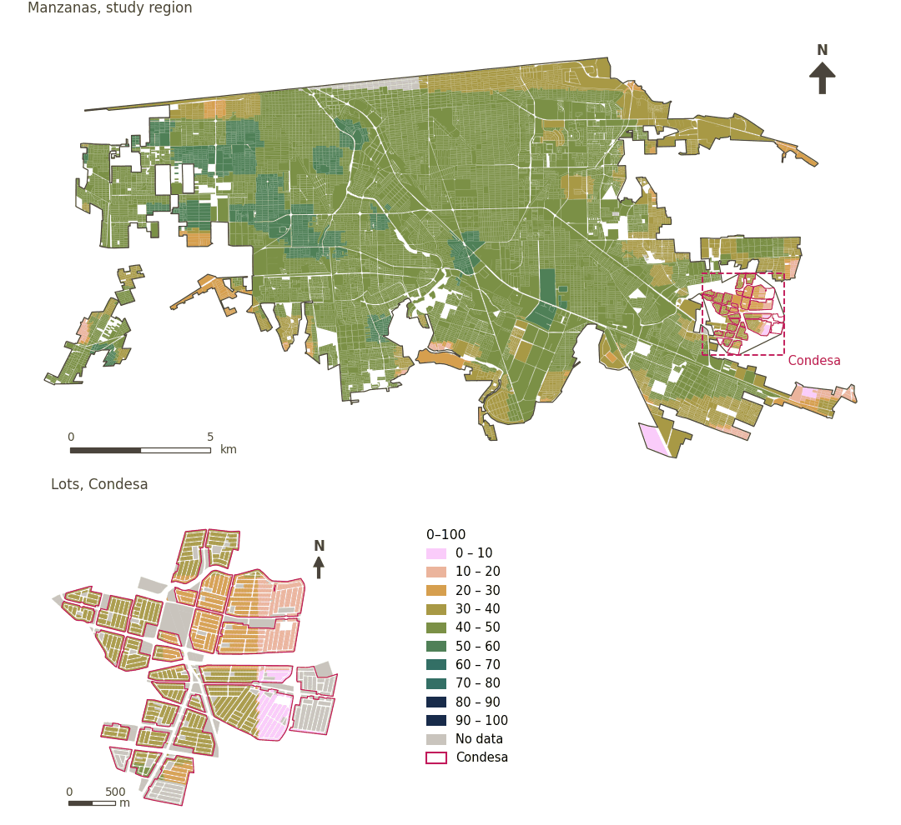

# Global Urban Heat Vulnerability Index (GUHVI) and its inputs

[← Back to contents](../README.md)

The GUHVI (Turner et al. 2025) is computed in Google Earth Engine on an analysis grid. Each input is min–max normalised to 0–100 within the region (weighted by the share of the cell that is not water); the child dependency ratio, subnational HDI and infant mortality use a fixed 0–100 range.

- **Heat exposure (HEI)**: land surface temperature (Landsat 8, over the hottest four consecutive months identified from five years of MODIS).
- **Heat sensitivity (HSI)**: equally weighted mean of inverted albedo, negated NDVI, NDBI, local climate zone, population density and vulnerable population percentage.
- **Adaptive capability (ACI)**: equally weighted mean of the child dependency ratio, subnational HDI and infant mortality rate.
- **GUHVI**: the mean of the three; the GUHVI class is quintiles 1–5.

The ULI uses the three sub-indices, not the overall GUHVI. Each sample point takes the value of the cell containing it.

| Sample point variable | Area variable (measured value) | Description | Study region (Mexicali incl. Condesa) | Condesa |
|---|---|---|---|---|
| `sp_urban_heat_exposure_index` | `urban_heat_exposure_index` | Heat Exposure Index (HEI): the heat exposure sub-index, derived from land surface temperature | 49.0 | 33.3 |
| `sp_urban_heat_sensitivity_index` | `urban_heat_sensitivity_index` | Heat Sensitivity Index (HSI): the equally weighted heat sensitivity sub-index of land surface albedo, NDVI, NDBI, local climate zone, population density and vulnerable population | 59.7 | 33.8 |
| `sp_urban_heat_adaptive_capability_index` | `urban_heat_adaptive_capability_index` | Adaptive Capability Index (ACI): the equally weighted adaptive capability sub-index of child dependency ratio, subnational Human Development Index and infant mortality rate; higher values indicate lower adaptive capability | 22.2 | 15.0 |
| `sp_urban_heat_guhvi` | `urban_heat_guhvi` | Global Urban Heat Vulnerability Index (GUHVI): the equally weighted composite of the Heat Exposure, Heat Sensitivity and Adaptive Capability indices, (HEI + HSI + ACI) / 3 | 43.6 | 27.4 |

| Variable | Description | Study region | Condesa |
|---|---|---|---|
| `urban_heat_adaptive_capability_index` | Adaptive Capability Index (ACI): the equally weighted adaptive capability sub-index of child dependency ratio, subnational Human Development Index and infant mortality rate; higher values indicate lower adaptive capability | 22.2 | 15.0 |
| `urban_heat_exposure_index` | Heat Exposure Index (HEI): the heat exposure sub-index, derived from land surface temperature | 49.0 | 33.3 |
| `urban_heat_guhvi` | Global Urban Heat Vulnerability Index (GUHVI): the equally weighted composite of the Heat Exposure, Heat Sensitivity and Adaptive Capability indices, (HEI + HSI + ACI) / 3 | 43.6 | 27.4 |
| `urban_heat_guhvi_class` | Global Urban Heat Vulnerability Index (GUHVI) class, from 1 (least vulnerable) to 5 (most vulnerable) | 3.01 | 1.02 |
| `urban_heat_sensitivity_index` | Heat Sensitivity Index (HSI): the equally weighted heat sensitivity sub-index of land surface albedo, NDVI, NDBI, local climate zone, population density and vulnerable population | 59.7 | 33.8 |

## Method: practice

**Recipes:** [R8. Earth Engine: heat vulnerability and large green space](../03_recipes.md#r8)

**Configuration** ([`MX_Mexicali_2025_ULI.yml:706`](../../data/MX_Mexicali_2025_ULI.yml#L706)):

```yaml
gee: true
```

**Code (GHSCI):**

- [`process/subprocesses/_earth_engine_indicators.py:846`](https://github.com/healthysustainablecities/global-indicators/blob/f03909611dba336c2728fffab6d697779487d0b1/process/subprocesses/_earth_engine_indicators.py#L846) `guhvi_analysis()`
- [`process/subprocesses/_earth_engine_indicators.py:1105`](https://github.com/healthysustainablecities/global-indicators/blob/f03909611dba336c2728fffab6d697779487d0b1/process/subprocesses/_earth_engine_indicators.py#L1105) `normalise_band()`

## Used by

[Heat adaptive capability (GUHVI)](adaptive_capability.md), [Heat exposure (GUHVI)](heat_exposure.md), [Heat sensitivity (GUHVI)](heat_sensitivity.md)

## Results

| Measure | Study region (Mexicali incl. Condesa) | Condesa |
|---|---|---|
| Region value | 43.6 | 27.4 |
| Areas with a value | 14,148 of 14,252 manzanas | 13,265 of 14,988 lots |
| Median (P25–P75), weighted | 46.0 (41.8 – 48.2) | 30.6 (27.0 – 33.5) |
| Range | 3.3 – 55.7 | 9.2 – 46.4 |

*Distributions: study region manzanas weighted by census population (2020); Condesa lots weighted equally (3.2 residents assumed per lot). Region values are those GHSCI reports for each region as a whole.*

## Map



*Map. Global Urban Heat Vulnerability Index (GUHVI) and its inputs: measured value (0–100) by manzana across the study region and by lot in Condesa (inset). Dashboard classes; the favourable end is the light end (lower is better).*
