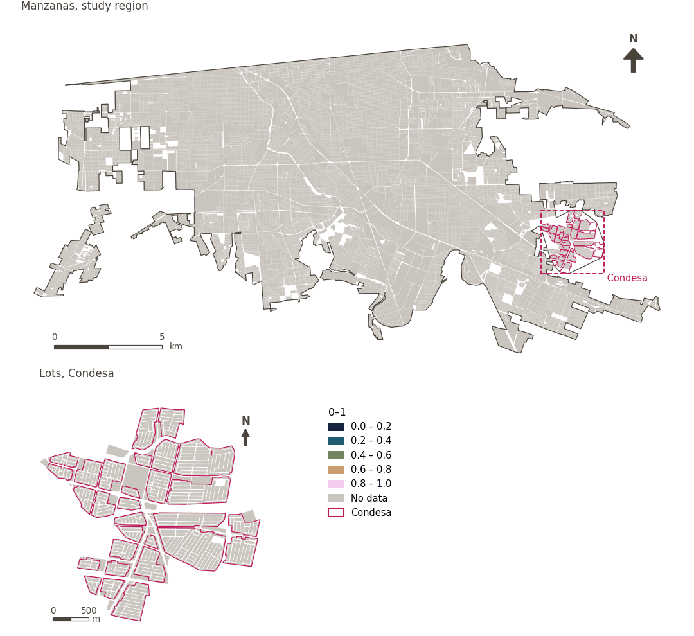

# Job diversity

[← Back to contents](../README.md)

> Diversity (0-1) of economic sectors around residential areas.

## Identity

| | |
|---|---|
| Identifier | `job_diversity` |
| Core measure (variable sheet) | Access to employment |
| Sheet / register ID | – |
| Sample point variable | `sp_ext_economic_sector_diversity` |
| Area variable (measured value) | `ext_economic_sector_diversity` (0–1) |
| Normalised score | `index_uli__job_diversity` |
| Domains (share of weight) | [Economic development](domain_economic_development.md) |
| Subdomain | Economy |
| Lens | Diversity |
| Better when | higher |
| Effective weight in the index | `uli` 5.0% · `uli_plain` 5.0% |
| Status | Scored in the published index |

## Rationale and interpretation

*Pending: Not recorded in the project register.*

**How to read it.** Mean diversity of economic sectors of … (0-1).

**Job diversity** (Access to employment; ID –)
- *How to calculate (variable sheet):* Diversity of economic sectors within a XX buffer of residential areas.
- *Doubts (sheet):* Ask Natalia about this one

## Data sources

**Sources declared in the configuration:**

- Mexicali ULI work packages (final_indicators.gpkg, 22 September 2026).

**Source recorded by GHSCI (data dictionary)** (`ext_economic_sector_diversity`):

- Work package indicators: Mexicali ULI work packages (final_indicators.gpkg; see excel_work_sheet_key.xlsx)

**Inputs:** [Work package indicators (linked)](work_package_layers.md)

## Method: theory

1. A value prepared outside GHSCI by a work package and linked to the reference areas (R7: by geometry against the reference areas).
2. Replicated to each sample point from the area containing it (`grid`, `condesa_lotes (15 m)`, `manzanas (30 m)`).
3. AMPI normalisation (R11) of the value as measured, aggregation (R12) and areas (R13).

## Method: practice

**Recipes:** [R1. Sample points and the pedestrian network](../03_recipes.md#r1), [R7. Linking externally prepared indicators](../03_recipes.md#r7), [R11. Normalisation: the Adjusted Mazziotta–Pareto Index (AMPI)](../03_recipes.md#r11), [R12. Aggregation: domains, shared indicators and the index](../03_recipes.md#r12), [R13. From sample points to areas](../03_recipes.md#r13), [R14. Frozen goalposts and recalculating a scenario](../03_recipes.md#r14)

**Configuration** ([`MX_Mexicali_2025_ULI.yml:1656`](../../data/MX_Mexicali_2025_ULI.yml#L1656)):

```yaml
- variable: sp_ext_economic_sector_diversity
  name: job_diversity
  domains: [economic_development]
  polarity: positive
  lens: diversity
  group: {es: 'Acceso al empleo', en: 'Access to employment'}
  label: {es: 'Diversidad de empleos', en: 'Job diversity'}
  reading: {es: 'Diversidad media de sectores económicos de {value} (0-1)', en: 'Mean diversity of economic sectors of {value} (0-1)'}
  subdomain: {es: 'Economía', en: 'Economy'}
  about:
    es: Diversidad (0-1) de los sectores económicos en torno a las áreas residenciales.
    en: Diversity (0-1) of economic sectors around residential areas.
  sources:
    - 'Mexicali ULI work packages (final_indicators.gpkg, 22 September 2026).'
```

**Code (GHSCI):**

- [`process/subprocesses/_linkage_indicators.py:403`](https://github.com/healthysustainablecities/global-indicators/blob/f03909611dba336c2728fffab6d697779487d0b1/process/subprocesses/_linkage_indicators.py#L403) `match_by_geometry()`
- [`process/subprocesses/_linkage_indicators.py:537`](https://github.com/healthysustainablecities/global-indicators/blob/f03909611dba336c2728fffab6d697779487d0b1/process/subprocesses/_linkage_indicators.py#L537) `sample_point_values()`
- [`process/subprocesses/_composite_index.py:1819`](https://github.com/healthysustainablecities/global-indicators/blob/f03909611dba336c2728fffab6d697779487d0b1/process/subprocesses/_composite_index.py#L1819) `normalise()`
- [`process/subprocesses/_composite_index.py:1838`](https://github.com/healthysustainablecities/global-indicators/blob/f03909611dba336c2728fffab6d697779487d0b1/process/subprocesses/_composite_index.py#L1838) `mpi_aggregate()`

|  | Sample point variable | Transform | Goalposts (scale scored) | inf – sup | skew / kurt. / tied | Flags |
|---|---|---|---|---|---|---|
| `uli` | sp_ext_economic_sector_diversity | as measured | −0.236 · 0.264 · 0.764 | 0.000 – 1.000 | 1.00 / −0.96 / 71.9% | none |
| `uli_plain` | sp_ext_economic_sector_diversity | as measured | −0.236 · 0.264 · 0.764 | 0.000 – 1.000 | 1.00 / −0.96 / 71.9% | none |

## Recalculation (Reimagina Urbano)

The value comes from an external work package: a scenario (for example, more vegetation) replaces the area's value, which is replicated to its sample points.

With the frozen goalposts of the parameters file (`Ref`, `Min`, `Max`, R14), a new score is `r = 100 ± 60·(x − Ref)/(Max − Min)` without re-resolving goalposts; the domain and index are recomputed by R12, less 100. A scenario is then compared with the baseline on the same scale.

## Results

| Measure | Study region (Mexicali incl. Condesa) | Condesa |
|---|---|---|
| Region value | 0.33 | – |
| Region score (`uli`) | +3.7 | −14.1 |
| Areas with a value | 0 of 14,252 manzanas | – |
| Median (P25–P75), weighted | – | – |
| Range | – | – |
| Score: median (P25–P75) (`uli`) | +2.1 (−13.4 – +15.1) | −15.8 (−15.8 – −15.8) |

*Distributions: study region manzanas weighted by census population (2020); Condesa lots weighted equally (3.2 residents assumed per lot). Region values are those GHSCI reports for each region as a whole.*

- Study region: Mean diversity of economic sectors of 0.33 (0-1).
- Condesa: Mean diversity of economic sectors of – (0-1).
- For the study region as a whole the value is 0.33; in Condesa, –. Condesa's score lies 14.1 points below the study region average (+3.7 for the study region).

## Map



*Map. Job diversity: measured value (0–1) by manzana across the study region and by lot in Condesa (inset). Dashboard classes; the favourable end is the light end (higher is better).*

## Caveats and open questions

- Delivered for the 100 m grid only, which tiles the city, so every sample point takes its cell's value (configuration). The sheet's buffer distance is unspecified ("XX").
