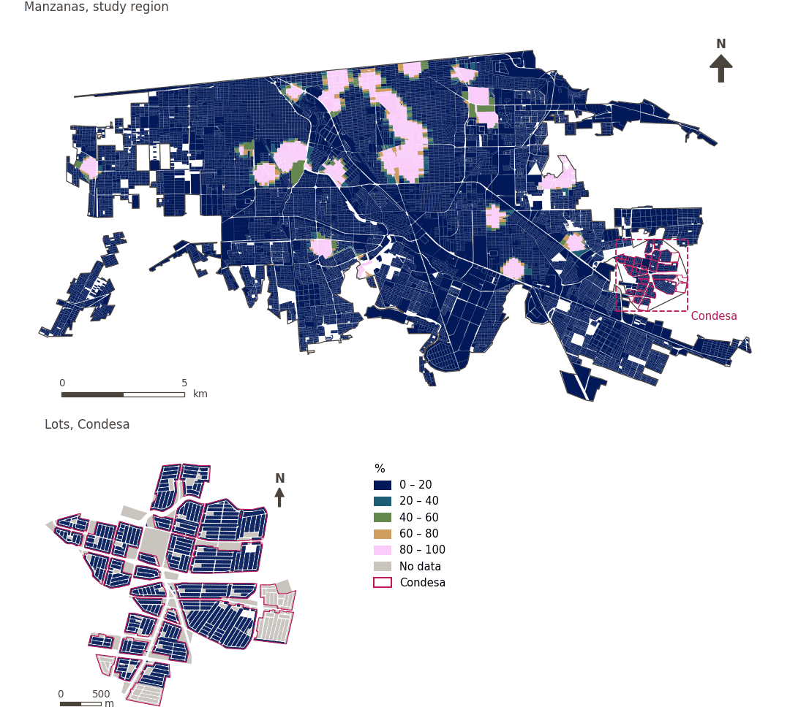

# Large public green space within 500 m

[← Back to contents](../README.md)

> Walking access within 500 m to a large public green space.

## Identity

| | |
|---|---|
| Identifier | `lpugs` |
| Core measure (variable sheet) | Large public open space accessibility |
| Sheet / register ID | 91, 187 · #91, #187 |
| Sample point variable | `sp_access_large_public_green_space_score` |
| Area variable (measured value) | `pct_access_500m_large_public_green_space_score` (%) |
| Normalised score | `index_uli__lpugs` |
| Domains (share of weight) | [Ambient environment](domain_ambient_environment.md) (50%), [Built environment](domain_built_environment.md) (50%) |
| Subdomain | Ambient environment: Ambient; Built environment: Green and blue infrastructure |
| Lens | Accessibility |
| Better when | higher |
| Effective weight in the index | `uli` 4.0% · `uli_plain` 3.8% |
| Status | Scored in the published index |

## Rationale and interpretation

> Source article not available for review.
>
> — *Indicator register #91: Access to public green space (Built Environment / Green & Blue Infrastructure)*

- Workbook citation: Not reported.

> Availability of open spaces provides urban residents with areas for comfort, enjoyment, and relaxation, directly contributing to their overall quality of life.
>
> — *Indicator register #187: Access to public open space (Built Environment / Green & Blue Infrastructure)*

- Workbook citation: Zhan et al., 2018, 'Assessment and Determinants of Satisfaction with Urban Livability in China'; Paul & Sen, 2018, 'Livability Assessment within a Metropolis Based on the Impact of Integrated Urban Geographic Factors (IUGFs) on Clustering Urban Centers of Kolkata'
- Article list: #18: Jodder (2024), ‘Urban Livability in a Rapidly Urbanizing Mid-Size City: Lessons for Planning in the Global South’
- ⚠ the workbook citation names no author of the listed article; verify before citing (citation_audit.csv)

**How to read it.** … of the population live within 500 m of a large public green space (higher is better).

**% of total land area within 500 m pedestrian network distance of LPUGS (LPUGS Accesibility)** (Large Public Open Spaces Accesibility; ID 91, 187)
- *How to calculate (variable sheet):* USE GHSCI CALCULATION HERE
- *Notes (sheet):* Exclude inaccessible/private land.
- *Doubts (sheet):* Do we want to include plazas here?

**% of population with access to LPUGS within 500 m pedestrian network distance (LPUGS Accesibility)** (Large Public Open Spaces Accesibility; ID 91, 187)
- *How to calculate (variable sheet):* USE GHSCI CALCULATION HERE
- *Notes (sheet):* Exclude inaccessible/private land.
- *Doubts (sheet):* Do we want to include plazas here?

## Data sources

**Sources declared in the configuration:**

- GHSCI large public urban green space indicator (Google Earth Engine), with OpenStreetMap public open space.

**Source recorded by GHSCI (data dictionary)** (`pct_access_500m_large_public_green_space_score`):

- OpenStreetMap: Geofabrik GmbH, 20260815, ODbL, https://download.geofabrik.de/north-america/mexico-latest.osm.pbf, OpenStreetMap Contributors.  Geofabrik GmbH (2026). https://download.geofabrik.de/north-america/mexico-latest.osm.pbf

**Inputs:** [Public open space and large public green space](public_open_space.md)

## Method: theory

1. Large public green spaces: OpenStreetMap public open spaces of at least 1 ha with annual mean NDVI ≥ 0.2 (Sentinel-2), identified in Google Earth Engine (R8).
2. Distance along the pedestrian network to the nearest entry point (R2), and binary access within 500 m (R3).
3. For areas, the percentage of points with access. AMPI normalisation (R11), aggregation (R12) and areas (R13).

## Method: practice

**Recipes:** [R1. Sample points and the pedestrian network](../03_recipes.md#r1), [R8. Earth Engine: heat vulnerability and large green space](../03_recipes.md#r8), [R2. Network distance to the nearest destination, censored](../03_recipes.md#r2), [R3. Banded access, and distance from a disamenity](../03_recipes.md#r3), [R11. Normalisation: the Adjusted Mazziotta–Pareto Index (AMPI)](../03_recipes.md#r11), [R12. Aggregation: domains, shared indicators and the index](../03_recipes.md#r12), [R13. From sample points to areas](../03_recipes.md#r13), [R14. Frozen goalposts and recalculating a scenario](../03_recipes.md#r14)

**Configuration** ([`MX_Mexicali_2025_ULI.yml:1330`](../../data/MX_Mexicali_2025_ULI.yml#L1330)):

```yaml
- variable: sp_access_large_public_green_space_score
  name: lpugs
  domains: [ambient_environment, built_environment]
  lens: accessibility
  group: {es: 'Accesibilidad a grandes espacios públicos abiertos', en: 'Large public open space accessibility'}
  label: {es: 'Gran espacio verde público a menos de 500 m', en: 'Large public green space within 500 m'}
  reading: {es: '{value} de la población vive a menos de 500 m de un gran espacio verde público', en: '{value} of the population live within 500 m of a large public green space'}
  subdomain:
    ambient_environment: {es: 'Medioambiente', en: 'Ambient'}
    built_environment: {es: 'Infraestructura verde y azul', en: 'Green and blue infrastructure'}
  about:
    es: Acceso a pie, a 500 m, a un espacio verde público grande.
    en: Walking access within 500 m to a large public green space.
  sources:
    - 'GHSCI large public urban green space indicator (Google Earth Engine), with OpenStreetMap public open space.'
```

**Code (GHSCI):**

- [`process/subprocesses/_earth_engine_indicators.py:282`](https://github.com/healthysustainablecities/global-indicators/blob/f03909611dba336c2728fffab6d697779487d0b1/process/subprocesses/_earth_engine_indicators.py#L282) `lpugs_analysis()`
- [`process/subprocesses/_earth_engine_indicators.py:664`](https://github.com/healthysustainablecities/global-indicators/blob/f03909611dba336c2728fffab6d697779487d0b1/process/subprocesses/_earth_engine_indicators.py#L664) `lpugs_indicators()`
- [`process/subprocesses/_composite_index.py:1819`](https://github.com/healthysustainablecities/global-indicators/blob/f03909611dba336c2728fffab6d697779487d0b1/process/subprocesses/_composite_index.py#L1819) `normalise()`
- [`process/subprocesses/_composite_index.py:1838`](https://github.com/healthysustainablecities/global-indicators/blob/f03909611dba336c2728fffab6d697779487d0b1/process/subprocesses/_composite_index.py#L1838) `mpi_aggregate()`

|  | Sample point variable | Transform | Goalposts (scale scored) | inf – sup | skew / kurt. / tied | Flags |
|---|---|---|---|---|---|---|
| `uli` | sp_access_large_public_green_space_score | as measured | −0.419 · 0.081 · 0.581 | 0.000 – 1.000 | 3.08 / 7.51 / 92.0% | skewed, tied |
| `uli_plain` | sp_access_large_public_green_space_score | as measured | −0.419 · 0.081 · 0.581 | 0.000 – 1.000 | 3.08 / 7.51 / 92.0% | skewed, tied |

## Recalculation (Reimagina Urbano)

A destination added or removed, or a change to the pedestrian network, changes `d` only at points whose nearest destination changes: a multi-source Dijkstra from the affected destinations, limited to 1,500 m, taking the minimum with the previous distance, suffices.

With the frozen goalposts of the parameters file (`Ref`, `Min`, `Max`, R14), a new score is `r = 100 ± 60·(x − Ref)/(Max − Min)` without re-resolving goalposts; the domain and index are recomputed by R12, less 100. A scenario is then compared with the baseline on the same scale.

## Results

| Measure | Study region (Mexicali incl. Condesa) | Condesa |
|---|---|---|
| Region value | 8.2% | 0.0% |
| Region score (`uli`) | +0.1 | −4.8 |
| Areas with a value | 14,216 of 14,252 manzanas | 13,265 of 14,988 lots |
| Median (P25–P75), weighted | 0.0% (0.0% – 0.0%) | 0.0% (0.0% – 0.0%) |
| Range | 0.0% – 100.0% | 0.0% – 0.0% |
| Score: median (P25–P75) (`uli`) | −4.8 (−4.8 – −4.8) | −4.8 (−4.8 – −4.8) |

*Distributions: study region manzanas weighted by census population (2020); Condesa lots weighted equally (3.2 residents assumed per lot). Region values are those GHSCI reports for each region as a whole.*

- Study region: 8.2% of the population live within 500 m of a large public green space.
- Condesa: 0.0% of the population live within 500 m of a large public green space.
- For the study region as a whole the value is 8.2%; in Condesa, 0.0%. Condesa's score lies 4.8 points below the study region average (+0.1 for the study region).

## Map



*Map. Large public green space within 500 m: measured value (%) by manzana across the study region and by lot in Condesa (inset). Dashboard classes; the favourable end is the light end (higher is better).*

## Caveats and open questions

- This is the accessibility sub-variable, calculated by the core GHSCI workflow. The sheet's separate availability sub-variable (the share of an area's land that is large public green space) describes an area rather than a sample point's surroundings, so it is not scored in the index as it stands (configuration). The sheet asks whether plazas should be included.
