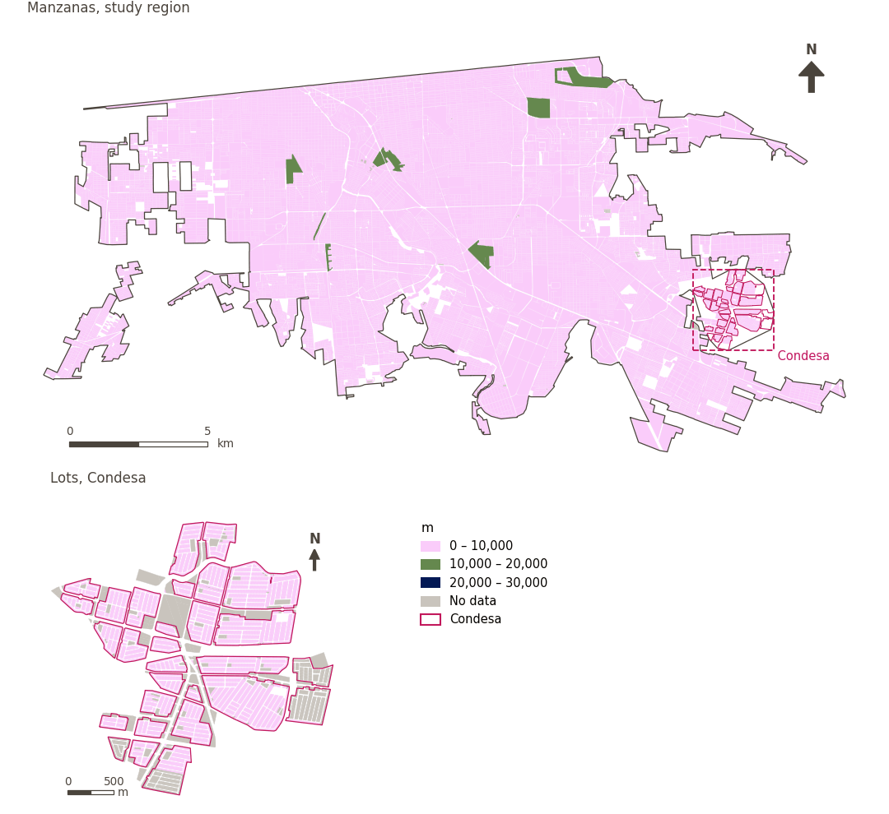

# Proximity to major roads

[← Back to contents](../README.md)

> Length of major roads within 300 m, a proxy for exposure to traffic noise, pollution and danger; lower is better.

## Identity

| | |
|---|---|
| Identifier | `major_roads` |
| Core measure (variable sheet) | Proximity to high levels of traffic |
| Sheet / register ID | 125 · #125 |
| Sample point variable | `sp_ext_major_road_length_300m` |
| Area variable (measured value) | `ext_major_road_length_300m` (m) |
| Normalised score | `index_uli__major_roads` |
| Domains (share of weight) | [Ambient environment](domain_ambient_environment.md) (50%), [Safety and protection](domain_safety.md) (50%) |
| Subdomain | Ambient environment: Ambient; Safety and protection: Road safety |
| Lens | Proximity |
| Better when | lower |
| Effective weight in the index | `uli` 5.9% · `uli_plain` 5.7% |
| Status | Scored in the published index |

## Rationale and interpretation

> Major roads are a source of air and noise pollution associated with negative health impacts
>
> — *Indicator register #125: Access to major road (Built Environment / Urban Morphology)*

- Workbook citation: Zhan et al., 2018, 'Assessment and Determinants of Satisfaction with Urban Livability in China'; Tao et al., 2015, 'Housing Choices of Migrant Workers in China: Beyond the Hukou Perspective'
- Article list: #18: Jodder (2024), ‘Urban Livability in a Rapidly Urbanizing Mid-Size City: Lessons for Planning in the Global South’
- ⚠ the workbook citation names no author of the listed article; verify before citing (citation_audit.csv)

**How to read it.** On average, … of major roads within 300 m (lower is better).

**Proximity to major roads** (Proximity to high levels of traffic; ID 125)
- *How to calculate (variable sheet):* Length of major roads within a 500m radius of each block/ageb

## Data sources

**Sources declared in the configuration:**

- Mexicali ULI work packages (final_indicators.gpkg, 22 September 2026).

**Source recorded by GHSCI (data dictionary)** (`ext_major_road_length_300m`):

- Work package indicators: Mexicali ULI work packages (final_indicators.gpkg; see excel_work_sheet_key.xlsx)

**Inputs:** [Work package indicators (linked)](work_package_layers.md)

## Method: theory

1. A value prepared outside GHSCI by a work package and linked to the reference areas (R7: by geometry against the reference areas).
2. Replicated to each sample point from the area containing it (`grid`, `condesa_lotes (15 m)`, `manzanas (30 m)`).
3. AMPI normalisation (R11) of the value as measured, aggregation (R12) and areas (R13).

## Method: practice

**Recipes:** [R1. Sample points and the pedestrian network](../03_recipes.md#r1), [R7. Linking externally prepared indicators](../03_recipes.md#r7), [R11. Normalisation: the Adjusted Mazziotta–Pareto Index (AMPI)](../03_recipes.md#r11), [R12. Aggregation: domains, shared indicators and the index](../03_recipes.md#r12), [R13. From sample points to areas](../03_recipes.md#r13), [R14. Frozen goalposts and recalculating a scenario](../03_recipes.md#r14)

**Configuration** ([`MX_Mexicali_2025_ULI.yml:1346`](../../data/MX_Mexicali_2025_ULI.yml#L1346)):

```yaml
- variable: sp_ext_major_road_length_300m
  name: major_roads
  domains: [ambient_environment, safety]
  polarity: negative
  lens: proximity
  group: {es: 'Proximidad a altos niveles de tráfico', en: 'Proximity to high levels of traffic'}
  label: {es: 'Proximidad a vialidades principales', en: 'Proximity to major roads'}
  reading: {es: 'En promedio, {value} de vialidades principales a 300 m', en: 'On average, {value} of major roads within 300 m'}
  subdomain:
    ambient_environment: {es: 'Medioambiente', en: 'Ambient'}
    safety: {es: 'Seguridad vial', en: 'Road safety'}
  about:
    es: Longitud de vialidades principales a 300 m, una aproximación a la exposición al ruido, la contaminación y el riesgo del tráfico; menor es mejor.
    en: Length of major roads within 300 m, a proxy for exposure to traffic noise, pollution and danger; lower is better.
  sources:
    - 'Mexicali ULI work packages (final_indicators.gpkg, 22 September 2026).'
```

**Code (GHSCI):**

- [`process/subprocesses/_linkage_indicators.py:403`](https://github.com/healthysustainablecities/global-indicators/blob/f03909611dba336c2728fffab6d697779487d0b1/process/subprocesses/_linkage_indicators.py#L403) `match_by_geometry()`
- [`process/subprocesses/_linkage_indicators.py:537`](https://github.com/healthysustainablecities/global-indicators/blob/f03909611dba336c2728fffab6d697779487d0b1/process/subprocesses/_linkage_indicators.py#L537) `sample_point_values()`
- [`process/subprocesses/_composite_index.py:1819`](https://github.com/healthysustainablecities/global-indicators/blob/f03909611dba336c2728fffab6d697779487d0b1/process/subprocesses/_composite_index.py#L1819) `normalise()`
- [`process/subprocesses/_composite_index.py:1838`](https://github.com/healthysustainablecities/global-indicators/blob/f03909611dba336c2728fffab6d697779487d0b1/process/subprocesses/_composite_index.py#L1838) `mpi_aggregate()`

|  | Sample point variable | Transform | Goalposts (scale scored) | inf – sup | skew / kurt. / tied | Flags |
|---|---|---|---|---|---|---|
| `uli` | sp_ext_major_road_length_300m | as measured | −2,429 · 1,756 · 5,940 | 0 – 8,368 | 0.62 / 0.16 / 20.7% | none |
| `uli_plain` | sp_ext_major_road_length_300m | as measured | −2,429 · 1,756 · 5,940 | 0 – 8,368 | 0.62 / 0.16 / 20.7% | none |

## Recalculation (Reimagina Urbano)

The value comes from an external work package: a scenario (for example, more vegetation) replaces the area's value, which is replicated to its sample points.

With the frozen goalposts of the parameters file (`Ref`, `Min`, `Max`, R14), a new score is `r = 100 ± 60·(x − Ref)/(Max − Min)` without re-resolving goalposts; the domain and index are recomputed by R12, less 100. A scenario is then compared with the baseline on the same scale.

## Results

| Measure | Study region (Mexicali incl. Condesa) | Condesa |
|---|---|---|
| Region value | 1,996 m | 414 m |
| Region score (`uli`) | −1.7 | +8.5 |
| Areas with a value | 14,200 of 14,252 manzanas | 13,265 of 14,988 lots |
| Median (P25–P75), weighted | 1,848 m (1,075 m – 2,890 m) | 0 m (0 m – 949 m) |
| Range | 0 m – 16,859 m | 0 m – 2,115 m |
| Score: median (P25–P75) (`uli`) | +0.4 (−6.5 – +5.5) | +12.6 (+3.0 – +12.6) |

*Distributions: study region manzanas weighted by census population (2020); Condesa lots weighted equally (3.2 residents assumed per lot). Region values are those GHSCI reports for each region as a whole.*

- Study region: On average, 1,996 m of major roads within 300 m.
- Condesa: On average, 414 m of major roads within 300 m.
- For the study region as a whole the value is 1,996 m; in Condesa, 414 m. Condesa's score lies 8.5 points above the study region average (−1.7 for the study region).

## Map



*Map. Proximity to major roads: measured value (m) by manzana across the study region and by lot in Condesa (inset). Dashboard classes; the favourable end is the light end (lower is better).*

## Caveats and open questions

- The sheet describes major road length within 500 m; the delivered variable is within 300 m (final_indicators.gpkg).
