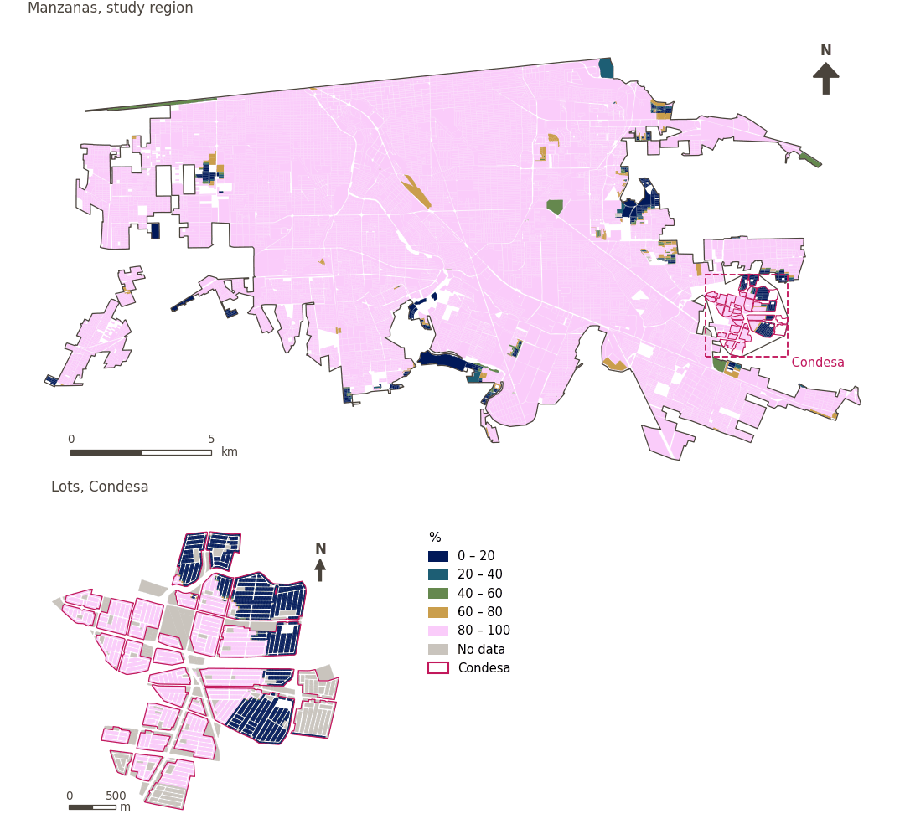

# Manufacturing within 1 km

[← Back to contents](../README.md)

> Whether a manufacturing establishment lies within a 1 km walk, as a proxy for access to employment.

## Identity

| | |
|---|---|
| Identifier | `manufacturing_1000m` |
| Core measure (variable sheet) | Access to employment |
| Sheet / register ID | 127 · #127 |
| Sample point variable | `sp_walk_access_denue_manufacturing_1000m` |
| Area variable (measured value) | `pct_access_walk_denue_manufacturing_1000m` (%) |
| Normalised score | `index_uli__manufacturing_1000m` |
| Domains (share of weight) | [Economic development](domain_economic_development.md) |
| Subdomain | Economy |
| Lens | Accessibility |
| Better when | higher |
| Effective weight in the index | `uli` 5.0% · `uli_plain` 5.0% |
| Status | Scored in the published index |

## Rationale and interpretation

> Manufacturing centres are sources of industrial hazards and pollution; restricting residential proximity ensures physical safety and protects wellbeing.
>
> — *Indicator register #127: Access to manufacturing district / centre (Economic Development / Economy)*

- Workbook citation: Onnom et al., 2018, 'Development of a Liveable City Index (LCI) using multi criteria geospatial modelling for medium class cities in developing countries'
- Article list: #20: Basu (2021), ‘Urban livability index assessment based on land-use changes in an Indian medium-sized city (Raiganj)’
- ⚠ the workbook citation names no author of the listed article; verify before citing (citation_audit.csv)

**How to read it.** … of the population live within a 1 km walk of a manufacturing establishment (higher is better).

**Access to manufacturing district/centre** (Access to employment; ID 127)
- *How to calculate (variable sheet):* Destination analysis using GHSCI tools with permutations of: distance to closest, access within threshold(s), and where applicable count per sqkm and per 1,000 persons
- *Doubts (sheet):* Should this one be split into separate sub-variables?

## Data sources

**Sources declared in the configuration:**

- INEGI (2026) Directorio Estadístico Nacional de Unidades Económicas (DENUE), May 2026.

**Source recorded by GHSCI (data dictionary)** (`pct_access_walk_denue_manufacturing_1000m`):

- OpenStreetMap: Geofabrik GmbH, 20260815, ODbL, https://download.geofabrik.de/north-america/mexico-latest.osm.pbf, OpenStreetMap Contributors.  Geofabrik GmbH (2026). https://download.geofabrik.de/north-america/mexico-latest.osm.pbf; INEGI, Directorio Estadistico Nacional de Unidades Economicas (DENUE): 2026-05, Terminos de Libre Uso de la Informacion del INEGI, https://www.inegi.org.mx/app/mapa/denue/, INEGI (2026). Directorio Estadistico Nacional de Unidades Economicas (DENUE), mayo 2026. Instituto Nacional de Estadistica y Geografia, Mexico.

**Destination filter:**

- `denue_manufacturing` (Manufacturing and industrial establishments (DENUE)): `MX/INEGI/DENUE_2026/denue_inegi_02_.shp` — Destination filter: `"codigo_act LIKE '31%' OR codigo_act LIKE '32%' OR codigo_act LIKE '33%'"`

**Inputs:** [DENUE destinations by SCIAN code](denue_destinations.md)

## Method: theory

1. Distance along the pedestrian network to the nearest destination, `d` (R2).
2. Binary access (R3): `a = 1` if `d ≤ 1,000 m`, otherwise `a = 0` (including nothing found). Binary access is used because the 1,500 m search does not extend far enough beyond 1,000 m for a soft threshold.
3. For areas, the percentage of points with access. AMPI normalisation (R11), aggregation (R12) and areas (R13).

## Method: practice

**Recipes:** [R1. Sample points and the pedestrian network](../03_recipes.md#r1), [R2. Network distance to the nearest destination, censored](../03_recipes.md#r2), [R3. Banded access, and distance from a disamenity](../03_recipes.md#r3), [R11. Normalisation: the Adjusted Mazziotta–Pareto Index (AMPI)](../03_recipes.md#r11), [R12. Aggregation: domains, shared indicators and the index](../03_recipes.md#r12), [R13. From sample points to areas](../03_recipes.md#r13), [R14. Frozen goalposts and recalculating a scenario](../03_recipes.md#r14)

**Configuration** ([`MX_Mexicali_2025_ULI.yml:1642`](../../data/MX_Mexicali_2025_ULI.yml#L1642)):

```yaml
- variable: sp_walk_access_denue_manufacturing_1000m
  name: manufacturing_1000m
  domains: [economic_development]
  group: {es: 'Acceso al empleo', en: 'Access to employment'}
  label: {es: 'Manufactura a menos de 1 km', en: 'Manufacturing within 1 km'}
  reading: {es: '{value} de la población vive a menos de 1 km a pie de un establecimiento manufacturero', en: '{value} of the population live within a 1 km walk of a manufacturing establishment'}
  subdomain: {es: 'Economía', en: 'Economy'}
  about:
    es: Si hay un establecimiento manufacturero a 1 km a pie, como aproximación al acceso al empleo.
    en: Whether a manufacturing establishment lies within a 1 km walk, as a proxy for access to employment.
  sources:
    - 'INEGI (2026) Directorio Estadístico Nacional de Unidades Económicas (DENUE), May 2026.'
```

[`MX_Mexicali_2025_ULI.yml:524`](../../data/MX_Mexicali_2025_ULI.yml#L524):

```yaml
- {name: denue_manufacturing, category: manufacturing, variant: any, layer: destinations, where: "dest_name = 'denue_manufacturing'"}
```

**Code (GHSCI):**

- [`process/subprocesses/_accessibility_spec.py:806`](https://github.com/healthysustainablecities/global-indicators/blob/f03909611dba336c2728fffab6d697779487d0b1/process/subprocesses/_accessibility_spec.py#L806) `_banded_distances()`
- [`process/subprocesses/setup_sp.py:888`](https://github.com/healthysustainablecities/global-indicators/blob/f03909611dba336c2728fffab6d697779487d0b1/process/subprocesses/setup_sp.py#L888) `create_full_nodes()`
- [`process/subprocesses/_accessibility_spec.py:1272`](https://github.com/healthysustainablecities/global-indicators/blob/f03909611dba336c2728fffab6d697779487d0b1/process/subprocesses/_accessibility_spec.py#L1272) `sample_point_access()`
- [`process/subprocesses/_composite_index.py:1819`](https://github.com/healthysustainablecities/global-indicators/blob/f03909611dba336c2728fffab6d697779487d0b1/process/subprocesses/_composite_index.py#L1819) `normalise()`
- [`process/subprocesses/_composite_index.py:1838`](https://github.com/healthysustainablecities/global-indicators/blob/f03909611dba336c2728fffab6d697779487d0b1/process/subprocesses/_composite_index.py#L1838) `mpi_aggregate()`

|  | Sample point variable | Transform | Goalposts (scale scored) | inf – sup | skew / kurt. / tied | Flags |
|---|---|---|---|---|---|---|
| `uli` | sp_walk_access_denue_manufacturing_1000m | as measured | 0.435 · 0.935 · 1.435 | 0.000 – 1.000 | −3.51 / 10.34 / 93.5% | skewed, tied |
| `uli_plain` | sp_walk_access_denue_manufacturing_1000m | as measured | 0.435 · 0.935 · 1.435 | 0.000 – 1.000 | −3.51 / 10.34 / 93.5% | skewed, tied |

## Recalculation (Reimagina Urbano)

A destination added or removed, or a change to the pedestrian network, changes `d` only at points whose nearest destination changes: a multi-source Dijkstra from the affected destinations, limited to 1,500 m, taking the minimum with the previous distance, suffices.

With the frozen goalposts of the parameters file (`Ref`, `Min`, `Max`, R14), a new score is `r = 100 ± 60·(x − Ref)/(Max − Min)` without re-resolving goalposts; the domain and index are recomputed by R12, less 100. A scenario is then compared with the baseline on the same scale.

## Results

| Measure | Study region (Mexicali incl. Condesa) | Condesa |
|---|---|---|
| Region value | 99.4% | 62.6% |
| Region score (`uli`) | +3.6 | −18.5 |
| Areas with a value | 14,216 of 14,252 manzanas | 13,265 of 14,988 lots |
| Median (P25–P75), weighted | 100.0% (100.0% – 100.0%) | 100.0% (0.0% – 100.0%) |
| Range | 0.0% – 100.0% | 0.0% – 100.0% |
| Score: median (P25–P75) (`uli`) | +3.9 (+3.9 – +3.9) | +3.9 (−56.1 – +3.9) |

*Distributions: study region manzanas weighted by census population (2020); Condesa lots weighted equally (3.2 residents assumed per lot). Region values are those GHSCI reports for each region as a whole.*

- Study region: 99.4% of the population live within a 1 km walk of a manufacturing establishment.
- Condesa: 62.6% of the population live within a 1 km walk of a manufacturing establishment.
- For the study region as a whole the value is 99.4%; in Condesa, 62.6%. Condesa's score lies 18.5 points below the study region average (+3.6 for the study region).

## Map



*Map. Manufacturing within 1 km: measured value (%) by manzana across the study region and by lot in Condesa (inset). Dashboard classes; the favourable end is the light end (higher is better).*

## Caveats and open questions

- Manufacturing is read here as a source of employment: the sheet places this sub-variable under the core measure "Access to employment", so being within reach of manufacturing counts as better. The register's rationale for the row comes from a source that treats manufacturing centres as industrial hazards; that reading is recorded above for completeness, but it is not the one the index applies.
