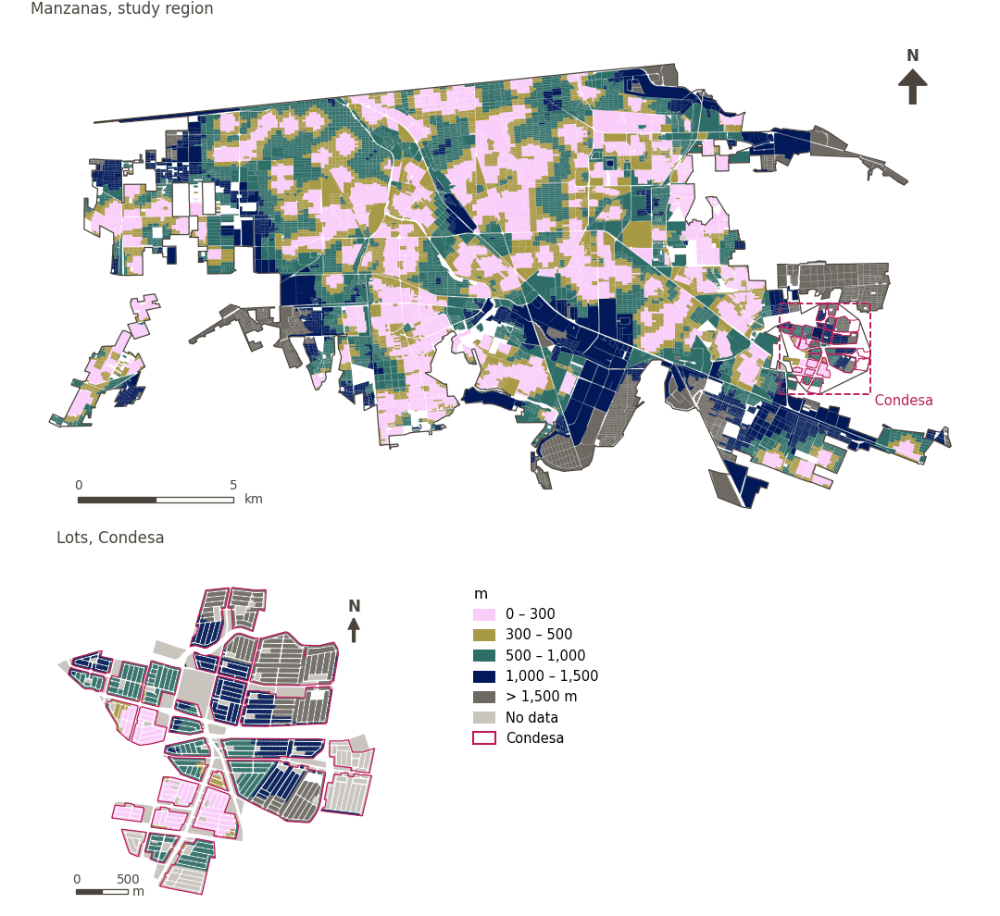

# Parks within 300 m

[← Back to contents](../README.md)

> Walking distance to the nearest public open space, scored with a 300 m soft threshold.

## Identity

| | |
|---|---|
| Identifier | `parks` |
| Core measure (variable sheet) | Access to parks |
| Sheet / register ID | 162 · #162, #187 |
| Sample point variable | `sp_walk_nearest_node_public_open_space_any` |
| Area variable (measured value) | `avg_walk_dist_public_open_space_any` (m) |
| Normalised score | `index_uli__parks` |
| Domains (share of weight) | [Ambient environment](domain_ambient_environment.md) (50%), [Built environment](domain_built_environment.md) (50%) |
| Subdomain | Ambient environment: Ambient; Built environment: Green and blue infrastructure |
| Lens | Proximity |
| Better when | measured value lower (transformed score higher) |
| Effective weight in the index | `uli` 4.0% · `uli_plain` 3.8% |
| Status | Scored in the published index |

## Rationale and interpretation

> Source article not available for review.
>
> — *Indicator register #162: Access to parks (local, neighbourhood, district, regional) (Built Environment / Green & Blue Infrastructure)*

- Workbook citation: Not reported.
- Article list: #19: Wu (2022), ‘Urban greenness, mixed land-use, and life satisfaction: Evidence from residential locations and workplace settings in Beijing’
- ⚠ the workbook citation names no author of the listed article; verify before citing (citation_audit.csv)

> Availability of open spaces provides urban residents with areas for comfort, enjoyment, and relaxation, directly contributing to their overall quality of life.
>
> — *Indicator register #187: Access to public open space (Built Environment / Green & Blue Infrastructure)*

- Workbook citation: Zhan et al., 2018, 'Assessment and Determinants of Satisfaction with Urban Livability in China'; Paul & Sen, 2018, 'Livability Assessment within a Metropolis Based on the Impact of Integrated Urban Geographic Factors (IUGFs) on Clustering Urban Centers of Kolkata'
- Article list: #18: Jodder (2024), ‘Urban Livability in a Rapidly Urbanizing Mid-Size City: Lessons for Planning in the Global South’
- ⚠ the workbook citation names no author of the listed article; verify before citing (citation_audit.csv)

**How to read it.** … of the population live within 300 m of a park or public open space; on average the nearest is … away (lower is better).

**Access to parks (local, neighbourhood, district, regional)** (Access to parks; ID 162)
- *How to calculate (variable sheet):* USE GHSCI CALCULATION HERE

**Population with access to parks** (Access to parks; ID 162)
- *How to calculate (variable sheet):* USE GHSCI CALCULATION HERE

## Data sources

**Sources declared in the configuration:**

- OpenStreetMap contributors (Geofabrik Mexico extract, 15 August 2026); public open space identified by GHSCI.

**Source recorded by GHSCI (data dictionary)** (`avg_walk_dist_public_open_space_any`):

- OpenStreetMap: Geofabrik GmbH, 20260815, ODbL, https://download.geofabrik.de/north-america/mexico-latest.osm.pbf, OpenStreetMap Contributors.  Geofabrik GmbH (2026). https://download.geofabrik.de/north-america/mexico-latest.osm.pbf

**Inputs:** [Public open space and large public green space](public_open_space.md)

## Method: theory

1. Distance along the pedestrian network from each sample point to the nearest destination, `d` (R2), censored at the largest band searched (1,500 m): a point with no destination within it has no value.
2. Soft access score (R10): `s(d) = 1 / (1 + exp(k·(d − t)/t))`, with `t = 300 m` and `k = 5`; `s = 0.5` at the threshold, ≈ 0.99 beside the destination, ≈ 0.007 at `2t`; no value → `s = 0`.
3. AMPI normalisation (R11) of `s` against the study region's goalposts, then aggregation to domains and index (R12) and to areas (R13).

## Method: practice

**Recipes:** [R1. Sample points and the pedestrian network](../03_recipes.md#r1), [R2. Network distance to the nearest destination, censored](../03_recipes.md#r2), [R10. Transforms: soft thresholds and stepped ladders](../03_recipes.md#r10), [R11. Normalisation: the Adjusted Mazziotta–Pareto Index (AMPI)](../03_recipes.md#r11), [R12. Aggregation: domains, shared indicators and the index](../03_recipes.md#r12), [R13. From sample points to areas](../03_recipes.md#r13), [R14. Frozen goalposts and recalculating a scenario](../03_recipes.md#r14)

**Configuration** ([`MX_Mexicali_2025_ULI.yml:1315`](../../data/MX_Mexicali_2025_ULI.yml#L1315)):

```yaml
- variable: sp_walk_nearest_node_public_open_space_any
  name: parks
  domains: [ambient_environment, built_environment]
  transform: {soft_threshold: 300}
  group: {es: 'Acceso a parques', en: 'Access to parks'}
  label: {es: 'Parques a menos de 300 m', en: 'Parks within 300 m'}
  reading: {es: '{access} de la población vive a menos de 300 m de un parque o espacio público abierto; en promedio, el más cercano está a {value}', en: '{access} of the population live within 300 m of a park or public open space; on average the nearest is {value} away'}
  subdomain:
    ambient_environment: {es: 'Medioambiente', en: 'Ambient'}
    built_environment: {es: 'Infraestructura verde y azul', en: 'Green and blue infrastructure'}
  about:
    es: Distancia a pie al espacio público abierto más cercano, puntuada con un umbral suave de 300 m.
    en: Walking distance to the nearest public open space, scored with a 300 m soft threshold.
  sources:
    - 'OpenStreetMap contributors (Geofabrik Mexico extract, 15 August 2026); public open space identified by GHSCI.'
```

[`MX_Mexicali_2025_ULI.yml:475`](../../data/MX_Mexicali_2025_ULI.yml#L475):

```yaml
- {name: public_open_space_any,   category: pos,  variant: lenient, layer: aos_public_any_nodes_30m_line}
```

**Code (GHSCI):**

- [`process/subprocesses/_accessibility_spec.py:806`](https://github.com/healthysustainablecities/global-indicators/blob/f03909611dba336c2728fffab6d697779487d0b1/process/subprocesses/_accessibility_spec.py#L806) `_banded_distances()`
- [`process/subprocesses/setup_sp.py:888`](https://github.com/healthysustainablecities/global-indicators/blob/f03909611dba336c2728fffab6d697779487d0b1/process/subprocesses/setup_sp.py#L888) `create_full_nodes()`
- [`process/subprocesses/_composite_index.py:1457`](https://github.com/healthysustainablecities/global-indicators/blob/f03909611dba336c2728fffab6d697779487d0b1/process/subprocesses/_composite_index.py#L1457) `soft_threshold()`
- [`process/subprocesses/_composite_index.py:1819`](https://github.com/healthysustainablecities/global-indicators/blob/f03909611dba336c2728fffab6d697779487d0b1/process/subprocesses/_composite_index.py#L1819) `normalise()`
- [`process/subprocesses/_composite_index.py:1838`](https://github.com/healthysustainablecities/global-indicators/blob/f03909611dba336c2728fffab6d697779487d0b1/process/subprocesses/_composite_index.py#L1838) `mpi_aggregate()`

|  | Sample point variable | Transform | Goalposts (scale scored) | inf – sup | skew / kurt. / tied | Flags |
|---|---|---|---|---|---|---|
| `uli` | sp_walk_nearest_node_public_open_space_any | soft access, 300 m threshold, k = 5 | −0.197 · 0.299 · 0.796 | 0.000 – 0.993 | 0.80 / −1.10 / 12.9% | none |
| `uli_plain` | sp_walk_nearest_node_public_open_space_any | soft access, 300 m threshold, k = 5 | −0.197 · 0.299 · 0.796 | 0.000 – 0.993 | 0.80 / −1.10 / 12.9% | none |

## Recalculation (Reimagina Urbano)

A destination added or removed, or a change to the pedestrian network, changes `d` only at points whose nearest destination changes: a multi-source Dijkstra from the affected destinations, limited to 1,500 m, taking the minimum with the previous distance, suffices.

With the frozen goalposts of the parameters file (`Ref`, `Min`, `Max`, R14), a new score is `r = 100 ± 60·(x − Ref)/(Max − Min)` without re-resolving goalposts; the domain and index are recomputed by R12, less 100. A scenario is then compared with the baseline on the same scale.

## Results

| Measure | Study region (Mexicali incl. Condesa) | Condesa |
|---|---|---|
| Region value | 469 m | 849 m |
| Region score (`uli`) | +3.7 | −9.9 |
| Areas with a value | 13,268 of 14,252 manzanas | 9,054 of 14,988 lots |
| Median (P25–P75), weighted | 357 m (205 m – 637 m) | 811 m (469 m – 1,309 m) |
| Range | 5 m – 2,271 m | 11 m – 2,609 m |
| Nothing within the distance searched | 5.0% | 31.7% |
| Score: median (P25–P75) (`uli`) | −1.0 (−17.9 – +27.4) | −18.1 (−18.1 – −18.0) |

*Distributions: study region manzanas weighted by census population (2020); Condesa lots weighted equally (3.2 residents assumed per lot). Region values are those GHSCI reports for each region as a whole.*

*A mean distance is taken over the sample points that found a destination within the distance searched; the row "Nothing within the distance searched" gives the share of population in areas that found none.*

- Study region: 36.9% of the population live within 300 m of a park or public open space; on average the nearest is 469 m away.
- Condesa: 14.8% of the population live within 300 m of a park or public open space; on average the nearest is 849 m away.
- For the study region as a whole the value is 469 m; in Condesa, 849 m. Condesa's score lies 9.9 points below the study region average (+3.7 for the study region).

## Map



*Map. Parks within 300 m: measured value (m) by manzana across the study region and by lot in Condesa (inset). Dashboard classes; the favourable end is the light end (lower is better).*

## Caveats and open questions

- Where the sheet pairs access with the percentage of the population with access, one indicator serves both: at a sample point they are the same measure (configuration).
