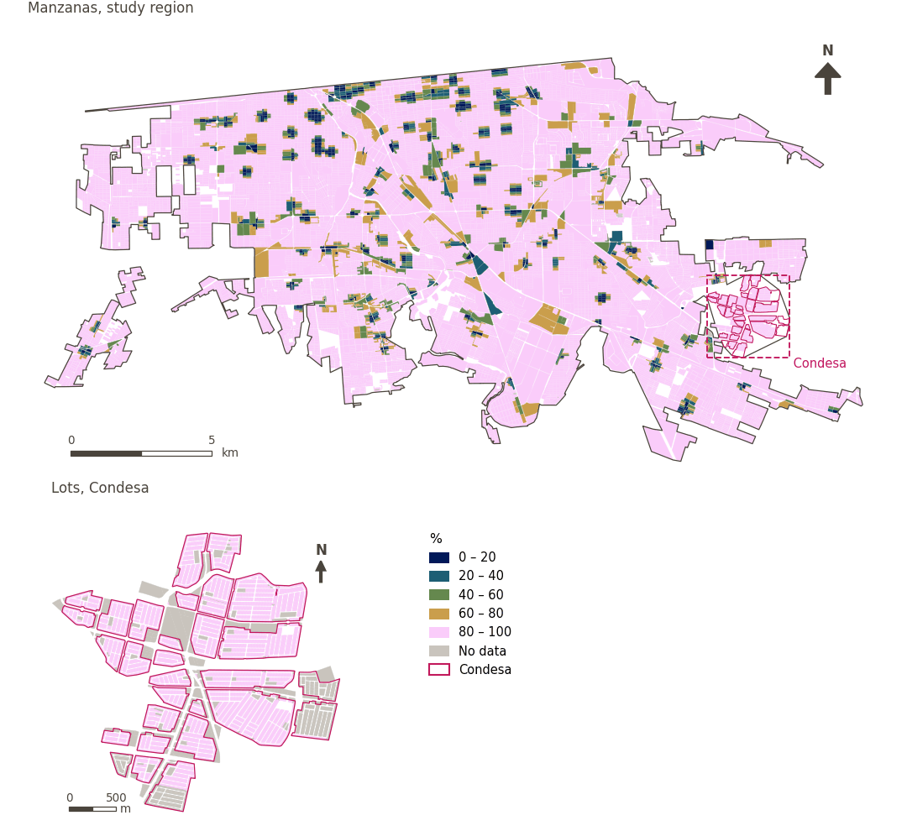

# 250 m or more from petrol stations

[← Back to contents](../README.md)

> Whether the nearest petrol station is 250 m or more away on foot (a disamenity when closer).

## Identity

| | |
|---|---|
| Identifier | `petrol_250m` |
| Core measure (variable sheet) | Daily essential-services access |
| Sheet / register ID | 169 · #169 |
| Sample point variable | `sp_walk_beyond_denue_petrol_station_250m` |
| Area variable (measured value) | `pct_beyond_walk_denue_petrol_station_250m` (%) |
| Normalised score | `index_uli__petrol_250m` |
| Domains (share of weight) | [Social infrastructure](domain_social_infrastructure.md) (33%), [Mobility and transport](domain_mobility_transport.md) (33%), [Economic development](domain_economic_development.md) (33%) |
| Subdomain | Social infrastructure: Public services; Economic development: Resources |
| Lens | Proximity |
| Better when | higher |
| Effective weight in the index | `uli` 3.6% · `uli_plain` 3.6% |
| Status | Scored in the published index |

## Rationale and interpretation

> Living at a sufficient distance from gas stations improves residents' safety by reducing the risks of fire incidents and accidents associated with hazardous fuel locations.
>
> — *Indicator register #169: Access to petrol station (>= 250m away) (Economic Development / Resources)*

- Workbook citation: Basu et al., 2021, 'Urban Livability Index Assessment Based on Land-Use Changes in an Indian Medium-Sized City (Raiganj)'
- Article list: #18: Jodder (2024), ‘Urban Livability in a Rapidly Urbanizing Mid-Size City: Lessons for Planning in the Global South’
- ⚠ the workbook citation names no author of the listed article; verify before citing (citation_audit.csv)

**How to read it.** … of the population live 250 m or more from a petrol station (higher is better).

**Access to petrol station (>= 250m away)** (Daily essential-services access; ID 169)
- *How to calculate (variable sheet):* Average distance access to petrol stations
- *Notes (sheet):* CH: the evidence for this one might be complex -- I can imagine there might be a sweet spot --- yes, you don't want to be too close (how close is that, maybe that is our indicator --- not within XXX distance m, if we can link with citable evidence.) But the reality is people do drive, and need petrol or perhaps electrical charging; living too far from one could impact some aspects of life. Lets be guided by evidence here. Here's a good basis for an indicator: Petrol station within 250m is associated with increased relative risk of childhood leukemia. Another study: https://link.springer.com/article/10.1007/s00420-021-01767-y
- *Doubts (sheet):* I am not sure these are relevant, I added them considering that most people use cars in Mexicali for their daily commute

**Percentage of population with access to petrol stations** (Daily essential-services access; ID 169)
- *How to calculate (variable sheet):* USE GHSCI CALCULATION HERE (Average distance (m) along the pedestrian network to the nearest 'denue petrol station' (custom destination) (population weighted))
- *Doubts (sheet):* I am not sure these are relevant, I added them considering that most people use cars in Mexicali for their daily commute

## Data sources

**Sources declared in the configuration:**

- INEGI (2026) Directorio Estadístico Nacional de Unidades Económicas (DENUE), May 2026.

**Source recorded by GHSCI (data dictionary)** (`pct_beyond_walk_denue_petrol_station_250m`):

- OpenStreetMap: Geofabrik GmbH, 20260815, ODbL, https://download.geofabrik.de/north-america/mexico-latest.osm.pbf, OpenStreetMap Contributors.  Geofabrik GmbH (2026). https://download.geofabrik.de/north-america/mexico-latest.osm.pbf; INEGI, Directorio Estadistico Nacional de Unidades Economicas (DENUE): 2026-05, Terminos de Libre Uso de la Informacion del INEGI, https://www.inegi.org.mx/app/mapa/denue/, INEGI (2026). Directorio Estadistico Nacional de Unidades Economicas (DENUE), mayo 2026. Instituto Nacional de Estadistica y Geografia, Mexico.

**Destination filter:**

- `denue_petrol_station` (Petrol stations (DENUE)): `MX/INEGI/DENUE_2026/denue_inegi_02_.shp` — Destination filter: `"codigo_act IN ('468411','468413')"`

**Inputs:** [DENUE destinations by SCIAN code](denue_destinations.md)

## Method: theory

1. Distance along the pedestrian network to the nearest petrol station, `d` (R2).
2. Binary distance-from indicator (R3, `direction: avoid`): `b = 1` if `d > 250 m` or none was found within the distance searched; `b = 0` if one lies within 250 m.
3. For areas, the percentage of points with `b = 1`. AMPI normalisation (R11), aggregation (R12) and areas (R13).

## Method: practice

**Recipes:** [R1. Sample points and the pedestrian network](../03_recipes.md#r1), [R2. Network distance to the nearest destination, censored](../03_recipes.md#r2), [R3. Banded access, and distance from a disamenity](../03_recipes.md#r3), [R11. Normalisation: the Adjusted Mazziotta–Pareto Index (AMPI)](../03_recipes.md#r11), [R12. Aggregation: domains, shared indicators and the index](../03_recipes.md#r12), [R13. From sample points to areas](../03_recipes.md#r13), [R14. Frozen goalposts and recalculating a scenario](../03_recipes.md#r14)

**Configuration** ([`MX_Mexicali_2025_ULI.yml:1523`](../../data/MX_Mexicali_2025_ULI.yml#L1523)):

```yaml
- variable: sp_walk_beyond_denue_petrol_station_250m
  name: petrol_250m
  domains: [social_infrastructure, mobility_transport, economic_development]
  lens: proximity
  group: {es: 'Acceso a servicios esenciales cotidianos', en: 'Daily essential-services access'}
  label: {es: 'A 250 m o más de gasolineras', en: '250 m or more from petrol stations'}
  reading: {es: '{value} de la población vive a 250 m o más de una gasolinera', en: '{value} of the population live 250 m or more from a petrol station'}
  subdomain:
    social_infrastructure: {es: 'Servicios públicos', en: 'Public services'}
    economic_development: {es: 'Recursos', en: 'Resources'}
  about:
    es: Si la gasolinera más cercana está a 250 m o más a pie (una desventaja cuando está más cerca).
    en: Whether the nearest petrol station is 250 m or more away on foot (a disamenity when closer).
  sources:
    - 'INEGI (2026) Directorio Estadístico Nacional de Unidades Económicas (DENUE), May 2026.'
```

[`MX_Mexicali_2025_ULI.yml:533`](../../data/MX_Mexicali_2025_ULI.yml#L533):

```yaml
- {name: denue_petrol_station, category: petrol_station, variant: any, layer: destinations, where: "dest_name = 'denue_petrol_station'", distances: [250], direction: avoid}
```

**Code (GHSCI):**

- [`process/subprocesses/_accessibility_spec.py:806`](https://github.com/healthysustainablecities/global-indicators/blob/f03909611dba336c2728fffab6d697779487d0b1/process/subprocesses/_accessibility_spec.py#L806) `_banded_distances()`
- [`process/subprocesses/setup_sp.py:888`](https://github.com/healthysustainablecities/global-indicators/blob/f03909611dba336c2728fffab6d697779487d0b1/process/subprocesses/setup_sp.py#L888) `create_full_nodes()`
- [`process/subprocesses/_accessibility_spec.py:1272`](https://github.com/healthysustainablecities/global-indicators/blob/f03909611dba336c2728fffab6d697779487d0b1/process/subprocesses/_accessibility_spec.py#L1272) `sample_point_access()`
- [`process/subprocesses/_composite_index.py:1819`](https://github.com/healthysustainablecities/global-indicators/blob/f03909611dba336c2728fffab6d697779487d0b1/process/subprocesses/_composite_index.py#L1819) `normalise()`
- [`process/subprocesses/_composite_index.py:1838`](https://github.com/healthysustainablecities/global-indicators/blob/f03909611dba336c2728fffab6d697779487d0b1/process/subprocesses/_composite_index.py#L1838) `mpi_aggregate()`

|  | Sample point variable | Transform | Goalposts (scale scored) | inf – sup | skew / kurt. / tied | Flags |
|---|---|---|---|---|---|---|
| `uli` | sp_walk_beyond_denue_petrol_station_250m | as measured | 0.421 · 0.921 · 1.421 | 0.000 – 1.000 | −3.13 / 7.77 / 92.1% | skewed, tied |
| `uli_plain` | sp_walk_beyond_denue_petrol_station_250m | as measured | 0.421 · 0.921 · 1.421 | 0.000 – 1.000 | −3.13 / 7.77 / 92.1% | skewed, tied |

## Recalculation (Reimagina Urbano)

A destination added or removed, or a change to the pedestrian network, changes `d` only at points whose nearest destination changes: a multi-source Dijkstra from the affected destinations, limited to 1,500 m, taking the minimum with the previous distance, suffices.

With the frozen goalposts of the parameters file (`Ref`, `Min`, `Max`, R14), a new score is `r = 100 ± 60·(x − Ref)/(Max − Min)` without re-resolving goalposts; the domain and index are recomputed by R12, less 100. A scenario is then compared with the baseline on the same scale.

## Results

| Measure | Study region (Mexicali incl. Condesa) | Condesa |
|---|---|---|
| Region value | 92.2% | 100.0% |
| Region score (`uli`) | 0.0 | +4.7 |
| Areas with a value | 14,216 of 14,252 manzanas | 13,265 of 14,988 lots |
| Median (P25–P75), weighted | 100.0% (100.0% – 100.0%) | 100.0% (100.0% – 100.0%) |
| Range | 0.0% – 100.0% | 100.0% – 100.0% |
| Score: median (P25–P75) (`uli`) | +4.7 (+4.7 – +4.7) | +4.7 (+4.7 – +4.7) |

*Distributions: study region manzanas weighted by census population (2020); Condesa lots weighted equally (3.2 residents assumed per lot). Region values are those GHSCI reports for each region as a whole.*

- Study region: 92.2% of the population live 250 m or more from a petrol station.
- Condesa: 100.0% of the population live 250 m or more from a petrol station.
- For the study region as a whole the value is 92.2%; in Condesa, 100.0%. Condesa's score lies 4.7 points above the study region average (0.0 for the study region).

## Map



*Map. 250 m or more from petrol stations: measured value (%) by manzana across the study region and by lot in Condesa (inset). Dashboard classes; the favourable end is the light end (higher is better).*

## Caveats and open questions

- The sheet's notes cite an increased relative risk of childhood leukaemia within 250 m of a petrol station, and record doubts about relevance, as most people in Mexicali drive.
