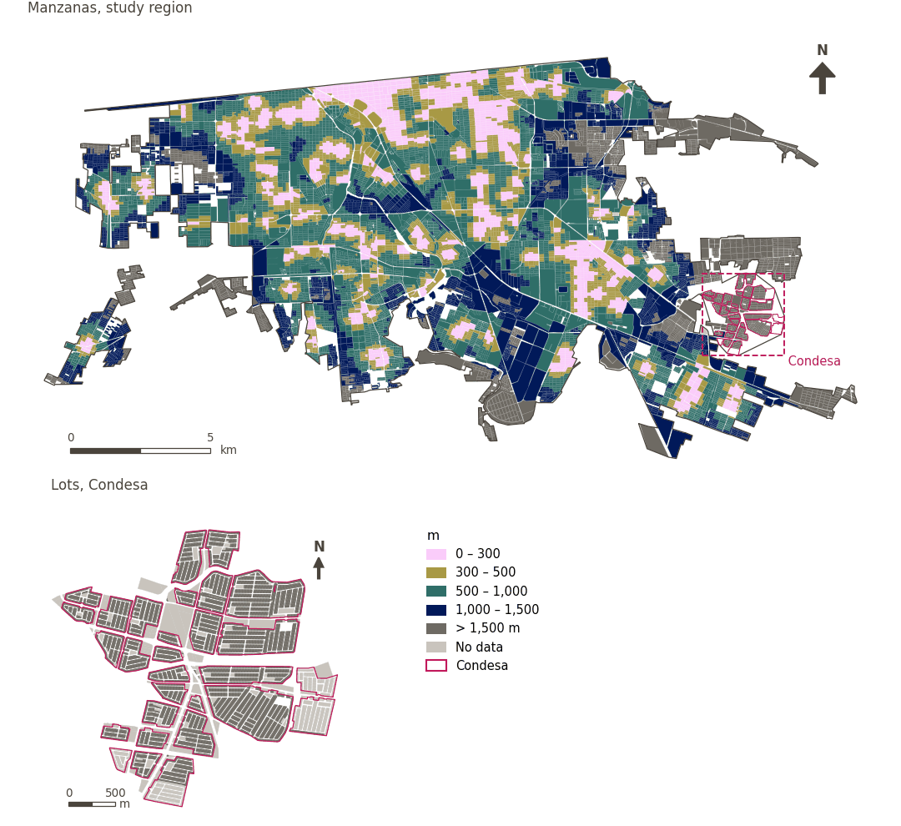

# Primary healthcare within 300 m

[← Back to contents](../README.md)

> Walking distance to the nearest primary healthcare service, scored with a 300 m soft threshold.

## Identity

| | |
|---|---|
| Identifier | `primary_healthcare` |
| Core measure (variable sheet) | Health, education and care access |
| Sheet / register ID | 97, 101, 170 · #97 |
| Sample point variable | `sp_walk_nearest_node_denue_primary_healthcare` |
| Area variable (measured value) | `avg_walk_dist_denue_primary_healthcare` (m) |
| Normalised score | `index_uli__primary_healthcare` |
| Domains (share of weight) | [Social infrastructure](domain_social_infrastructure.md) |
| Subdomain | Health and healthcare |
| Lens | Proximity |
| Better when | measured value lower (transformed score higher) |
| Effective weight in the index | `uli` 1.7% · `uli_plain` 1.7% |
| Status | Scored in the published index |

## Rationale and interpretation

> Proximity to healthcare facilities is essential for maintaining urban life quality and ensures residents have timely access to medical services.
>
> — *Indicator register #97: Access to health centres (Social Infrastructure / Health & Healthcare)*

- Workbook citation: McMichael, 2000, 'The urban environment and health in a world of increasing globalisation: issues for developing countries'
- Article list: #19: Wu (2022), ‘Urban greenness, mixed land-use, and life satisfaction: Evidence from residential locations and workplace settings in Beijing’; #20: Basu (2021), ‘Urban livability index assessment based on land-use changes in an Indian medium-sized city (Raiganj)’
- ⚠ the workbook citation names no author of the listed article; verify before citing (citation_audit.csv)

**How to read it.** … of the population live within 300 m of primary healthcare; on average the nearest is … away (lower is better).

**Access to health & health care services** (Health, education and care access; ID 97,101, 170)
- *How to calculate (variable sheet):* Walking distance access to health centers, clinics, hospitals and pharmacies.

## Data sources

**Sources declared in the configuration:**

- INEGI (2026) Directorio Estadístico Nacional de Unidades Económicas (DENUE), May 2026.

**Source recorded by GHSCI (data dictionary)** (`avg_walk_dist_denue_primary_healthcare`):

- OpenStreetMap: Geofabrik GmbH, 20260815, ODbL, https://download.geofabrik.de/north-america/mexico-latest.osm.pbf, OpenStreetMap Contributors.  Geofabrik GmbH (2026). https://download.geofabrik.de/north-america/mexico-latest.osm.pbf; INEGI, Directorio Estadistico Nacional de Unidades Economicas (DENUE): 2026-05, Terminos de Libre Uso de la Informacion del INEGI, https://www.inegi.org.mx/app/mapa/denue/, INEGI (2026). Directorio Estadistico Nacional de Unidades Economicas (DENUE), mayo 2026. Instituto Nacional de Estadistica y Geografia, Mexico.

**Destination filter:**

- `denue_primary_healthcare` (Primary healthcare (DENUE)): `MX/INEGI/DENUE_2026/denue_inegi_02_.shp` — Destination filter: `"codigo_act IN ('621111','621112','621115','621116')"`

**Inputs:** [DENUE destinations by SCIAN code](denue_destinations.md)

## Method: theory

1. Distance along the pedestrian network from each sample point to the nearest destination, `d` (R2), censored at the largest band searched (1,500 m): a point with no destination within it has no value.
2. Soft access score (R10): `s(d) = 1 / (1 + exp(k·(d − t)/t))`, with `t = 300 m` and `k = 5`; `s = 0.5` at the threshold, ≈ 0.99 beside the destination, ≈ 0.007 at `2t`; no value → `s = 0`.
3. AMPI normalisation (R11) of `s` against the study region's goalposts, then aggregation to domains and index (R12) and to areas (R13).

## Method: practice

**Recipes:** [R1. Sample points and the pedestrian network](../03_recipes.md#r1), [R2. Network distance to the nearest destination, censored](../03_recipes.md#r2), [R10. Transforms: soft thresholds and stepped ladders](../03_recipes.md#r10), [R11. Normalisation: the Adjusted Mazziotta–Pareto Index (AMPI)](../03_recipes.md#r11), [R12. Aggregation: domains, shared indicators and the index](../03_recipes.md#r12), [R13. From sample points to areas](../03_recipes.md#r13), [R14. Frozen goalposts and recalculating a scenario](../03_recipes.md#r14)

**Configuration** ([`MX_Mexicali_2025_ULI.yml:1564`](../../data/MX_Mexicali_2025_ULI.yml#L1564)):

```yaml
- variable: sp_walk_nearest_node_denue_primary_healthcare
  name: primary_healthcare
  domains: [social_infrastructure]
  transform: {soft_threshold: 300}
  group: {es: 'Acceso a salud, educación y cuidados', en: 'Health, education and care access'}
  label: {es: 'Atención primaria de salud a menos de 300 m', en: 'Primary healthcare within 300 m'}
  reading: {es: '{access} de la población vive a menos de 300 m de un servicio de atención primaria; en promedio, el más cercano está a {value}', en: '{access} of the population live within 300 m of primary healthcare; on average the nearest is {value} away'}
  subdomain: {es: 'Salud y atención sanitaria', en: 'Health and healthcare'}
  about:
    es: Distancia a pie al servicio de atención primaria más cercano, puntuada con un umbral suave de 300 m.
    en: Walking distance to the nearest primary healthcare service, scored with a 300 m soft threshold.
  sources:
    - 'INEGI (2026) Directorio Estadístico Nacional de Unidades Económicas (DENUE), May 2026.'
```

[`MX_Mexicali_2025_ULI.yml:505`](../../data/MX_Mexicali_2025_ULI.yml#L505):

```yaml
- {name: denue_primary_healthcare, category: healthcare, variant: any, layer: destinations, where: "dest_name = 'denue_primary_healthcare'"}
```

**Code (GHSCI):**

- [`process/subprocesses/_accessibility_spec.py:806`](https://github.com/healthysustainablecities/global-indicators/blob/f03909611dba336c2728fffab6d697779487d0b1/process/subprocesses/_accessibility_spec.py#L806) `_banded_distances()`
- [`process/subprocesses/setup_sp.py:888`](https://github.com/healthysustainablecities/global-indicators/blob/f03909611dba336c2728fffab6d697779487d0b1/process/subprocesses/setup_sp.py#L888) `create_full_nodes()`
- [`process/subprocesses/_composite_index.py:1457`](https://github.com/healthysustainablecities/global-indicators/blob/f03909611dba336c2728fffab6d697779487d0b1/process/subprocesses/_composite_index.py#L1457) `soft_threshold()`
- [`process/subprocesses/_composite_index.py:1819`](https://github.com/healthysustainablecities/global-indicators/blob/f03909611dba336c2728fffab6d697779487d0b1/process/subprocesses/_composite_index.py#L1819) `normalise()`
- [`process/subprocesses/_composite_index.py:1838`](https://github.com/healthysustainablecities/global-indicators/blob/f03909611dba336c2728fffab6d697779487d0b1/process/subprocesses/_composite_index.py#L1838) `mpi_aggregate()`

|  | Sample point variable | Transform | Goalposts (scale scored) | inf – sup | skew / kurt. / tied | Flags |
|---|---|---|---|---|---|---|
| `uli` | sp_walk_nearest_node_denue_primary_healthcare | soft access, 300 m threshold, k = 5 | −0.358 · 0.139 · 0.636 | 0.000 – 0.993 | 1.99 / 2.46 / 26.8% | none |
| `uli_plain` | sp_walk_nearest_node_denue_primary_healthcare | soft access, 300 m threshold, k = 5 | −0.358 · 0.139 · 0.636 | 0.000 – 0.993 | 1.99 / 2.46 / 26.8% | none |

## Recalculation (Reimagina Urbano)

A destination added or removed, or a change to the pedestrian network, changes `d` only at points whose nearest destination changes: a multi-source Dijkstra from the affected destinations, limited to 1,500 m, taking the minimum with the previous distance, suffices.

With the frozen goalposts of the parameters file (`Ref`, `Min`, `Max`, R14), a new score is `r = 100 ± 60·(x − Ref)/(Max − Min)` without re-resolving goalposts; the domain and index are recomputed by R12, less 100. A scenario is then compared with the baseline on the same scale.

## Results

| Measure | Study region (Mexicali incl. Condesa) | Condesa |
|---|---|---|
| Region value | 625 m | – |
| Region score (`uli`) | +3.2 | −8.4 |
| Areas with a value | 12,068 of 14,252 manzanas | 0 of 14,988 lots |
| Median (P25–P75), weighted | 604 m (373 m – 917 m) | – |
| Range | 42 m – 2,470 m | – |
| Nothing within the distance searched | 10.7% | 100.0% |
| Score: median (P25–P75) (`uli`) | −8.1 (−8.4 – +6.1) | −8.4 (−8.4 – −8.4) |

*Distributions: study region manzanas weighted by census population (2020); Condesa lots weighted equally (3.2 residents assumed per lot). Region values are those GHSCI reports for each region as a whole.*

*A mean distance is taken over the sample points that found a destination within the distance searched; the row "Nothing within the distance searched" gives the share of population in areas that found none.*

- Study region: 18.4% of the population live within 300 m of primary healthcare; on average the nearest is 625 m away.
- Condesa: 0.0% of the population live within 300 m of primary healthcare; on average the nearest is – away.
- For the study region as a whole the value is 625 m; in Condesa, –. Condesa's score lies 8.4 points below the study region average (+3.2 for the study region).

## Map



*Map. Primary healthcare within 300 m: measured value (m) by manzana across the study region and by lot in Condesa (inset). Dashboard classes; the favourable end is the light end (lower is better).*

## Caveats and open questions

- The ULI worksheet gives SCIAN 6221 for this row, but 6221 is general hospitals; general medical consulting rooms and clinics (6211xx) are used (configuration).
