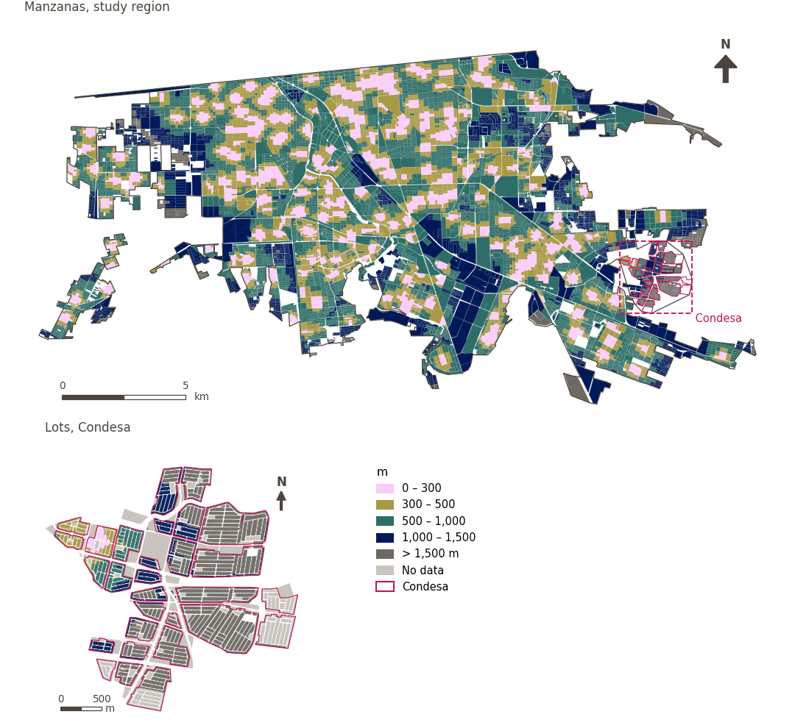

# Primary schools within 300 m

[← Back to contents](../README.md)

> Walking distance to the nearest primary school, scored with a 300 m soft threshold.

## Identity

| | |
|---|---|
| Identifier | `primary_school` |
| Core measure (variable sheet) | Health, education and care access |
| Sheet / register ID | 180, 246, 379 · #180 |
| Sample point variable | `sp_walk_nearest_node_denue_primary_school` |
| Area variable (measured value) | `avg_walk_dist_denue_primary_school` (m) |
| Normalised score | `index_uli__primary_school` |
| Domains (share of weight) | [Social infrastructure](domain_social_infrastructure.md) |
| Subdomain | Education |
| Lens | Proximity |
| Better when | measured value lower (transformed score higher) |
| Effective weight in the index | `uli` 1.7% · `uli_plain` 1.7% |
| Status | Scored in the published index |

## Rationale and interpretation

> Close proximity to primary schools supports family-oriented livability by facilitating easy and convenient access to essential basic education for young residents.
>
> — *Indicator register #180: Access to schools: primary (Social Infrastructure / Education)*

- Workbook citation: Onnom et al., 2018, 'Development of a Liveable City Index (LCI) Using Multi Criteria Geospatial Modelling for Medium Class Cities in Developing Countries'; Fu et al., 2019, 'The Livable Urban Landscape: GIS and Remote Sensing Extracted Land Use Assessment for Urban Livability in Changchun Proper, China'; Liu et al., 2020, 'Using Multi-Source Data to Assess Livability in Hong Kong at the Community-Based Level: A Combined Subjective-Objective Approach'
- Article list: #18: Jodder (2024), ‘Urban Livability in a Rapidly Urbanizing Mid-Size City: Lessons for Planning in the Global South’
- ⚠ the workbook citation names no author of the listed article; verify before citing (citation_audit.csv)

**How to read it.** … of the population live within 300 m of a primary school; on average the nearest is … away (lower is better).

**Access to educational services** (Health, education and care access; ID 180, 246, 379)
- *How to calculate (variable sheet):* Walking distance access to preeschols, primary, secondary and tertiary educaitonal centers
- *Notes (sheet):* Using DENUE data

## Data sources

**Sources declared in the configuration:**

- INEGI (2026) Directorio Estadístico Nacional de Unidades Económicas (DENUE), May 2026.

**Source recorded by GHSCI (data dictionary)** (`avg_walk_dist_denue_primary_school`):

- OpenStreetMap: Geofabrik GmbH, 20260815, ODbL, https://download.geofabrik.de/north-america/mexico-latest.osm.pbf, OpenStreetMap Contributors.  Geofabrik GmbH (2026). https://download.geofabrik.de/north-america/mexico-latest.osm.pbf; INEGI, Directorio Estadistico Nacional de Unidades Economicas (DENUE): 2026-05, Terminos de Libre Uso de la Informacion del INEGI, https://www.inegi.org.mx/app/mapa/denue/, INEGI (2026). Directorio Estadistico Nacional de Unidades Economicas (DENUE), mayo 2026. Instituto Nacional de Estadistica y Geografia, Mexico.

**Destination filter:**

- `denue_primary_school` (Primary schools (DENUE)): `MX/INEGI/DENUE_2026/denue_inegi_02_.shp` — Destination filter: `"codigo_act IN ('611121','611122','611171','611172')"`

**Inputs:** [DENUE destinations by SCIAN code](denue_destinations.md)

## Method: theory

1. Distance along the pedestrian network from each sample point to the nearest destination, `d` (R2), censored at the largest band searched (1,500 m): a point with no destination within it has no value.
2. Soft access score (R10): `s(d) = 1 / (1 + exp(k·(d − t)/t))`, with `t = 300 m` and `k = 5`; `s = 0.5` at the threshold, ≈ 0.99 beside the destination, ≈ 0.007 at `2t`; no value → `s = 0`.
3. AMPI normalisation (R11) of `s` against the study region's goalposts, then aggregation to domains and index (R12) and to areas (R13).

## Method: practice

**Recipes:** [R1. Sample points and the pedestrian network](../03_recipes.md#r1), [R2. Network distance to the nearest destination, censored](../03_recipes.md#r2), [R10. Transforms: soft thresholds and stepped ladders](../03_recipes.md#r10), [R11. Normalisation: the Adjusted Mazziotta–Pareto Index (AMPI)](../03_recipes.md#r11), [R12. Aggregation: domains, shared indicators and the index](../03_recipes.md#r12), [R13. From sample points to areas](../03_recipes.md#r13), [R14. Frozen goalposts and recalculating a scenario](../03_recipes.md#r14)

**Configuration** ([`MX_Mexicali_2025_ULI.yml:1539`](../../data/MX_Mexicali_2025_ULI.yml#L1539)):

```yaml
- variable: sp_walk_nearest_node_denue_primary_school
  name: primary_school
  domains: [social_infrastructure]
  transform: {soft_threshold: 300}
  group: {es: 'Acceso a salud, educación y cuidados', en: 'Health, education and care access'}
  label: {es: 'Escuelas primarias a menos de 300 m', en: 'Primary schools within 300 m'}
  reading: {es: '{access} de la población vive a menos de 300 m de una escuela primaria; en promedio, la más cercana está a {value}', en: '{access} of the population live within 300 m of a primary school; on average the nearest is {value} away'}
  subdomain: {es: 'Educación', en: 'Education'}
  about:
    es: Distancia a pie a la escuela primaria más cercana, puntuada con un umbral suave de 300 m.
    en: Walking distance to the nearest primary school, scored with a 300 m soft threshold.
  sources:
    - 'INEGI (2026) Directorio Estadístico Nacional de Unidades Económicas (DENUE), May 2026.'
```

[`MX_Mexicali_2025_ULI.yml:502`](../../data/MX_Mexicali_2025_ULI.yml#L502):

```yaml
- {name: denue_primary_school, category: primary_school, variant: any, layer: destinations, where: "dest_name = 'denue_primary_school'"}
```

**Code (GHSCI):**

- [`process/subprocesses/_accessibility_spec.py:806`](https://github.com/healthysustainablecities/global-indicators/blob/f03909611dba336c2728fffab6d697779487d0b1/process/subprocesses/_accessibility_spec.py#L806) `_banded_distances()`
- [`process/subprocesses/setup_sp.py:888`](https://github.com/healthysustainablecities/global-indicators/blob/f03909611dba336c2728fffab6d697779487d0b1/process/subprocesses/setup_sp.py#L888) `create_full_nodes()`
- [`process/subprocesses/_composite_index.py:1457`](https://github.com/healthysustainablecities/global-indicators/blob/f03909611dba336c2728fffab6d697779487d0b1/process/subprocesses/_composite_index.py#L1457) `soft_threshold()`
- [`process/subprocesses/_composite_index.py:1819`](https://github.com/healthysustainablecities/global-indicators/blob/f03909611dba336c2728fffab6d697779487d0b1/process/subprocesses/_composite_index.py#L1819) `normalise()`
- [`process/subprocesses/_composite_index.py:1838`](https://github.com/healthysustainablecities/global-indicators/blob/f03909611dba336c2728fffab6d697779487d0b1/process/subprocesses/_composite_index.py#L1838) `mpi_aggregate()`

|  | Sample point variable | Transform | Goalposts (scale scored) | inf – sup | skew / kurt. / tied | Flags |
|---|---|---|---|---|---|---|
| `uli` | sp_walk_nearest_node_denue_primary_school | soft access, 300 m threshold, k = 5 | −0.330 · 0.166 · 0.663 | 0.000 – 0.993 | 1.70 / 1.44 / 12.5% | none |
| `uli_plain` | sp_walk_nearest_node_denue_primary_school | soft access, 300 m threshold, k = 5 | −0.330 · 0.166 · 0.663 | 0.000 – 0.993 | 1.70 / 1.44 / 12.5% | none |

## Recalculation (Reimagina Urbano)

A destination added or removed, or a change to the pedestrian network, changes `d` only at points whose nearest destination changes: a multi-source Dijkstra from the affected destinations, limited to 1,500 m, taking the minimum with the previous distance, suffices.

With the frozen goalposts of the parameters file (`Ref`, `Min`, `Max`, R14), a new score is `r = 100 ± 60·(x − Ref)/(Max − Min)` without re-resolving goalposts; the domain and index are recomputed by R12, less 100. A scenario is then compared with the baseline on the same scale.

## Results

| Measure | Study region (Mexicali incl. Condesa) | Condesa |
|---|---|---|
| Region value | 525 m | 1,013 m |
| Region score (`uli`) | +4.6 | −8.6 |
| Areas with a value | 13,765 of 14,252 manzanas | 4,084 of 14,988 lots |
| Median (P25–P75), weighted | 500 m (341 m – 730 m) | 1,039 m (518 m – 1,462 m) |
| Range | 58 m – 2,777 m | 33 m – 3,051 m |
| Nothing within the distance searched | 1.0% | 69.2% |
| Score: median (P25–P75) (`uli`) | −6.0 (−9.9 – +13.0) | −10.1 (−10.1 – −10.1) |

*Distributions: study region manzanas weighted by census population (2020); Condesa lots weighted equally (3.2 residents assumed per lot). Region values are those GHSCI reports for each region as a whole.*

*A mean distance is taken over the sample points that found a destination within the distance searched; the row "Nothing within the distance searched" gives the share of population in areas that found none.*

- Study region: 22.9% of the population live within 300 m of a primary school; on average the nearest is 525 m away.
- Condesa: 1.9% of the population live within 300 m of a primary school; on average the nearest is 1,013 m away.
- For the study region as a whole the value is 525 m; in Condesa, 1,013 m. Condesa's score lies 8.6 points below the study region average (+4.6 for the study region).

## Map



*Map. Primary schools within 300 m: measured value (m) by manzana across the study region and by lot in Condesa (inset). Dashboard classes; the favourable end is the light end (lower is better).*

## Caveats and open questions

- Schools combining several levels (SCIAN 611171/611172) are counted in each level they serve (configuration).
