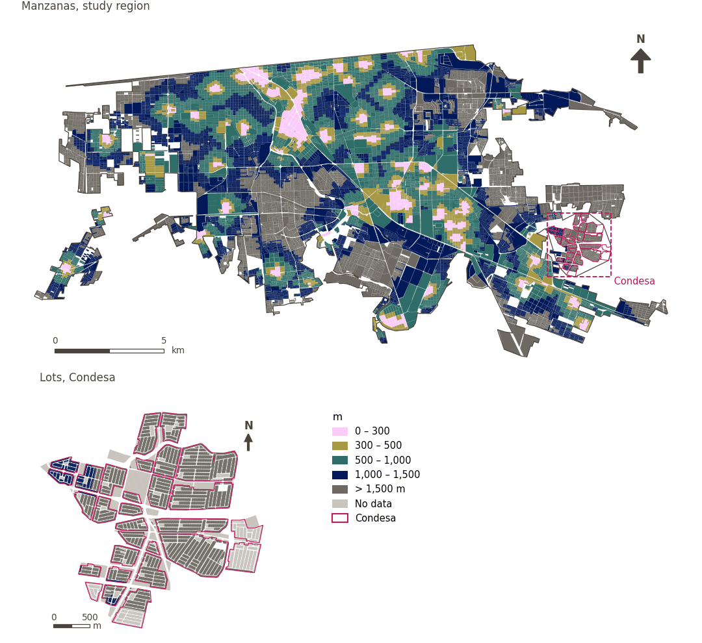

# Public transport within 300 m

[← Back to contents](../README.md)

> Walking distance to the nearest public transport stop, scored with a 300 m soft threshold.

## Identity

| | |
|---|---|
| Identifier | `public_transport` |
| Core measure (variable sheet) | Public-transport access |
| Sheet / register ID | 26 · #26, #223 |
| Sample point variable | `sp_walk_nearest_node_pt_any` |
| Area variable (measured value) | `avg_walk_dist_pt_any` (m) |
| Normalised score | `index_uli__public_transport` |
| Domains (share of weight) | [Mobility and transport](domain_mobility_transport.md) |
| Subdomain | Public transport |
| Lens | Proximity |
| Better when | measured value lower (transformed score higher) |
| Effective weight in the index | `uli` 4.2% · `uli_plain` 4.2% |
| Status | Scored in the published index |

## Rationale and interpretation

> Proximity to bus stops improves accessibility to city facilities and services, acting as a major engine of urban growth and resident liveability.
>
> — *Indicator register #26: Access to buses: stops (Mobility & Transport / Public Transport)*

- Workbook citation: Higgs et al., 2019, 'The Urban Liveability Index: developing a policy-relevant urban liveability composite measure and evaluating associations with transport mode choice'; Suptelo & Sehida, 2020, 'Factors of Post-Industrial Transformations of Urban Sociogeosystems (Case Kharkiv)'
- Article list: #5: Mahanta (2025), ‘Constructing a city liveability index and evaluating the spatial pattern of liveability of Guwahati city’
- ⚠ the workbook citation names no author of the listed article; verify before citing (citation_audit.csv)

> Extensive public transit coverage ensures equitable access to city-wide opportunities and services, reducing health inequities related to mobility.
>
> — *Indicator register #223: Access to public transport (Mobility & Transport / Public Transport)*

- Workbook citation: Kashef, 2016, 'Urban liveability across disciplinary and professional boundaries'; Cervero, 2009, 'Transport infrastructure and global competitiveness'; Bassolas et al., 2019, 'Hierarchical organization of urban mobility and its connection with city liveability'; Vuchic, 2017, 'Transportation for Livable Cities'
- Article list: #27: Alzaim (2024), ‘Integrated Framework for Enhancing Liveability and Ecological Sustainability in UAE Communities’
- ⚠ the workbook citation names no author of the listed article; verify before citing (citation_audit.csv)

**How to read it.** … of the population live within 300 m of a public transport stop; on average the nearest is … away (lower is better).

**Access to public transport stops** (Public-transport access; ID 26)
- *How to calculate (variable sheet):* USE GHSCI CALCULATION HERE

## Data sources

**Sources declared in the configuration:**

- IMIP / CFC public transport stops (suburban transport routes).

**Source recorded by GHSCI (data dictionary)** (`avg_walk_dist_pt_any`):

- OpenStreetMap: Geofabrik GmbH, 20260815, ODbL, https://download.geofabrik.de/north-america/mexico-latest.osm.pbf, OpenStreetMap Contributors.  Geofabrik GmbH (2026). https://download.geofabrik.de/north-america/mexico-latest.osm.pbf; IMIP / CFC: 2026-05-18, Provided by IMIP via CFC, As per advice from Juan Ernesto Díaz Noguez

**Destination filter:**

- `pt_any` (pt_any): `MX/CFC/cleaned/por_estado/02_baja_california/002_mexicali/imip/equipamiento_combined.fgb` — Destination filter: `"equipamiento_category='transp' AND TIPO != 'TERMINAL INTERIOR DE CARGA (CENTRAL DE SERVICIOS DE CARGA)'"`

**Inputs:** [Public transport stops](pt_stops.md)

## Method: theory

1. Distance along the pedestrian network from each sample point to the nearest destination, `d` (R2), censored at the largest band searched (1,500 m): a point with no destination within it has no value.
2. Soft access score (R10): `s(d) = 1 / (1 + exp(k·(d − t)/t))`, with `t = 300 m` and `k = 5`; `s = 0.5` at the threshold, ≈ 0.99 beside the destination, ≈ 0.007 at `2t`; no value → `s = 0`.
3. AMPI normalisation (R11) of `s` against the study region's goalposts, then aggregation to domains and index (R12) and to areas (R13).

## Method: practice

**Recipes:** [R1. Sample points and the pedestrian network](../03_recipes.md#r1), [R2. Network distance to the nearest destination, censored](../03_recipes.md#r2), [R10. Transforms: soft thresholds and stepped ladders](../03_recipes.md#r10), [R11. Normalisation: the Adjusted Mazziotta–Pareto Index (AMPI)](../03_recipes.md#r11), [R12. Aggregation: domains, shared indicators and the index](../03_recipes.md#r12), [R13. From sample points to areas](../03_recipes.md#r13), [R14. Frozen goalposts and recalculating a scenario](../03_recipes.md#r14)

**Configuration** ([`MX_Mexicali_2025_ULI.yml:1460`](../../data/MX_Mexicali_2025_ULI.yml#L1460)):

```yaml
- variable: sp_walk_nearest_node_pt_any
  name: public_transport
  domains: [mobility_transport]
  transform: {soft_threshold: 300}
  group: {es: 'Acceso al transporte público', en: 'Public-transport access'}
  label: {es: 'Transporte público a menos de 300 m', en: 'Public transport within 300 m'}
  reading: {es: '{access} de la población vive a menos de 300 m de una parada de transporte público; en promedio, la más cercana está a {value}', en: '{access} of the population live within 300 m of a public transport stop; on average the nearest is {value} away'}
  subdomain: {es: 'Transporte público', en: 'Public transport'}
  about:
    es: Distancia a pie a la parada de transporte público más cercana, puntuada con un umbral suave de 300 m.
    en: Walking distance to the nearest public transport stop, scored with a 300 m soft threshold.
  sources:
    - 'IMIP / CFC public transport stops (suburban transport routes).'
```

[`MX_Mexicali_2025_ULI.yml:492`](../../data/MX_Mexicali_2025_ULI.yml#L492):

```yaml
- {name: pt_any,                  category: pt,   variant: lenient, layer: destinations, where: "dest_name = 'pt_any'"}
```

**Code (GHSCI):**

- [`process/subprocesses/_accessibility_spec.py:806`](https://github.com/healthysustainablecities/global-indicators/blob/f03909611dba336c2728fffab6d697779487d0b1/process/subprocesses/_accessibility_spec.py#L806) `_banded_distances()`
- [`process/subprocesses/setup_sp.py:888`](https://github.com/healthysustainablecities/global-indicators/blob/f03909611dba336c2728fffab6d697779487d0b1/process/subprocesses/setup_sp.py#L888) `create_full_nodes()`
- [`process/subprocesses/_composite_index.py:1457`](https://github.com/healthysustainablecities/global-indicators/blob/f03909611dba336c2728fffab6d697779487d0b1/process/subprocesses/_composite_index.py#L1457) `soft_threshold()`
- [`process/subprocesses/_composite_index.py:1819`](https://github.com/healthysustainablecities/global-indicators/blob/f03909611dba336c2728fffab6d697779487d0b1/process/subprocesses/_composite_index.py#L1819) `normalise()`
- [`process/subprocesses/_composite_index.py:1838`](https://github.com/healthysustainablecities/global-indicators/blob/f03909611dba336c2728fffab6d697779487d0b1/process/subprocesses/_composite_index.py#L1838) `mpi_aggregate()`

|  | Sample point variable | Transform | Goalposts (scale scored) | inf – sup | skew / kurt. / tied | Flags |
|---|---|---|---|---|---|---|
| `uli` | sp_walk_nearest_node_pt_any | soft access, 300 m threshold, k = 5 | −0.433 · 0.064 · 0.561 | 0.000 – 0.993 | 3.44 / 10.89 / 41.0% | skewed |
| `uli_plain` | sp_walk_nearest_node_pt_any | soft access, 300 m threshold, k = 5 | −0.433 · 0.064 · 0.561 | 0.000 – 0.993 | 3.44 / 10.89 / 41.0% | skewed |

## Recalculation (Reimagina Urbano)

A destination added or removed, or a change to the pedestrian network, changes `d` only at points whose nearest destination changes: a multi-source Dijkstra from the affected destinations, limited to 1,500 m, taking the minimum with the previous distance, suffices.

With the frozen goalposts of the parameters file (`Ref`, `Min`, `Max`, R14), a new score is `r = 100 ± 60·(x − Ref)/(Max − Min)` without re-resolving goalposts; the domain and index are recomputed by R12, less 100. A scenario is then compared with the baseline on the same scale.

## Results

| Measure | Study region (Mexicali incl. Condesa) | Condesa |
|---|---|---|
| Region value | 882 m | 1,432 m |
| Region score (`uli`) | −0.2 | −3.9 |
| Areas with a value | 9,959 of 14,252 manzanas | 845 of 14,988 lots |
| Median (P25–P75), weighted | 926 m (610 m – 1,259 m) | 1,409 m (1,297 m – 1,540 m) |
| Range | 38 m – 3,167 m | 1,089 m – 1,962 m |
| Nothing within the distance searched | 28.5% | 93.6% |
| Score: median (P25–P75) (`uli`) | −3.9 (−3.9 – −3.8) | −3.9 (−3.9 – −3.9) |

*Distributions: study region manzanas weighted by census population (2020); Condesa lots weighted equally (3.2 residents assumed per lot). Region values are those GHSCI reports for each region as a whole.*

*A mean distance is taken over the sample points that found a destination within the distance searched; the row "Nothing within the distance searched" gives the share of population in areas that found none.*

- Study region: 5.5% of the population live within 300 m of a public transport stop; on average the nearest is 882 m away.
- Condesa: 0.0% of the population live within 300 m of a public transport stop; on average the nearest is 1,432 m away.
- For the study region as a whole the value is 882 m; in Condesa, 1,432 m. Condesa's score lies 3.9 points below the study region average (−0.2 for the study region).

## Map



*Map. Public transport within 300 m: measured value (m) by manzana across the study region and by lot in Condesa (inset). Dashboard classes; the favourable end is the light end (lower is better).*

## Caveats and open questions

- Mexicali has no GTFS feed. IMIP stops are pooled with stops identified from OpenStreetMap, so a stop present in both is counted twice in any count of stops (it does not affect distances) (configuration, points_of_interest).
