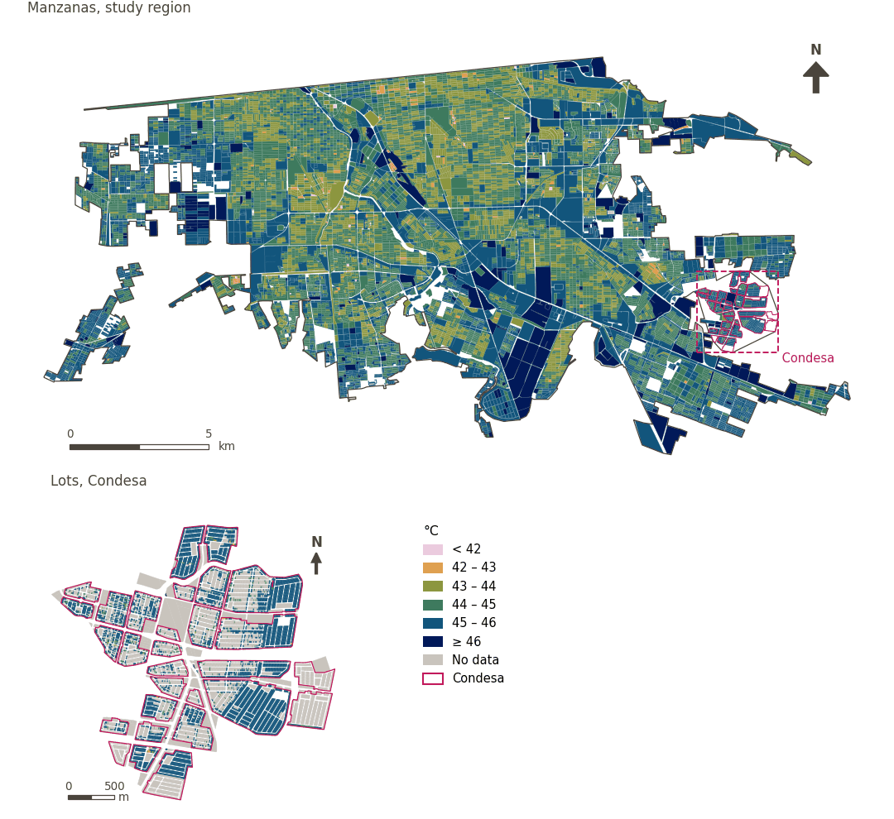

# Daytime thermal comfort

[← Back to contents](../README.md)

> Mean Universal Thermal Climate Index (UTCI) over sunlit hours on pedestrian surfaces, modelled for the hottest day of 2023; lower is better.

## Identity

| | |
|---|---|
| Identifier | `thermal_comfort` |
| Core measure (variable sheet) | Thermal comfort |
| Sheet / register ID | 371, 337 · #371, #337, #372 |
| Sample point variable | `sp_utci_day_mean` |
| Area variable (measured value) | `utci_day_mean` (°C) |
| Score (unattenuated variant) | `index_uli_plain__thermal_comfort` |
| Domains (share of weight) | [Ambient environment](domain_ambient_environment.md) |
| Subdomain | Ambient |
| Lens | Quality |
| Better when | lower |
| Effective weight in the index | `uli_plain` 2.4% |
| Status | Listed but not scored in the published index: Included through walkability's thermal comfort attenuation. Choose walkability without attenuation to score it here. |

## Rationale and interpretation

> Maintaining urban temperatures within a comfortable range is vital for physical health and preventing heat-related illnesses and thermal discomfort.
>
> — *Indicator register #371: Temperature (Ambient Environment / Ambient)*

- Workbook citation: Kashi et al., 2024, 'Effects of extreme weather events and climate change on cities’ livability'; Alijani et al., 2020, 'A new approach of urban livability in Tehran: Thermal comfort as a primitive indicator'
- Article list: #16: Kashi (2025), ‘Spatial analysis and ranking of urban districts based on a comprehensive livability approach: the case of Tehran’

> Appropriate humidity levels are necessary for human thermal comfort and can affect respiratory health and the perceived quality of the urban environment.
>
> — *Indicator register #337: Humidity (Ambient Environment / Ambient)*

- Workbook citation: Kashi et al., 2024, 'Effects of extreme weather events and climate change on cities’ livability'; Liang and Li, 2020, 'Resilience and sustainable development goals based social-ecological indicators and assessment of coastal urban areas'
- Article list: #16: Kashi (2025), ‘Spatial analysis and ranking of urban districts based on a comprehensive livability approach: the case of Tehran’

> The difference from optimal temperature in July indicates thermal comfort; excessive summer heat is linked to physiological stress and reduced outdoor activity.
>
> — *Indicator register #372: The difference between the average temperature in July and the optimal temperature for human body (Ambient Environment / Ambient)*

- Workbook citation: Zhan et al., 2018, 'Assessment and determinants of satisfaction with urban livability in China'; Cao et al., 2019, 'The framework of relationship between built environment and residents healthy based on activity perspective'
- Article list: #17: Wang (2023), ‘The impact of economic development on urban livability: Evidence from 40 large and medium-sized cities of China’
- ⚠ the workbook citation names no author of the listed article; verify before citing (citation_audit.csv)

**How to read it.** Mean daytime UTCI of … on pedestrian surfaces on the hottest day of 2023 (lower is better).

**Dry bulb air temperature** (Thermal Comfort; ID 371)
- *Doubts (sheet):* Rossano, please review according to what is needed by PyThermal comfort (https://pythermalcomfort.readthedocs.io/en/latest/documentation/models.html#universal-thermal-climate-index-utci)

**Mean radiant temperature** (Thermal Comfort; ID 371)

**Wind speed 10m above ground level** (Thermal Comfort; ID –)

**Relative humidity** (Thermal Comfort; ID 337)
- *Notes (sheet):* Could we also calculate it as "The difference between the relative humidity in the hottest month of the year and the optimum humidity for human body"?

## Data sources

**Sources declared in the configuration:**

- Rossano Schifanella (WP02): SOLWEIG, forced by Mexicali airport observations for 21 July 2023; UTCI operational polynomial (Bröde et al. 2012).

**Source recorded by GHSCI (data dictionary)** (`utci_day_mean`):

- Outdoor thermal comfort (UTCI): Rossano Schifanella (WP02); SOLWEIG and the UTCI operational polynomial (Bröde et al. 2012), Terrain from FABDEM v1 (CC BY-NC-SA 4.0, non-commercial); other inputs CC BY 4.0 or public domain

**Inputs:** [Outdoor thermal comfort (UTCI)](utci.md)

## Method: theory

1. Daytime mean UTCI (Universal Thermal Climate Index), modelled with SOLWEIG for 21 July 2023 over pedestrian surfaces and summarised by area (work package 2); units with fewer than 100 pedestrian pixels are masked (R7).
2. Replicated to each sample point from its 100 m cell.
3. In the published index it enters only through walkability's attenuation (R9). In `uli_plain` it is normalised (R11, lower is better) and aggregated (R12, R13).

*This indicator is not scored in the published index; the unattenuated variant (uli_plain) scores it.*

## Method: practice

**Recipes:** [R1. Sample points and the pedestrian network](../03_recipes.md#r1), [R7. Linking externally prepared indicators](../03_recipes.md#r7), [R9. Walkability, and its attenuation by thermal comfort](../03_recipes.md#r9), [R11. Normalisation: the Adjusted Mazziotta–Pareto Index (AMPI)](../03_recipes.md#r11), [R12. Aggregation: domains, shared indicators and the index](../03_recipes.md#r12), [R13. From sample points to areas](../03_recipes.md#r13), [R14. Frozen goalposts and recalculating a scenario](../03_recipes.md#r14)

**Configuration** ([`MX_Mexicali_2025_ULI.yml:1264`](../../data/MX_Mexicali_2025_ULI.yml#L1264)):

```yaml
- variable: sp_utci_day_mean
  name: thermal_comfort
  domains: [ambient_environment]
  polarity: negative
  lens: quality
  active: false
  inactive_reason:
    es: Incluido mediante la atenuación de la caminabilidad por confort térmico. Elija la caminabilidad sin atenuación para puntuarlo aquí.
    en: Included through walkability's thermal comfort attenuation. Choose walkability without attenuation to score it here.
  group: {es: 'Confort térmico', en: 'Thermal comfort'}
  label: {es: 'Confort térmico diurno', en: 'Daytime thermal comfort'}
  reading: {es: 'UTCI diurno medio de {value} en superficies peatonales en el día más caluroso de 2023', en: 'Mean daytime UTCI of {value} on pedestrian surfaces on the hottest day of 2023'}
  subdomain: {es: 'Medioambiente', en: 'Ambient'}
  about:
    es: Índice Universal de Clima Térmico (UTCI) medio durante las horas de sol en superficies peatonales, modelado para el día más caluroso de 2023; menor es mejor.
    en: Mean Universal Thermal Climate Index (UTCI) over sunlit hours on pedestrian surfaces, modelled for the hottest day of 2023; lower is better.
  sources:
    - 'Rossano Schifanella (WP02): SOLWEIG, forced by Mexicali airport observations for 21 July 2023; UTCI operational polynomial (Bröde et al. 2012).'
```

**Code (GHSCI):**

- [`process/subprocesses/_linkage_indicators.py:512`](https://github.com/healthysustainablecities/global-indicators/blob/f03909611dba336c2728fffab6d697779487d0b1/process/subprocesses/_linkage_indicators.py#L512) `apply_rules()`
- [`process/subprocesses/_linkage_indicators.py:537`](https://github.com/healthysustainablecities/global-indicators/blob/f03909611dba336c2728fffab6d697779487d0b1/process/subprocesses/_linkage_indicators.py#L537) `sample_point_values()`
- [`process/subprocesses/_composite_index.py:1819`](https://github.com/healthysustainablecities/global-indicators/blob/f03909611dba336c2728fffab6d697779487d0b1/process/subprocesses/_composite_index.py#L1819) `normalise()`
- [`process/subprocesses/_composite_index.py:1838`](https://github.com/healthysustainablecities/global-indicators/blob/f03909611dba336c2728fffab6d697779487d0b1/process/subprocesses/_composite_index.py#L1838) `mpi_aggregate()`

|  | Sample point variable | Transform | Goalposts (scale scored) | inf – sup | skew / kurt. / tied | Flags |
|---|---|---|---|---|---|---|
| `uli_plain` | sp_utci_day_mean | as measured | 41.938 · 44.949 · 47.960 | 40.831 – 46.853 | −0.16 / −0.39 / 0.2% | none |

## Recalculation (Reimagina Urbano)

The value comes from an external work package: a scenario (for example, more vegetation) replaces the area's value, which is replicated to its sample points.

With the frozen goalposts of the parameters file (`Ref`, `Min`, `Max`, R14), a new score is `r = 100 ± 60·(x − Ref)/(Max − Min)` without re-resolving goalposts; the domain and index are recomputed by R12, less 100. A scenario is then compared with the baseline on the same scale.

## Results

| Measure | Study region (Mexicali incl. Condesa) | Condesa |
|---|---|---|
| Region value | 45.1 °C | 45.5 °C |
| Region score (`uli_plain`) | +3.8 | −5.6 |
| Areas with a value | 14,200 of 14,252 manzanas | 7,766 of 14,988 lots |
| Median (P25–P75), weighted | 44.3 °C (43.9 °C – 44.8 °C) | 45.9 °C (45.6 °C – 46.0 °C) |
| Range | 40.4 °C – 46.7 °C | 40.4 °C – 46.4 °C |
| Score: median (P25–P75) (`uli_plain`) | +3.3 (−0.4 – +6.2) | −5.9 (−8.3 – −3.4) |

*Distributions: study region manzanas weighted by census population (2020); Condesa lots weighted equally (3.2 residents assumed per lot). Region values are those GHSCI reports for each region as a whole.*

- Study region: Mean daytime UTCI of 45.1 °C on pedestrian surfaces on the hottest day of 2023.
- Condesa: Mean daytime UTCI of 45.5 °C on pedestrian surfaces on the hottest day of 2023.
- For the study region as a whole the value is 45.1 °C; in Condesa, 45.5 °C. Condesa's score lies 5.6 points below the study region average (+3.8 for the study region).

## Map



*Map. Daytime thermal comfort: measured value (°C) by manzana across the study region and by lot in Condesa (inset). Dashboard classes; the favourable end is the light end (lower is better).*

## Caveats and open questions

- Air temperature, humidity and wind are spatially uniform in the model, so only radiant temperature (sun and shade) varies across the city; most values exceed the UTCI polynomial's fitted range; comparisons within a neighbourhood are sound where rankings of neighbourhoods kilometres apart are not (configuration, linkage_indicators.utci; README_mexicali_utci.md).
- Only daytime thermal comfort is used: night-time UTCI varies by fractions of a degree across the city (30.3–30.6 °C) (configuration).
