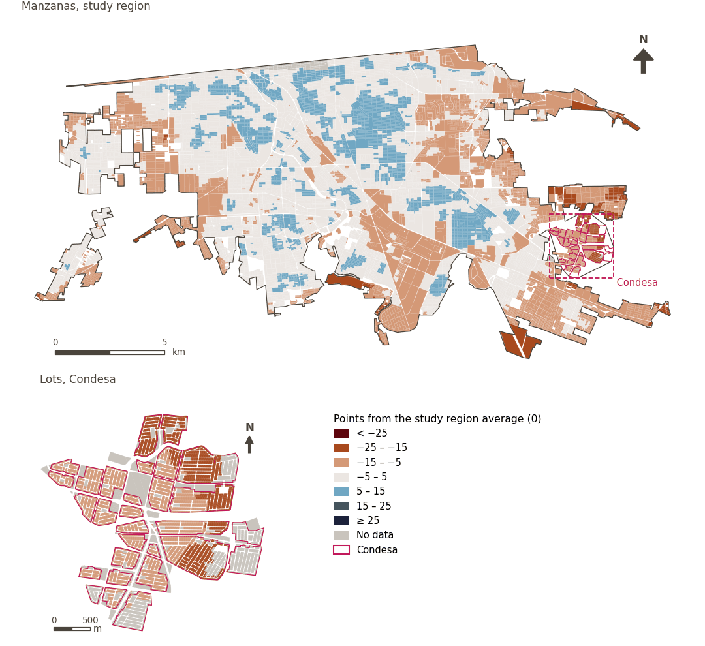

# Mexicali Urban Liveability Index

[← Back to contents](../README.md)

> Average of the Mexicali Urban Liveability Index's domain scores, each summarising its normalised sub-indicators, less a penalty for variation across domains that rewards balanced performance. Expressed as points above or below the study region average (0).

The Urban Liveability Index draws on the Adjusted Mazziotta-Pareto Index (AMPI): each sub-indicator is re-scaled so that 0 is the study region average (its mean over all sample points), and scores are points above or below it. Each domain is the weighted mean of its sub-indicators less a penalty for imbalance between them, and the index is likewise the mean of the domains less a penalty for imbalance between domains. A sub-indicator bearing on several domains counts an equal share of its weight in each (a third in each of three), so that in all it weighs no more than one in a single domain. Scored at sample points along the pedestrian network, and averaged to grid cells and, weighted by population, to larger areas.

The published index: walkability enters attenuated by daytime thermal comfort (`sp_walk_idx_300_tm`), and thermal comfort is not scored separately. See also the variant [Mexicali Urban Liveability Index: Walkability (300 m), without thermal comfort attenuation](uli_plain.md).

## Domains

| Domains | n | Region score: Study region (Mexicali incl. Condesa) | Condesa |
|---|---|---|---|
| [Ambient environment](domain_ambient_environment.md) | 8 | −2.6 | +2.3 |
| [Built environment](domain_built_environment.md) | 8 | +2.0 | −17.8 |
| [Economic development](domain_economic_development.md) | 6 | +1.9 | −14.8 |
| [Housing](domain_housing.md) | – | – | – |
| [Mobility and transport](domain_mobility_transport.md) | 10 | +2.4 | −15.4 |
| [Safety and protection](domain_safety.md) | 5 | +2.2 | −20.7 |
| [Social infrastructure](domain_social_infrastructure.md) | 13 | +2.4 | −12.1 |
| [Sociodemographic characteristics](domain_sociodemographics.md) | – | – | – |

## Method: theory

```text
r_i      = 100 ± 60 · (x_i − Ref_i) / (Max_i − Min_i)                 (R11)
domain_d = M_d − S_d · (S_d / M_d),  w_i ∝ weight_i · share_{i,d}       (R12)
index    = M − S · (S / M)  over the six scored domains, equal weights
reported = index − 100   (0 = study region average)
```

**Recipes:** [R10. Transforms: soft thresholds and stepped ladders](../03_recipes.md#r10), [R11. Normalisation: the Adjusted Mazziotta–Pareto Index (AMPI)](../03_recipes.md#r11), [R12. Aggregation: domains, shared indicators and the index](../03_recipes.md#r12), [R13. From sample points to areas](../03_recipes.md#r13), [R14. Frozen goalposts and recalculating a scenario](../03_recipes.md#r14)

## Method: practice

**Configuration:** [`MX_Mexicali_2025_ULI.yml:1019`](../../data/MX_Mexicali_2025_ULI.yml#L1019); [`MX_Mexicali_2025_ULI_composite_uli_parameters.yml`](../../data/MX_Mexicali_2025_ULI_composite_uli_parameters.yml)

**Code (GHSCI):** [`process/subprocesses/_composite_index.py:1602`](https://github.com/healthysustainablecities/global-indicators/blob/f03909611dba336c2728fffab6d697779487d0b1/process/subprocesses/_composite_index.py#L1602) `resolve_parameters()`, [`process/subprocesses/_composite_index.py:1874`](https://github.com/healthysustainablecities/global-indicators/blob/f03909611dba336c2728fffab6d697779487d0b1/process/subprocesses/_composite_index.py#L1874) `score()`, [`process/subprocesses/_composite_index.py:1838`](https://github.com/healthysustainablecities/global-indicators/blob/f03909611dba336c2728fffab6d697779487d0b1/process/subprocesses/_composite_index.py#L1838) `mpi_aggregate()`, [`process/subprocesses/_composite_index.py:2062`](https://github.com/healthysustainablecities/global-indicators/blob/f03909611dba336c2728fffab6d697779487d0b1/process/subprocesses/_composite_index.py#L2062) `propagate()`

## Recalculation (Reimagina Urbano)

With the frozen goalposts of the parameters file (`Ref`, `Min`, `Max`, R14), a new score is `r = 100 ± 60·(x − Ref)/(Max − Min)` without re-resolving goalposts; the domain and index are recomputed by R12, less 100. A scenario is then compared with the baseline on the same scale.

[R14. Frozen goalposts and recalculating a scenario](../03_recipes.md#r14)

## Results

| Measure | Study region (Mexicali incl. Condesa) | Condesa |
|---|---|---|
| Region score (`uli`) | +1.0 | −13.8 |
| Region score (`uli_mean`) | +1.4 | −12.9 |
| Region score (`uli_penalty`) | 0.39 | 0.96 |
| Areas with a value | 14,145 of 14,252 manzanas | 12,186 of 14,988 lots |
| Median (P25–P75), weighted | +0.9 (−3.1 – +4.1) | −12.6 (−17.8 – −11.1) |
| Range | −20.3 – +14.9 | −20.7 – −3.7 |

*Distributions: study region manzanas weighted by census population (2020); Condesa lots weighted equally (3.2 residents assumed per lot). Region values are those GHSCI reports for each region as a whole.*

- The study region (Mexicali with Condesa) scores +1.0, and Condesa −13.8: 13.8 points below the study region average. The penalty measures imbalance between domains (`_penalty`, not centred).

## Map



*Map. Mexicali Urban Liveability Index: score by manzana across the study region and by lot in Condesa (inset), in points from the study region average (0); blue is better.*

## Sources declared in the configuration

- Mazziotta, M. & Pareto, A. (2018) Measuring well-being over time: the Adjusted Mazziotta-Pareto Index versus other non-compensatory indices. Social Indicators Research 136, 967-976.
- Mazziotta, M. & Pareto, A. (2022) Weighted composite indices: the case of the Mazziotta-Pareto Index. Rivista Italiana di Economia Demografia e Statistica 76(4), 17-26.
- Higgs, C. et al. (2019) The Urban Liveability Index: developing a policy-relevant urban liveability composite measure and evaluating associations with transport mode choice. International Journal of Health Geographics 18, 14.
- OECD & JRC (2008) Handbook on Constructing Composite Indicators: Methodology and User Guide. OECD Publishing, Paris.
- Population: GHS-POP R2023A (JRC) and INEGI Censo 2020; Condesa lots at an assumed 3.2 residents each.

## Caveats and open questions

- The index is provisional: the indicators in each domain and how it is calculated are still under review.
