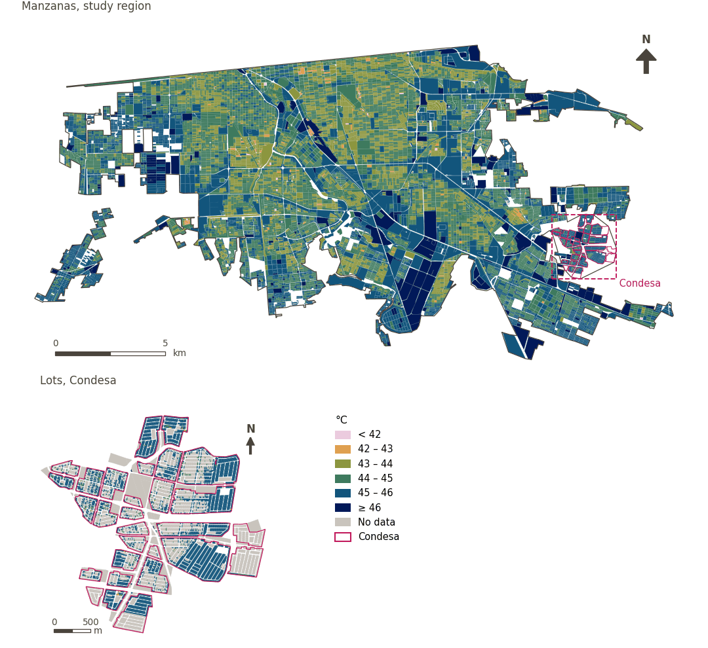

# Outdoor thermal comfort (UTCI)

[← Back to contents](../README.md)

Universal Thermal Climate Index modelled by work package 2 (Rossano Schifanella) with SOLWEIG for the hottest day of 2023 (21 July; maximum temperature 48.5 °C), forced by Mexicali airport observations, over pedestrian surfaces, and converted to UTCI with the operational polynomial (Bröde et al. 2012). It was delivered summarised for the reference areas (grid, AGEBs, manzanas, lots and subdivisions) and is linked by identifier. Units with fewer than 100 pedestrian pixels are masked (`reliable`).

- `utci_day_mean`: unit mean of the daytime mean UTCI (sunlit hours); the input to walkability's attenuation and the thermal comfort indicator.
- `utci_peak`: unit mean of the daily maximum UTCI (effectively 17:00); linked for reference, not used in the index.

| Sample point variable | Area variable (measured value) | Description | Study region (Mexicali incl. Condesa) | Condesa |
|---|---|---|---|---|
| `sp_utci_day_mean` | `utci_day_mean` | Unit mean of the daytime mean Universal Thermal Climate Index (hours with sunlight), over pedestrian surfaces, on the hottest day of 2023. | 45.1 °C | 45.5 °C |
| `sp_utci_peak` | `utci_peak` | Unit mean of the daily maximum Universal Thermal Climate Index (effectively 17:00), over pedestrian surfaces, on the hottest day of 2023. | 52.8 °C | 52.9 °C |

| Column | Name | Units | Direction |
|---|---|---|---|
| `utci_day_mean` | Daytime thermal comfort (mean UTCI) | °C | lower_is_better |
| `utci_peak` | Peak UTCI (17:00) | °C | lower_is_better |

- `data`: MX/UTCI - 2026-08-25/mexicali_utci_2023-07-21.gpkg
- `match`: id
- `id`: area_id
- `mask`: reliable
- `source`: Rossano Schifanella (WP02); SOLWEIG and the UTCI operational polynomial (Bröde et al. 2012)
- `licence`: Terrain from FABDEM v1 (CC BY-NC-SA 4.0, non-commercial); other inputs CC BY 4.0 or public domain
- `notes`: Modelled day 2023-07-21 (Tmax 48.5 °C).  See README_mexicali_utci.md, sections 3.1 and 5, for forcing and limitations.

## Method: practice

**Recipes:** [R7. Linking externally prepared indicators](../03_recipes.md#r7)

**Configuration** ([`MX_Mexicali_2025_ULI.yml:770`](../../data/MX_Mexicali_2025_ULI.yml#L770)):

```yaml
utci:
  data: MX/UTCI - 2026-08-25/mexicali_utci_2023-07-21.gpkg
  match: id
  id: area_id
  mask: reliable
  label: {es: Confort térmico exterior (UTCI), en: Outdoor thermal comfort (UTCI)}
  source: Rossano Schifanella (WP02); SOLWEIG and the UTCI operational polynomial (Bröde et al. 2012)
  licence: Terrain from FABDEM v1 (CC BY-NC-SA 4.0, non-commercial); other inputs CC BY 4.0 or public domain
  notes: 'Modelled day 2023-07-21 (Tmax 48.5 °C).  See README_mexicali_utci.md, sections 3.1 and 5, for forcing and limitations.'
  columns:
    utci_day_mean:
      label: {es: 'Confort térmico diurno (UTCI medio)', en: 'Daytime thermal comfort (mean UTCI)'}
      units: °C
      direction: lower_is_better
      description: Unit mean of the daytime mean Universal Thermal Climate Index (hours with sunlight), over pedestrian surfaces, on the hottest day of 2023.
    utci_peak:
      label: {es: 'UTCI máximo (17:00)', en: 'Peak UTCI (17:00)'}
      units: °C
      direction: lower_is_better
      description: Unit mean of the daily maximum Universal Thermal Climate Index (effectively 17:00), over pedestrian surfaces, on the hottest day of 2023.
  areas:
    grid: grid_100m
    agebs: agebs
    manzanas: manzanas
    condesa_lotes: {layer: condesa_lotes, boundary_id: id}
    condesa_fraccionamientos: {layer: condesa_fraccionamientos, boundary_id: fid}
    region_mexicali: region
    region_condesa: region
  ## the 100 m grid tiles the study region: sample points lie on streets,
  ## between blocks, so a block layer would leave most of them unvalued
  sample_points: [grid_100m]
```

**Code (GHSCI):**

- [`process/subprocesses/_linkage_indicators.py:512`](https://github.com/healthysustainablecities/global-indicators/blob/f03909611dba336c2728fffab6d697779487d0b1/process/subprocesses/_linkage_indicators.py#L512) `apply_rules()`
- [`process/subprocesses/_linkage_indicators.py:537`](https://github.com/healthysustainablecities/global-indicators/blob/f03909611dba336c2728fffab6d697779487d0b1/process/subprocesses/_linkage_indicators.py#L537) `sample_point_values()`

## Used by

[Daytime thermal comfort](thermal_comfort.md), [Walkability (300 m), attenuated by thermal comfort](walkability.md)

## Results

| Measure | Study region (Mexicali incl. Condesa) | Condesa |
|---|---|---|
| Region value | 45.1 °C | 45.5 °C |
| Areas with a value | 14,200 of 14,252 manzanas | 7,766 of 14,988 lots |
| Median (P25–P75), weighted | 44.3 °C (43.9 °C – 44.8 °C) | 45.9 °C (45.6 °C – 46.0 °C) |
| Range | 40.4 °C – 46.7 °C | 40.4 °C – 46.4 °C |

*Distributions: study region manzanas weighted by census population (2020); Condesa lots weighted equally (3.2 residents assumed per lot). Region values are those GHSCI reports for each region as a whole.*

## Map



*Map. Outdoor thermal comfort (UTCI): measured value (°C) by manzana across the study region and by lot in Condesa (inset). Dashboard classes; the favourable end is the light end (lower is better).*
