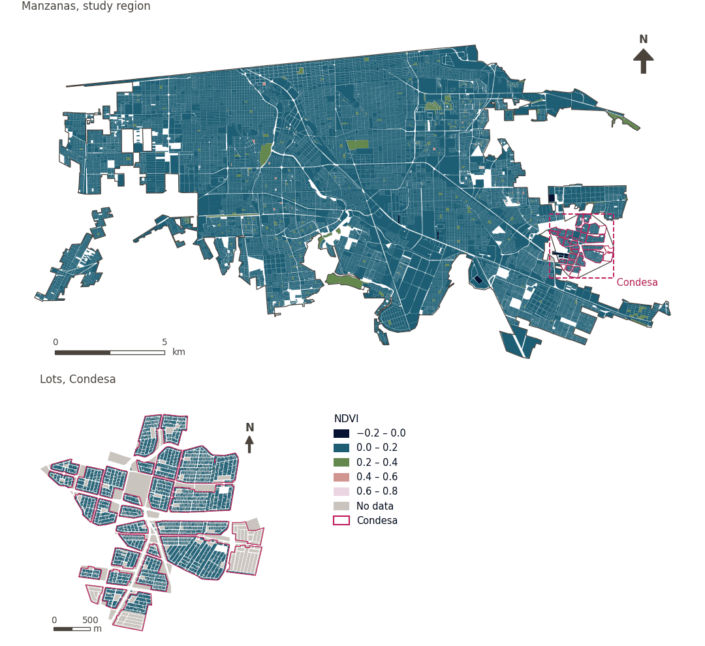

# Vegetation cover (NDVI)

[← Back to contents](../README.md)

> Mean normalised difference vegetation index (NDVI); higher is better.

## Identity

| | |
|---|---|
| Identifier | `vegetation` |
| Core measure (variable sheet) | Vegetation and shade |
| Sheet / register ID | 135, 378, 389 · #135, #389, #385 |
| Sample point variable | `sp_ext_ndvi` |
| Area variable (measured value) | `ext_ndvi` (NDVI) |
| Normalised score | `index_uli__vegetation` |
| Domains (share of weight) | [Ambient environment](domain_ambient_environment.md) (50%), [Built environment](domain_built_environment.md) (50%) |
| Subdomain | Ambient environment: Ambient; Built environment: Green and blue infrastructure |
| Lens | Quality |
| Better when | higher |
| Effective weight in the index | `uli` 4.0% · `uli_plain` 3.8% |
| Status | Scored in the published index |

## Rationale and interpretation

> The Normalised Difference Vegetation Index (NDVI) is used to track city-wide greenness, which supports mental health and environmental sustainability.
>
> — *Indicator register #135: NDVI (Ambient Environment / Ambient)*

- Workbook citation: Sachs et al., 2019, 'Six transformations to achieve the sustainable development goals'; Lowe et al., 2015, 'Planning healthy, liveable and sustainable cities: how can indicators inform policy?'
- Article list: #13: Alderton (2021), ‘Measuring and monitoring liveability in a low-to-middle income country: a proof-of-concept for Bangkok, Thailand and lessons from an international partnership’
- ⚠ the workbook citation names no author of the listed article; verify before citing (citation_audit.csv)

> Mean vegetation coverage across the city helps mitigate the urban heat island effect and provides psychological health benefits through exposure to nature.
>
> — *Indicator register #389: Vegetation percent (Ambient Environment / Ambient)*

- Workbook citation: Lowe et al., 2015, 'Planning healthy, liveable and sustainable cities: how can indicators inform policy?'; Sachs et al., 2019, 'Six transformations to achieve the sustainable development goals'
- Article list: #13: Alderton (2021), ‘Measuring and monitoring liveability in a low-to-middle income country: a proof-of-concept for Bangkok, Thailand and lessons from an international partnership’
- ⚠ the workbook citation names no author of the listed article; verify before citing (citation_audit.csv)

> Vegetation as a land use type is the optimal land category for human settlement, directly supporting liveability and wellbeing through ecosystem services and green space provision.
>
> — *Indicator register #385: Vegetation (Ambient Environment / Resources)*

- Workbook citation: No external citations provided for this indicator.
- Article list: #28: Chen (2023), ‘Evaluation of the livability of arid urban environments under global warming: A multi-parameter approach’
- ⚠ the workbook citation names no author of the listed article; verify before citing (citation_audit.csv)

**How to read it.** Mean vegetation index (NDVI) of ….

**Vegetation coverage percent** (Vegetation and shade; ID 135, 378; 389)
- *How to calculate (variable sheet):* Mean NDVI, fractional vegetation, or percent vegetated land. Vegetation Percent (mean); Vegetation Percent (standard deviation)
- *Notes (sheet):* Do not equate with accessible cooling.

## Data sources

**Sources declared in the configuration:**

- Mexicali ULI work packages (final_indicators.gpkg, 22 September 2026).

**Source recorded by GHSCI (data dictionary)** (`ext_ndvi`):

- Work package indicators: Mexicali ULI work packages (final_indicators.gpkg; see excel_work_sheet_key.xlsx)

**Inputs:** [Work package indicators (linked)](work_package_layers.md)

## Method: theory

1. A value prepared outside GHSCI by a work package and linked to the reference areas (R7: by geometry against the reference areas).
2. Replicated to each sample point from the area containing it (`grid`, `condesa_lotes (15 m)`, `manzanas (30 m)`).
3. AMPI normalisation (R11) of the value as measured, aggregation (R12) and areas (R13).

## Method: practice

**Recipes:** [R1. Sample points and the pedestrian network](../03_recipes.md#r1), [R7. Linking externally prepared indicators](../03_recipes.md#r7), [R11. Normalisation: the Adjusted Mazziotta–Pareto Index (AMPI)](../03_recipes.md#r11), [R12. Aggregation: domains, shared indicators and the index](../03_recipes.md#r12), [R13. From sample points to areas](../03_recipes.md#r13), [R14. Frozen goalposts and recalculating a scenario](../03_recipes.md#r14)

**Configuration** ([`MX_Mexicali_2025_ULI.yml:1299`](../../data/MX_Mexicali_2025_ULI.yml#L1299)):

```yaml
- variable: sp_ext_ndvi
  name: vegetation
  domains: [ambient_environment, built_environment]
  polarity: positive
  lens: quality
  group: {es: 'Vegetación y sombra', en: 'Vegetation and shade'}
  label: {es: 'Cobertura vegetal (NDVI)', en: 'Vegetation cover (NDVI)'}
  reading: {es: 'Índice de vegetación (NDVI) medio de {value}', en: 'Mean vegetation index (NDVI) of {value}'}
  subdomain:
    ambient_environment: {es: 'Medioambiente', en: 'Ambient'}
    built_environment: {es: 'Infraestructura verde y azul', en: 'Green and blue infrastructure'}
  about:
    es: Índice de vegetación de diferencia normalizada (NDVI) medio; mayor es mejor.
    en: Mean normalised difference vegetation index (NDVI); higher is better.
  sources:
    - 'Mexicali ULI work packages (final_indicators.gpkg, 22 September 2026).'
```

**Code (GHSCI):**

- [`process/subprocesses/_linkage_indicators.py:403`](https://github.com/healthysustainablecities/global-indicators/blob/f03909611dba336c2728fffab6d697779487d0b1/process/subprocesses/_linkage_indicators.py#L403) `match_by_geometry()`
- [`process/subprocesses/_linkage_indicators.py:537`](https://github.com/healthysustainablecities/global-indicators/blob/f03909611dba336c2728fffab6d697779487d0b1/process/subprocesses/_linkage_indicators.py#L537) `sample_point_values()`
- [`process/subprocesses/_composite_index.py:1819`](https://github.com/healthysustainablecities/global-indicators/blob/f03909611dba336c2728fffab6d697779487d0b1/process/subprocesses/_composite_index.py#L1819) `normalise()`
- [`process/subprocesses/_composite_index.py:1838`](https://github.com/healthysustainablecities/global-indicators/blob/f03909611dba336c2728fffab6d697779487d0b1/process/subprocesses/_composite_index.py#L1838) `mpi_aggregate()`

|  | Sample point variable | Transform | Goalposts (scale scored) | inf – sup | skew / kurt. / tied | Flags |
|---|---|---|---|---|---|---|
| `uli` | sp_ext_ndvi | as measured | −0.251 · 0.082 · 0.415 | −0.031 – 0.636 | 2.37 / 12.56 / 0.1% | skewed |
| `uli_plain` | sp_ext_ndvi | as measured | −0.251 · 0.082 · 0.415 | −0.031 – 0.636 | 2.37 / 12.56 / 0.1% | skewed |

## Recalculation (Reimagina Urbano)

The value comes from an external work package: a scenario (for example, more vegetation) replaces the area's value, which is replicated to its sample points.

With the frozen goalposts of the parameters file (`Ref`, `Min`, `Max`, R14), a new score is `r = 100 ± 60·(x − Ref)/(Max − Min)` without re-resolving goalposts; the domain and index are recomputed by R12, less 100. A scenario is then compared with the baseline on the same scale.

## Results

| Measure | Study region (Mexicali incl. Condesa) | Condesa |
|---|---|---|
| Region value | 0.08 | 0.05 |
| Region score (`uli`) | −0.2 | −1.8 |
| Areas with a value | 14,200 of 14,252 manzanas | 11,279 of 14,988 lots |
| Median (P25–P75), weighted | 0.07 (0.06 – 0.08) | 0.04 (0.03 – 0.06) |
| Range | −0.03 – 0.61 | −0.08 – 0.34 |
| Score: median (P25–P75) (`uli`) | −0.4 (−1.4 – +0.8) | −2.3 (−3.3 – −0.8) |

*Distributions: study region manzanas weighted by census population (2020); Condesa lots weighted equally (3.2 residents assumed per lot). Region values are those GHSCI reports for each region as a whole.*

- Study region: Mean vegetation index (NDVI) of 0.08.
- Condesa: Mean vegetation index (NDVI) of 0.05.
- For the study region as a whole the value is 0.08; in Condesa, 0.05. Condesa's score lies 1.8 points below the study region average (−0.2 for the study region).

## Map



*Map. Vegetation cover (NDVI): measured value (NDVI) by manzana across the study region and by lot in Condesa (inset). Dashboard classes; the favourable end is the light end (higher is better).*

## Caveats and open questions

- Not to be equated with accessible cooling (sheet note). Tree canopy, a better proxy for shade, covers only 210 manzanas and is not used (configuration).
