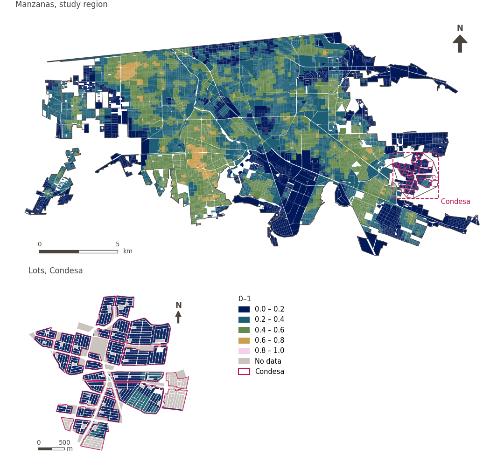

# Walkability (300 m), attenuated by thermal comfort

[← Back to contents](../README.md)

> Sum of z-scores of access to a fresh food market, convenience store and public transport within 300 m, population density and intersection density. By default its percentile rank is attenuated by daytime thermal comfort, by up to half at the hottest locations.

## Identity

| | |
|---|---|
| Identifier | `walkability` |
| Core measure (variable sheet) | Walkability index |
| Sheet / register ID | 362, 74, 230, 120, 116 · #74, #362 |
| Sample point variable | `sp_walk_idx_300_tm` |
| Area variable (measured value) | `walk_idx_300_tm` (0–1) |
| Normalised score | `index_uli__walkability` |
| Score (unattenuated variant) | `index_uli_plain__walkability` |
| Domains (share of weight) | [Built environment](domain_built_environment.md) (33%), [Mobility and transport](domain_mobility_transport.md) (33%), [Social infrastructure](domain_social_infrastructure.md) (33%) |
| Subdomain | Built environment: Urban design; Mobility and transport: Active mobility; Social infrastructure: Public services |
| Lens | Accessibility |
| Better when | higher |
| Effective weight in the index | `uli` 3.7% · `uli_plain` 3.7% |
| Status | Scored in the published index |

## Rationale and interpretation

> Walking-friendly urban environments support safety and promote healthy lifestyles through human-oriented design.
>
> — *Indicator register #74: Walkability Index (Safety / Road Safety)*

- Workbook citation: Skalicky & Čerpes, 2019, 'Comprehensive assessment methodology for liveable residential environment'
- Article list: #23: Sarkar (2020), ‘Socio-physical liveability through socio-spatiality in low-income resettlement archetypes - A case of slum rehabilitation housing in Mumbai, India.’
- ⚠ the workbook citation names no author of the listed article; verify before citing (citation_audit.csv)

> A well-connected pedestrian network promotes a safe environment and directly supports the physical health of residents by encouraging walking.
>
> — *Indicator register #362: Street connectivity (Built Environment / Urban Morphology)*

- Workbook citation: Ahmed, 2012, 'Urban social sustainability: A study of the Emirati local communities in Al Ain'
- Article list: #23: Sarkar (2020), ‘Socio-physical liveability through socio-spatiality in low-income resettlement archetypes - A case of slum rehabilitation housing in Mumbai, India.’
- ⚠ the workbook citation names no author of the listed article; verify before citing (citation_audit.csv)

**How to read it.** Average walkability score of … (higher is more walkable).

**Street connectivity** (Walkability Index; ID 362,74)
- *How to calculate (variable sheet):* USE GHSCI CALCULATION HERE (Average walkable neighbourhood population density (population per km²) of sample points in this area) or Intersection density defined as the number of 3- and 4-way intersections in a buffer area/total buffer area in squared kilometers
- *Notes (sheet):* Use pedestrian-relevant network.

**Net residential density** (Walkability Index; ID 230, 120, 74)
- *How to calculate (variable sheet):* USE GHSCI CALCULATION HERE

**Commercial land use proportion** (Walkability Index; ID –)
- *How to calculate (variable sheet):* USE GHSCI CALCULATION HERE or Squared kilometers designated to commercial land use in buffer area/total squared kilometers of buffer area.

**Land use mix** (Walkability Index; ID 116, 74)
- *How to calculate (variable sheet):* USE GHSCI CALCULATION HERE or −[Σi (pi)(ln pi)]/(ln k) where p = proportion of total land uses, i = land use category, ln = natural logarithm, k = number of land uses. Range is 0 to 1. Categoriesb are defined as low (reference)

## Data sources

**Sources declared in the configuration:**

- Frank, L. D. et al. (2010) The development of a walkability index. British Journal of Sports Medicine 44, 924-933.
- OpenStreetMap contributors (Geofabrik Mexico extract, 15 August 2026); INEGI DENUE (May 2026); IMIP / CFC public transport stops; GHS-POP R2023A.
- Thermal comfort: Rossano Schifanella (WP02), SOLWEIG modelled UTCI for 21 July 2023 (Bröde et al. 2012).

**Source recorded by GHSCI (data dictionary)** (`walk_idx_300_tm`):

- OpenStreetMap: Geofabrik GmbH, 20260815, ODbL, https://download.geofabrik.de/north-america/mexico-latest.osm.pbf, OpenStreetMap Contributors.  Geofabrik GmbH (2026). https://download.geofabrik.de/north-america/mexico-latest.osm.pbf; Global Human Settlements population data: 2025, Mollweide (EU JRC, 2023): CC BY 4.0, https://jeodpp.jrc.ec.europa.eu/ftp/jrc-opendata/GHSL/GHS_POP_GLOBE_R2023A/GHS_POP_E2025_GLOBE_R2023A_54009_100/V1-0/tiles/GHS_POP_E2025_GLOBE_R2023A_54009_100_V1_0_R6_C8.zip, Schiavina, M., Freire, S., Carioli, A., MacManus, K. (2023). GHS-POP R2023A - GHS population grid multitemporal (1975-2030). European Commission, Joint Research Centre (JRC). https://doi.org/10.2905/2FF68A52-5B5B-4A22-8F40-C41DA8332CFE; Outdoor thermal comfort (UTCI): Rossano Schifanella (WP02); SOLWEIG and the UTCI operational polynomial (Bröde et al. 2012), Terrain from FABDEM v1 (CC BY-NC-SA 4.0, non-commercial); other inputs CC BY 4.0 or public domain; IMIP / CFC: 2026-05-18, Provided by IMIP via CFC, As per advice from Juan Ernesto Díaz Noguez

**Destination filter:**

- `pt_any` (pt_any): `MX/CFC/cleaned/por_estado/02_baja_california/002_mexicali/imip/equipamiento_combined.fgb` — Destination filter: `"equipamiento_category='transp' AND TIPO != 'TERMINAL INTERIOR DE CARGA (CENTRAL DE SERVICIOS DE CARGA)'"`

**Inputs:** [Walkability within 300 m and its components](walkability_components.md), [Outdoor thermal comfort (UTCI)](utci.md)

## Method: theory

1. Daily living within 300 m: `DL = a_market + a_convenience + a_transport` (binary access within 300 m, R3; OpenStreetMap destinations and IMIP/OSM stops).
2. Walkability: `W = z(population density) + z(intersection density) + z(DL)`, z-scores over all urban sample points (R9).
3. Thermal comfort attenuation (R9): `W_tm = percentile_rank(W) · (1 − λ·h′)`, with `λ = 0.5` and `h′ = clip((UTCI − 30)/(50 − 30), 0, 1)` from the daytime mean UTCI (°C).
4. AMPI normalisation (R11) of `W_tm`, aggregation (R12) and areas (R13). In the unattenuated variant (`uli_plain`) `W` is used and thermal comfort is scored separately.

## Method: practice

**Recipes:** [R1. Sample points and the pedestrian network](../03_recipes.md#r1), [R2. Network distance to the nearest destination, censored](../03_recipes.md#r2), [R3. Banded access, and distance from a disamenity](../03_recipes.md#r3), [R9. Walkability, and its attenuation by thermal comfort](../03_recipes.md#r9), [R11. Normalisation: the Adjusted Mazziotta–Pareto Index (AMPI)](../03_recipes.md#r11), [R12. Aggregation: domains, shared indicators and the index](../03_recipes.md#r12), [R13. From sample points to areas](../03_recipes.md#r13), [R14. Frozen goalposts and recalculating a scenario](../03_recipes.md#r14)

**Configuration** ([`MX_Mexicali_2025_ULI.yml:1368`](../../data/MX_Mexicali_2025_ULI.yml#L1368)):

```yaml
- variable: sp_walk_idx_300_tm
  name: walkability
  domains: [built_environment, mobility_transport, social_infrastructure]
  polarity: positive
  lens: accessibility
  group: {es: 'Índice de caminabilidad', en: 'Walkability index'}
  label: {es: 'Caminabilidad (300 m), atenuada por confort térmico', en: 'Walkability (300 m), attenuated by thermal comfort'}
  reading: {es: 'Puntuación media de caminabilidad de {value} (mayor es más caminable)', en: 'Average walkability score of {value} (higher is more walkable)'}
  subdomain:
    built_environment: {es: 'Diseño urbano', en: 'Urban design'}
    mobility_transport: {es: 'Movilidad activa', en: 'Active mobility'}
    social_infrastructure: {es: 'Servicios públicos', en: 'Public services'}
  about:
    es: Suma de puntuaciones z del acceso a mercado de alimentos frescos, tienda de conveniencia y transporte público a 300 m, la densidad de población y la densidad de intersecciones. Por defecto, su rango percentil se atenúa según el confort térmico diurno, hasta la mitad en los lugares más calurosos.
    en: Sum of z-scores of access to a fresh food market, convenience store and public transport within 300 m, population density and intersection density. By default its percentile rank is attenuated by daytime thermal comfort, by up to half at the hottest locations.
  sources:
    - 'Frank, L. D. et al. (2010) The development of a walkability index. British Journal of Sports Medicine 44, 924-933.'
    - 'OpenStreetMap contributors (Geofabrik Mexico extract, 15 August 2026); INEGI DENUE (May 2026); IMIP / CFC public transport stops; GHS-POP R2023A.'
    - 'Thermal comfort: Rossano Schifanella (WP02), SOLWEIG modelled UTCI for 21 July 2023 (Bröde et al. 2012).'
```

**Code (GHSCI):**

- [`process/subprocesses/_walkability_variants.py:275`](https://github.com/healthysustainablecities/global-indicators/blob/f03909611dba336c2728fffab6d697779487d0b1/process/subprocesses/_walkability_variants.py#L275) `compute_variants()`
- [`process/subprocesses/_walkability_variants.py:270`](https://github.com/healthysustainablecities/global-indicators/blob/f03909611dba336c2728fffab6d697779487d0b1/process/subprocesses/_walkability_variants.py#L270) `percentile_rank()`
- [`process/subprocesses/_composite_index.py:1819`](https://github.com/healthysustainablecities/global-indicators/blob/f03909611dba336c2728fffab6d697779487d0b1/process/subprocesses/_composite_index.py#L1819) `normalise()`
- [`process/subprocesses/_composite_index.py:1838`](https://github.com/healthysustainablecities/global-indicators/blob/f03909611dba336c2728fffab6d697779487d0b1/process/subprocesses/_composite_index.py#L1838) `mpi_aggregate()`

|  | Sample point variable | Transform | Goalposts (scale scored) | inf – sup | skew / kurt. / tied | Flags |
|---|---|---|---|---|---|---|
| `uli` | sp_walk_idx_300_tm | as measured | −0.022 · 0.315 · 0.651 | 0.000 – 0.673 | 0.00 / −1.21 / 0.1% | none |
| `uli_plain` | sp_walk_idx_300 | as measured | −10.0 · 0.0 · 10.0 | −8.9 – 11.1 | 0.23 / 0.11 / 0.2% | none |

## Recalculation (Reimagina Urbano)

Walkability uses z-scores and percentile ranks over all points; for a scenario, freeze each component's baseline mean and standard deviation and the baseline distribution of `W` (from the `sample_points_walkability` table and its inputs in the database), so that only the affected points change. These values are not published in the results files: they must be extracted from the database.

With the frozen goalposts of the parameters file (`Ref`, `Min`, `Max`, R14), a new score is `r = 100 ± 60·(x − Ref)/(Max − Min)` without re-resolving goalposts; the domain and index are recomputed by R12, less 100. A scenario is then compared with the baseline on the same scale.

## Results

| Measure | Study region (Mexicali incl. Condesa) | Condesa |
|---|---|---|
| Region value | 0.41 | 0.12 |
| Region score (`uli`) | +8.9 | −17.5 |
| Region score (`uli_plain`) | +3.1 | −5.8 |
| Areas with a value | 14,216 of 14,252 manzanas | 13,265 of 14,988 lots |
| Median (P25–P75), weighted | 0.42 (0.30 – 0.52) | 0.11 (0.08 – 0.15) |
| Range | 0.00 – 0.65 | 0.01 – 0.26 |
| Score: median (P25–P75) (`uli`) | +9.1 (−0.9 – +18.3) | −18.2 (−20.9 – −14.8) |
| Score: median (P25–P75) (`uli_plain`) | +2.5 (−0.4 – +5.8) | −6.1 (−7.1 – −4.7) |

*Distributions: study region manzanas weighted by census population (2020); Condesa lots weighted equally (3.2 residents assumed per lot). Region values are those GHSCI reports for each region as a whole.*

- Study region: Average walkability score of 0.41 (higher is more walkable).
- Condesa: Average walkability score of 0.12 (higher is more walkable).
- For the study region as a whole the value is 0.41; in Condesa, 0.12. Condesa's score lies 17.5 points below the study region average (+8.9 for the study region).

## Map



*Map. Walkability (300 m), attenuated by thermal comfort: measured value (0–1) by manzana across the study region and by lot in Condesa (inset). Dashboard classes; the favourable end is the light end (higher is better).*

## Caveats and open questions

- Net residential density, commercial land use and land use mix (final_indicators.gpkg) are the components of the walkability core measure, which walkability itself represents: scoring them as well would count density twice (configuration).
- The fixed 30–50 °C range judges heat absolutely: most of the city lies between 43.8 and 46.0 °C on the modelled day, all of it very hot, and re-scaling between those percentiles would have treated the least hot as comfortable (configuration, decided 25 September 2026).
