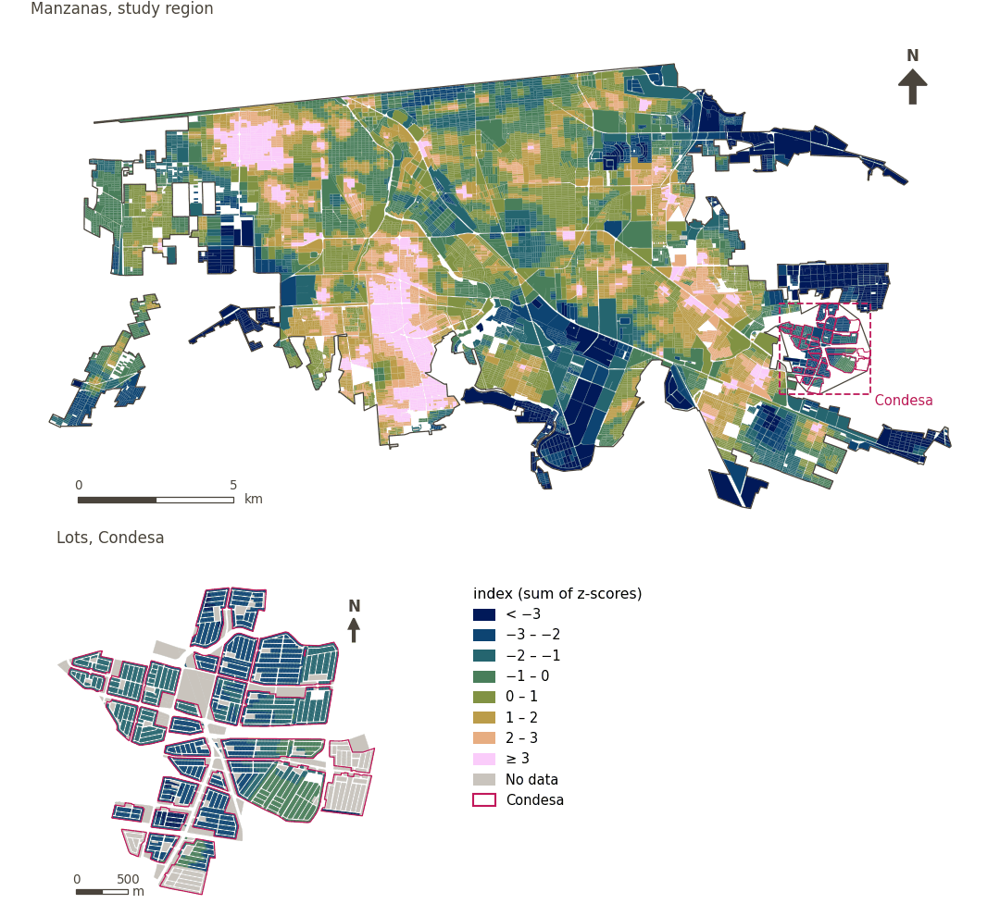

# Walkability within 300 m and its components

[← Back to contents](../README.md)

The ULI's walkability follows the GHSCI walkability index (Frank et al. 2010), with the daily living score judged within 300 m, the five-minute walk of Mexicali's walkability policy, rather than 500 m.

- **Daily living within 300 m** (`sp_walk_dl_300`): the sum of binary access within 300 m to a fresh food market, a convenience store (both from OpenStreetMap) and a public transport stop (IMIP or OpenStreetMap); 0 to 3. If any of the three is missing, the score is missing.
- **Neighbourhood population density** (`sp_local_nh_avg_pop_density`): for each node, the unweighted mean population density (persons/km²) of the 100 m cells containing any node reachable within 1,000 m along the network; interpolated to each point by its position along the edge.
- **Neighbourhood intersection density** (`sp_local_nh_avg_intersection_density`): likewise, with intersections per km² (OSMnx consolidated intersections, 12 m tolerance).
- **Walkability** (`sp_walk_idx_300`): `W = z(DL) + z(population density) + z(intersection density)`, z-scores using the sample standard deviation over all urban sample points with a value.
- **Walkability attenuated by thermal comfort** (`sp_walk_idx_300_tm`): `percentile_rank(W)·(1 − 0.5·h′)`, where `h′` is the daytime mean UTCI re-scaled from 30 to 50 °C and clipped to 0–1. The percentile rank averages ties and runs from 0 to 1.

| Sample point variable | Area variable (measured value) | Description | Study region (Mexicali incl. Condesa) | Condesa |
|---|---|---|---|---|
| `sp_walk_dl_300` | `walk_dl_300` | Average across sample points of the daily living score: the number of daily living destination types (fresh food market, convenience, pt any) with access within 300 m | 0.300 | 0.016 |
| `sp_local_nh_avg_pop_density` | `local_nh_population_density` | Average walkable neighbourhood population density (population per km²) of sample points in this area | 4,274 | 131 |
| `sp_local_nh_avg_intersection_density` | `local_nh_intersection_density` | Average walkable neighbourhood intersection density (intersections per km²) of sample points in this area | 171 | 174 |
| `sp_walk_idx_300` | `walk_idx_300` | Average across sample points of the walkability index with daily living access judged within 300 m: the sum of the z-scores of that daily living score, local population density and street intersection density | 1.05 | −1.94 |
| `sp_walk_idx_300_tm` | `walk_idx_300_tm` | Average across sample points of the percentile rank (0-1) of the walkability index with daily living access judged within 300 m: the sum of the z-scores of that daily living score, local population density and street intersection density, multiplied by (1 - lambda x h), where h is thermal comfort re-scaled from 0 at 30 to 1 at 50 (a fixed range); lambda = 0.5 (attenuation) | 0.41 | 0.12 |

## Method: practice

**Recipes:** [R1. Sample points and the pedestrian network](../03_recipes.md#r1), [R2. Network distance to the nearest destination, censored](../03_recipes.md#r2), [R3. Banded access, and distance from a disamenity](../03_recipes.md#r3), [R9. Walkability, and its attenuation by thermal comfort](../03_recipes.md#r9)

**Configuration** ([`MX_Mexicali_2025_ULI.yml:909`](../../data/MX_Mexicali_2025_ULI.yml#L909)):

```yaml
walkability_variants:
  distances: [300]
  daily_living: [fresh_food_market, convenience, pt_any]
  heat:
    t: {variable: sp_utci_day_mean, range: [30, 50], label: {es: confort térmico, en: thermal comfort}}
  sets: [t]
  forms: [multiplicative]
  attenuation: 0.5
  percentiles: [5, 95]
```

**Code (GHSCI):**

- [`process/subprocesses/_11_neighbourhood_analysis.py:115`](https://github.com/healthysustainablecities/global-indicators/blob/f03909611dba336c2728fffab6d697779487d0b1/process/subprocesses/_11_neighbourhood_analysis.py#L115) `compute_nodes_pop_intersect_density()`
- [`process/subprocesses/_walkability_variants.py:243`](https://github.com/healthysustainablecities/global-indicators/blob/f03909611dba336c2728fffab6d697779487d0b1/process/subprocesses/_walkability_variants.py#L243) `zscore()`
- [`process/subprocesses/_walkability_variants.py:270`](https://github.com/healthysustainablecities/global-indicators/blob/f03909611dba336c2728fffab6d697779487d0b1/process/subprocesses/_walkability_variants.py#L270) `percentile_rank()`
- [`process/subprocesses/_walkability_variants.py:261`](https://github.com/healthysustainablecities/global-indicators/blob/f03909611dba336c2728fffab6d697779487d0b1/process/subprocesses/_walkability_variants.py#L261) `rescale()`
- [`process/subprocesses/_walkability_variants.py:275`](https://github.com/healthysustainablecities/global-indicators/blob/f03909611dba336c2728fffab6d697779487d0b1/process/subprocesses/_walkability_variants.py#L275) `compute_variants()`

## Used by

[Walkability (300 m), attenuated by thermal comfort](walkability.md)

## Results

| Measure | Study region (Mexicali incl. Condesa) | Condesa |
|---|---|---|
| Region value | 1.05 | −1.94 |
| Areas with a value | 14,216 of 14,252 manzanas | 13,265 of 14,988 lots |
| Median (P25–P75), weighted | 0.824 (−0.124 – 1.94) | −2.02 (−2.36 – −1.58) |
| Range | −5.59 – 7.01 | −4.26 – −0.363 |

*Distributions: study region manzanas weighted by census population (2020); Condesa lots weighted equally (3.2 residents assumed per lot). Region values are those GHSCI reports for each region as a whole.*

## Map



*Map. Walkability within 300 m and its components: measured value (index (sum of z-scores)) by manzana across the study region and by lot in Condesa (inset). Dashboard classes; the favourable end is the light end (higher is better).*
