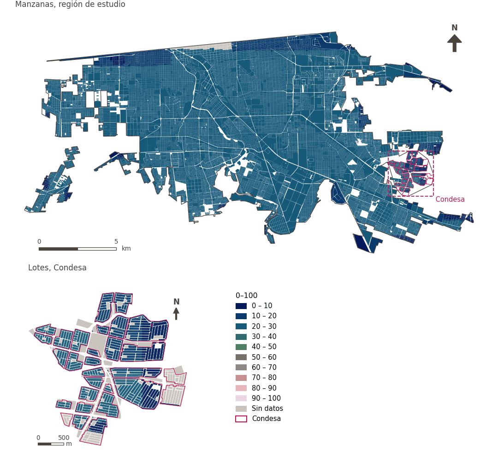

# Capacidad de adaptación al calor (GUHVI)

[← Volver al contenido](../README.md)

> Subíndice de capacidad de adaptación del GUHVI (0-100), a partir de la razón de dependencia infantil, el índice de desarrollo humano subnacional y la mortalidad infantil; mayor es mejor.

## Identificación

| | |
|---|---|
| Identificador | `adaptive_capability` |
| Medida central (hoja de variables) | Índice Global de Vulnerabilidad Urbana al Calor (GUHVI) |
| ID de la hoja / registro | – |
| Variable en puntos de muestra | `sp_urban_heat_adaptive_capability_index` |
| Variable de área (valor medido) | `urban_heat_adaptive_capability_index` (0–100) |
| Puntuación normalizada | `index_uli__adaptive_capability` |
| Dominios (parte del peso) | [Entorno medioambiental](domain_ambient_environment.md) |
| Subdominio | Riesgos climáticos |
| Enfoque | Calidad |
| Mejor si es | mayor |
| Peso efectivo en el índice | `uli` 2.8% · `uli_plain` 2.4% |
| Estado | Se puntúa en el índice publicado |

## Justificación e interpretación

*Pendiente: No consta en el registro del proyecto.*

**Cómo leerlo.** Índice de capacidad de adaptación de … (0-100; mayor es mejor).

**Adaptive capability** (Global Urban Heat Vulnerability Index (GUHVI); ID –) (en inglés en la hoja)
- *Cómo calcular (hoja de variables):* USE GHSCI CALCULATION HERE (Child dependency ratio, Subnational Human Development Index, Infant Mortality Rates)

## Fuentes de datos

**Fuentes declaradas en la configuración:**

- Turner et al. (2025) Urban Climate 64, 102716; computed in Google Earth Engine by GHSCI.

**Insumos:** [Índice Global de Vulnerabilidad Urbana al Calor (GUHVI) y sus insumos](guhvi.md)

## Método: teoría

1. Subíndice del Índice Global de Vulnerabilidad Urbana al Calor (GUHVI; Turner et al. 2025) calculado en Google Earth Engine sobre una cuadrícula de análisis, normalizado mín.–máx. a 0–100 dentro de la región (R8).
2. Cada punto de muestra toma el valor de la celda que lo contiene.
3. Normalización AMPI (R11) con metas fijas de 0 y 100 (la propia escala del subíndice), agregación (R12) y áreas (R13).

## Método: práctica

**Recetas:** [R1. Puntos de muestra y red peatonal](../03_recipes.md#r1), [R8. Earth Engine: vulnerabilidad al calor y grandes espacios verdes](../03_recipes.md#r8), [R11. Normalización: el Índice Ajustado de Mazziotta–Pareto (AMPI)](../03_recipes.md#r11), [R12. Agregación: dominios, indicadores compartidos e índice](../03_recipes.md#r12), [R13. De los puntos de muestra a las áreas](../03_recipes.md#r13), [R14. Metas congeladas y recálculo de un escenario](../03_recipes.md#r14)

**Configuración** ([`MX_Mexicali_2025_ULI.yml:1247`](../../data/MX_Mexicali_2025_ULI.yml#L1247)):

```yaml
- variable: sp_urban_heat_adaptive_capability_index
  name: adaptive_capability
  domains: [ambient_environment]
  polarity: positive
  goalposts: {min: 0, max: 100}
  lens: quality
  group: {es: 'Índice Global de Vulnerabilidad Urbana al Calor (GUHVI)', en: 'Global Urban Heat Vulnerability Index (GUHVI)'}
  label: {es: 'Capacidad de adaptación al calor (GUHVI)', en: 'Heat adaptive capability (GUHVI)'}
  reading: {es: 'Índice de capacidad de adaptación de {value} (0-100; mayor es mejor)', en: 'Adaptive capability index of {value} (0-100; higher is better)'}
  subdomain: {es: 'Riesgos climáticos', en: 'Climate risks'}
  about:
    es: Subíndice de capacidad de adaptación del GUHVI (0-100), a partir de la razón de dependencia infantil, el índice de desarrollo humano subnacional y la mortalidad infantil; mayor es mejor.
    en: The GUHVI's adaptive capability sub-index (0-100), from the child dependency ratio, the subnational human development index and infant mortality; higher is better.
  sources:
    - 'Turner et al. (2025) Urban Climate 64, 102716; computed in Google Earth Engine by GHSCI.'
```

**Código (GHSCI):**

- [`process/subprocesses/_earth_engine_indicators.py:846`](https://github.com/healthysustainablecities/global-indicators/blob/f03909611dba336c2728fffab6d697779487d0b1/process/subprocesses/_earth_engine_indicators.py#L846) `guhvi_analysis()`
- [`process/subprocesses/_earth_engine_indicators.py:1105`](https://github.com/healthysustainablecities/global-indicators/blob/f03909611dba336c2728fffab6d697779487d0b1/process/subprocesses/_earth_engine_indicators.py#L1105) `normalise_band()`
- [`process/subprocesses/_composite_index.py:1819`](https://github.com/healthysustainablecities/global-indicators/blob/f03909611dba336c2728fffab6d697779487d0b1/process/subprocesses/_composite_index.py#L1819) `normalise()`
- [`process/subprocesses/_composite_index.py:1838`](https://github.com/healthysustainablecities/global-indicators/blob/f03909611dba336c2728fffab6d697779487d0b1/process/subprocesses/_composite_index.py#L1838) `mpi_aggregate()`

|  | Variable en puntos de muestra | Transformación | Metas (escala puntuada) | inf – sup | asim. / curt. / empates | Alertas |
|---|---|---|---|---|---|---|
| `uli` | sp_urban_heat_adaptive_capability_index | tal cual | 0 · 22 · 100 | 0 – 30 | −2.81 / 7.51 / 2.6% | skewed |
| `uli_plain` | sp_urban_heat_adaptive_capability_index | tal cual | 0 · 22 · 100 | 0 – 30 | −2.81 / 7.51 / 2.6% | skewed |

## Recálculo (Reimagina Urbano)

Los subíndices GUHVI se normalizan dentro de la región con sus propios mínimos y máximos; un escenario debe usar los mismos mínimos y máximos de la línea base para no reescalar toda la ciudad.

Con las metas congeladas del archivo de parámetros (`Ref`, `Mín.`, `Máx.`, R14), una nueva puntuación es `r = 100 ± 60·(x − Ref)/(Máx. − Mín.)` sin volver a resolver metas; el dominio y el índice se recalculan con R12 y se resta 100. Así un escenario se compara con la línea base en la misma escala.

## Resultados

| Medida | Región de estudio (Mexicali con Condesa) | Condesa |
|---|---|---|
| Valor de la región | 22.2 | 15.0 |
| Puntuación de la región (`uli`) | +0.6 | −4.0 |
| Áreas con valor | 14,148 de 14,252 manzanas | 13,265 de 14,988 lotes |
| Mediana (P25–P75), ponderada | 23.1 (23.1 – 23.2) | 13.0 (11.3 – 23.1) |
| Rango | 0.0 – 30.3 | 0.0 – 23.9 |
| Puntuación: mediana (P25–P75) (`uli`) | +0.9 (+0.9 – +0.9) | −5.2 (−6.2 – +0.9) |

*Distribuciones: manzanas de la región de estudio ponderadas por su población censal (2020); lotes de Condesa con igual peso (3.2 residentes supuestos por lote). Los valores de la región son los que GHSCI reporta para cada región en conjunto.*

- Región de estudio: Índice de capacidad de adaptación de 22.2 (0-100; mayor es mejor).
- Condesa: Índice de capacidad de adaptación de 15.0 (0-100; mayor es mejor).
- Para la región de estudio en su conjunto, el valor es 22.2; en Condesa, 15.0. La puntuación de Condesa queda 4.0 puntos por debajo del promedio de la región de estudio (+0.6 para la región de estudio).

## Mapa



*Mapa. Capacidad de adaptación al calor (GUHVI): valor medido (0–100) por manzana en la región de estudio y por lote en Condesa (recuadro). Clases del tablero; los colores favorables son los claros (mayor es mejor).*

## Advertencias y pendientes

- Varios de sus insumos (el índice de desarrollo humano subnacional, la tasa de mortalidad infantil) son constantes en una sola ciudad, por lo que su variación dentro de Mexicali proviene sobre todo de la razón de dependencia infantil (configuración, dashboard.hide).
