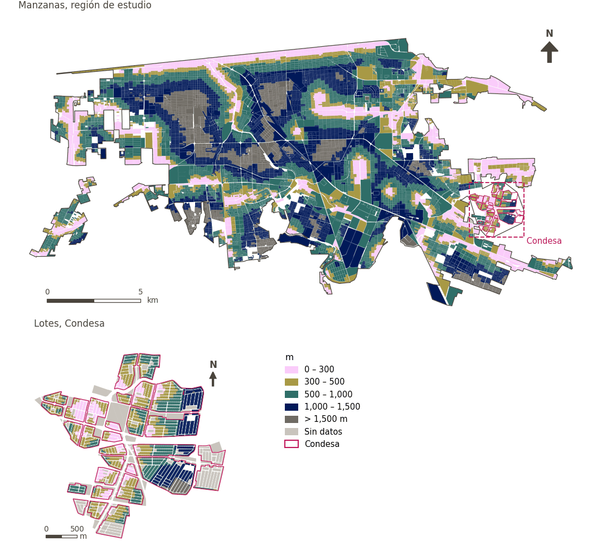

# Espacios azules naturales cercanos

[← Volver al contenido](../README.md)

> Distancia a pie al cuerpo de agua más cercano, puntuada con la escala del proyecto para ciudades áridas (100 a 200 m, 90 a 500 m, 80 a 1 km y 60 más allá).

## Identificación

| | |
|---|---|
| Identificador | `blue_space` |
| Medida central (hoja de variables) | Espacios azules naturales disponibles |
| ID de la hoja / registro | 10 · #10 |
| Variable en puntos de muestra | `sp_walk_nearest_node_blue_space` |
| Variable de área (valor medido) | `avg_walk_dist_blue_space` (m) |
| Puntuación normalizada | `index_uli__blue_space` |
| Dominios (parte del peso) | [Entorno medioambiental](domain_ambient_environment.md) |
| Subdominio | Medioambiente |
| Enfoque | Proximidad |
| Mejor si es | valor medido menor (puntuación transformada mayor) |
| Peso efectivo en el índice | `uli` 2.8% · `uli_plain` 2.4% |
| Estado | Se puntúa en el índice publicado |

## Justificación e interpretación

> La cercanía a recursos hídricos disponibles es un indicador crítico de habitabilidad en entornos urbanos áridos, pues el acceso al agua es fundamental para la salud, el confort y la supervivencia humanas. (traducción preliminar del inglés)
>
> — *Registro de indicadores #10: Access to blue space (Ambient Environment / Resources)*

- Cita del libro de trabajo: No external citations provided for this indicator.
- Lista de artículos: #28: Chen (2023), ‘Evaluation of the livability of arid urban environments under global warming: A multi-parameter approach’
- ⚠ la cita del libro de trabajo no nombra a un autor del artículo de la lista; verifique antes de citar (citation_audit.csv)

**Cómo leerlo.** … de la población vive a menos de 500 m de un cuerpo de agua; en promedio, el más cercano está a … (menor es mejor).

**Available natural blue spaces** (Available natural blue spaces; ID 10) (en inglés en la hoja)
- *Cómo calcular (hoja de variables):* Based on Landsat OLI_TIRS multispectral data, thenormalized differential water index (MNDWI) was calculated, where: MNDWI = G - MIR/G + MIR where MIR is the reflectance value of the infrared band in Landsat and Gis the reflectance value of the infrared band. Single-factor scores were evaluated in combination with the effects of water bodies on the livability of urban environments within a certain radiation distance. When the radiation range of water bodies was < 200 m, the areas surrounding water bodies (e.g., wetlands and parks) were the most livable,reaching scores of 100. Water bodies could influence the livability of the urban environment within 200–500 m, where AWR was evaluated as having a score of 90. Areas 500–1000 m away from water bodies might be influenced by other buildings, where AWR had a score of 80. Areas 1000–1500 m away from water bodies require travel by foot, bike orother means, and their AWR score was 60. Since water resources are extremely important to arid cities, the lowest limit was determined as 60. That means the lowest level of the livability in this area is the Generally livable when only water resources are considered

## Fuentes de datos

**Fuentes declaradas en la configuración:**

- OpenStreetMap contributors (Geofabrik Mexico extract, 15 August 2026).

**Fuente registrada por GHSCI (diccionario de datos)** (`avg_walk_dist_blue_space`):

- OpenStreetMap: Geofabrik GmbH, 20260815, ODbL, https://download.geofabrik.de/north-america/mexico-latest.osm.pbf, OpenStreetMap Contributors.  Geofabrik GmbH (2026). https://download.geofabrik.de/north-america/mexico-latest.osm.pbf

**Insumos:** [Espacios azules naturales](blue_space_layer.md)

## Método: teoría

1. Distancia por la red peatonal al destino más cercano, `d` (R2), censurada en 1,500 m.
2. Escala escalonada (R10): 100 a 200 m, 90 a 500 m, 80 a 1,000 m, 60 a 1,500 m; sin valor (nada a 1,500 m) → 60.
3. Normalización AMPI (R11), agregación (R12) y áreas (R13).

## Método: práctica

**Recetas:** [R1. Puntos de muestra y red peatonal](../03_recipes.md#r1), [R2. Distancia por la red al destino más cercano, censurada](../03_recipes.md#r2), [R10. Transformaciones: umbrales suaves y escalas escalonadas](../03_recipes.md#r10), [R11. Normalización: el Índice Ajustado de Mazziotta–Pareto (AMPI)](../03_recipes.md#r11), [R12. Agregación: dominios, indicadores compartidos e índice](../03_recipes.md#r12), [R13. De los puntos de muestra a las áreas](../03_recipes.md#r13), [R14. Metas congeladas y recálculo de un escenario](../03_recipes.md#r14)

**Configuración** ([`MX_Mexicali_2025_ULI.yml:1285`](../../data/MX_Mexicali_2025_ULI.yml#L1285)):

```yaml
- variable: sp_walk_nearest_node_blue_space
  domains: [ambient_environment]
  transform: {steps: [[200, 100], [500, 90], [1000, 80], [1500, 60]], beyond: 60}
  group: {es: 'Espacios azules naturales disponibles', en: 'Available natural blue spaces'}
  label: {es: 'Espacios azules naturales cercanos', en: 'Natural blue space nearby'}
  reading: {es: '{access} de la población vive a menos de 500 m de un cuerpo de agua; en promedio, el más cercano está a {value}', en: '{access} of the population live within 500 m of a water body; on average the nearest is {value} away'}
  reading_columns: {access: pct_access_walk_blue_space_500m}
  subdomain: {es: 'Medioambiente', en: 'Ambient'}
  about:
    es: Distancia a pie al cuerpo de agua más cercano, puntuada con la escala del proyecto para ciudades áridas (100 a 200 m, 90 a 500 m, 80 a 1 km y 60 más allá).
    en: Walking distance to the nearest water body, scored by the project's scale for arid cities (100 within 200 m, 90 within 500 m, 80 within 1 km, and 60 beyond).
  sources:
    - 'OpenStreetMap contributors (Geofabrik Mexico extract, 15 August 2026).'
```

[`MX_Mexicali_2025_ULI.yml:489`](../../data/MX_Mexicali_2025_ULI.yml#L489):

```yaml
- {name: blue_space, category: blue_space, variant: any, layer: blue_space_nodes_30m_line}
```

**Código (GHSCI):**

- [`process/subprocesses/_accessibility_spec.py:806`](https://github.com/healthysustainablecities/global-indicators/blob/f03909611dba336c2728fffab6d697779487d0b1/process/subprocesses/_accessibility_spec.py#L806) `_banded_distances()`
- [`process/subprocesses/setup_sp.py:888`](https://github.com/healthysustainablecities/global-indicators/blob/f03909611dba336c2728fffab6d697779487d0b1/process/subprocesses/setup_sp.py#L888) `create_full_nodes()`
- [`process/subprocesses/_composite_index.py:423`](https://github.com/healthysustainablecities/global-indicators/blob/f03909611dba336c2728fffab6d697779487d0b1/process/subprocesses/_composite_index.py#L423) `stepped_score()`
- [`process/subprocesses/_composite_index.py:1819`](https://github.com/healthysustainablecities/global-indicators/blob/f03909611dba336c2728fffab6d697779487d0b1/process/subprocesses/_composite_index.py#L1819) `normalise()`
- [`process/subprocesses/_composite_index.py:1838`](https://github.com/healthysustainablecities/global-indicators/blob/f03909611dba336c2728fffab6d697779487d0b1/process/subprocesses/_composite_index.py#L1838) `mpi_aggregate()`

|  | Variable en puntos de muestra | Transformación | Metas (escala puntuada) | inf – sup | asim. / curt. / empates | Alertas |
|---|---|---|---|---|---|---|
| `uli` | sp_walk_nearest_node_blue_space | escala escalonada | 56.9 · 76.9 · 96.9 | 60.0 – 100.0 | −0.01 / −1.37 / 36.7% | ninguna |
| `uli_plain` | sp_walk_nearest_node_blue_space | escala escalonada | 56.9 · 76.9 · 96.9 | 60.0 – 100.0 | −0.01 / −1.37 / 36.7% | ninguna |

## Recálculo (Reimagina Urbano)

Un destino nuevo o retirado, o un cambio en la red peatonal, cambia `d` solo en los puntos cuyo destino más cercano cambia: basta un Dijkstra multi-origen desde los destinos afectados, limitado a 1,500 m, tomando el mínimo con la distancia previa.

Con las metas congeladas del archivo de parámetros (`Ref`, `Mín.`, `Máx.`, R14), una nueva puntuación es `r = 100 ± 60·(x − Ref)/(Máx. − Mín.)` sin volver a resolver metas; el dominio y el índice se recalculan con R12 y se resta 100. Así un escenario se compara con la línea base en la misma escala.

## Resultados

| Medida | Región de estudio (Mexicali con Condesa) | Condesa |
|---|---|---|
| Valor de la región | 797 m | 590 m |
| Puntuación de la región (`uli`) | −3.9 | +7.8 |
| Áreas con valor | 12,412 de 14,252 manzanas | 12,866 de 14,988 lotes |
| Mediana (P25–P75), ponderada | 771 m (454 m – 1,111 m) | 472 m (338 m – 665 m) |
| Rango | 0 m – 1,937 m | 8 m – 1,848 m |
| Nada a la distancia buscada | 13.5% | 3.0% |
| Puntuación: mediana (P25–P75) (`uli`) | +3.5 (−25.4 – +12.5) | +19.6 (+4.6 – +19.6) |

*Distribuciones: manzanas de la región de estudio ponderadas por su población censal (2020); lotes de Condesa con igual peso (3.2 residentes supuestos por lote). Los valores de la región son los que GHSCI reporta para cada región en conjunto.*

*Una distancia media se calcula sobre los puntos que encontraron un destino dentro de la distancia buscada; la fila «Nada a la distancia buscada» da la parte de la población de las áreas sin ninguno.*

- Región de estudio: 23.7% de la población vive a menos de 500 m de un cuerpo de agua; en promedio, el más cercano está a 797 m.
- Condesa: 53.0% de la población vive a menos de 500 m de un cuerpo de agua; en promedio, el más cercano está a 590 m.
- Para la región de estudio en su conjunto, el valor es 797 m; en Condesa, 590 m. La puntuación de Condesa queda 7.8 puntos por encima del promedio de la región de estudio (−3.9 para la región de estudio).

## Mapa



*Mapa. Espacios azules naturales cercanos: valor medido (m) por manzana en la región de estudio y por lote en Condesa (recuadro). Clases del tablero; los colores favorables son los claros (menor es mejor).*

## Advertencias y pendientes

- El método de la hoja deriva el agua de Landsat (MNDWI) y puntúa por distancia de radiación; aquí la escala se aplica a la distancia a pie a cuerpos de agua de OpenStreetMap, polígonos y líneas, para que cuenten los canales y drenes de Mexicali (configuración, accessibility).
