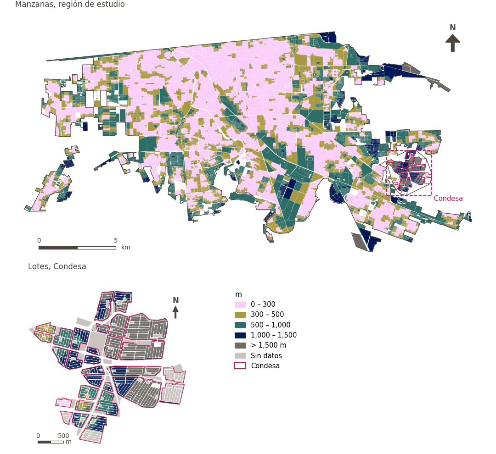

# Comunidad, cultura y recreación a menos de 300 m

[← Volver al contenido](../README.md)

> Distancia a pie al espacio comunitario, cultural o recreativo más cercano, puntuada con un umbral suave de 300 m.

## Identificación

| | |
|---|---|
| Identificador | `ccr_any` |
| Medida central (hoja de variables) | Acceso a comunidad, cultura y recreación |
| ID de la hoja / registro | 4, 46, 58, 121, 134, 225, 228, 257, 394 · #46, #58, #121, #134, #228, #225, #257, #394 |
| Variable en puntos de muestra | `sp_walk_nearest_node_denue_ccr_any` |
| Variable de área (valor medido) | `avg_walk_dist_denue_ccr_any` (m) |
| Puntuación normalizada | `index_uli__ccr_any` |
| Dominios (parte del peso) | [Infraestructura social](domain_social_infrastructure.md) |
| Subdominio | Comunidad, cultura y recreación |
| Enfoque | Proximidad |
| Mejor si es | valor medido menor (puntuación transformada mayor) |
| Peso efectivo en el índice | `uli` 1.7% · `uli_plain` 1.7% |
| Estado | Se puntúa en el índice publicado |

## Justificación e interpretación

> Los centros comunitarios de usos múltiples ofrecen oportunidades importantes de interacción social y conexión comunitaria, vitales para el bienestar mental y social. (traducción preliminar del inglés)
>
> — *Registro de indicadores #46: Access to community centres (Social Infrastructure / Community, culture & leisure)*

- Cita del libro de trabajo: Saitluanga, 2014, 'Spatial pattern of urban livability in Himalayan region: a case of Aizawl City'
- Lista de artículos: #22: Alderton (2019), ‘What is the meaning of urban liveability for a city in a low-to-middle-income country? Contextualising liveability for Bangkok, Thailand’
- ⚠ la cita del libro de trabajo no nombra a un autor del artículo de la lista; verifique antes de citar (citation_audit.csv)

> Los centros culturales son nodos importantes de actividad social y cultural que fortalecen la identidad comunitaria y promueven el bienestar psicológico de los residentes. (traducción preliminar del inglés)
>
> — *Registro de indicadores #58: Access to cultural centers (Social Infrastructure / Community, culture & leisure)*

- Cita del libro de trabajo: Kang et al., 2022, 'Can tourism development make cities more livable? Investigating 40 cities in China'
- Lista de artículos: #16: Kashi (2025), ‘Spatial analysis and ranking of urban districts based on a comprehensive livability approach: the case of Tehran’
- ⚠ la cita del libro de trabajo no nombra a un autor del artículo de la lista; verifique antes de citar (citation_audit.csv)

> El acceso fácil a equipamientos culturales como las bibliotecas es un componente clave de la comodidad urbana, pues permite a los residentes satisfacer sus necesidades básicas de información y educación. (traducción preliminar del inglés)
>
> — *Registro de indicadores #121: Access to libraries (Social Infrastructure / Community, culture & leisure)*

- Cita del libro de trabajo: Onnom et al., 2018, 'Development of a Liveable City Index (LCI) Using Multi Criteria Geospatial Modelling for Medium Class Cities in Developing Countries'; Liu et al., 2020, 'Using Multi-Source Data to Assess Livability in Hong Kong at the Community-Based Level: A Combined Subjective-Objective Approach'
- Lista de artículos: #18: Jodder (2024), ‘Urban Livability in a Rapidly Urbanizing Mid-Size City: Lessons for Planning in the Global South’
- ⚠ la cita del libro de trabajo no nombra a un autor del artículo de la lista; verifique antes de citar (citation_audit.csv)

> Los museos constituyen infraestructura cultural importante que favorece el desarrollo social, el aprendizaje a lo largo de la vida y la cohesión social de la comunidad. (traducción preliminar del inglés)
>
> — *Registro de indicadores #134: Access to museums (Social Infrastructure / Community, culture & leisure)*

- Cita del libro de trabajo: Lowe et al., 2015, 'Planning healthy, liveable and sustainable cities: how can indicators inform policy?'
- Lista de artículos: #13: Alderton (2021), ‘Measuring and monitoring liveability in a low-to-middle income country: a proof-of-concept for Bangkok, Thailand and lessons from an international partnership’
- ⚠ la cita del libro de trabajo no nombra a un autor del artículo de la lista; verifique antes de citar (citation_audit.csv)

> El acceso a centros religiosos contribuye al valor de amenidad de las zonas urbanas, y brinda confort social y cultural que mejora el bienestar humano. (traducción preliminar del inglés)
>
> — *Registro de indicadores #228: Access to religious buildings (Social Infrastructure / Community, Culture & Leisure)*

- Cita del libro de trabajo: Rehdanz and Maddison, 2008, 'Local environmental quality and life-satisfaction in Germany'
- Lista de artículos: #20: Basu (2021), ‘Urban livability index assessment based on land-use changes in an Indian medium-sized city (Raiganj)’
- ⚠ la cita del libro de trabajo no nombra a un autor del artículo de la lista; verifique antes de citar (citation_audit.csv)

> El acceso fácil a instalaciones recreativas enfatiza la provisión de espacios que brindan disfrute y confort físico, y mejora la habitabilidad general de los entornos urbanos. (traducción preliminar del inglés)
>
> — *Registro de indicadores #225: Access to recreational areas (Social Infrastructure / Community, Culture & Leisure)*

- Cita del libro de trabajo: Basu et al., 2021, 'Urban Livability Index Assessment Based on Land-Use Changes in an Indian Medium-Sized City (Raiganj)'; Fu et al., 2019, 'The Livable Urban Landscape: GIS and Remote Sensing Extracted Land Use Assessment for Urban Livability in Changchun Proper, China'
- Lista de artículos: #18: Jodder (2024), ‘Urban Livability in a Rapidly Urbanizing Mid-Size City: Lessons for Planning in the Global South’
- ⚠ la cita del libro de trabajo no nombra a un autor del artículo de la lista; verifique antes de citar (citation_audit.csv)

> La provisión de centros deportivos es crítica para promover la actividad física, que reduce el riesgo de enfermedades crónicas y mejora la salud mental. (traducción preliminar del inglés)
>
> — *Registro de indicadores #257: Access to sports centres (Social Infrastructure / Community, Culture & Leisure)*

- Cita del libro de trabajo: Lowe et al., 2015, 'Planning healthy, liveable and sustainable cities: how can indicators inform policy?'; Sachs et al., 2019, 'Six transformations to achieve the sustainable development goals'
- Lista de artículos: #13: Alderton (2021), ‘Measuring and monitoring liveability in a low-to-middle income country: a proof-of-concept for Bangkok, Thailand and lessons from an international partnership’; #16: Kashi (2025), ‘Spatial analysis and ranking of urban districts based on a comprehensive livability approach: the case of Tehran’; #20: Basu (2021), ‘Urban livability index assessment based on land-use changes in an Indian medium-sized city (Raiganj)’
- ⚠ la cita del libro de trabajo no nombra a un autor del artículo de la lista; verifique antes de citar (citation_audit.csv)

> El acceso a centros juveniles proporciona infraestructura social esencial que favorece la cohesión social, la salud mental y el bienestar comunitario de los residentes jóvenes. (traducción preliminar del inglés)
>
> — *Registro de indicadores #394: Access to youth centres (Social Infrastructure / Community, culture & leisure)*

- Cita del libro de trabajo: Lowe et al., 2015, 'Planning healthy, liveable and sustainable cities: how can indicators inform policy?'
- Lista de artículos: #13: Alderton (2021), ‘Measuring and monitoring liveability in a low-to-middle income country: a proof-of-concept for Bangkok, Thailand and lessons from an international partnership’
- ⚠ la cita del libro de trabajo no nombra a un autor del artículo de la lista; verifique antes de citar (citation_audit.csv)

**Cómo leerlo.** … de la población vive a menos de 300 m de un espacio comunitario, cultural o recreativo; en promedio, el más cercano está a … (menor es mejor).

**Access to community, culture and recreation services** (Community, culture and recreation access; ID 4, 46, 58, 121,134,225,228,257,394) (en inglés en la hoja)
- *Cómo calcular (hoja de variables):* Walking distance access to cultural centers, libraries, museums, recreational areas, religious buildings, sports centers, youth centers, activity centers and community centers.
- *Dudas (hoja):* Do we want to split this in 3: 1. Community 2. Recreational and 3. Cultural?

## Fuentes de datos

**Fuentes declaradas en la configuración:**

- INEGI (2026) Directorio Estadístico Nacional de Unidades Económicas (DENUE), May 2026.

**Fuente registrada por GHSCI (diccionario de datos)** (`avg_walk_dist_denue_ccr_any`):

- OpenStreetMap: Geofabrik GmbH, 20260815, ODbL, https://download.geofabrik.de/north-america/mexico-latest.osm.pbf, OpenStreetMap Contributors.  Geofabrik GmbH (2026). https://download.geofabrik.de/north-america/mexico-latest.osm.pbf; INEGI, Directorio Estadistico Nacional de Unidades Economicas (DENUE): 2026-05, Terminos de Libre Uso de la Informacion del INEGI, https://www.inegi.org.mx/app/mapa/denue/, INEGI (2026). Directorio Estadistico Nacional de Unidades Economicas (DENUE), mayo 2026. Instituto Nacional de Estadistica y Geografia, Mexico.

**Filtro de destinos:**

- `denue_community` (Community and social facilities (DENUE)): `MX/INEGI/DENUE_2026/denue_inegi_02_.shp` — Filtro de destinos: `"codigo_act IN ('813210','813230','931610')"`
- `denue_culture` (Cultural facilities (DENUE)): `MX/INEGI/DENUE_2026/denue_inegi_02_.shp` — Filtro de destinos: `"codigo_act IN ('712111','712112','519211','519212','512130','711311','711312')"`
- `denue_sport` (Sports and active recreation (DENUE)): `MX/INEGI/DENUE_2026/denue_inegi_02_.shp` — Filtro de destinos: `"codigo_act IN ('713941','713942','713943','713944','713910','713950','611621','611622')"`
- `denue_recreation` (Public recreation venues (DENUE)): `MX/INEGI/DENUE_2026/denue_inegi_02_.shp` — Filtro de destinos: `"codigo_act IN ('713111','713112','713113','712131','712132')"`

**Insumos:** [Destinos del DENUE por código SCIAN](denue_destinations.md)

## Método: teoría

1. Distancia por la red peatonal desde cada punto de muestra al destino más cercano, `d` (R2), censurada en la banda mayor buscada (1,500 m): un punto sin destino a esa distancia queda sin valor.
2. Puntuación de acceso suave (R10): `s(d) = 1 / (1 + exp(k·(d − t)/t))`, con `t = 300 m` y `k = 5`; `s = 0.5` en el umbral, ≈ 0.99 junto al destino, ≈ 0.007 a `2t`; sin valor → `s = 0`.
3. Normalización AMPI (R11) de `s` con las metas de la región de estudio, luego agregación por dominio e índice (R12) y a áreas (R13).

## Método: práctica

**Recetas:** [R1. Puntos de muestra y red peatonal](../03_recipes.md#r1), [R2. Distancia por la red al destino más cercano, censurada](../03_recipes.md#r2), [R10. Transformaciones: umbrales suaves y escalas escalonadas](../03_recipes.md#r10), [R11. Normalización: el Índice Ajustado de Mazziotta–Pareto (AMPI)](../03_recipes.md#r11), [R12. Agregación: dominios, indicadores compartidos e índice](../03_recipes.md#r12), [R13. De los puntos de muestra a las áreas](../03_recipes.md#r13), [R14. Metas congeladas y recálculo de un escenario](../03_recipes.md#r14)

**Configuración** ([`MX_Mexicali_2025_ULI.yml:1614`](../../data/MX_Mexicali_2025_ULI.yml#L1614)):

```yaml
- variable: sp_walk_nearest_node_denue_ccr_any
  name: ccr_any
  domains: [social_infrastructure]
  transform: {soft_threshold: 300}
  group: {es: 'Acceso a comunidad, cultura y recreación', en: 'Community, culture and recreation access'}
  label: {es: 'Comunidad, cultura y recreación a menos de 300 m', en: 'Community, culture and recreation within 300 m'}
  reading: {es: '{access} de la población vive a menos de 300 m de un espacio comunitario, cultural o recreativo; en promedio, el más cercano está a {value}', en: '{access} of the population live within 300 m of a community, cultural or recreational venue; on average the nearest is {value} away'}
  subdomain: {es: 'Comunidad, cultura y recreación', en: 'Community, culture and recreation'}
  about:
    es: Distancia a pie al espacio comunitario, cultural o recreativo más cercano, puntuada con un umbral suave de 300 m.
    en: Walking distance to the nearest community, cultural or recreational venue, scored with a 300 m soft threshold.
  sources:
    - 'INEGI (2026) Directorio Estadístico Nacional de Unidades Económicas (DENUE), May 2026.'
```

[`MX_Mexicali_2025_ULI.yml:517`](../../data/MX_Mexicali_2025_ULI.yml#L517):

```yaml
- {name: denue_ccr_any, category: community_culture_recreation, variant: any, layer: destinations, where: "dest_name IN ('denue_community', 'denue_culture', 'denue_sport', 'denue_recreation')"}
```

**Código (GHSCI):**

- [`process/subprocesses/_accessibility_spec.py:806`](https://github.com/healthysustainablecities/global-indicators/blob/f03909611dba336c2728fffab6d697779487d0b1/process/subprocesses/_accessibility_spec.py#L806) `_banded_distances()`
- [`process/subprocesses/setup_sp.py:888`](https://github.com/healthysustainablecities/global-indicators/blob/f03909611dba336c2728fffab6d697779487d0b1/process/subprocesses/setup_sp.py#L888) `create_full_nodes()`
- [`process/subprocesses/_composite_index.py:1457`](https://github.com/healthysustainablecities/global-indicators/blob/f03909611dba336c2728fffab6d697779487d0b1/process/subprocesses/_composite_index.py#L1457) `soft_threshold()`
- [`process/subprocesses/_composite_index.py:1819`](https://github.com/healthysustainablecities/global-indicators/blob/f03909611dba336c2728fffab6d697779487d0b1/process/subprocesses/_composite_index.py#L1819) `normalise()`
- [`process/subprocesses/_composite_index.py:1838`](https://github.com/healthysustainablecities/global-indicators/blob/f03909611dba336c2728fffab6d697779487d0b1/process/subprocesses/_composite_index.py#L1838) `mpi_aggregate()`

|  | Variable en puntos de muestra | Transformación | Metas (escala puntuada) | inf – sup | asim. / curt. / empates | Alertas |
|---|---|---|---|---|---|---|
| `uli` | sp_walk_nearest_node_denue_ccr_any | acceso suave, umbral de 300 m, k = 5 | −0.077 · 0.420 · 0.916 | 0.000 – 0.993 | 0.21 / −1.67 / 6.6% | ninguna |
| `uli_plain` | sp_walk_nearest_node_denue_ccr_any | acceso suave, umbral de 300 m, k = 5 | −0.077 · 0.420 · 0.916 | 0.000 – 0.993 | 0.21 / −1.67 / 6.6% | ninguna |

## Recálculo (Reimagina Urbano)

Un destino nuevo o retirado, o un cambio en la red peatonal, cambia `d` solo en los puntos cuyo destino más cercano cambia: basta un Dijkstra multi-origen desde los destinos afectados, limitado a 1,500 m, tomando el mínimo con la distancia previa.

Con las metas congeladas del archivo de parámetros (`Ref`, `Mín.`, `Máx.`, R14), una nueva puntuación es `r = 100 ± 60·(x − Ref)/(Máx. − Mín.)` sin volver a resolver metas; el dominio y el índice se recalculan con R12 y se resta 100. Así un escenario se compara con la línea base en la misma escala.

## Resultados

| Medida | Región de estudio (Mexicali con Condesa) | Condesa |
|---|---|---|
| Valor de la región | 332 m | 1,075 m |
| Puntuación de la región (`uli`) | +6.5 | −24.4 |
| Áreas con valor | 14,110 de 14,252 manzanas | 6,788 de 14,988 lotes |
| Mediana (P25–P75), ponderada | 292 m (189 m – 458 m) | 1,071 m (791 m – 1,417 m) |
| Rango | 17 m – 2,257 m | 64 m – 2,412 m |
| Nada a la distancia buscada | 0.3% | 48.8% |
| Puntuación: mediana (P25–P75) (`uli`) | +6.5 (−18.1 – +24.0) | −25.3 (−25.3 – −25.3) |

*Distribuciones: manzanas de la región de estudio ponderadas por su población censal (2020); lotes de Condesa con igual peso (3.2 residentes supuestos por lote). Los valores de la región son los que GHSCI reporta para cada región en conjunto.*

*Una distancia media se calcula sobre los puntos que encontraron un destino dentro de la distancia buscada; la fila «Nada a la distancia buscada» da la parte de la población de las áreas sin ninguno.*

- Región de estudio: 55.7% de la población vive a menos de 300 m de un espacio comunitario, cultural o recreativo; en promedio, el más cercano está a 332 m.
- Condesa: 1.4% de la población vive a menos de 300 m de un espacio comunitario, cultural o recreativo; en promedio, el más cercano está a 1,075 m.
- Para la región de estudio en su conjunto, el valor es 332 m; en Condesa, 1,075 m. La puntuación de Condesa queda 24.4 puntos por debajo del promedio de la región de estudio (+6.5 para la región de estudio).

## Mapa



*Mapa. Comunidad, cultura y recreación a menos de 300 m: valor medido (m) por manzana en la región de estudio y por lote en Condesa (recuadro). Clases del tablero; los colores favorables son los claros (menor es mejor).*

## Advertencias y pendientes

- La hoja pregunta si separarlo en acceso comunitario, recreativo y cultural; se usa una sola medida, y la separación se refleja en su diversidad.
