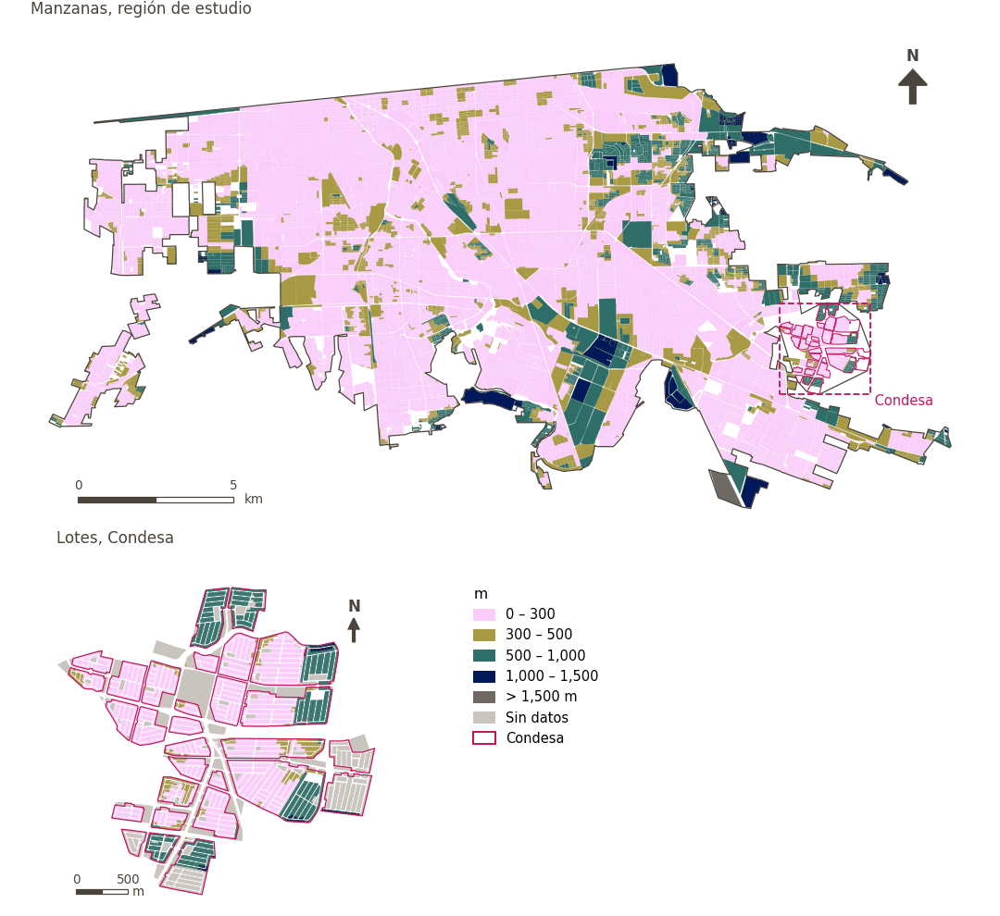

# Tiendas de conveniencia a menos de 300 m

[← Volver al contenido](../README.md)

> Distancia a pie a la tienda de conveniencia más cercana, puntuada con un umbral suave de 300 m.

## Identificación

| | |
|---|---|
| Identificador | `convenience` |
| Medida central (hoja de variables) | Acceso a servicios esenciales cotidianos |
| ID de la hoja / registro | 132 · #132 |
| Variable en puntos de muestra | `sp_walk_nearest_node_denue_food_retail` |
| Variable de área (valor medido) | `avg_walk_dist_denue_food_retail` (m) |
| Puntuación normalizada | `index_uli__convenience` |
| Dominios (parte del peso) | [Infraestructura social](domain_social_infrastructure.md) (33%), [Movilidad y transporte](domain_mobility_transport.md) (33%), [Desarrollo económico](domain_economic_development.md) (33%) |
| Subdominio | Infraestructura social: Servicios públicos; Movilidad y transporte: Movilidad activa; Desarrollo económico: Ambiente de alimentación |
| Enfoque | Proximidad |
| Mejor si es | valor medido menor (puntuación transformada mayor) |
| Peso efectivo en el índice | `uli` 3.6% · `uli_plain` 3.6% |
| Estado | Se puntúa en el índice publicado |

## Justificación e interpretación

> La disponibilidad de minisupers es un indicador del acceso local a alimentos, que facilita la provisión conveniente de artículos de primera necesidad que moldean la calidad de vida urbana. (traducción preliminar del inglés)
>
> — *Registro de indicadores #132: Access to minimarts (Economic Development / Food Environment)*

- Cita del libro de trabajo: Lowe et al., 2015, 'Planning healthy, liveable and sustainable cities: how can indicators inform policy?'; Alderton et al., 2019, 'What is the meaning of urban liveability for a city in a low-to-middle-income country? Contextualising liveability for Bangkok, Thailand'
- Lista de artículos: #13: Alderton (2021), ‘Measuring and monitoring liveability in a low-to-middle income country: a proof-of-concept for Bangkok, Thailand and lessons from an international partnership’

**Cómo leerlo.** … de la población vive a menos de 300 m de una tienda de conveniencia; en promedio, la más cercana está a … (menor es mejor).

**Access to convenience stores** (Daily essential-services access; ID 132) (en inglés en la hoja)
- *Cómo calcular (hoja de variables):* Walking distance access to convenience stores and minimart

**Percentage of population with access to convenience stores** (Daily essential-services access; ID 132) (en inglés en la hoja)
- *Cómo calcular (hoja de variables):* USE GHSCI CALCULATION HERE (Distance (m) along the pedestrian network to the nearest convenience store (source: OpenStreetMap or custom data))

## Fuentes de datos

**Fuentes declaradas en la configuración:**

- INEGI (2026) Directorio Estadístico Nacional de Unidades Económicas (DENUE), May 2026.

**Fuente registrada por GHSCI (diccionario de datos)** (`avg_walk_dist_denue_food_retail`):

- OpenStreetMap: Geofabrik GmbH, 20260815, ODbL, https://download.geofabrik.de/north-america/mexico-latest.osm.pbf, OpenStreetMap Contributors.  Geofabrik GmbH (2026). https://download.geofabrik.de/north-america/mexico-latest.osm.pbf; INEGI, Directorio Estadistico Nacional de Unidades Economicas (DENUE): 2026-05, Terminos de Libre Uso de la Informacion del INEGI, https://www.inegi.org.mx/app/mapa/denue/, INEGI (2026). Directorio Estadistico Nacional de Unidades Economicas (DENUE), mayo 2026. Instituto Nacional de Estadistica y Geografia, Mexico.

**Filtro de destinos:**

- `denue_food_retail` (Food retail, any (DENUE)): `MX/INEGI/DENUE_2026/denue_inegi_02_.shp` — Filtro de destinos: `"(codigo_act LIKE '4611%' AND codigo_act NOT IN ('461211','461212','461213','461220')) OR codigo_act LIKE '4621%'"`

**Insumos:** [Destinos del DENUE por código SCIAN](denue_destinations.md)

## Método: teoría

1. Distancia por la red peatonal desde cada punto de muestra al destino más cercano, `d` (R2), censurada en la banda mayor buscada (1,500 m): un punto sin destino a esa distancia queda sin valor.
2. Puntuación de acceso suave (R10): `s(d) = 1 / (1 + exp(k·(d − t)/t))`, con `t = 300 m` y `k = 5`; `s = 0.5` en el umbral, ≈ 0.99 junto al destino, ≈ 0.007 a `2t`; sin valor → `s = 0`.
3. Normalización AMPI (R11) de `s` con las metas de la región de estudio, luego agregación por dominio e índice (R12) y a áreas (R13).

## Método: práctica

**Recetas:** [R1. Puntos de muestra y red peatonal](../03_recipes.md#r1), [R2. Distancia por la red al destino más cercano, censurada](../03_recipes.md#r2), [R10. Transformaciones: umbrales suaves y escalas escalonadas](../03_recipes.md#r10), [R11. Normalización: el Índice Ajustado de Mazziotta–Pareto (AMPI)](../03_recipes.md#r11), [R12. Agregación: dominios, indicadores compartidos e índice](../03_recipes.md#r12), [R13. De los puntos de muestra a las áreas](../03_recipes.md#r13), [R14. Metas congeladas y recálculo de un escenario](../03_recipes.md#r14)

**Configuración** ([`MX_Mexicali_2025_ULI.yml:1506`](../../data/MX_Mexicali_2025_ULI.yml#L1506)):

```yaml
- variable: sp_walk_nearest_node_denue_food_retail
  name: convenience
  domains: [social_infrastructure, mobility_transport, economic_development]
  transform: {soft_threshold: 300}
  group: {es: 'Acceso a servicios esenciales cotidianos', en: 'Daily essential-services access'}
  label: {es: 'Tiendas de conveniencia a menos de 300 m', en: 'Convenience stores within 300 m'}
  reading: {es: '{access} de la población vive a menos de 300 m de una tienda de conveniencia; en promedio, la más cercana está a {value}', en: '{access} of the population live within 300 m of a convenience store; on average the nearest is {value} away'}
  subdomain:
    social_infrastructure: {es: 'Servicios públicos', en: 'Public services'}
    mobility_transport: {es: 'Movilidad activa', en: 'Active mobility'}
    economic_development: {es: 'Ambiente de alimentación', en: 'Food environment'}
  about:
    es: Distancia a pie a la tienda de conveniencia más cercana, puntuada con un umbral suave de 300 m.
    en: Walking distance to the nearest convenience store, scored with a 300 m soft threshold.
  sources:
    - 'INEGI (2026) Directorio Estadístico Nacional de Unidades Económicas (DENUE), May 2026.'
```

[`MX_Mexicali_2025_ULI.yml:496`](../../data/MX_Mexicali_2025_ULI.yml#L496):

```yaml
- {name: denue_food_retail, category: food_retail, variant: lenient, layer: destinations, where: "dest_name = 'denue_food_retail'"}
```

**Código (GHSCI):**

- [`process/subprocesses/_accessibility_spec.py:806`](https://github.com/healthysustainablecities/global-indicators/blob/f03909611dba336c2728fffab6d697779487d0b1/process/subprocesses/_accessibility_spec.py#L806) `_banded_distances()`
- [`process/subprocesses/setup_sp.py:888`](https://github.com/healthysustainablecities/global-indicators/blob/f03909611dba336c2728fffab6d697779487d0b1/process/subprocesses/setup_sp.py#L888) `create_full_nodes()`
- [`process/subprocesses/_composite_index.py:1457`](https://github.com/healthysustainablecities/global-indicators/blob/f03909611dba336c2728fffab6d697779487d0b1/process/subprocesses/_composite_index.py#L1457) `soft_threshold()`
- [`process/subprocesses/_composite_index.py:1819`](https://github.com/healthysustainablecities/global-indicators/blob/f03909611dba336c2728fffab6d697779487d0b1/process/subprocesses/_composite_index.py#L1819) `normalise()`
- [`process/subprocesses/_composite_index.py:1838`](https://github.com/healthysustainablecities/global-indicators/blob/f03909611dba336c2728fffab6d697779487d0b1/process/subprocesses/_composite_index.py#L1838) `mpi_aggregate()`

|  | Variable en puntos de muestra | Transformación | Metas (escala puntuada) | inf – sup | asim. / curt. / empates | Alertas |
|---|---|---|---|---|---|---|
| `uli` | sp_walk_nearest_node_denue_food_retail | acceso suave, umbral de 300 m, k = 5 | 0.179 · 0.675 · 1.172 | 0.000 – 0.993 | −0.94 / −0.77 / 0.5% | ninguna |
| `uli_plain` | sp_walk_nearest_node_denue_food_retail | acceso suave, umbral de 300 m, k = 5 | 0.179 · 0.675 · 1.172 | 0.000 – 0.993 | −0.94 / −0.77 / 0.5% | ninguna |

## Recálculo (Reimagina Urbano)

Un destino nuevo o retirado, o un cambio en la red peatonal, cambia `d` solo en los puntos cuyo destino más cercano cambia: basta un Dijkstra multi-origen desde los destinos afectados, limitado a 1,500 m, tomando el mínimo con la distancia previa.

Con las metas congeladas del archivo de parámetros (`Ref`, `Mín.`, `Máx.`, R14), una nueva puntuación es `r = 100 ± 60·(x − Ref)/(Máx. − Mín.)` sin volver a resolver metas; el dominio y el índice se recalculan con R12 y se resta 100. Así un escenario se compara con la línea base en la misma escala.

## Resultados

| Medida | Región de estudio (Mexicali con Condesa) | Condesa |
|---|---|---|
| Valor de la región | 181 m | 341 m |
| Puntuación de la región (`uli`) | +8.0 | −4.2 |
| Áreas con valor | 14,209 de 14,252 manzanas | 13,265 de 14,988 lotes |
| Mediana (P25–P75), ponderada | 136 m (99 m – 203 m) | 210 m (140 m – 527 m) |
| Rango | 16 m – 1,594 m | 10 m – 1,660 m |
| Nada a la distancia buscada | 0.0% | 0.0% |
| Puntuación: mediana (P25–P75) (`uli`) | +14.3 (+6.3 – +16.9) | +8.2 (−38.5 – +15.6) |

*Distribuciones: manzanas de la región de estudio ponderadas por su población censal (2020); lotes de Condesa con igual peso (3.2 residentes supuestos por lote). Los valores de la región son los que GHSCI reporta para cada región en conjunto.*

*Una distancia media se calcula sobre los puntos que encontraron un destino dentro de la distancia buscada; la fila «Nada a la distancia buscada» da la parte de la población de las áreas sin ninguno.*

- Región de estudio: 87.2% de la población vive a menos de 300 m de una tienda de conveniencia; en promedio, la más cercana está a 181 m.
- Condesa: 67.4% de la población vive a menos de 300 m de una tienda de conveniencia; en promedio, la más cercana está a 341 m.
- Para la región de estudio en su conjunto, el valor es 181 m; en Condesa, 341 m. La puntuación de Condesa queda 4.2 puntos por debajo del promedio de la región de estudio (+8.0 para la región de estudio).

## Mapa



*Mapa. Tiendas de conveniencia a menos de 300 m: valor medido (m) por manzana en la región de estudio y por lote en Condesa (recuadro). Clases del tablero; los colores favorables son los claros (menor es mejor).*

## Advertencias y pendientes

- Con el nombre de «tiendas de conveniencia», el destino es el comercio de alimentos de cualquier tipo del DENUE (abarrotes y misceláneas, dulcerías, alimentos preparados, autoservicio y departamentales), que incluye los comercios de alimentos frescos.
