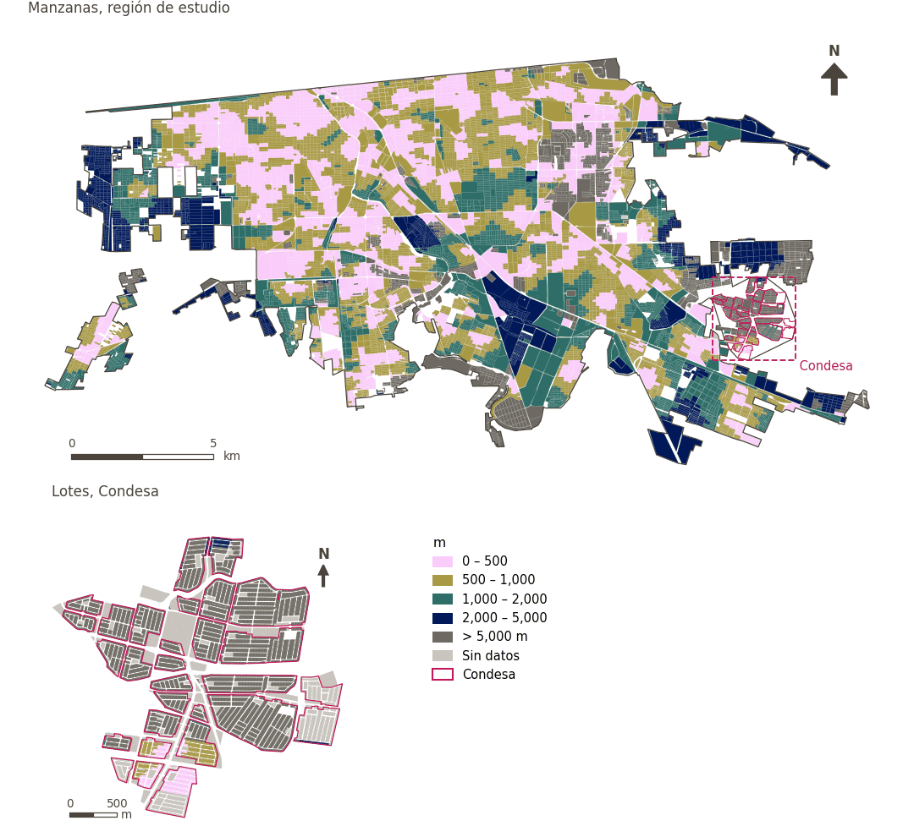

# Alimentos a menos de 1.5 km en bicicleta de bajo estrés

[← Volver al contenido](../README.md)

> Distancia a la tienda de alimentos frescos o de conveniencia más cercana usando solo calles de bajo estrés para bicicleta (LTS 1-2), puntuada con un umbral suave de 1.5 km.

## Identificación

| | |
|---|---|
| Identificador | `cycle_low_stress_food` |
| Medida central (hoja de variables) | Nivel de estrés del tráfico para ciclismo |
| ID de la hoja / registro | #62 |
| Variable en puntos de muestra | `sp_cycle_safe_nearest_node_fresh_food_pooled` |
| Variable de área (valor medido) | `avg_cycle_dist_safe_fresh_food_pooled` (m) |
| Puntuación normalizada | `index_uli__cycle_low_stress_food` |
| Dominios (parte del peso) | [Seguridad y protección](domain_safety.md) (33%), [Movilidad y transporte](domain_mobility_transport.md) (33%), [Ambiente construido](domain_built_environment.md) (33%) |
| Subdominio | Seguridad y protección: Seguridad vial; Movilidad y transporte: Movilidad activa; Ambiente construido: Diseño urbano |
| Enfoque | Proximidad |
| Mejor si es | valor medido menor (puntuación transformada mayor) |
| Peso efectivo en el índice | `uli` 6.2% · `uli_plain` 6.2% |
| Estado | Se puntúa en el índice publicado |

## Justificación e interpretación

> Diseñar calles secundarias que promuevan la caminata y la bicicleta integra a los residentes al tejido urbano y favorece un entorno saludable y centrado en las personas. (traducción preliminar del inglés)
>
> — *Registro de indicadores #62: Level of cycling traffic stress (Mobility & Transport / Active Travel)*

- Cita del libro de trabajo: Skalicky & Čerpes, 2019, 'Comprehensive assessment methodology for liveable residential environment'
- Lista de artículos: #23: Sarkar (2020), ‘Socio-physical liveability through socio-spatiality in low-income resettlement archetypes - A case of slum rehabilitation housing in Mumbai, India.’
- ⚠ la cita del libro de trabajo no nombra a un autor del artículo de la lista; verifique antes de citar (citation_audit.csv)

**Cómo leerlo.** En promedio, la tienda de alimentos más cercana está a … por calles de bajo estrés (menor es mejor).

**Average distance to nearest** (Level of Traffic Stress for Cycling; ID –) (en inglés en la hoja)
- *Cómo calcular (hoja de variables):* USE GHSCI CALCULATION HERE
- *Dudas (hoja):* This is a suite of variables that we need to disaggregate.

## Fuentes de datos

**Fuentes declaradas en la configuración:**

- OpenStreetMap contributors (Geofabrik Mexico extract, 15 August 2026); level of traffic stress classified by GHSCI.
- INEGI (2026) Directorio Estadístico Nacional de Unidades Económicas (DENUE), May 2026.

**Fuente registrada por GHSCI (diccionario de datos)** (`avg_cycle_dist_safe_fresh_food_pooled`):

- OpenStreetMap: Geofabrik GmbH, 20260815, ODbL, https://download.geofabrik.de/north-america/mexico-latest.osm.pbf, OpenStreetMap Contributors.  Geofabrik GmbH (2026). https://download.geofabrik.de/north-america/mexico-latest.osm.pbf

**Insumos:** [Red ciclista por nivel de estrés del tráfico (LTS)](lts_network.md)

## Método: teoría

1. Red ciclista clasificada por nivel de estrés del tráfico (LTS 1–4) y restringida a tramos de bajo estrés (LTS ≤ 2) donde se permite circular en bicicleta o empujarla (R6).
2. Distancia por esa red al destino más cercano, `d` (R2), buscada hasta 5,000 m.
3. Acceso suave (R10): `t = 1,500 m`, `k = 5`; sin valor → 0. Luego R11–R13.

## Método: práctica

**Recetas:** [R1. Puntos de muestra y red peatonal](../03_recipes.md#r1), [R6. Nivel de estrés del tráfico y red ciclista de bajo estrés](../03_recipes.md#r6), [R2. Distancia por la red al destino más cercano, censurada](../03_recipes.md#r2), [R10. Transformaciones: umbrales suaves y escalas escalonadas](../03_recipes.md#r10), [R11. Normalización: el Índice Ajustado de Mazziotta–Pareto (AMPI)](../03_recipes.md#r11), [R12. Agregación: dominios, indicadores compartidos e índice](../03_recipes.md#r12), [R13. De los puntos de muestra a las áreas](../03_recipes.md#r13), [R14. Metas congeladas y recálculo de un escenario](../03_recipes.md#r14)

**Configuración** ([`MX_Mexicali_2025_ULI.yml:1440`](../../data/MX_Mexicali_2025_ULI.yml#L1440)):

```yaml
- variable: sp_cycle_safe_nearest_node_fresh_food_pooled
  name: cycle_low_stress_food
  domains: [safety, mobility_transport, built_environment]
  transform: {soft_threshold: 1500}
  group: {es: 'Nivel de estrés del tráfico para ciclismo', en: 'Level of traffic stress for cycling'}
  label: {es: 'Alimentos a menos de 1.5 km en bicicleta de bajo estrés', en: 'Food within 1.5 km by low-stress cycling'}
  reading: {es: 'En promedio, la tienda de alimentos más cercana está a {value} por calles de bajo estrés', en: 'On average the nearest fresh food or convenience store is {value} away by low-stress streets'}
  subdomain:
    safety: {es: 'Seguridad vial', en: 'Road safety'}
    mobility_transport: {es: 'Movilidad activa', en: 'Active mobility'}
    built_environment: {es: 'Diseño urbano', en: 'Urban design'}
  about:
    es: Distancia a la tienda de alimentos frescos o de conveniencia más cercana usando solo calles de bajo estrés para bicicleta (LTS 1-2), puntuada con un umbral suave de 1.5 km.
    en: Distance to the nearest fresh food or convenience store using only low-stress cycling streets (LTS 1-2), scored with a 1.5 km soft threshold.
  sources:
    - 'OpenStreetMap contributors (Geofabrik Mexico extract, 15 August 2026); level of traffic stress classified by GHSCI.'
    - 'INEGI (2026) Directorio Estadístico Nacional de Unidades Económicas (DENUE), May 2026.'
```

**Código (GHSCI):**

- [`process/subprocesses/_cycling_lts_network.py:546`](https://github.com/healthysustainablecities/global-indicators/blob/f03909611dba336c2728fffab6d697779487d0b1/process/subprocesses/_cycling_lts_network.py#L546) `assign_lts()`
- [`process/subprocesses/_cycling_accessibility.py:469`](https://github.com/healthysustainablecities/global-indicators/blob/f03909611dba336c2728fffab6d697779487d0b1/process/subprocesses/_cycling_accessibility.py#L469) `cycling_poi_distance()`
- [`process/subprocesses/_composite_index.py:1457`](https://github.com/healthysustainablecities/global-indicators/blob/f03909611dba336c2728fffab6d697779487d0b1/process/subprocesses/_composite_index.py#L1457) `soft_threshold()`
- [`process/subprocesses/_composite_index.py:1819`](https://github.com/healthysustainablecities/global-indicators/blob/f03909611dba336c2728fffab6d697779487d0b1/process/subprocesses/_composite_index.py#L1819) `normalise()`
- [`process/subprocesses/_composite_index.py:1838`](https://github.com/healthysustainablecities/global-indicators/blob/f03909611dba336c2728fffab6d697779487d0b1/process/subprocesses/_composite_index.py#L1838) `mpi_aggregate()`

|  | Variable en puntos de muestra | Transformación | Metas (escala puntuada) | inf – sup | asim. / curt. / empates | Alertas |
|---|---|---|---|---|---|---|
| `uli` | sp_cycle_safe_nearest_node_fresh_food_pooled | acceso suave, umbral de 1,500 m, k = 5 | 0.059 · 0.555 · 1.052 | 0.000 – 0.993 | −0.34 / −1.76 / 28.6% | ninguna |
| `uli_plain` | sp_cycle_safe_nearest_node_fresh_food_pooled | acceso suave, umbral de 1,500 m, k = 5 | 0.059 · 0.555 · 1.052 | 0.000 – 0.993 | −0.34 / −1.76 / 28.6% | ninguna |

## Recálculo (Reimagina Urbano)

Reclasificar el LTS de un tramo (p. ej., una ciclovía protegida nueva) cambia la subred de bajo estrés; hay que recalcular las distancias de los puntos conectados a ese tramo.

Con las metas congeladas del archivo de parámetros (`Ref`, `Mín.`, `Máx.`, R14), una nueva puntuación es `r = 100 ± 60·(x − Ref)/(Máx. − Mín.)` sin volver a resolver metas; el dominio y el índice se recalculan con R12 y se resta 100. Así un escenario se compara con la línea base en la misma escala.

## Resultados

| Medida | Región de estudio (Mexicali con Condesa) | Condesa |
|---|---|---|
| Valor de la región | 826 m | 1,025 m |
| Puntuación de la región (`uli`) | +10.4 | −27.9 |
| Áreas con valor | 12,510 de 14,252 manzanas | 1,530 de 14,988 lotes |
| Mediana (P25–P75), ponderada | 677 m (418 m – 1,062 m) | 550 m (402 m – 743 m) |
| Rango | 10 m – 5,552 m | 57 m – 5,142 m |
| Nada a la distancia buscada | 9.3% | 88.5% |
| Puntuación: mediana (P25–P75) (`uli`) | +20.5 (−2.4 – +24.7) | −33.5 (−33.5 – −33.5) |

*Distribuciones: manzanas de la región de estudio ponderadas por su población censal (2020); lotes de Condesa con igual peso (3.2 residentes supuestos por lote). Los valores de la región son los que GHSCI reporta para cada región en conjunto.*

*Una distancia media se calcula sobre los puntos que encontraron un destino dentro de la distancia buscada; la fila «Nada a la distancia buscada» da la parte de la población de las áreas sin ninguno.*

- Región de estudio: En promedio, la tienda de alimentos más cercana está a 826 m por calles de bajo estrés.
- Condesa: En promedio, la tienda de alimentos más cercana está a 1,025 m por calles de bajo estrés.
- Para la región de estudio en su conjunto, el valor es 826 m; en Condesa, 1,025 m. La puntuación de Condesa queda 27.9 puntos por debajo del promedio de la región de estudio (+10.4 para la región de estudio).

## Mapa



*Mapa. Alimentos a menos de 1.5 km en bicicleta de bajo estrés: valor medido (m) por manzana en la región de estudio y por lote en Condesa (recuadro). Clases del tablero; los colores favorables son los claros (menor es mejor).*

## Advertencias y pendientes

- La hoja describe el nivel de estrés del tráfico como un conjunto de variables aún por desagregar; el destino (alimentos frescos o conveniencia, de OpenStreetMap) y el umbral de 1.5 km son una elección provisional dentro de ese conjunto.
