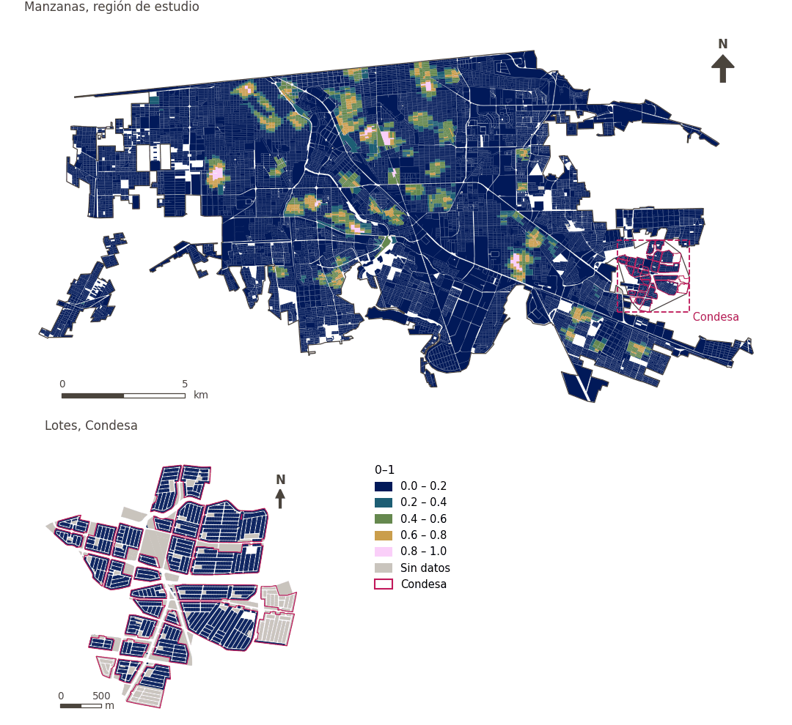

# Diversidad de servicios de cuidado a 500 m

[← Volver al contenido](../README.md)

> Diversidad (entropía de Shannon, 0-1) de los tipos de servicio de cuidado a 500 m a pie.

## Identificación

| | |
|---|---|
| Identificador | `div_care_500m` |
| Medida central (hoja de variables) | Acceso a salud, educación y cuidados |
| ID de la hoja / registro | – |
| Variable en puntos de muestra | `sp_walk_diversity_care_500m` |
| Variable de área (valor medido) | `avg_diversity_walk_care_500m` (0–1) |
| Puntuación normalizada | `index_uli__div_care_500m` |
| Dominios (parte del peso) | [Infraestructura social](domain_social_infrastructure.md) |
| Subdominio | Servicios públicos |
| Enfoque | Diversidad |
| Mejor si es | mayor |
| Peso efectivo en el índice | `uli` 1.7% · `uli_plain` 1.7% |
| Estado | Se puntúa en el índice publicado |

## Justificación e interpretación

*Pendiente: No consta en el registro del proyecto.*

**Cómo leerlo.** Diversidad media de servicios de cuidado a 500 m a pie: … (0 = un tipo o ninguno, 1 = todos los tipos por igual).

**Diversity of care services** (Health, education and care access; ID –) (en inglés en la hoja)
- *Cómo calcular (hoja de variables):* ?

## Fuentes de datos

**Fuentes declaradas en la configuración:**

- INEGI (2026) Directorio Estadístico Nacional de Unidades Económicas (DENUE), May 2026.

**Fuente registrada por GHSCI (diccionario de datos)** (`avg_diversity_walk_care_500m`):

- OpenStreetMap: Geofabrik GmbH, 20260815, ODbL, https://download.geofabrik.de/north-america/mexico-latest.osm.pbf, OpenStreetMap Contributors.  Geofabrik GmbH (2026). https://download.geofabrik.de/north-america/mexico-latest.osm.pbf; INEGI, Directorio Estadistico Nacional de Unidades Economicas (DENUE): 2026-05, Terminos de Libre Uso de la Informacion del INEGI, https://www.inegi.org.mx/app/mapa/denue/, INEGI (2026). Directorio Estadistico Nacional de Unidades Economicas (DENUE), mayo 2026. Instituto Nacional de Estadistica y Geografia, Mexico.

**Filtro de destinos:**

- `denue_care_support` (Care and social support services (DENUE)): `MX/INEGI/DENUE_2026/denue_inegi_02_.shp` — Filtro de destinos: `"codigo_act LIKE '623%' OR codigo_act LIKE '624%'"`

**Insumos:** [Conjuntos de diversidad y sus subtipos](diversity_sets.md), [Destinos del DENUE por código SCIAN](denue_destinations.md)

## Método: teoría

1. Para cada uno de los `k = 3` subtipos del conjunto «care» (`childcare`, `residential_care`, `social_assistance`), el número de destinos distintos alcanzables a 500 m por la red peatonal, `c_g` (R4).
2. Entropía de Shannon normalizada: `p_g = c_g / Σc`, `H = −Σ p_g·ln p_g / ln k`, de 0 (un subtipo o ninguno) a 1 (todos por igual). `k` es el número de subtipos configurados, no el de los presentes.
3. Normalización AMPI (R11), agregación (R12) y áreas (R13).

## Método: práctica

**Recetas:** [R1. Puntos de muestra y red peatonal](../03_recipes.md#r1), [R4. Diversidad de lo alcanzable](../03_recipes.md#r4), [R11. Normalización: el Índice Ajustado de Mazziotta–Pareto (AMPI)](../03_recipes.md#r11), [R12. Agregación: dominios, indicadores compartidos e índice](../03_recipes.md#r12), [R13. De los puntos de muestra a las áreas](../03_recipes.md#r13), [R14. Metas congeladas y recálculo de un escenario](../03_recipes.md#r14)

**Configuración** ([`MX_Mexicali_2025_ULI.yml:1602`](../../data/MX_Mexicali_2025_ULI.yml#L1602)):

```yaml
- variable: sp_walk_diversity_care_500m
  name: div_care_500m
  domains: [social_infrastructure]
  group: {es: 'Acceso a salud, educación y cuidados', en: 'Health, education and care access'}
  label: {es: 'Diversidad de servicios de cuidado a 500 m', en: 'Care service diversity within 500 m'}
  reading: {es: 'Diversidad media de servicios de cuidado a 500 m a pie: {value} (0 = un tipo o ninguno, 1 = todos los tipos por igual)', en: 'Mean diversity of care services within a 500 m walk: {value} (0 = one kind or none, 1 = every kind equally)'}
  subdomain: {es: 'Servicios públicos', en: 'Public services'}
  about:
    es: Diversidad (entropía de Shannon, 0-1) de los tipos de servicio de cuidado a 500 m a pie.
    en: Diversity (Shannon entropy, 0-1) of the kinds of care service within a 500 m walk.
  sources:
    - 'INEGI (2026) Directorio Estadístico Nacional de Unidades Económicas (DENUE), May 2026.'
```

**Código (GHSCI):**

- [`process/subprocesses/_accessibility_spec.py:929`](https://github.com/healthysustainablecities/global-indicators/blob/f03909611dba336c2728fffab6d697779487d0b1/process/subprocesses/_accessibility_spec.py#L929) `_banded_counts()`
- [`process/subprocesses/_accessibility_spec.py:466`](https://github.com/healthysustainablecities/global-indicators/blob/f03909611dba336c2728fffab6d697779487d0b1/process/subprocesses/_accessibility_spec.py#L466) `normalised_entropy()`
- [`process/subprocesses/_composite_index.py:1819`](https://github.com/healthysustainablecities/global-indicators/blob/f03909611dba336c2728fffab6d697779487d0b1/process/subprocesses/_composite_index.py#L1819) `normalise()`
- [`process/subprocesses/_composite_index.py:1838`](https://github.com/healthysustainablecities/global-indicators/blob/f03909611dba336c2728fffab6d697779487d0b1/process/subprocesses/_composite_index.py#L1838) `mpi_aggregate()`

|  | Variable en puntos de muestra | Transformación | Metas (escala puntuada) | inf – sup | asim. / curt. / empates | Alertas |
|---|---|---|---|---|---|---|
| `uli` | sp_walk_diversity_care_500m | tal cual | −0.440 · 0.060 · 0.560 | 0.000 – 1.000 | 2.91 / 7.16 / 89.8% | skewed |
| `uli_plain` | sp_walk_diversity_care_500m | tal cual | −0.440 · 0.060 · 0.560 | 0.000 – 1.000 | 2.91 / 7.16 / 89.8% | skewed |

## Recálculo (Reimagina Urbano)

Un destino nuevo suma 1 a `c_g` de su subtipo en los puntos a 500 m o menos por la red; la entropía se recalcula en esos puntos.

Con las metas congeladas del archivo de parámetros (`Ref`, `Mín.`, `Máx.`, R14), una nueva puntuación es `r = 100 ± 60·(x − Ref)/(Máx. − Mín.)` sin volver a resolver metas; el dominio y el índice se recalculan con R12 y se resta 100. Así un escenario se compara con la línea base en la misma escala.

## Resultados

| Medida | Región de estudio (Mexicali con Condesa) | Condesa |
|---|---|---|
| Valor de la región | 0.09 | 0.00 |
| Puntuación de la región (`uli`) | +1.7 | −3.6 |
| Áreas con valor | 14,216 de 14,252 manzanas | 13,265 de 14,988 lotes |
| Mediana (P25–P75), ponderada | 0.00 (0.00 – 0.00) | 0.00 (0.00 – 0.00) |
| Rango | 0.00 – 1.00 | 0.00 – 0.00 |
| Puntuación: mediana (P25–P75) (`uli`) | −3.6 (−3.6 – −3.6) | −3.6 (−3.6 – −3.6) |

*Distribuciones: manzanas de la región de estudio ponderadas por su población censal (2020); lotes de Condesa con igual peso (3.2 residentes supuestos por lote). Los valores de la región son los que GHSCI reporta para cada región en conjunto.*

- Región de estudio: Diversidad media de servicios de cuidado a 500 m a pie: 0.09 (0 = un tipo o ninguno, 1 = todos los tipos por igual).
- Condesa: Diversidad media de servicios de cuidado a 500 m a pie: 0.00 (0 = un tipo o ninguno, 1 = todos los tipos por igual).
- Para la región de estudio en su conjunto, el valor es 0.09; en Condesa, 0.00. La puntuación de Condesa queda 3.6 puntos por debajo del promedio de la región de estudio (+1.7 para la región de estudio).

## Mapa



*Mapa. Diversidad de servicios de cuidado a 500 m: valor medido (0–1) por manzana en la región de estudio y por lote en Condesa (recuadro). Clases del tablero; los colores favorables son los claros (mayor es mejor).*

## Advertencias y pendientes

- La hoja no especificó el método de esta fila («?»); los subtipos son los grupos SCIAN de cuidado y apoyo social (configuración).
