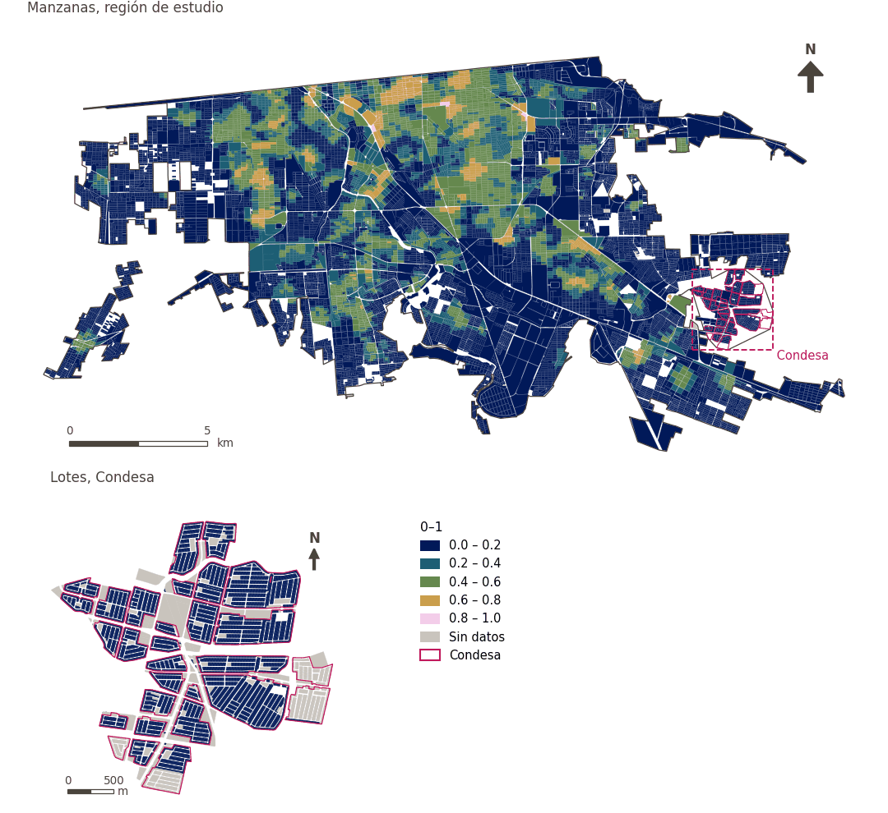

# Diversidad de comunidad, cultura y recreación a 500 m

[← Volver al contenido](../README.md)

> Diversidad (entropía de Shannon, 0-1) de los espacios comunitarios, culturales y recreativos a 500 m a pie.

## Identificación

| | |
|---|---|
| Identificador | `div_ccr_500m` |
| Medida central (hoja de variables) | Acceso a comunidad, cultura y recreación |
| ID de la hoja / registro | 4, 46, 58, 121, 134, 225, 228, 257, 394 · #46, #58, #121, #134, #228, #225, #257, #394 |
| Variable en puntos de muestra | `sp_walk_diversity_community_culture_recreation_500m` |
| Variable de área (valor medido) | `avg_diversity_walk_community_culture_recreation_500m` (0–1) |
| Puntuación normalizada | `index_uli__div_ccr_500m` |
| Dominios (parte del peso) | [Infraestructura social](domain_social_infrastructure.md) |
| Subdominio | Comunidad, cultura y recreación |
| Enfoque | Diversidad |
| Mejor si es | mayor |
| Peso efectivo en el índice | `uli` 1.7% · `uli_plain` 1.7% |
| Estado | Se puntúa en el índice publicado |

## Justificación e interpretación

> Los centros comunitarios de usos múltiples ofrecen oportunidades importantes de interacción social y conexión comunitaria, vitales para el bienestar mental y social. (traducción preliminar del inglés)
>
> — *Registro de indicadores #46: Access to community centres (Social Infrastructure / Community, culture & leisure)*

- Cita del libro de trabajo: Saitluanga, 2014, 'Spatial pattern of urban livability in Himalayan region: a case of Aizawl City'
- Lista de artículos: #22: Alderton (2019), ‘What is the meaning of urban liveability for a city in a low-to-middle-income country? Contextualising liveability for Bangkok, Thailand’
- ⚠ la cita del libro de trabajo no nombra a un autor del artículo de la lista; verifique antes de citar (citation_audit.csv)

> Los centros culturales son nodos importantes de actividad social y cultural que fortalecen la identidad comunitaria y promueven el bienestar psicológico de los residentes. (traducción preliminar del inglés)
>
> — *Registro de indicadores #58: Access to cultural centers (Social Infrastructure / Community, culture & leisure)*

- Cita del libro de trabajo: Kang et al., 2022, 'Can tourism development make cities more livable? Investigating 40 cities in China'
- Lista de artículos: #16: Kashi (2025), ‘Spatial analysis and ranking of urban districts based on a comprehensive livability approach: the case of Tehran’
- ⚠ la cita del libro de trabajo no nombra a un autor del artículo de la lista; verifique antes de citar (citation_audit.csv)

> El acceso fácil a equipamientos culturales como las bibliotecas es un componente clave de la comodidad urbana, pues permite a los residentes satisfacer sus necesidades básicas de información y educación. (traducción preliminar del inglés)
>
> — *Registro de indicadores #121: Access to libraries (Social Infrastructure / Community, culture & leisure)*

- Cita del libro de trabajo: Onnom et al., 2018, 'Development of a Liveable City Index (LCI) Using Multi Criteria Geospatial Modelling for Medium Class Cities in Developing Countries'; Liu et al., 2020, 'Using Multi-Source Data to Assess Livability in Hong Kong at the Community-Based Level: A Combined Subjective-Objective Approach'
- Lista de artículos: #18: Jodder (2024), ‘Urban Livability in a Rapidly Urbanizing Mid-Size City: Lessons for Planning in the Global South’
- ⚠ la cita del libro de trabajo no nombra a un autor del artículo de la lista; verifique antes de citar (citation_audit.csv)

> Los museos constituyen infraestructura cultural importante que favorece el desarrollo social, el aprendizaje a lo largo de la vida y la cohesión social de la comunidad. (traducción preliminar del inglés)
>
> — *Registro de indicadores #134: Access to museums (Social Infrastructure / Community, culture & leisure)*

- Cita del libro de trabajo: Lowe et al., 2015, 'Planning healthy, liveable and sustainable cities: how can indicators inform policy?'
- Lista de artículos: #13: Alderton (2021), ‘Measuring and monitoring liveability in a low-to-middle income country: a proof-of-concept for Bangkok, Thailand and lessons from an international partnership’
- ⚠ la cita del libro de trabajo no nombra a un autor del artículo de la lista; verifique antes de citar (citation_audit.csv)

> El acceso a centros religiosos contribuye al valor de amenidad de las zonas urbanas, y brinda confort social y cultural que mejora el bienestar humano. (traducción preliminar del inglés)
>
> — *Registro de indicadores #228: Access to religious buildings (Social Infrastructure / Community, Culture & Leisure)*

- Cita del libro de trabajo: Rehdanz and Maddison, 2008, 'Local environmental quality and life-satisfaction in Germany'
- Lista de artículos: #20: Basu (2021), ‘Urban livability index assessment based on land-use changes in an Indian medium-sized city (Raiganj)’
- ⚠ la cita del libro de trabajo no nombra a un autor del artículo de la lista; verifique antes de citar (citation_audit.csv)

> El acceso fácil a instalaciones recreativas enfatiza la provisión de espacios que brindan disfrute y confort físico, y mejora la habitabilidad general de los entornos urbanos. (traducción preliminar del inglés)
>
> — *Registro de indicadores #225: Access to recreational areas (Social Infrastructure / Community, Culture & Leisure)*

- Cita del libro de trabajo: Basu et al., 2021, 'Urban Livability Index Assessment Based on Land-Use Changes in an Indian Medium-Sized City (Raiganj)'; Fu et al., 2019, 'The Livable Urban Landscape: GIS and Remote Sensing Extracted Land Use Assessment for Urban Livability in Changchun Proper, China'
- Lista de artículos: #18: Jodder (2024), ‘Urban Livability in a Rapidly Urbanizing Mid-Size City: Lessons for Planning in the Global South’
- ⚠ la cita del libro de trabajo no nombra a un autor del artículo de la lista; verifique antes de citar (citation_audit.csv)

> La provisión de centros deportivos es crítica para promover la actividad física, que reduce el riesgo de enfermedades crónicas y mejora la salud mental. (traducción preliminar del inglés)
>
> — *Registro de indicadores #257: Access to sports centres (Social Infrastructure / Community, Culture & Leisure)*

- Cita del libro de trabajo: Lowe et al., 2015, 'Planning healthy, liveable and sustainable cities: how can indicators inform policy?'; Sachs et al., 2019, 'Six transformations to achieve the sustainable development goals'
- Lista de artículos: #13: Alderton (2021), ‘Measuring and monitoring liveability in a low-to-middle income country: a proof-of-concept for Bangkok, Thailand and lessons from an international partnership’; #16: Kashi (2025), ‘Spatial analysis and ranking of urban districts based on a comprehensive livability approach: the case of Tehran’; #20: Basu (2021), ‘Urban livability index assessment based on land-use changes in an Indian medium-sized city (Raiganj)’
- ⚠ la cita del libro de trabajo no nombra a un autor del artículo de la lista; verifique antes de citar (citation_audit.csv)

> El acceso a centros juveniles proporciona infraestructura social esencial que favorece la cohesión social, la salud mental y el bienestar comunitario de los residentes jóvenes. (traducción preliminar del inglés)
>
> — *Registro de indicadores #394: Access to youth centres (Social Infrastructure / Community, culture & leisure)*

- Cita del libro de trabajo: Lowe et al., 2015, 'Planning healthy, liveable and sustainable cities: how can indicators inform policy?'
- Lista de artículos: #13: Alderton (2021), ‘Measuring and monitoring liveability in a low-to-middle income country: a proof-of-concept for Bangkok, Thailand and lessons from an international partnership’
- ⚠ la cita del libro de trabajo no nombra a un autor del artículo de la lista; verifique antes de citar (citation_audit.csv)

**Cómo leerlo.** Diversidad media de espacios comunitarios, culturales y recreativos a 500 m a pie: … (0 = un tipo o ninguno, 1 = todos los tipos por igual).

**Diversity of community, culture and recreation services** (Community, culture and recreation access; ID 4, 46, 58, 121,134,225,228,257,394) (en inglés en la hoja)
- *Cómo calcular (hoja de variables):* Weighted share/number of cultural centers, libraries, museums, recreational areas, religious buildings, sports centers, youth centers, activity centers and community centers reachable within a walking distance
- *Dudas (hoja):* Do we want to split this in 3: 1. Community 2. Recreational and 3. Cultural?

## Fuentes de datos

**Fuentes declaradas en la configuración:**

- INEGI (2026) Directorio Estadístico Nacional de Unidades Económicas (DENUE), May 2026.

**Fuente registrada por GHSCI (diccionario de datos)** (`avg_diversity_walk_community_culture_recreation_500m`):

- OpenStreetMap: Geofabrik GmbH, 20260815, ODbL, https://download.geofabrik.de/north-america/mexico-latest.osm.pbf, OpenStreetMap Contributors.  Geofabrik GmbH (2026). https://download.geofabrik.de/north-america/mexico-latest.osm.pbf

**Filtro de destinos:**

- `denue_community` (Community and social facilities (DENUE)): `MX/INEGI/DENUE_2026/denue_inegi_02_.shp` — Filtro de destinos: `"codigo_act IN ('813210','813230','931610')"`
- `denue_culture` (Cultural facilities (DENUE)): `MX/INEGI/DENUE_2026/denue_inegi_02_.shp` — Filtro de destinos: `"codigo_act IN ('712111','712112','519211','519212','512130','711311','711312')"`
- `denue_sport` (Sports and active recreation (DENUE)): `MX/INEGI/DENUE_2026/denue_inegi_02_.shp` — Filtro de destinos: `"codigo_act IN ('713941','713942','713943','713944','713910','713950','611621','611622')"`
- `denue_recreation` (Public recreation venues (DENUE)): `MX/INEGI/DENUE_2026/denue_inegi_02_.shp` — Filtro de destinos: `"codigo_act IN ('713111','713112','713113','712131','712132')"`

**Insumos:** [Conjuntos de diversidad y sus subtipos](diversity_sets.md), [Destinos del DENUE por código SCIAN](denue_destinations.md)

## Método: teoría

1. Para cada uno de los `k = 4` subtipos del conjunto «community_culture_rec» (`community`, `culture`, `sport`, `recreation`), el número de destinos distintos alcanzables a 500 m por la red peatonal, `c_g` (R4).
2. Entropía de Shannon normalizada: `p_g = c_g / Σc`, `H = −Σ p_g·ln p_g / ln k`, de 0 (un subtipo o ninguno) a 1 (todos por igual). `k` es el número de subtipos configurados, no el de los presentes.
3. Normalización AMPI (R11), agregación (R12) y áreas (R13).

## Método: práctica

**Recetas:** [R1. Puntos de muestra y red peatonal](../03_recipes.md#r1), [R4. Diversidad de lo alcanzable](../03_recipes.md#r4), [R11. Normalización: el Índice Ajustado de Mazziotta–Pareto (AMPI)](../03_recipes.md#r11), [R12. Agregación: dominios, indicadores compartidos e índice](../03_recipes.md#r12), [R13. De los puntos de muestra a las áreas](../03_recipes.md#r13), [R14. Metas congeladas y recálculo de un escenario](../03_recipes.md#r14)

**Configuración** ([`MX_Mexicali_2025_ULI.yml:1627`](../../data/MX_Mexicali_2025_ULI.yml#L1627)):

```yaml
- variable: sp_walk_diversity_community_culture_rec_500m
  name: div_ccr_500m
  domains: [social_infrastructure]
  group: {es: 'Acceso a comunidad, cultura y recreación', en: 'Community, culture and recreation access'}
  label: {es: 'Diversidad de comunidad, cultura y recreación a 500 m', en: 'Community, culture and recreation diversity within 500 m'}
  reading: {es: 'Diversidad media de espacios comunitarios, culturales y recreativos a 500 m a pie: {value} (0 = un tipo o ninguno, 1 = todos los tipos por igual)', en: 'Mean diversity of community, cultural and recreational venues within a 500 m walk: {value} (0 = one kind or none, 1 = every kind equally)'}
  subdomain: {es: 'Comunidad, cultura y recreación', en: 'Community, culture and recreation'}
  about:
    es: Diversidad (entropía de Shannon, 0-1) de los espacios comunitarios, culturales y recreativos a 500 m a pie.
    en: Diversity (Shannon entropy, 0-1) of community, cultural and recreational venues within a 500 m walk.
  sources:
    - 'INEGI (2026) Directorio Estadístico Nacional de Unidades Económicas (DENUE), May 2026.'
```

*La configuración actual nombra esta variable `sp_walk_diversity_community_culture_rec_500m`; los resultados publicados se produjeron con `sp_walk_diversity_community_culture_recreation_500m`, antes de que se acortara el nombre para respetar el límite de 63 caracteres de PostgreSQL. Volver a ejecutar el análisis adopta el nombre nuevo.*

**Código (GHSCI):**

- [`process/subprocesses/_accessibility_spec.py:929`](https://github.com/healthysustainablecities/global-indicators/blob/f03909611dba336c2728fffab6d697779487d0b1/process/subprocesses/_accessibility_spec.py#L929) `_banded_counts()`
- [`process/subprocesses/_accessibility_spec.py:466`](https://github.com/healthysustainablecities/global-indicators/blob/f03909611dba336c2728fffab6d697779487d0b1/process/subprocesses/_accessibility_spec.py#L466) `normalised_entropy()`
- [`process/subprocesses/_composite_index.py:1819`](https://github.com/healthysustainablecities/global-indicators/blob/f03909611dba336c2728fffab6d697779487d0b1/process/subprocesses/_composite_index.py#L1819) `normalise()`
- [`process/subprocesses/_composite_index.py:1838`](https://github.com/healthysustainablecities/global-indicators/blob/f03909611dba336c2728fffab6d697779487d0b1/process/subprocesses/_composite_index.py#L1838) `mpi_aggregate()`

|  | Variable en puntos de muestra | Transformación | Metas (escala puntuada) | inf – sup | asim. / curt. / empates | Alertas |
|---|---|---|---|---|---|---|
| `uli` | sp_walk_diversity_community_culture_recreation_500m | tal cual | −0.331 · 0.163 · 0.656 | 0.000 – 0.987 | 1.01 / −0.42 / 64.3% | ninguna |
| `uli_plain` | sp_walk_diversity_community_culture_recreation_500m | tal cual | −0.331 · 0.163 · 0.656 | 0.000 – 0.987 | 1.01 / −0.42 / 64.3% | ninguna |

## Recálculo (Reimagina Urbano)

Un destino nuevo suma 1 a `c_g` de su subtipo en los puntos a 500 m o menos por la red; la entropía se recalcula en esos puntos.

Con las metas congeladas del archivo de parámetros (`Ref`, `Mín.`, `Máx.`, R14), una nueva puntuación es `r = 100 ± 60·(x − Ref)/(Máx. − Mín.)` sin volver a resolver metas; el dominio y el índice se recalculan con R12 y se resta 100. Así un escenario se compara con la línea base en la misma escala.

## Resultados

| Medida | Región de estudio (Mexicali con Condesa) | Condesa |
|---|---|---|
| Valor de la región | 0.22 | 0.00 |
| Puntuación de la región (`uli`) | +3.4 | −9.9 |
| Áreas con valor | 14,216 de 14,252 manzanas | 13,265 de 14,988 lotes |
| Mediana (P25–P75), ponderada | 0.05 (0.00 – 0.39) | 0.00 (0.00 – 0.00) |
| Rango | 0.00 – 0.83 | 0.00 – 0.00 |
| Puntuación: mediana (P25–P75) (`uli`) | −6.6 (−9.9 – +13.8) | −9.9 (−9.9 – −9.9) |

*Distribuciones: manzanas de la región de estudio ponderadas por su población censal (2020); lotes de Condesa con igual peso (3.2 residentes supuestos por lote). Los valores de la región son los que GHSCI reporta para cada región en conjunto.*

- Región de estudio: Diversidad media de espacios comunitarios, culturales y recreativos a 500 m a pie: 0.22 (0 = un tipo o ninguno, 1 = todos los tipos por igual).
- Condesa: Diversidad media de espacios comunitarios, culturales y recreativos a 500 m a pie: 0.00 (0 = un tipo o ninguno, 1 = todos los tipos por igual).
- Para la región de estudio en su conjunto, el valor es 0.22; en Condesa, 0.00. La puntuación de Condesa queda 9.9 puntos por debajo del promedio de la región de estudio (+3.4 para la región de estudio).

## Mapa



*Mapa. Diversidad de comunidad, cultura y recreación a 500 m: valor medido (0–1) por manzana en la región de estudio y por lote en Condesa (recuadro). Clases del tablero; los colores favorables son los claros (mayor es mejor).*
