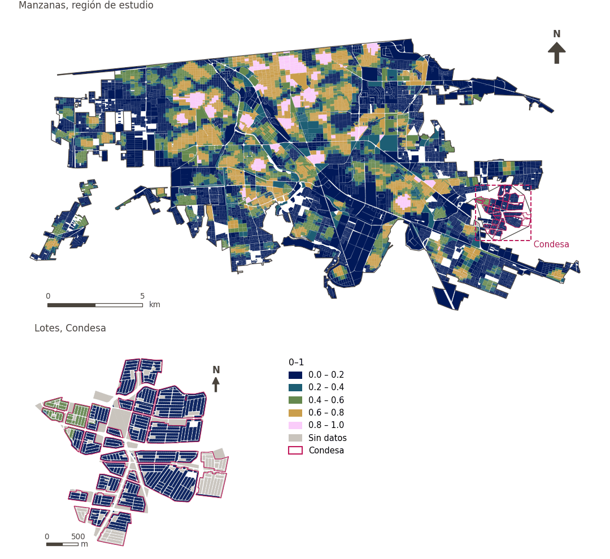

# Diversidad educativa a 500 m

[← Volver al contenido](../README.md)

> Diversidad (entropía de Shannon, 0-1) de los niveles educativos ofrecidos a 500 m a pie.

## Identificación

| | |
|---|---|
| Identificador | `div_education_500m` |
| Medida central (hoja de variables) | Acceso a salud, educación y cuidados |
| ID de la hoja / registro | 180, 246, 379 · #180, #246, #379 |
| Variable en puntos de muestra | `sp_walk_diversity_education_500m` |
| Variable de área (valor medido) | `avg_diversity_walk_education_500m` (0–1) |
| Puntuación normalizada | `index_uli__div_education_500m` |
| Dominios (parte del peso) | [Infraestructura social](domain_social_infrastructure.md) |
| Subdominio | Educación |
| Enfoque | Diversidad |
| Mejor si es | mayor |
| Peso efectivo en el índice | `uli` 1.7% · `uli_plain` 1.7% |
| Estado | Se puntúa en el índice publicado |

## Justificación e interpretación

> La cercanía a escuelas primarias favorece la habitabilidad para las familias al facilitar el acceso cómodo a la educación básica de los residentes más jóvenes. (traducción preliminar del inglés)
>
> — *Registro de indicadores #180: Access to schools: primary (Social Infrastructure / Education)*

- Cita del libro de trabajo: Onnom et al., 2018, 'Development of a Liveable City Index (LCI) Using Multi Criteria Geospatial Modelling for Medium Class Cities in Developing Countries'; Fu et al., 2019, 'The Livable Urban Landscape: GIS and Remote Sensing Extracted Land Use Assessment for Urban Livability in Changchun Proper, China'; Liu et al., 2020, 'Using Multi-Source Data to Assess Livability in Hong Kong at the Community-Based Level: A Combined Subjective-Objective Approach'
- Lista de artículos: #18: Jodder (2024), ‘Urban Livability in a Rapidly Urbanizing Mid-Size City: Lessons for Planning in the Global South’
- ⚠ la cita del libro de trabajo no nombra a un autor del artículo de la lista; verifique antes de citar (citation_audit.csv)

> Asegurar que las escuelas secundarias estén a una distancia accesible mejora la comodidad urbana y satisface las necesidades educativas de los residentes, lo que contribuye a una mayor satisfacción comunitaria. (traducción preliminar del inglés)
>
> — *Registro de indicadores #246: Access to schools: secondary (Social Infrastructure / Education)*

- Cita del libro de trabajo: Onnom et al., 2018, 'Development of a Liveable City Index (LCI) Using Multi Criteria Geospatial Modelling for Medium Class Cities in Developing Countries'; Fu et al., 2019, 'The Livable Urban Landscape: GIS and Remote Sensing Extracted Land Use Assessment for Urban Livability in Changchun Proper, China'; Liu et al., 2020, 'Using Multi-Source Data to Assess Livability in Hong Kong at the Community-Based Level: A Combined Subjective-Objective Approach'
- Lista de artículos: #18: Jodder (2024), ‘Urban Livability in a Rapidly Urbanizing Mid-Size City: Lessons for Planning in the Global South’
- ⚠ la cita del libro de trabajo no nombra a un autor del artículo de la lista; verifique antes de citar (citation_audit.csv)

> Las universidades constituyen infraestructura social esencial; su accesibilidad contribuye a la comodidad general y a la valoración de la habitabilidad de los entornos urbanos. (traducción preliminar del inglés)
>
> — *Registro de indicadores #379: Access to schools: tertiary (universities) (Social Infrastructure / Education)*

- Cita del libro de trabajo: Ibem and Amole, 2013, 'Residential satisfaction in public core housing in Abeokuta, Ogun State, Nigeria'; Huang and Du, 2015, 'Assessment and determinants of residential satisfaction with public housing in Hangzhou, China'
- Lista de artículos: #20: Basu (2021), ‘Urban livability index assessment based on land-use changes in an Indian medium-sized city (Raiganj)’
- ⚠ la cita del libro de trabajo no nombra a un autor del artículo de la lista; verifique antes de citar (citation_audit.csv)

**Cómo leerlo.** Diversidad media de niveles educativos a 500 m a pie: … (0 = un tipo o ninguno, 1 = todos los tipos por igual).

**Diversity of available educational services** (Health, education and care access; ID 180, 246, 379) (en inglés en la hoja)
- *Cómo calcular (hoja de variables):* Weighted share/number of preeschols, primary, secondary and tertiary educaitonal centers reachable within a walking distance

## Fuentes de datos

**Fuentes declaradas en la configuración:**

- INEGI (2026) Directorio Estadístico Nacional de Unidades Económicas (DENUE), May 2026.

**Fuente registrada por GHSCI (diccionario de datos)** (`avg_diversity_walk_education_500m`):

- OpenStreetMap: Geofabrik GmbH, 20260815, ODbL, https://download.geofabrik.de/north-america/mexico-latest.osm.pbf, OpenStreetMap Contributors.  Geofabrik GmbH (2026). https://download.geofabrik.de/north-america/mexico-latest.osm.pbf; INEGI, Directorio Estadistico Nacional de Unidades Economicas (DENUE): 2026-05, Terminos de Libre Uso de la Informacion del INEGI, https://www.inegi.org.mx/app/mapa/denue/, INEGI (2026). Directorio Estadistico Nacional de Unidades Economicas (DENUE), mayo 2026. Instituto Nacional de Estadistica y Geografia, Mexico.

**Filtro de destinos:**

- `denue_preschool` (Preschools (DENUE)): `MX/INEGI/DENUE_2026/denue_inegi_02_.shp` — Filtro de destinos: `"codigo_act IN ('611111','611112','611171','611172')"`
- `denue_primary_school` (Primary schools (DENUE)): `MX/INEGI/DENUE_2026/denue_inegi_02_.shp` — Filtro de destinos: `"codigo_act IN ('611121','611122','611171','611172')"`
- `denue_secondary_school` (Secondary and upper secondary schools (DENUE)): `MX/INEGI/DENUE_2026/denue_inegi_02_.shp` — Filtro de destinos: `"codigo_act IN ('611131','611132','611142','611151','611152','611161','611162','611171','611172')"`
- `denue_tertiary_education` (Tertiary and vocational education (DENUE)): `MX/INEGI/DENUE_2026/denue_inegi_02_.shp` — Filtro de destinos: `"codigo_act LIKE '6112%' OR codigo_act LIKE '6113%' OR codigo_act IN ('611411','611412','611511','611512')"`

**Insumos:** [Conjuntos de diversidad y sus subtipos](diversity_sets.md), [Destinos del DENUE por código SCIAN](denue_destinations.md)

## Método: teoría

1. Para cada uno de los `k = 4` subtipos del conjunto «education» (`preschool`, `primary`, `secondary`, `tertiary`), el número de destinos distintos alcanzables a 500 m por la red peatonal, `c_g` (R4).
2. Entropía de Shannon normalizada: `p_g = c_g / Σc`, `H = −Σ p_g·ln p_g / ln k`, de 0 (un subtipo o ninguno) a 1 (todos por igual). `k` es el número de subtipos configurados, no el de los presentes.
3. Normalización AMPI (R11), agregación (R12) y áreas (R13).

## Método: práctica

**Recetas:** [R1. Puntos de muestra y red peatonal](../03_recipes.md#r1), [R4. Diversidad de lo alcanzable](../03_recipes.md#r4), [R11. Normalización: el Índice Ajustado de Mazziotta–Pareto (AMPI)](../03_recipes.md#r11), [R12. Agregación: dominios, indicadores compartidos e índice](../03_recipes.md#r12), [R13. De los puntos de muestra a las áreas](../03_recipes.md#r13), [R14. Metas congeladas y recálculo de un escenario](../03_recipes.md#r14)

**Configuración** ([`MX_Mexicali_2025_ULI.yml:1552`](../../data/MX_Mexicali_2025_ULI.yml#L1552)):

```yaml
- variable: sp_walk_diversity_education_500m
  name: div_education_500m
  domains: [social_infrastructure]
  group: {es: 'Acceso a salud, educación y cuidados', en: 'Health, education and care access'}
  label: {es: 'Diversidad educativa a 500 m', en: 'Education diversity within 500 m'}
  reading: {es: 'Diversidad media de niveles educativos a 500 m a pie: {value} (0 = un tipo o ninguno, 1 = todos los tipos por igual)', en: 'Mean diversity of levels of education within a 500 m walk: {value} (0 = one kind or none, 1 = every kind equally)'}
  subdomain: {es: 'Educación', en: 'Education'}
  about:
    es: Diversidad (entropía de Shannon, 0-1) de los niveles educativos ofrecidos a 500 m a pie.
    en: Diversity (Shannon entropy, 0-1) of the levels of education offered within a 500 m walk.
  sources:
    - 'INEGI (2026) Directorio Estadístico Nacional de Unidades Económicas (DENUE), May 2026.'
```

**Código (GHSCI):**

- [`process/subprocesses/_accessibility_spec.py:929`](https://github.com/healthysustainablecities/global-indicators/blob/f03909611dba336c2728fffab6d697779487d0b1/process/subprocesses/_accessibility_spec.py#L929) `_banded_counts()`
- [`process/subprocesses/_accessibility_spec.py:466`](https://github.com/healthysustainablecities/global-indicators/blob/f03909611dba336c2728fffab6d697779487d0b1/process/subprocesses/_accessibility_spec.py#L466) `normalised_entropy()`
- [`process/subprocesses/_composite_index.py:1819`](https://github.com/healthysustainablecities/global-indicators/blob/f03909611dba336c2728fffab6d697779487d0b1/process/subprocesses/_composite_index.py#L1819) `normalise()`
- [`process/subprocesses/_composite_index.py:1838`](https://github.com/healthysustainablecities/global-indicators/blob/f03909611dba336c2728fffab6d697779487d0b1/process/subprocesses/_composite_index.py#L1838) `mpi_aggregate()`

|  | Variable en puntos de muestra | Transformación | Metas (escala puntuada) | inf – sup | asim. / curt. / empates | Alertas |
|---|---|---|---|---|---|---|
| `uli` | sp_walk_diversity_education_500m | tal cual | −0.232 · 0.268 · 0.768 | 0.000 – 1.000 | 0.67 / −1.15 / 57.3% | ninguna |
| `uli_plain` | sp_walk_diversity_education_500m | tal cual | −0.232 · 0.268 · 0.768 | 0.000 – 1.000 | 0.67 / −1.15 / 57.3% | ninguna |

## Recálculo (Reimagina Urbano)

Un destino nuevo suma 1 a `c_g` de su subtipo en los puntos a 500 m o menos por la red; la entropía se recalcula en esos puntos.

Con las metas congeladas del archivo de parámetros (`Ref`, `Mín.`, `Máx.`, R14), una nueva puntuación es `r = 100 ± 60·(x − Ref)/(Máx. − Mín.)` sin volver a resolver metas; el dominio y el índice se recalculan con R12 y se resta 100. Así un escenario se compara con la línea base en la misma escala.

## Resultados

| Medida | Región de estudio (Mexicali con Condesa) | Condesa |
|---|---|---|
| Valor de la región | 0.36 | 0.04 |
| Puntuación de la región (`uli`) | +5.8 | −13.9 |
| Áreas con valor | 14,216 de 14,252 manzanas | 13,265 de 14,988 lotes |
| Mediana (P25–P75), ponderada | 0.32 (0.00 – 0.55) | 0.00 (0.00 – 0.00) |
| Rango | 0.00 – 1.00 | 0.00 – 0.74 |
| Puntuación: mediana (P25–P75) (`uli`) | +3.2 (−16.1 – +17.2) | −16.1 (−16.1 – −16.1) |

*Distribuciones: manzanas de la región de estudio ponderadas por su población censal (2020); lotes de Condesa con igual peso (3.2 residentes supuestos por lote). Los valores de la región son los que GHSCI reporta para cada región en conjunto.*

- Región de estudio: Diversidad media de niveles educativos a 500 m a pie: 0.36 (0 = un tipo o ninguno, 1 = todos los tipos por igual).
- Condesa: Diversidad media de niveles educativos a 500 m a pie: 0.04 (0 = un tipo o ninguno, 1 = todos los tipos por igual).
- Para la región de estudio en su conjunto, el valor es 0.36; en Condesa, 0.04. La puntuación de Condesa queda 13.9 puntos por debajo del promedio de la región de estudio (+5.8 para la región de estudio).

## Mapa



*Mapa. Diversidad educativa a 500 m: valor medido (0–1) por manzana en la región de estudio y por lote en Condesa (recuadro). Clases del tablero; los colores favorables son los claros (mayor es mejor).*
