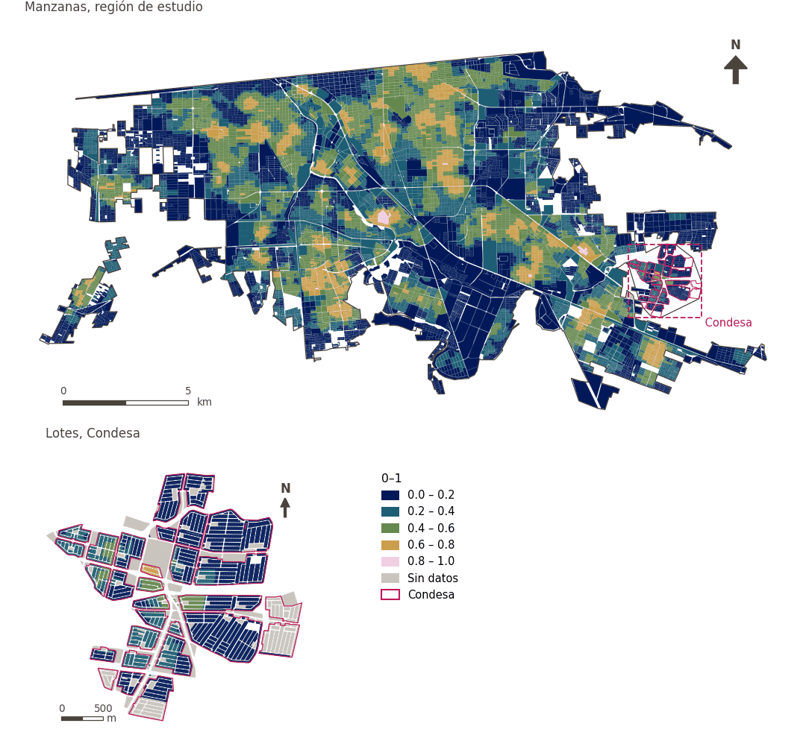

# Diversidad de alimentos frescos a 500 m

[← Volver al contenido](../README.md)

> Diversidad (entropía de Shannon, 0-1) de los tipos de comercio de alimentos frescos a 500 m a pie.

## Identificación

| | |
|---|---|
| Identificador | `div_fresh_food_500m` |
| Medida central (hoja de variables) | Acceso a servicios esenciales cotidianos |
| ID de la hoja / registro | 129, 11, 367 · #129, #11, #367 |
| Variable en puntos de muestra | `sp_walk_diversity_fresh_food_500m` |
| Variable de área (valor medido) | `avg_diversity_walk_fresh_food_500m` (0–1) |
| Puntuación normalizada | `index_uli__div_fresh_food_500m` |
| Dominios (parte del peso) | [Infraestructura social](domain_social_infrastructure.md) (33%), [Movilidad y transporte](domain_mobility_transport.md) (33%), [Desarrollo económico](domain_economic_development.md) (33%) |
| Subdominio | Infraestructura social: Servicios públicos; Movilidad y transporte: Movilidad activa; Desarrollo económico: Ambiente de alimentación |
| Enfoque | Diversidad |
| Mejor si es | mayor |
| Peso efectivo en el índice | `uli` 3.6% · `uli_plain` 3.6% |
| Estado | Se puntúa en el índice publicado |

## Justificación e interpretación

> Los mercados locales dan a los residentes acceso a alimentos frescos y oportunidades de actividad económica e interacción social en sus barrios. (traducción preliminar del inglés)
>
> — *Registro de indicadores #129: Access to markets (Economic Development / Food Environment)*

- Cita del libro de trabajo: Ghasemi, 2024, 'Enhancing urban livability: Analyzing Tehran through equitable land use distribution'; Yang et al., 2021, 'Spatiotemporal trends and driving factors of urban livability in the Yangtze River Delta Agglomeration'
- Lista de artículos: #16: Kashi (2025), ‘Spatial analysis and ranking of urban districts based on a comprehensive livability approach: the case of Tehran’
- ⚠ la cita del libro de trabajo no nombra a un autor del artículo de la lista; verifique antes de citar (citation_audit.csv)

> La presencia de panaderías y servicios de alimentos locales contribuye a la comodidad de la vida urbana y atiende las necesidades funcionales cotidianas de los residentes. (traducción preliminar del inglés)
>
> — *Registro de indicadores #11: Access to bakery (Economic Development / Food Environment)*

- Cita del libro de trabajo: Ghasemi, 2024, 'Enhancing urban livability: Analyzing Tehran through equitable land use distribution'
- Lista de artículos: #16: Kashi (2025), ‘Spatial analysis and ranking of urban districts based on a comprehensive livability approach: the case of Tehran’
- ⚠ la cita del libro de trabajo no nombra a un autor del artículo de la lista; verifique antes de citar (citation_audit.csv)

> La disponibilidad de supermercados es un indicador del entorno alimentario formal, que influye en la capacidad de los residentes de acceder a opciones de alimentos variadas y nutritivas. (traducción preliminar del inglés)
>
> — *Registro de indicadores #367: Access to supermarket (Economic Development / Food Environment)*

- Cita del libro de trabajo: Lowe et al., 2015, 'Planning healthy, liveable and sustainable cities: how can indicators inform policy?'
- Lista de artículos: #13: Alderton (2021), ‘Measuring and monitoring liveability in a low-to-middle income country: a proof-of-concept for Bangkok, Thailand and lessons from an international partnership’
- ⚠ la cita del libro de trabajo no nombra a un autor del artículo de la lista; verifique antes de citar (citation_audit.csv)

**Cómo leerlo.** Diversidad media de comercio de alimentos frescos a 500 m a pie: … (0 = un tipo o ninguno, 1 = todos los tipos por igual).

**Diversity of available fresh food** (Daily essential-services access; ID 129, 11, 367) (en inglés en la hoja)
- *Cómo calcular (hoja de variables):* Weighted share/number of supermarkets, markets, bakeries, abarroterías, tortillerías, pollerías, carnicerías, fruterías, verdulerías reachable within a walking distance
- *Notas (hoja):* Using DENUE data

## Fuentes de datos

**Fuentes declaradas en la configuración:**

- INEGI (2026) Directorio Estadístico Nacional de Unidades Económicas (DENUE), May 2026.

**Fuente registrada por GHSCI (diccionario de datos)** (`avg_diversity_walk_fresh_food_500m`):

- OpenStreetMap: Geofabrik GmbH, 20260815, ODbL, https://download.geofabrik.de/north-america/mexico-latest.osm.pbf, OpenStreetMap Contributors.  Geofabrik GmbH (2026). https://download.geofabrik.de/north-america/mexico-latest.osm.pbf; INEGI, Directorio Estadistico Nacional de Unidades Economicas (DENUE): 2026-05, Terminos de Libre Uso de la Informacion del INEGI, https://www.inegi.org.mx/app/mapa/denue/, INEGI (2026). Directorio Estadistico Nacional de Unidades Economicas (DENUE), mayo 2026. Instituto Nacional de Estadistica y Geografia, Mexico.

**Filtro de destinos:**

- `denue_fresh_food` (Fresh food retail (DENUE)): `MX/INEGI/DENUE_2026/denue_inegi_02_.shp` — Filtro de destinos: `"codigo_act IN ('461121','461122','461123','461130','461140','461150','462111','462112')"`
- `denue_bakery_tortilleria` (Bakeries and tortillerias (DENUE)): `MX/INEGI/DENUE_2026/denue_inegi_02_.shp` — Filtro de destinos: `"codigo_act IN ('311812','311813','311830')"`

**Insumos:** [Conjuntos de diversidad y sus subtipos](diversity_sets.md), [Destinos del DENUE por código SCIAN](denue_destinations.md)

## Método: teoría

1. Para cada uno de los `k = 7` subtipos del conjunto «fresh_food» (`meat`, `produce`, `grains_and_spices`, `dairy`, `supermarket`, `minisuper`, `bakery_tortilleria`), el número de destinos distintos alcanzables a 500 m por la red peatonal, `c_g` (R4).
2. Entropía de Shannon normalizada: `p_g = c_g / Σc`, `H = −Σ p_g·ln p_g / ln k`, de 0 (un subtipo o ninguno) a 1 (todos por igual). `k` es el número de subtipos configurados, no el de los presentes.
3. Normalización AMPI (R11), agregación (R12) y áreas (R13).

## Método: práctica

**Recetas:** [R1. Puntos de muestra y red peatonal](../03_recipes.md#r1), [R4. Diversidad de lo alcanzable](../03_recipes.md#r4), [R11. Normalización: el Índice Ajustado de Mazziotta–Pareto (AMPI)](../03_recipes.md#r11), [R12. Agregación: dominios, indicadores compartidos e índice](../03_recipes.md#r12), [R13. De los puntos de muestra a las áreas](../03_recipes.md#r13), [R14. Metas congeladas y recálculo de un escenario](../03_recipes.md#r14)

**Configuración** ([`MX_Mexicali_2025_ULI.yml:1491`](../../data/MX_Mexicali_2025_ULI.yml#L1491)):

```yaml
- variable: sp_walk_diversity_fresh_food_500m
  name: div_fresh_food_500m
  domains: [social_infrastructure, mobility_transport, economic_development]
  group: {es: 'Acceso a servicios esenciales cotidianos', en: 'Daily essential-services access'}
  label: {es: 'Diversidad de alimentos frescos a 500 m', en: 'Fresh food diversity within 500 m'}
  reading: {es: 'Diversidad media de comercio de alimentos frescos a 500 m a pie: {value} (0 = un tipo o ninguno, 1 = todos los tipos por igual)', en: 'Mean diversity of fresh food retail within a 500 m walk: {value} (0 = one kind or none, 1 = every kind equally)'}
  subdomain:
    social_infrastructure: {es: 'Servicios públicos', en: 'Public services'}
    mobility_transport: {es: 'Movilidad activa', en: 'Active mobility'}
    economic_development: {es: 'Ambiente de alimentación', en: 'Food environment'}
  about:
    es: Diversidad (entropía de Shannon, 0-1) de los tipos de comercio de alimentos frescos a 500 m a pie.
    en: Diversity (Shannon entropy, 0-1) of the kinds of fresh food retail within a 500 m walk.
  sources:
    - 'INEGI (2026) Directorio Estadístico Nacional de Unidades Económicas (DENUE), May 2026.'
```

**Código (GHSCI):**

- [`process/subprocesses/_accessibility_spec.py:929`](https://github.com/healthysustainablecities/global-indicators/blob/f03909611dba336c2728fffab6d697779487d0b1/process/subprocesses/_accessibility_spec.py#L929) `_banded_counts()`
- [`process/subprocesses/_accessibility_spec.py:466`](https://github.com/healthysustainablecities/global-indicators/blob/f03909611dba336c2728fffab6d697779487d0b1/process/subprocesses/_accessibility_spec.py#L466) `normalised_entropy()`
- [`process/subprocesses/_composite_index.py:1819`](https://github.com/healthysustainablecities/global-indicators/blob/f03909611dba336c2728fffab6d697779487d0b1/process/subprocesses/_composite_index.py#L1819) `normalise()`
- [`process/subprocesses/_composite_index.py:1838`](https://github.com/healthysustainablecities/global-indicators/blob/f03909611dba336c2728fffab6d697779487d0b1/process/subprocesses/_composite_index.py#L1838) `mpi_aggregate()`

|  | Variable en puntos de muestra | Transformación | Metas (escala puntuada) | inf – sup | asim. / curt. / empates | Alertas |
|---|---|---|---|---|---|---|
| `uli` | sp_walk_diversity_fresh_food_500m | tal cual | −0.167 · 0.269 · 0.705 | 0.000 – 0.871 | 0.19 / −1.36 / 39.9% | ninguna |
| `uli_plain` | sp_walk_diversity_fresh_food_500m | tal cual | −0.167 · 0.269 · 0.705 | 0.000 – 0.871 | 0.19 / −1.36 / 39.9% | ninguna |

## Recálculo (Reimagina Urbano)

Un destino nuevo suma 1 a `c_g` de su subtipo en los puntos a 500 m o menos por la red; la entropía se recalcula en esos puntos.

Con las metas congeladas del archivo de parámetros (`Ref`, `Mín.`, `Máx.`, R14), una nueva puntuación es `r = 100 ± 60·(x − Ref)/(Máx. − Mín.)` sin volver a resolver metas; el dominio y el índice se recalculan con R12 y se resta 100. Así un escenario se compara con la línea base en la misma escala.

## Resultados

| Medida | Región de estudio (Mexicali con Condesa) | Condesa |
|---|---|---|
| Valor de la región | 0.37 | 0.11 |
| Puntuación de la región (`uli`) | +7.0 | −11.1 |
| Áreas con valor | 14,216 de 14,252 manzanas | 13,265 de 14,988 lotes |
| Mediana (P25–P75), ponderada | 0.35 (0.18 – 0.51) | 0.00 (0.00 – 0.27) |
| Rango | 0.00 – 0.85 | 0.00 – 0.70 |
| Puntuación: mediana (P25–P75) (`uli`) | +5.7 (−6.3 – +16.9) | −18.5 (−18.5 – +0.3) |

*Distribuciones: manzanas de la región de estudio ponderadas por su población censal (2020); lotes de Condesa con igual peso (3.2 residentes supuestos por lote). Los valores de la región son los que GHSCI reporta para cada región en conjunto.*

- Región de estudio: Diversidad media de comercio de alimentos frescos a 500 m a pie: 0.37 (0 = un tipo o ninguno, 1 = todos los tipos por igual).
- Condesa: Diversidad media de comercio de alimentos frescos a 500 m a pie: 0.11 (0 = un tipo o ninguno, 1 = todos los tipos por igual).
- Para la región de estudio en su conjunto, el valor es 0.37; en Condesa, 0.11. La puntuación de Condesa queda 11.1 puntos por debajo del promedio de la región de estudio (+7.0 para la región de estudio).

## Mapa



*Mapa. Diversidad de alimentos frescos a 500 m: valor medido (0–1) por manzana en la región de estudio y por lote en Condesa (recuadro). Clases del tablero; los colores favorables son los claros (mayor es mejor).*
