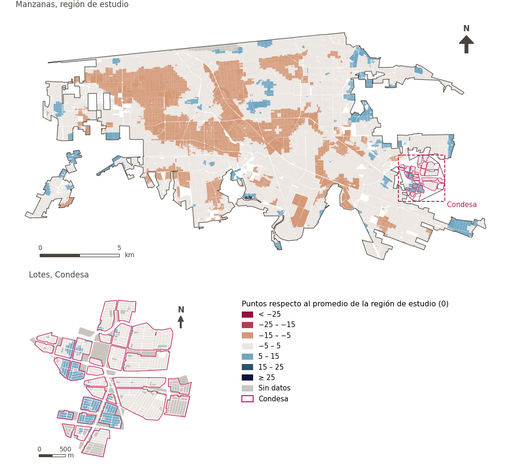

# Entorno medioambiental

[← Volver al contenido](../README.md)

> La calidad de las condiciones ambientales a las que están expuestos los residentes a diario. Ejemplos: aire, agua, ruido y temperatura.

## Subdominios

- **Riesgos climáticos.** Los efectos del cambio climático a escala de barrio y la capacidad para adaptarse a ellos y mitigarlos. Ejemplos: islas de calor, riesgo de inundaciones y fenómenos meteorológicos extremos.
- **Medioambiente.** Condiciones biofísicas y ambientales del entorno inmediato, que abarcan factores como ruido, agua, suelo, vegetación y confort térmico, que inciden de manera directa en la salud, la comodidad y el bienestar físico de los habitantes.
- **Recursos.** Disponibilidad, acceso, preservación y gestión sostenible de los recursos naturales y servicios básicos esenciales, como el agua, la tierra y el manejo de residuos sólidos, fundamentales para el sostenimiento ecológico y el funcionamiento continuo de la comunidad.

## Indicadores del dominio

| Indicador | Subdominio | Parte | Peso efectivo | Mejor si es |
|---|---|---|---|---|
| [Espacios azules naturales cercanos](blue_space.md) | Medioambiente | 100% | 2.8% | mayor |
| [Capacidad de adaptación al calor (GUHVI)](adaptive_capability.md) | Riesgos climáticos | 100% | 2.8% | mayor |
| [Exposición al calor (GUHVI)](heat_exposure.md) | Riesgos climáticos | 100% | 2.8% | menor |
| [Sensibilidad al calor (GUHVI)](heat_sensitivity.md) | Riesgos climáticos | 100% | 2.8% | menor |
| [Confort térmico diurno](thermal_comfort.md) *(inactivo en `uli`)* | Medioambiente | 100% | – | menor |
| [Parques a menos de 300 m](parks.md) | Medioambiente | 50% | 4.0% | mayor |
| [Gran espacio verde público a menos de 500 m](lpugs.md) | Medioambiente | 50% | 4.0% | mayor |
| [Cobertura vegetal (NDVI)](vegetation.md) | Medioambiente | 50% | 4.0% | mayor |
| [Proximidad a vialidades principales](major_roads.md) | Medioambiente | 50% | 5.9% | menor |

## Método: teoría

La puntuación del dominio es el compuesto ponderado de Mazziotta–Pareto de las puntuaciones normalizadas de sus indicadores (R12): cada indicador pesa `weight × parte`, normalizado sobre los indicadores con valor; `M` es su media ponderada, `S` su desviación ponderada y la puntuación es `M − S·(S/M)`, menos 100. En la variante `uli_plain` la caminabilidad no se atenúa y, en el entorno medioambiental, se activa el confort térmico.

**Recetas:** [R11. Normalización: el Índice Ajustado de Mazziotta–Pareto (AMPI)](../03_recipes.md#r11), [R12. Agregación: dominios, indicadores compartidos e índice](../03_recipes.md#r12), [R13. De los puntos de muestra a las áreas](../03_recipes.md#r13), [R14. Metas congeladas y recálculo de un escenario](../03_recipes.md#r14)

**Código (GHSCI):** [`process/subprocesses/_composite_index.py:1874`](https://github.com/healthysustainablecities/global-indicators/blob/f03909611dba336c2728fffab6d697779487d0b1/process/subprocesses/_composite_index.py#L1874) `score()`, [`process/subprocesses/_composite_index.py:1838`](https://github.com/healthysustainablecities/global-indicators/blob/f03909611dba336c2728fffab6d697779487d0b1/process/subprocesses/_composite_index.py#L1838) `mpi_aggregate()`

## Resultados

| Medida | Región de estudio (Mexicali con Condesa) | Condesa |
|---|---|---|
| Puntuación de la región (`uli`) | −2.6 | +2.3 |
| Puntuación de la región (`uli_plain`) | −1.8 | +1.0 |
| Áreas con valor | 14,148 de 14,252 manzanas | 13,265 de 14,988 lotes |
| Mediana (P25–P75), ponderada | −2.0 (−5.7 – +1.1) | +3.0 (+1.0 – +4.2) |
| Rango | −12.3 – +16.3 | −4.5 – +10.2 |

*Distribuciones: manzanas de la región de estudio ponderadas por su población censal (2020); lotes de Condesa con igual peso (3.2 residentes supuestos por lote). Los valores de la región son los que GHSCI reporta para cada región en conjunto.*

- La región de estudio puntúa −2.6; Condesa queda 2.3 puntos por encima del promedio de la región de estudio.

## Mapa

*Mapa. Entorno medioambiental: puntuación por manzana en la región de estudio y por lote en Condesa (recuadro), en puntos respecto al promedio de la región de estudio (0); azul es mejor.*
