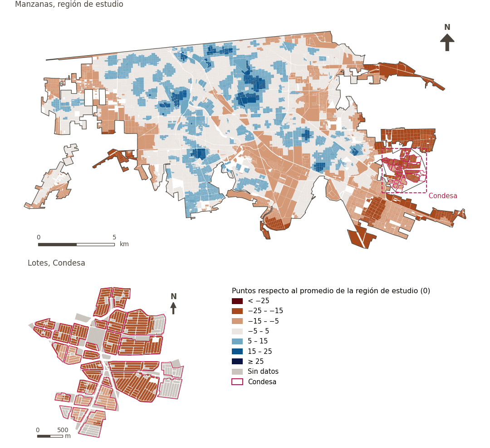

# Ambiente construido

[← Volver al contenido](../README.md)

> El entorno físico creado por el ser humano, cuya densidad, combinación de usos del suelo y conectividad dan forma a la vida cotidiana. Ejemplos: edificios, calles y espacios públicos.

## Subdominios

- **Morfología urbana.** La forma física, la estructura y el diseño del tejido urbano, elementos que determinan cómo se organiza el espacio y cómo influye esto en la experiencia de habitar la ciudad.
- **Diseño urbano.** Configuración y calidad de los espacios, calles y elementos que conforman la ciudad, incluyendo la infraestructura peatonal, ciclista y vial, así como el paisaje urbano, que influyen en la movilidad, la accesibilidad, la seguridad, la conectividad y la experiencia cotidiana de las personas.
- **Infraestructura verde y azul.** Red de espacios verdes y elementos acuáticos, como parques, árboles, ríos, canales, humedales y sistemas de gestión de aguas pluviales, que proporcionan servicios ecosistémicos, contribuyen a la regulación climática, favorecen la actividad física y las actividades recreativas, y promueven la salud mental.

## Indicadores del dominio

| Indicador | Subdominio | Parte | Peso efectivo | Mejor si es |
|---|---|---|---|---|
| [Parques a menos de 300 m](parks.md) | Infraestructura verde y azul | 50% | 4.0% | mayor |
| [Gran espacio verde público a menos de 500 m](lpugs.md) | Infraestructura verde y azul | 50% | 4.0% | mayor |
| [Cobertura vegetal (NDVI)](vegetation.md) | Infraestructura verde y azul | 50% | 4.0% | mayor |
| [Alimentos a menos de 1.5 km en bicicleta de bajo estrés](cycle_low_stress_food.md) | Diseño urbano | 33% | 6.2% | mayor |
| [Tamaño de manzana (perímetro)](block_size.md) | Morfología urbana | 33% | 6.2% | menor |
| [Estación de bomberos a menos de 3 km](fire_3km.md) |  | 33% | 6.2% | mayor |
| [Estación de policía a menos de 2 km](police_2km.md) |  | 33% | 6.2% | mayor |
| [Caminabilidad (300 m), atenuada por confort térmico](walkability.md) | Diseño urbano | 33% | 3.7% | mayor |

## Método: teoría

La puntuación del dominio es el compuesto ponderado de Mazziotta–Pareto de las puntuaciones normalizadas de sus indicadores (R12): cada indicador pesa `weight × parte`, normalizado sobre los indicadores con valor; `M` es su media ponderada, `S` su desviación ponderada y la puntuación es `M − S·(S/M)`, menos 100. En la variante `uli_plain` la caminabilidad no se atenúa y, en el entorno medioambiental, se activa el confort térmico.

**Recetas:** [R11. Normalización: el Índice Ajustado de Mazziotta–Pareto (AMPI)](../03_recipes.md#r11), [R12. Agregación: dominios, indicadores compartidos e índice](../03_recipes.md#r12), [R13. De los puntos de muestra a las áreas](../03_recipes.md#r13), [R14. Metas congeladas y recálculo de un escenario](../03_recipes.md#r14)

**Código (GHSCI):** [`process/subprocesses/_composite_index.py:1874`](https://github.com/healthysustainablecities/global-indicators/blob/f03909611dba336c2728fffab6d697779487d0b1/process/subprocesses/_composite_index.py#L1874) `score()`, [`process/subprocesses/_composite_index.py:1838`](https://github.com/healthysustainablecities/global-indicators/blob/f03909611dba336c2728fffab6d697779487d0b1/process/subprocesses/_composite_index.py#L1838) `mpi_aggregate()`

## Resultados

| Medida | Región de estudio (Mexicali con Condesa) | Condesa |
|---|---|---|
| Puntuación de la región (`uli`) | +2.0 | −17.8 |
| Puntuación de la región (`uli_plain`) | +1.5 | −16.5 |
| Áreas con valor | 14,216 de 14,252 manzanas | 12,862 de 14,988 lotes |
| Mediana (P25–P75), ponderada | +1.8 (−2.9 – +6.3) | −18.9 (−19.4 – −17.7) |
| Rango | −21.2 – +23.5 | −20.1 – −7.3 |

*Distribuciones: manzanas de la región de estudio ponderadas por su población censal (2020); lotes de Condesa con igual peso (3.2 residentes supuestos por lote). Los valores de la región son los que GHSCI reporta para cada región en conjunto.*

- La región de estudio puntúa +2.0; Condesa queda 17.8 puntos por debajo del promedio de la región de estudio.

## Mapa

*Mapa. Ambiente construido: puntuación por manzana en la región de estudio y por lote en Condesa (recuadro), en puntos respecto al promedio de la región de estudio (0); azul es mejor.*
