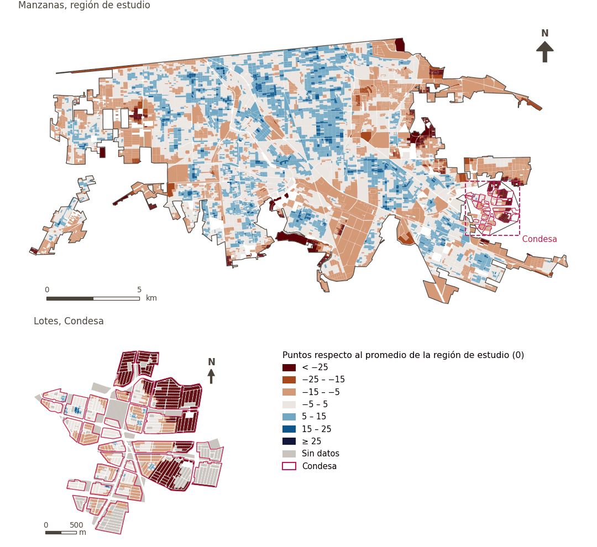

# Desarrollo económico

[← Volver al contenido](../README.md)

> Las condiciones económicas locales que ofrecen a los residentes oportunidades de empleo productivo, ingresos justos y participación económica.

## Subdominios

- **Ambiente de alimentación.** Presencia, proximidad y diversidad de establecimientos de abasto de alimentos, tales como supermercados y destinos de conveniencia, que determinan la facilidad y equidad con la que los habitantes acceden a insumos alimenticios en su entorno inmediato.
- **Recursos.** Disponibilidad, acceso, cobertura y suministro continuo de servicios e insumos energéticos esenciales, como la energía eléctrica y combustibles, necesarios para el funcionamiento de las actividades productivas, comerciales y del hogar.
- **Economía.** Dinamismo y estructura de la actividad productiva local, que abarca la presencia y distribución del comercio minorista, la industria y las fuentes de empleo, los cuales generan oportunidades laborales, ingresos y sustento económico para la población urbana.

## Indicadores del dominio

| Indicador | Subdominio | Parte | Peso efectivo | Mejor si es |
|---|---|---|---|---|
| [A 250 m o más de gasolineras](petrol_250m.md) | Recursos | 33% | 3.6% | mayor |
| [Tiendas de conveniencia a menos de 300 m](convenience.md) | Ambiente de alimentación | 33% | 3.6% | mayor |
| [Diversidad de alimentos frescos a 500 m](div_fresh_food_500m.md) | Ambiente de alimentación | 33% | 3.6% | mayor |
| [Alimentos frescos a menos de 300 m](fresh_food.md) | Ambiente de alimentación | 33% | 3.6% | mayor |
| [Diversidad de empleos](job_diversity.md) | Economía | 100% | 5.0% | mayor |
| [Manufactura a menos de 1 km](manufacturing_1000m.md) | Economía | 100% | 5.0% | mayor |

## Método: teoría

La puntuación del dominio es el compuesto ponderado de Mazziotta–Pareto de las puntuaciones normalizadas de sus indicadores (R12): cada indicador pesa `weight × parte`, normalizado sobre los indicadores con valor; `M` es su media ponderada, `S` su desviación ponderada y la puntuación es `M − S·(S/M)`, menos 100. En la variante `uli_plain` la caminabilidad no se atenúa y, en el entorno medioambiental, se activa el confort térmico.

**Recetas:** [R11. Normalización: el Índice Ajustado de Mazziotta–Pareto (AMPI)](../03_recipes.md#r11), [R12. Agregación: dominios, indicadores compartidos e índice](../03_recipes.md#r12), [R13. De los puntos de muestra a las áreas](../03_recipes.md#r13), [R14. Metas congeladas y recálculo de un escenario](../03_recipes.md#r14)

**Código (GHSCI):** [`process/subprocesses/_composite_index.py:1874`](https://github.com/healthysustainablecities/global-indicators/blob/f03909611dba336c2728fffab6d697779487d0b1/process/subprocesses/_composite_index.py#L1874) `score()`, [`process/subprocesses/_composite_index.py:1838`](https://github.com/healthysustainablecities/global-indicators/blob/f03909611dba336c2728fffab6d697779487d0b1/process/subprocesses/_composite_index.py#L1838) `mpi_aggregate()`

## Resultados

| Medida | Región de estudio (Mexicali con Condesa) | Condesa |
|---|---|---|
| Puntuación de la región (`uli`) | +1.9 | −14.8 |
| Puntuación de la región (`uli_plain`) | +1.9 | −14.8 |
| Áreas con valor | 14,213 de 14,252 manzanas | 12,589 de 14,988 lotes |
| Mediana (P25–P75), ponderada | +1.7 (−3.3 – +6.8) | −7.6 (−31.3 – −3.4) |
| Rango | −36.9 – +21.0 | −35.3 – +18.1 |

*Distribuciones: manzanas de la región de estudio ponderadas por su población censal (2020); lotes de Condesa con igual peso (3.2 residentes supuestos por lote). Los valores de la región son los que GHSCI reporta para cada región en conjunto.*

- La región de estudio puntúa +1.9; Condesa queda 14.8 puntos por debajo del promedio de la región de estudio.

## Mapa

*Mapa. Desarrollo económico: puntuación por manzana en la región de estudio y por lote en Condesa (recuadro), en puntos respecto al promedio de la región de estudio (0); azul es mejor.*
