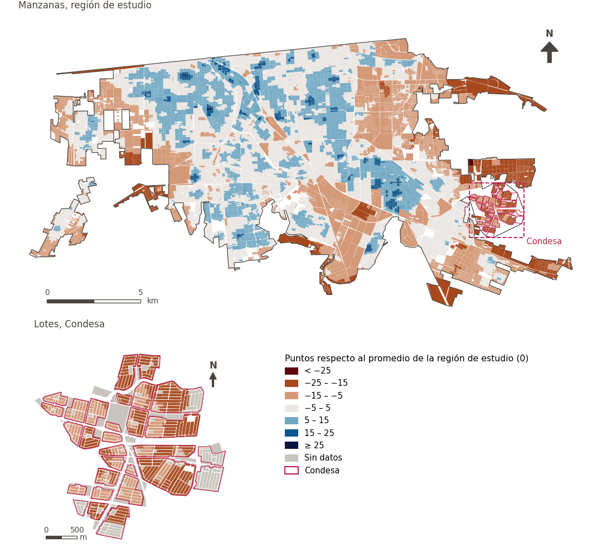

# Movilidad y transporte

[← Volver al contenido](../README.md)

> Las redes y los sistemas que permiten desplazarse de forma eficiente entre el hogar, el trabajo y los servicios.

## Subdominios

- **Transporte público.** Los sistemas de transporte público que conectan a los residentes con el trabajo, la educación y los servicios.
- **Movilidad activa.** Las condiciones del entorno urbano que facilitan los medios de transporte no motorizados, a pie y en bicicleta, como las redes viarias conectadas, permeables y bien diseñadas.

## Indicadores del dominio

| Indicador | Subdominio | Parte | Peso efectivo | Mejor si es |
|---|---|---|---|---|
| [Alimentos a menos de 1.5 km en bicicleta de bajo estrés](cycle_low_stress_food.md) | Movilidad activa | 33% | 6.2% | mayor |
| [Tamaño de manzana (perímetro)](block_size.md) | Movilidad activa | 33% | 6.2% | menor |
| [Estación de bomberos a menos de 3 km](fire_3km.md) |  | 33% | 6.2% | mayor |
| [Estación de policía a menos de 2 km](police_2km.md) |  | 33% | 6.2% | mayor |
| [Caminabilidad (300 m), atenuada por confort térmico](walkability.md) | Movilidad activa | 33% | 3.7% | mayor |
| [A 250 m o más de gasolineras](petrol_250m.md) |  | 33% | 3.6% | mayor |
| [Tiendas de conveniencia a menos de 300 m](convenience.md) | Movilidad activa | 33% | 3.6% | mayor |
| [Diversidad de alimentos frescos a 500 m](div_fresh_food_500m.md) | Movilidad activa | 33% | 3.6% | mayor |
| [Alimentos frescos a menos de 300 m](fresh_food.md) | Movilidad activa | 33% | 3.6% | mayor |
| [Transporte público a menos de 300 m](public_transport.md) | Transporte público | 100% | 4.2% | mayor |

## Método: teoría

La puntuación del dominio es el compuesto ponderado de Mazziotta–Pareto de las puntuaciones normalizadas de sus indicadores (R12): cada indicador pesa `weight × parte`, normalizado sobre los indicadores con valor; `M` es su media ponderada, `S` su desviación ponderada y la puntuación es `M − S·(S/M)`, menos 100. En la variante `uli_plain` la caminabilidad no se atenúa y, en el entorno medioambiental, se activa el confort térmico.

**Recetas:** [R11. Normalización: el Índice Ajustado de Mazziotta–Pareto (AMPI)](../03_recipes.md#r11), [R12. Agregación: dominios, indicadores compartidos e índice](../03_recipes.md#r12), [R13. De los puntos de muestra a las áreas](../03_recipes.md#r13), [R14. Metas congeladas y recálculo de un escenario](../03_recipes.md#r14)

**Código (GHSCI):** [`process/subprocesses/_composite_index.py:1874`](https://github.com/healthysustainablecities/global-indicators/blob/f03909611dba336c2728fffab6d697779487d0b1/process/subprocesses/_composite_index.py#L1874) `score()`, [`process/subprocesses/_composite_index.py:1838`](https://github.com/healthysustainablecities/global-indicators/blob/f03909611dba336c2728fffab6d697779487d0b1/process/subprocesses/_composite_index.py#L1838) `mpi_aggregate()`

## Resultados

| Medida | Región de estudio (Mexicali con Condesa) | Condesa |
|---|---|---|
| Puntuación de la región (`uli`) | +2.4 | −15.4 |
| Puntuación de la región (`uli_plain`) | +2.0 | −14.4 |
| Áreas con valor | 14,216 de 14,252 manzanas | 12,862 de 14,988 lotes |
| Mediana (P25–P75), ponderada | +2.4 (−3.1 – +6.4) | −15.5 (−17.1 – −12.9) |
| Rango | −26.4 – +26.7 | −21.3 – −6.6 |

*Distribuciones: manzanas de la región de estudio ponderadas por su población censal (2020); lotes de Condesa con igual peso (3.2 residentes supuestos por lote). Los valores de la región son los que GHSCI reporta para cada región en conjunto.*

- La región de estudio puntúa +2.4; Condesa queda 15.4 puntos por debajo del promedio de la región de estudio.

## Mapa

*Mapa. Movilidad y transporte: puntuación por manzana en la región de estudio y por lote en Condesa (recuadro), en puntos respecto al promedio de la región de estudio (0); azul es mejor.*
