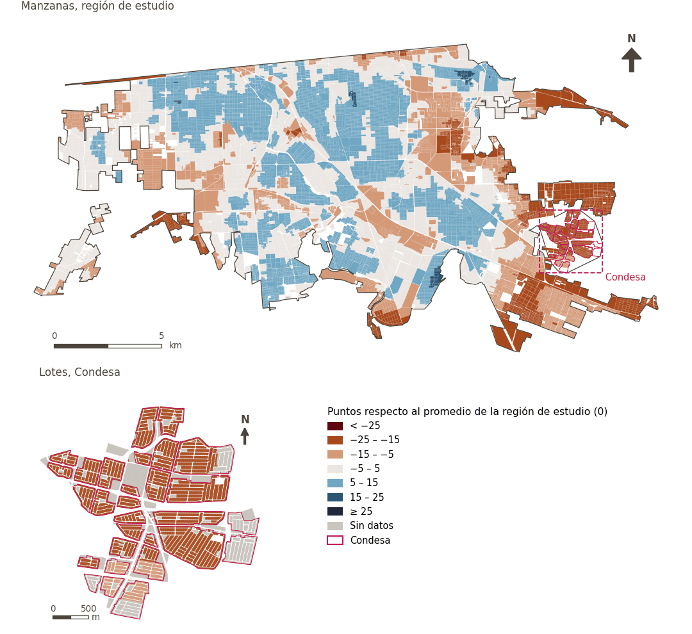

# Seguridad y protección

[← Volver al contenido](../README.md)

> Las condiciones del entorno urbano que permiten a los residentes moverse con libertad y participar en la vida pública sin temor a la delincuencia, la violencia o los accidentes de tráfico.

## Subdominios

- **Seguridad personal.** Condiciones del entorno urbano relacionadas con la incidencia delictiva y la presencia de servicios públicos y de vigilancia que determinan el grado de protección física de las personas, reduciendo la exposición al crimen y favoreciendo la tranquilidad en el espacio público.
- **Seguridad vial.** Características y condiciones de la infraestructura vial y peatonal diseñadas para prevenir siniestros de tránsito, protegiendo la integridad física de peatones, ciclistas y conductores al desplazarse por la ciudad.
- **Riesgos.** Exposición y vulnerabilidad de la población frente a amenazas de origen natural o antrópico, tales como sismos, inundaciones, calor extremo, fuego y eventos climáticos adversos, así como la capacidad del entorno urbano para mitigar sus impactos y salvaguardar a la comunidad.

## Indicadores del dominio

| Indicador | Subdominio | Parte | Peso efectivo | Mejor si es |
|---|---|---|---|---|
| [Proximidad a vialidades principales](major_roads.md) | Seguridad vial | 50% | 5.9% | menor |
| [Alimentos a menos de 1.5 km en bicicleta de bajo estrés](cycle_low_stress_food.md) | Seguridad vial | 33% | 6.2% | mayor |
| [Tamaño de manzana (perímetro)](block_size.md) | Seguridad vial | 33% | 6.2% | menor |
| [Estación de bomberos a menos de 3 km](fire_3km.md) | Riesgos | 33% | 6.2% | mayor |
| [Estación de policía a menos de 2 km](police_2km.md) | Seguridad personal | 33% | 6.2% | mayor |

## Método: teoría

La puntuación del dominio es el compuesto ponderado de Mazziotta–Pareto de las puntuaciones normalizadas de sus indicadores (R12): cada indicador pesa `weight × parte`, normalizado sobre los indicadores con valor; `M` es su media ponderada, `S` su desviación ponderada y la puntuación es `M − S·(S/M)`, menos 100. En la variante `uli_plain` la caminabilidad no se atenúa y, en el entorno medioambiental, se activa el confort térmico.

**Recetas:** [R11. Normalización: el Índice Ajustado de Mazziotta–Pareto (AMPI)](../03_recipes.md#r11), [R12. Agregación: dominios, indicadores compartidos e índice](../03_recipes.md#r12), [R13. De los puntos de muestra a las áreas](../03_recipes.md#r13), [R14. Metas congeladas y recálculo de un escenario](../03_recipes.md#r14)

**Código (GHSCI):** [`process/subprocesses/_composite_index.py:1874`](https://github.com/healthysustainablecities/global-indicators/blob/f03909611dba336c2728fffab6d697779487d0b1/process/subprocesses/_composite_index.py#L1874) `score()`, [`process/subprocesses/_composite_index.py:1838`](https://github.com/healthysustainablecities/global-indicators/blob/f03909611dba336c2728fffab6d697779487d0b1/process/subprocesses/_composite_index.py#L1838) `mpi_aggregate()`

## Resultados

| Medida | Región de estudio (Mexicali con Condesa) | Condesa |
|---|---|---|
| Puntuación de la región (`uli`) | +2.2 | −20.7 |
| Puntuación de la región (`uli_plain`) | +2.2 | −20.7 |
| Áreas con valor | 14,216 de 14,252 manzanas | 12,862 de 14,988 lotes |
| Mediana (P25–P75), ponderada | +3.3 (−4.1 – +8.2) | −21.4 (−21.8 – −21.2) |
| Rango | −24.1 – +16.1 | −23.7 – −10.7 |

*Distribuciones: manzanas de la región de estudio ponderadas por su población censal (2020); lotes de Condesa con igual peso (3.2 residentes supuestos por lote). Los valores de la región son los que GHSCI reporta para cada región en conjunto.*

- La región de estudio puntúa +2.2; Condesa queda 20.7 puntos por debajo del promedio de la región de estudio.

## Mapa

*Mapa. Seguridad y protección: puntuación por manzana en la región de estudio y por lote en Condesa (recuadro), en puntos respecto al promedio de la región de estudio (0); azul es mejor.*
