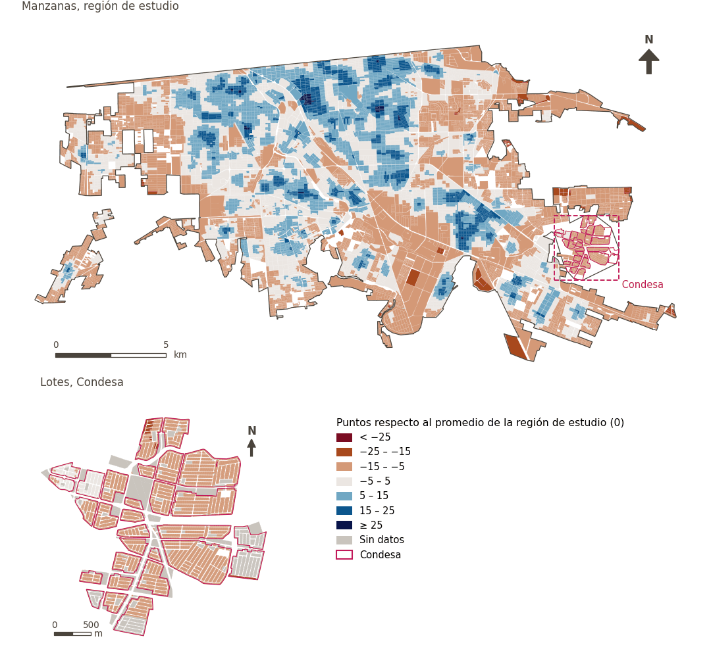

# Infraestructura social

[← Volver al contenido](../README.md)

> La red de equipamientos públicos que favorecen la interacción social, la cohesión y el bienestar colectivo.

## Subdominios

- **Servicios públicos.** Conjunto de instalaciones, equipamientos, redes y atenciones gubernamentales o comunitarias básicas, orientadas al bienestar, la gestión urbana y el soporte de la vida cotidiana, cuya disponibilidad, cobertura y adecuado funcionamiento garantizan condiciones dignas, seguras y equitativas para la población en el entorno urbano.
- **Salud y atención sanitaria.** Las instalaciones y los servicios sanitarios que contribuyen al bienestar físico y mental de los residentes.
- **Comunidad, cultura y recreación.** Los espacios culturales, los lugares de interés patrimonial y los eventos comunitarios que fomentan la identidad y el sentido de pertenencia.
- **Educación.** Las instituciones educativas, desde la primera infancia hasta la enseñanza superior, que favorecen el desarrollo humano y la movilidad social.

## Indicadores del dominio

| Indicador | Subdominio | Parte | Peso efectivo | Mejor si es |
|---|---|---|---|---|
| [Caminabilidad (300 m), atenuada por confort térmico](walkability.md) | Servicios públicos | 33% | 3.7% | mayor |
| [A 250 m o más de gasolineras](petrol_250m.md) | Servicios públicos | 33% | 3.6% | mayor |
| [Tiendas de conveniencia a menos de 300 m](convenience.md) | Servicios públicos | 33% | 3.6% | mayor |
| [Diversidad de alimentos frescos a 500 m](div_fresh_food_500m.md) | Servicios públicos | 33% | 3.6% | mayor |
| [Alimentos frescos a menos de 300 m](fresh_food.md) | Servicios públicos | 33% | 3.6% | mayor |
| [Diversidad de comunidad, cultura y recreación a 500 m](div_ccr_500m.md) | Comunidad, cultura y recreación | 100% | 1.7% | mayor |
| [Comunidad, cultura y recreación a menos de 300 m](ccr_any.md) | Comunidad, cultura y recreación | 100% | 1.7% | mayor |
| [Diversidad de servicios de cuidado a 500 m](div_care_500m.md) | Servicios públicos | 100% | 1.7% | mayor |
| [Servicios de cuidado a menos de 300 m](care_support.md) | Servicios públicos | 100% | 1.7% | mayor |
| [Diversidad educativa a 500 m](div_education_500m.md) | Educación | 100% | 1.7% | mayor |
| [Diversidad de servicios de salud a 500 m](div_health_500m.md) | Salud y atención sanitaria | 100% | 1.7% | mayor |
| [Atención primaria de salud a menos de 300 m](primary_healthcare.md) | Salud y atención sanitaria | 100% | 1.7% | mayor |
| [Escuelas primarias a menos de 300 m](primary_school.md) | Educación | 100% | 1.7% | mayor |

## Método: teoría

La puntuación del dominio es el compuesto ponderado de Mazziotta–Pareto de las puntuaciones normalizadas de sus indicadores (R12): cada indicador pesa `weight × parte`, normalizado sobre los indicadores con valor; `M` es su media ponderada, `S` su desviación ponderada y la puntuación es `M − S·(S/M)`, menos 100. En la variante `uli_plain` la caminabilidad no se atenúa y, en el entorno medioambiental, se activa el confort térmico.

**Recetas:** [R11. Normalización: el Índice Ajustado de Mazziotta–Pareto (AMPI)](../03_recipes.md#r11), [R12. Agregación: dominios, indicadores compartidos e índice](../03_recipes.md#r12), [R13. De los puntos de muestra a las áreas](../03_recipes.md#r13), [R14. Metas congeladas y recálculo de un escenario](../03_recipes.md#r14)

**Código (GHSCI):** [`process/subprocesses/_composite_index.py:1874`](https://github.com/healthysustainablecities/global-indicators/blob/f03909611dba336c2728fffab6d697779487d0b1/process/subprocesses/_composite_index.py#L1874) `score()`, [`process/subprocesses/_composite_index.py:1838`](https://github.com/healthysustainablecities/global-indicators/blob/f03909611dba336c2728fffab6d697779487d0b1/process/subprocesses/_composite_index.py#L1838) `mpi_aggregate()`

## Resultados

| Medida | Región de estudio (Mexicali con Condesa) | Condesa |
|---|---|---|
| Puntuación de la región (`uli`) | +2.4 | −12.1 |
| Puntuación de la región (`uli_plain`) | +2.3 | −11.6 |
| Áreas con valor | 14,216 de 14,252 manzanas | 13,265 de 14,988 lotes |
| Mediana (P25–P75), ponderada | +0.4 (−6.3 – +7.0) | −12.6 (−14.4 – −11.6) |
| Rango | −17.4 – +33.7 | −15.2 – +8.5 |

*Distribuciones: manzanas de la región de estudio ponderadas por su población censal (2020); lotes de Condesa con igual peso (3.2 residentes supuestos por lote). Los valores de la región son los que GHSCI reporta para cada región en conjunto.*

- La región de estudio puntúa +2.4; Condesa queda 12.1 puntos por debajo del promedio de la región de estudio.

## Mapa

*Mapa. Infraestructura social: puntuación por manzana en la región de estudio y por lote en Condesa (recuadro), en puntos respecto al promedio de la región de estudio (0); azul es mejor.*
