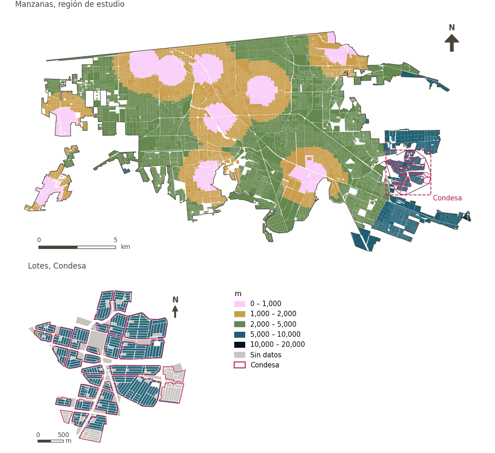

# Estación de bomberos a menos de 3 km

[← Volver al contenido](../README.md)

> Distancia en línea recta a la estación de bomberos municipal más cercana, puntuada con un umbral suave de 3 km (NFPA 1710, unos cuatro minutos a 45 km/h).

## Identificación

| | |
|---|---|
| Identificador | `fire_3km` |
| Medida central (hoja de variables) | Seguridad personal y vial |
| ID de la hoja / registro | 69, 174 · #69 |
| Variable en puntos de muestra | `sp_euclid_dist_imip_fire_station` |
| Variable de área (valor medido) | `avg_euclid_dist_imip_fire_station` (m) |
| Puntuación normalizada | `index_uli__fire_3km` |
| Dominios (parte del peso) | [Seguridad y protección](domain_safety.md) (33%), [Movilidad y transporte](domain_mobility_transport.md) (33%), [Ambiente construido](domain_built_environment.md) (33%) |
| Subdominio | Seguridad y protección: Riesgos |
| Enfoque | Proximidad |
| Mejor si es | valor medido menor (puntuación transformada mayor) |
| Peso efectivo en el índice | `uli` 6.2% · `uli_plain` 6.2% |
| Estado | Se puntúa en el índice publicado |

## Justificación e interpretación

> La cercanía a estaciones de bomberos asegura tiempos de respuesta rápidos, esenciales para proteger a los residentes de daños físicos y materiales. (traducción preliminar del inglés)
>
> — *Registro de indicadores #69: Access to fire station (Safety / Personal Safety)*

- Cita del libro de trabajo: Liu et al., 2020, 'Using Multi-Source Data to Assess Livability in Hong Kong at the Community-Based Level: A Combined Subjective-Objective Approach'
- Lista de artículos: #18: Jodder (2024), ‘Urban Livability in a Rapidly Urbanizing Mid-Size City: Lessons for Planning in the Global South’
- ⚠ la cita del libro de trabajo no nombra a un autor del artículo de la lista; verifique antes de citar (citation_audit.csv)

**Cómo leerlo.** En promedio, la estación de bomberos más cercana está a … en línea recta (menor es mejor).

**% of the population with coverage of of emergency services** (Personal and road safety; ID 69, 174) (en inglés en la hoja)
- *Cómo calcular (hoja de variables):* % of the population that is within a network buffer of 70 km around a fire station
- *Notas (hoja):* Threshold change from 70km to 3km (NFPA 1710 standard, ~4 min at 45 km/h; 70 km covered the entire muncipality with no variation). ~65% of grid cells within 3 km. Condesa: 40/40.

## Fuentes de datos

**Fuentes declaradas en la configuración:**

- IMIP equipamiento layer via CFC (10 municipal fire stations); threshold revised by the work package (Alejandro).

**Fuente registrada por GHSCI (diccionario de datos)** (`avg_euclid_dist_imip_fire_station`):

- Municipal fire stations (IMIP): IMIP / CFC, Provided by IMIP via CFC

**Insumos:** [Estaciones de policía y bomberos (línea recta)](emergency_stations.md)

## Método: teoría

1. Distancia en línea recta desde cada punto de muestra a la estación más cercana, `d` (R5), buscada hasta 75 km; más allá, sin valor.
2. Acceso suave (R10): `s(d) = 1 / (1 + exp(k·(d − t)/t))`, `t = 3,000 m`, `k = 5`; sin valor → 0.
3. Normalización AMPI (R11), agregación (R12) y áreas (R13).

## Método: práctica

**Recetas:** [R1. Puntos de muestra y red peatonal](../03_recipes.md#r1), [R5. Áreas de servicio en línea recta](../03_recipes.md#r5), [R10. Transformaciones: umbrales suaves y escalas escalonadas](../03_recipes.md#r10), [R11. Normalización: el Índice Ajustado de Mazziotta–Pareto (AMPI)](../03_recipes.md#r11), [R12. Agregación: dominios, indicadores compartidos e índice](../03_recipes.md#r12), [R13. De los puntos de muestra a las áreas](../03_recipes.md#r13), [R14. Metas congeladas y recálculo de un escenario](../03_recipes.md#r14)

**Configuración** ([`MX_Mexicali_2025_ULI.yml:1423`](../../data/MX_Mexicali_2025_ULI.yml#L1423)):

```yaml
- variable: sp_euclid_dist_imip_fire_station
  name: fire_3km
  domains: [safety, mobility_transport, built_environment]
  transform: {soft_threshold: 3000}
  group: {es: 'Seguridad personal y vial', en: 'Personal and road safety'}
  label: {es: 'Estación de bomberos a menos de 3 km', en: 'Fire station within 3 km'}
  reading: {es: 'En promedio, la estación de bomberos más cercana está a {value} en línea recta', en: 'On average the nearest fire station is {value} away in a straight line'}
  subdomain:
    safety: {es: 'Riesgos', en: 'Risks'}
  about:
    es: Distancia en línea recta a la estación de bomberos municipal más cercana, puntuada con un umbral suave de 3 km (NFPA 1710, unos cuatro minutos a 45 km/h).
    en: Straight-line distance to the nearest municipal fire station, scored with a 3 km soft threshold (NFPA 1710, about four minutes at 45 km/h).
  sources:
    - 'IMIP equipamiento layer via CFC (10 municipal fire stations); threshold revised by the work package (Alejandro).'
```

**Código (GHSCI):**

- [`process/subprocesses/_euclidean_accessibility.py:247`](https://github.com/healthysustainablecities/global-indicators/blob/f03909611dba336c2728fffab6d697779487d0b1/process/subprocesses/_euclidean_accessibility.py#L247) `nearest_distances()`
- [`process/subprocesses/_composite_index.py:1457`](https://github.com/healthysustainablecities/global-indicators/blob/f03909611dba336c2728fffab6d697779487d0b1/process/subprocesses/_composite_index.py#L1457) `soft_threshold()`
- [`process/subprocesses/_composite_index.py:1819`](https://github.com/healthysustainablecities/global-indicators/blob/f03909611dba336c2728fffab6d697779487d0b1/process/subprocesses/_composite_index.py#L1819) `normalise()`
- [`process/subprocesses/_composite_index.py:1838`](https://github.com/healthysustainablecities/global-indicators/blob/f03909611dba336c2728fffab6d697779487d0b1/process/subprocesses/_composite_index.py#L1838) `mpi_aggregate()`

|  | Variable en puntos de muestra | Transformación | Metas (escala puntuada) | inf – sup | asim. / curt. / empates | Alertas |
|---|---|---|---|---|---|---|
| `uli` | sp_euclid_dist_imip_fire_station | acceso suave, umbral de 3,000 m, k = 5 | 0.096 · 0.592 · 1.089 | 0.000 – 0.993 | −0.53 / −1.28 / 0.1% | ninguna |
| `uli_plain` | sp_euclid_dist_imip_fire_station | acceso suave, umbral de 3,000 m, k = 5 | 0.096 · 0.592 · 1.089 | 0.000 – 0.993 | −0.53 / −1.28 / 0.1% | ninguna |

## Recálculo (Reimagina Urbano)

Una estación nueva cambia `d` en los puntos más cercanos a ella que a cualquier otra: `d = min(d_previa, distancia euclidiana a la nueva estación)`.

Con las metas congeladas del archivo de parámetros (`Ref`, `Mín.`, `Máx.`, R14), una nueva puntuación es `r = 100 ± 60·(x − Ref)/(Máx. − Mín.)` sin volver a resolver metas; el dominio y el índice se recalculan con R12 y se resta 100. Así un escenario se compara con la línea base en la misma escala.

## Resultados

| Medida | Región de estudio (Mexicali con Condesa) | Condesa |
|---|---|---|
| Valor de la región | 2,297 m | 6,371 m |
| Puntuación de la región (`uli`) | +5.8 | −35.4 |
| Áreas con valor | 14,216 de 14,252 manzanas | 13,265 de 14,988 lotes |
| Mediana (P25–P75), ponderada | 2,293 m (1,501 m – 3,251 m) | 6,440 m (5,918 m – 6,830 m) |
| Rango | 71 m – 10,582 m | 4,920 m – 7,586 m |
| Puntuación: mediana (P25–P75) (`uli`) | +10.4 (−11.8 – +20.0) | −35.6 (−35.7 – −35.3) |

*Distribuciones: manzanas de la región de estudio ponderadas por su población censal (2020); lotes de Condesa con igual peso (3.2 residentes supuestos por lote). Los valores de la región son los que GHSCI reporta para cada región en conjunto.*

- Región de estudio: En promedio, la estación de bomberos más cercana está a 2,297 m en línea recta.
- Condesa: En promedio, la estación de bomberos más cercana está a 6,371 m en línea recta.
- Para la región de estudio en su conjunto, el valor es 2,297 m; en Condesa, 6,371 m. La puntuación de Condesa queda 35.4 puntos por debajo del promedio de la región de estudio (+5.8 para la región de estudio).

## Mapa



*Mapa. Estación de bomberos a menos de 3 km: valor medido (m) por manzana en la región de estudio y por lote en Condesa (recuadro). Clases del tablero; los colores favorables son los claros (menor es mejor).*

## Advertencias y pendientes

- Umbral revisado de 70 km a 3 km (NFPA 1710, unos cuatro minutos a 45 km/h); 70 km cubrían todo el municipio (nota de la hoja). La búsqueda en línea recta de estaciones de bomberos no tiene tope por debajo de su área de 75 km.
