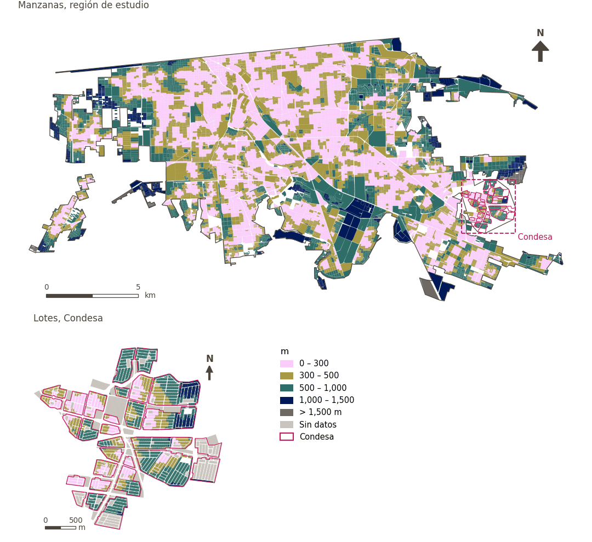

# Alimentos frescos a menos de 300 m

[← Volver al contenido](../README.md)

> Distancia a pie al comercio de alimentos frescos más cercano, puntuada con un umbral suave de 300 m.

## Identificación

| | |
|---|---|
| Identificador | `fresh_food` |
| Medida central (hoja de variables) | Acceso a servicios esenciales cotidianos |
| ID de la hoja / registro | 129, 11, 367 · #129, #11, #367 |
| Variable en puntos de muestra | `sp_walk_nearest_node_denue_fresh_food` |
| Variable de área (valor medido) | `avg_walk_dist_denue_fresh_food` (m) |
| Puntuación normalizada | `index_uli__fresh_food` |
| Dominios (parte del peso) | [Infraestructura social](domain_social_infrastructure.md) (33%), [Movilidad y transporte](domain_mobility_transport.md) (33%), [Desarrollo económico](domain_economic_development.md) (33%) |
| Subdominio | Infraestructura social: Servicios públicos; Movilidad y transporte: Movilidad activa; Desarrollo económico: Ambiente de alimentación |
| Enfoque | Proximidad |
| Mejor si es | valor medido menor (puntuación transformada mayor) |
| Peso efectivo en el índice | `uli` 3.6% · `uli_plain` 3.6% |
| Estado | Se puntúa en el índice publicado |

## Justificación e interpretación

> Los mercados locales dan a los residentes acceso a alimentos frescos y oportunidades de actividad económica e interacción social en sus barrios. (traducción preliminar del inglés)
>
> — *Registro de indicadores #129: Access to markets (Economic Development / Food Environment)*

- Cita del libro de trabajo: Ghasemi, 2024, 'Enhancing urban livability: Analyzing Tehran through equitable land use distribution'; Yang et al., 2021, 'Spatiotemporal trends and driving factors of urban livability in the Yangtze River Delta Agglomeration'
- Lista de artículos: #16: Kashi (2025), ‘Spatial analysis and ranking of urban districts based on a comprehensive livability approach: the case of Tehran’
- ⚠ la cita del libro de trabajo no nombra a un autor del artículo de la lista; verifique antes de citar (citation_audit.csv)

> La presencia de panaderías y servicios de alimentos locales contribuye a la comodidad de la vida urbana y atiende las necesidades funcionales cotidianas de los residentes. (traducción preliminar del inglés)
>
> — *Registro de indicadores #11: Access to bakery (Economic Development / Food Environment)*

- Cita del libro de trabajo: Ghasemi, 2024, 'Enhancing urban livability: Analyzing Tehran through equitable land use distribution'
- Lista de artículos: #16: Kashi (2025), ‘Spatial analysis and ranking of urban districts based on a comprehensive livability approach: the case of Tehran’
- ⚠ la cita del libro de trabajo no nombra a un autor del artículo de la lista; verifique antes de citar (citation_audit.csv)

> La disponibilidad de supermercados es un indicador del entorno alimentario formal, que influye en la capacidad de los residentes de acceder a opciones de alimentos variadas y nutritivas. (traducción preliminar del inglés)
>
> — *Registro de indicadores #367: Access to supermarket (Economic Development / Food Environment)*

- Cita del libro de trabajo: Lowe et al., 2015, 'Planning healthy, liveable and sustainable cities: how can indicators inform policy?'
- Lista de artículos: #13: Alderton (2021), ‘Measuring and monitoring liveability in a low-to-middle income country: a proof-of-concept for Bangkok, Thailand and lessons from an international partnership’
- ⚠ la cita del libro de trabajo no nombra a un autor del artículo de la lista; verifique antes de citar (citation_audit.csv)

**Cómo leerlo.** … de la población vive a menos de 300 m de un comercio de alimentos frescos; en promedio, el más cercano está a … (menor es mejor).

**Access to fresh food** (Daily essential-services access; ID 129, 11, 367) (en inglés en la hoja)
- *Cómo calcular (hoja de variables):* Walking distance access to supermarkets, markets, bakeries, abarroterías, tortillerías, pollerías, carnicerías, fruterías, pescaderías, verdulerías. SCIAN CODE: 4611 Comercio al por menor de abarrotes y alimentos
- *Notas (hoja):* Using DENUE data

**Percentage of population with access to fresh food** (Daily essential-services access; ID 129, 11, 367) (en inglés en la hoja)
- *Cómo calcular (hoja de variables):* USE GHSCI CALCULATION HERE (Distance (m) along the pedestrian network to the nearest fresh food market / supermarket (source: OpenStreetMap or custom data))
- *Notas (hoja):* Use alongside—not instead of—proximity.

## Fuentes de datos

**Fuentes declaradas en la configuración:**

- INEGI (2026) Directorio Estadístico Nacional de Unidades Económicas (DENUE), May 2026.

**Fuente registrada por GHSCI (diccionario de datos)** (`avg_walk_dist_denue_fresh_food`):

- OpenStreetMap: Geofabrik GmbH, 20260815, ODbL, https://download.geofabrik.de/north-america/mexico-latest.osm.pbf, OpenStreetMap Contributors.  Geofabrik GmbH (2026). https://download.geofabrik.de/north-america/mexico-latest.osm.pbf; INEGI, Directorio Estadistico Nacional de Unidades Economicas (DENUE): 2026-05, Terminos de Libre Uso de la Informacion del INEGI, https://www.inegi.org.mx/app/mapa/denue/, INEGI (2026). Directorio Estadistico Nacional de Unidades Economicas (DENUE), mayo 2026. Instituto Nacional de Estadistica y Geografia, Mexico.

**Filtro de destinos:**

- `denue_fresh_food` (Fresh food retail (DENUE)): `MX/INEGI/DENUE_2026/denue_inegi_02_.shp` — Filtro de destinos: `"codigo_act IN ('461121','461122','461123','461130','461140','461150','462111','462112')"`

**Insumos:** [Destinos del DENUE por código SCIAN](denue_destinations.md)

## Método: teoría

1. Distancia por la red peatonal desde cada punto de muestra al destino más cercano, `d` (R2), censurada en la banda mayor buscada (1,500 m): un punto sin destino a esa distancia queda sin valor.
2. Puntuación de acceso suave (R10): `s(d) = 1 / (1 + exp(k·(d − t)/t))`, con `t = 300 m` y `k = 5`; `s = 0.5` en el umbral, ≈ 0.99 junto al destino, ≈ 0.007 a `2t`; sin valor → `s = 0`.
3. Normalización AMPI (R11) de `s` con las metas de la región de estudio, luego agregación por dominio e índice (R12) y a áreas (R13).

## Método: práctica

**Recetas:** [R1. Puntos de muestra y red peatonal](../03_recipes.md#r1), [R2. Distancia por la red al destino más cercano, censurada](../03_recipes.md#r2), [R10. Transformaciones: umbrales suaves y escalas escalonadas](../03_recipes.md#r10), [R11. Normalización: el Índice Ajustado de Mazziotta–Pareto (AMPI)](../03_recipes.md#r11), [R12. Agregación: dominios, indicadores compartidos e índice](../03_recipes.md#r12), [R13. De los puntos de muestra a las áreas](../03_recipes.md#r13), [R14. Metas congeladas y recálculo de un escenario](../03_recipes.md#r14)

**Configuración** ([`MX_Mexicali_2025_ULI.yml:1475`](../../data/MX_Mexicali_2025_ULI.yml#L1475)):

```yaml
- variable: sp_walk_nearest_node_denue_fresh_food
  name: fresh_food
  domains: [social_infrastructure, mobility_transport, economic_development]
  transform: {soft_threshold: 300}
  group: {es: 'Acceso a servicios esenciales cotidianos', en: 'Daily essential-services access'}
  label: {es: 'Alimentos frescos a menos de 300 m', en: 'Fresh food within 300 m'}
  reading: {es: '{access} de la población vive a menos de 300 m de un comercio de alimentos frescos; en promedio, el más cercano está a {value}', en: '{access} of the population live within 300 m of a fresh food retailer; on average the nearest is {value} away'}
  subdomain:
    social_infrastructure: {es: 'Servicios públicos', en: 'Public services'}
    mobility_transport: {es: 'Movilidad activa', en: 'Active mobility'}
    economic_development: {es: 'Ambiente de alimentación', en: 'Food environment'}
  about:
    es: Distancia a pie al comercio de alimentos frescos más cercano, puntuada con un umbral suave de 300 m.
    en: Walking distance to the nearest fresh food retailer, scored with a 300 m soft threshold.
  sources:
    - 'INEGI (2026) Directorio Estadístico Nacional de Unidades Económicas (DENUE), May 2026.'
```

[`MX_Mexicali_2025_ULI.yml:495`](../../data/MX_Mexicali_2025_ULI.yml#L495):

```yaml
- {name: denue_fresh_food, category: food_retail, variant: strict, layer: destinations, where: "dest_name = 'denue_fresh_food'"}
```

**Código (GHSCI):**

- [`process/subprocesses/_accessibility_spec.py:806`](https://github.com/healthysustainablecities/global-indicators/blob/f03909611dba336c2728fffab6d697779487d0b1/process/subprocesses/_accessibility_spec.py#L806) `_banded_distances()`
- [`process/subprocesses/setup_sp.py:888`](https://github.com/healthysustainablecities/global-indicators/blob/f03909611dba336c2728fffab6d697779487d0b1/process/subprocesses/setup_sp.py#L888) `create_full_nodes()`
- [`process/subprocesses/_composite_index.py:1457`](https://github.com/healthysustainablecities/global-indicators/blob/f03909611dba336c2728fffab6d697779487d0b1/process/subprocesses/_composite_index.py#L1457) `soft_threshold()`
- [`process/subprocesses/_composite_index.py:1819`](https://github.com/healthysustainablecities/global-indicators/blob/f03909611dba336c2728fffab6d697779487d0b1/process/subprocesses/_composite_index.py#L1819) `normalise()`
- [`process/subprocesses/_composite_index.py:1838`](https://github.com/healthysustainablecities/global-indicators/blob/f03909611dba336c2728fffab6d697779487d0b1/process/subprocesses/_composite_index.py#L1838) `mpi_aggregate()`

|  | Variable en puntos de muestra | Transformación | Metas (escala puntuada) | inf – sup | asim. / curt. / empates | Alertas |
|---|---|---|---|---|---|---|
| `uli` | sp_walk_nearest_node_denue_fresh_food | acceso suave, umbral de 300 m, k = 5 | −0.091 · 0.405 · 0.902 | 0.000 – 0.993 | 0.30 / −1.57 / 1.5% | ninguna |
| `uli_plain` | sp_walk_nearest_node_denue_fresh_food | acceso suave, umbral de 300 m, k = 5 | −0.091 · 0.405 · 0.902 | 0.000 – 0.993 | 0.30 / −1.57 / 1.5% | ninguna |

## Recálculo (Reimagina Urbano)

Un destino nuevo o retirado, o un cambio en la red peatonal, cambia `d` solo en los puntos cuyo destino más cercano cambia: basta un Dijkstra multi-origen desde los destinos afectados, limitado a 1,500 m, tomando el mínimo con la distancia previa.

Con las metas congeladas del archivo de parámetros (`Ref`, `Mín.`, `Máx.`, R14), una nueva puntuación es `r = 100 ± 60·(x − Ref)/(Máx. − Mín.)` sin volver a resolver metas; el dominio y el índice se recalculan con R12 y se resta 100. Así un escenario se compara con la línea base en la misma escala.

## Resultados

| Medida | Región de estudio (Mexicali con Condesa) | Condesa |
|---|---|---|
| Valor de la región | 334 m | 539 m |
| Puntuación de la región (`uli`) | +5.3 | −10.2 |
| Áreas con valor | 14,120 de 14,252 manzanas | 13,265 de 14,988 lotes |
| Mediana (P25–P75), ponderada | 303 m (208 m – 431 m) | 501 m (313 m – 729 m) |
| Rango | 16 m – 2,754 m | 10 m – 1,660 m |
| Nada a la distancia buscada | 0.1% | 0.0% |
| Puntuación: mediana (P25–P75) (`uli`) | +5.1 (−15.0 – +21.8) | −22.2 (−24.4 – +3.3) |

*Distribuciones: manzanas de la región de estudio ponderadas por su población censal (2020); lotes de Condesa con igual peso (3.2 residentes supuestos por lote). Los valores de la región son los que GHSCI reporta para cada región en conjunto.*

*Una distancia media se calcula sobre los puntos que encontraron un destino dentro de la distancia buscada; la fila «Nada a la distancia buscada» da la parte de la población de las áreas sin ninguno.*

- Región de estudio: 51.0% de la población vive a menos de 300 m de un comercio de alimentos frescos; en promedio, el más cercano está a 334 m.
- Condesa: 23.4% de la población vive a menos de 300 m de un comercio de alimentos frescos; en promedio, el más cercano está a 539 m.
- Para la región de estudio en su conjunto, el valor es 334 m; en Condesa, 539 m. La puntuación de Condesa queda 10.2 puntos por debajo del promedio de la región de estudio (+5.3 para la región de estudio).

## Mapa



*Mapa. Alimentos frescos a menos de 300 m: valor medido (m) por manzana en la región de estudio y por lote en Condesa (recuadro). Clases del tablero; los colores favorables son los claros (menor es mejor).*

## Advertencias y pendientes

- Las panaderías y tortillerías se clasifican en SCIAN como manufactura y no están en esta categoría; entran en la diversidad de alimentos frescos como subtipo (configuración).
