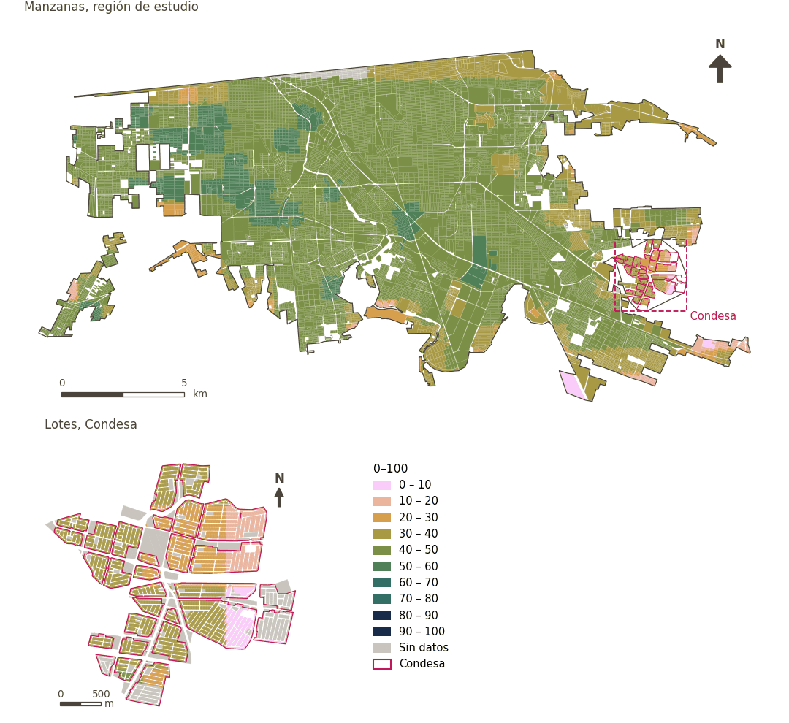

# Índice Global de Vulnerabilidad Urbana al Calor (GUHVI) y sus insumos

[← Volver al contenido](../README.md)

El GUHVI (Turner et al. 2025) se calcula en Google Earth Engine sobre una cuadrícula de análisis. Cada insumo se normaliza mín.–máx. a 0–100 dentro de la región (ponderado por la parte de la celda que no es agua); la razón de dependencia infantil, el IDH subnacional y la mortalidad infantil usan un rango fijo de 0–100.

- **Exposición al calor (HEI)**: temperatura de la superficie terrestre (Landsat 8, durante los cuatro meses consecutivos más calurosos identificados con cinco años de MODIS).
- **Sensibilidad al calor (HSI)**: media con pesos iguales de albedo invertido, NDVI negado, NDBI, zona climática local, densidad de población y porcentaje de población vulnerable.
- **Capacidad de adaptación (ACI)**: media con pesos iguales de la razón de dependencia infantil, el IDH subnacional y la tasa de mortalidad infantil.
- **GUHVI**: media de los tres; la clase GUHVI son quintiles 1–5.

El ULI usa los tres subíndices, no el GUHVI global. Cada punto de muestra toma el valor de la celda que lo contiene.

| Variable en puntos de muestra | Variable de área (valor medido) | Descripción | Región de estudio (Mexicali con Condesa) | Condesa |
|---|---|---|---|---|
| `sp_urban_heat_exposure_index` | `urban_heat_exposure_index` | Índice de exposición al calor | 49.0 | 33.3 |
| `sp_urban_heat_sensitivity_index` | `urban_heat_sensitivity_index` | Índice de sensibilidad al calor | 59.7 | 33.8 |
| `sp_urban_heat_adaptive_capability_index` | `urban_heat_adaptive_capability_index` | Índice de capacidad adaptativa | 22.2 | 15.0 |
| `sp_urban_heat_guhvi` | `urban_heat_guhvi` | Índice Global de Vulnerabilidad al Calor Urbano (GUHVI) | 43.6 | 27.4 |

| Variable | Descripción | Región de estudio | Condesa |
|---|---|---|---|
| `urban_heat_adaptive_capability_index` | Índice de capacidad adaptativa | 22.2 | 15.0 |
| `urban_heat_exposure_index` | Índice de exposición al calor | 49.0 | 33.3 |
| `urban_heat_guhvi` | Índice Global de Vulnerabilidad al Calor Urbano (GUHVI) | 43.6 | 27.4 |
| `urban_heat_guhvi_class` | Clase de vulnerabilidad GUHVI | 3.01 | 1.02 |
| `urban_heat_sensitivity_index` | Índice de sensibilidad al calor | 59.7 | 33.8 |

## Método: práctica

**Recetas:** [R8. Earth Engine: vulnerabilidad al calor y grandes espacios verdes](../03_recipes.md#r8)

**Configuración** ([`MX_Mexicali_2025_ULI.yml:706`](../../data/MX_Mexicali_2025_ULI.yml#L706)):

```yaml
gee: true
```

**Código (GHSCI):**

- [`process/subprocesses/_earth_engine_indicators.py:846`](https://github.com/healthysustainablecities/global-indicators/blob/f03909611dba336c2728fffab6d697779487d0b1/process/subprocesses/_earth_engine_indicators.py#L846) `guhvi_analysis()`
- [`process/subprocesses/_earth_engine_indicators.py:1105`](https://github.com/healthysustainablecities/global-indicators/blob/f03909611dba336c2728fffab6d697779487d0b1/process/subprocesses/_earth_engine_indicators.py#L1105) `normalise_band()`

## Lo usan

[Capacidad de adaptación al calor (GUHVI)](adaptive_capability.md), [Exposición al calor (GUHVI)](heat_exposure.md), [Sensibilidad al calor (GUHVI)](heat_sensitivity.md)

## Resultados

| Medida | Región de estudio (Mexicali con Condesa) | Condesa |
|---|---|---|
| Valor de la región | 43.6 | 27.4 |
| Áreas con valor | 14,148 de 14,252 manzanas | 13,265 de 14,988 lotes |
| Mediana (P25–P75), ponderada | 46.0 (41.8 – 48.2) | 30.6 (27.0 – 33.5) |
| Rango | 3.3 – 55.7 | 9.2 – 46.4 |

*Distribuciones: manzanas de la región de estudio ponderadas por su población censal (2020); lotes de Condesa con igual peso (3.2 residentes supuestos por lote). Los valores de la región son los que GHSCI reporta para cada región en conjunto.*

## Mapa



*Mapa. Índice Global de Vulnerabilidad Urbana al Calor (GUHVI) y sus insumos: valor medido (0–100) por manzana en la región de estudio y por lote en Condesa (recuadro). Clases del tablero; los colores favorables son los claros (menor es mejor).*
